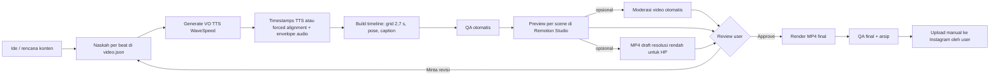

# PRD — Bintangku Video Studio — v1.1 draft

> Draf v1.1. Nama project **Bintangku Video Studio** sudah disetujui user (DEC-21, OQ-01 ditutup). Belum ditulis ke Coda. Dokumen ini hanya spesifikasi, bukan kode atau build aplikasi. Penanda **[v1.1]** menandai bagian yang berubah dari v1.0; rincian lengkap di `CHANGELOG.md`.

## 01. Document Control

| Field | Isi |
|---|---|
| Dokumen | Product Requirements Document (PRD) |
| Produk | Pipeline produksi internal video 2D chibi 30–60 detik untuk Instagram Reels bintangku.app |
| Nama project | Bintangku Video Studio (disetujui user 24 Nov 2026, DEC-21) |
| Versi | 1.1 draft |
| Status | Draf untuk review user. Belum final, belum ke Coda |
| Lokasi | `/workspace/product-architect/bintangku-video-studio/v1.1/PRD.md` (v1.0 disimpan utuh di `../v1.0/`) |
| Dokumen pasangan | `TRD.md` (HOW), `CHANGELOG.md` di folder yang sama |
| Tanggal | 24 November 2026 (WIB) |
| Pemilik produk | BrainBox Digital |
| Penulis | Product Architect |
| Sumber | Arahan user di chat 24 Nov 2026 (keputusan DEC-01..06), jawaban user 24 Nov 2026 20:56 WIB (DEC-19 dikunci, DEC-21..24); rekomendasi Product Architect (DEC-07..18, DEC-20, DEC-25..31, status usulan); halaman model & docs WaveSpeed (Lampiran B); Brand Guidelines bintangku.app via PRD BintangMatika v1.0.1 Lampiran D; README 3 repo referensi Remotion dan skill voiceover resmi Remotion (Lampiran B) |
| Framework | AI-First Documentation Framework, PRD 22 bagian |

Konvensi ID: `FR-<MODUL>-NNN`, `NFR-<KATEGORI>-NNN`, `US-NNN`, `AC-NNN`, `BR-NNN`, `EC-NNN`, `DEP-NN`, `RSK-NN`, `ASM-NN`, `DEC-NN`, `OQ-NN`, `TASK-USR-NNN` (tugas user). ID `SYS-`, `TECH-`, `ADR-` ada di TRD. Prioritas: P0 Must, P1 Should, P2 Could, P3 Won't (rilis ini).

Aturan angka: angka teknis hanya dari sumber yang dikutip. Angka desain tanpa sumber ditandai ASM. Harga, kuota, dan target bisnis yang belum diketahui masuk OQ. Tidak ada harga yang dikarang.

### Keputusan

Status **Dikunci** = keputusan langsung dari user. Status **Usulan** = rekomendasi Product Architect yang sudah disampaikan di chat tapi belum dikonfirmasi user secara eksplisit.

| ID | Keputusan | Status | Dampak |
|---|---|---|---|
| DEC-01 | Satu repository berisi aset, rencana konten, rules, skill agent, dan semua bahan lain untuk membuat setiap video | Dikunci (user) | FR-REPO-*, BR-001 |
| DEC-02 | ~~Suara/VO memakai ElevenLabs API~~ → **diganti DEC-24** [v1.1] | Diganti (user) | FR-VO-*, DEP-02 |
| DEC-03 | Scene/transisi berganti setiap 2,7 detik (30 detik ≈ 11 shot, 60 detik ≈ 22 shot) | Dikunci (user) | BR-003, BR-004, FR-TL-002 |
| DEC-04 | Setiap video dibuat preview draft dulu di player Remotion Studio per scene; export MP4 hanya setelah approved | Dikunci (user) | FR-PRV-*, FR-APR-*, FR-RND-001, BR-006 |
| DEC-05 | Blender opsional, hanya kalau hasil di atas kurang bagus | Dikunci (user) | Future Scope, OQ-12 |
| DEC-06 | Dibangun dengan Remotion + Three.js; karakter dibuat sebagai SVG/kode (komponen React) supaya bisa dipakai ulang | Dikunci (user) | FR-CHR-*, FR-FX-* |
| DEC-07 | Basis dari `remotion-dev/template-prompt-to-video` (timeline Elements/Text/Audio, VO dengan timestamps, CLI `npm run gen`). Generate gambar AI diganti komponen SVG Thinker; durasi slide dikunci 2,7 detik. [v1.1] OpenAI dan ElevenLabs dari template diganti WaveSpeed (DEC-24); draf naskah opsional via WaveSpeed AI Story Generator (DEC-28) | Usulan | TRD ADR-01 |
| DEC-08 | Dari `remotion-dev/template-three` hanya diambil setup `@remotion/three` + React Three Fiber, untuk efek opsional (partikel bintang, latar kosmik, parallax) sebagai satu jenis element | Usulan | FR-FX-*, TRD ADR-03 |
| DEC-09 | Dari `remotion-dev/template-audiogram` hanya diambil komponen caption per kata. [v1.1] Data caption dari timestamps TTS (WaveSpeed); jika TTS tidak memberi timestamps, pakai forced alignment (DEC-27) | Usulan | FR-CAP-*, TRD ADR-04, ADR-16 |
| DEC-10 | Semua package Remotion dikunci di versi yang sama (`npx remotion upgrade`) | Usulan | NFR-MAINT-001, TRD ADR-09 |
| DEC-11 | Satu file data per video (`video.json`) sebagai sumber kebenaran | Usulan | FR-SCR-002, BR-002 |
| DEC-12 | Thinker di-rig sebagai bagian SVG terpisah dengan props (pose, expression, mouth, blink). [v1.1] Detail gerak mulut di DEC-26 | Usulan | FR-CHR-*, TRD ADR-02 |
| DEC-13 | Master SVG Thinker digambar ulang dengan rapi (auto-trace dari PNG AI berantakan). Ini tugas user/ilustrator | Usulan | TASK-USR-001, RSK-01 |
| DEC-14 | Hybrid: SVG untuk mayoritas shot; image-to-video AI opsional hanya untuk 2–4 shot kunci | Usulan | FR-AIV-001, OQ-11 |
| DEC-15 | Preview dua level: Remotion Studio + MP4 draft resolusi rendah opsional untuk dicek dari HP | Usulan | FR-PRV-003 |
| DEC-16 | Satu voice ID dan setting suara dikunci di repo. [v1.1] Provider: WaveSpeed (DEC-24, DEC-25) | Usulan | FR-VO-002, BR-005 |
| DEC-17 | Aturan safe area Reels, template musik/SFX yang dipakai ulang, dan checklist QA (warna maskot, ejaan, sinkron VO) | Usulan | FR-QA-*, FR-AUD-*, FR-BRD-004 |
| DEC-18 | Blender dan Three.js sama-sama jalur fallback 3D; Three.js didahulukan karena satu stack dengan Remotion | Usulan | Future Scope |
| DEC-19 | Rekonsiliasi grid 2,7 detik dengan VO: VO dibuat per **beat** (satu kalimat/ide yang mencakup 1..n slot), lalu dibulatkan ke atas ke kelipatan penuh slot 2,7 detik. Grid tetap, VO menyesuaikan grid | **Dikunci (user, 24 Nov 2026)** [v1.1] | BR-003, BR-007, FR-VO-004, TRD ADR-05; OQ-05 ditutup |
| DEC-20 | Frame rate 30 fps supaya 2,7 detik = tepat 81 frame | Usulan (baru) | ASM-02, TRD ADR-08 |
| DEC-21 | Nama project: **Bintangku Video Studio**. Folder `/workspace/product-architect/bintangku-video-studio/` | Dikunci (user) [v1.1] | OQ-01 ditutup; DEP-06 |
| DEC-22 | Video 30 detik = 11 slot (29,7 detik); 60 detik = 22 slot (59,4 detik) | Dikunci (user) [v1.1] | OQ-06 ditutup; BR-004 |
| DEC-23 | BrainBox Digital punya 1 karyawan → Remotion Free License berlaku (syarat: for-profit maks. 3 karyawan) | Dikunci (user) [v1.1] | OQ-09 ditutup; DEP-01; RSK-03 tetap dipantau |
| DEC-24 | Semua model AI lewat **WaveSpeed** (satu `WAVESPEED_API_KEY`), menggantikan OpenAI dan ElevenLabs API langsung. TTS/VO memakai model text-to-speech di WaveSpeed | Dikunci (user) [v1.1] | DEC-02 diganti; FR-VO-*, FR-SCR-003, DEP-02, DEP-09, TRD ADR-13 |
| DEC-25 | TTS utama: `elevenlabs/eleven-v3/timing` **lewat WaveSpeed** (ditagih WaveSpeed, tanpa akun ElevenLabs). Alasan: dari 38 model TTS di katalog WaveSpeed, hanya model ini yang dinyatakan mengembalikan timestamps (alignment per karakter); halaman Eleven v4, MiniMax Speech 2.8 HD, Gemini 3.1 Flash TTS, OmniVoice, dan Qwen3 TTS yang dibaca tidak menyebut timestamps (model lain belum dicek satu per satu); Eleven v3 mendukung bahasa Indonesian (`id`); voice_id tetap. Alternatif: `minimax/speech-2.8-hd` (ada `language_boost: Indonesian`, voice clone, tanpa timestamps → butuh DEC-27). Pilihan final setelah uji A/B (TASK-VAL-006) | Usulan [v1.1] | FR-VO-001, OQ-21, TRD ADR-13 |
| DEC-26 | Lip-sync: Thinker memakai 4 bentuk mulut (`closed`, `half`, `open`, `round`). Penggerak utama: amplitudo/envelope audio VO per frame (tidak bergantung provider). Jika TTS memberi timestamps, dipakai untuk memperhalus (mis. vokal o/u → `round`). Mulut menutup saat hening | Usulan [v1.1] | FR-CHR-002, FR-CHR-003, TRD ADR-15 |
| DEC-27 | Caption per kata dari timestamps TTS jika tersedia; jika tidak, forced alignment: speech-to-text dengan timestamps per kata (WaveSpeed `elevenlabs/scribe-v2` atau `wavespeed-ai/openai-whisper` dengan `enable_timestamps`), lalu dicocokkan ke kata naskah. Teks naskah tetap sumber kebenaran | Usulan [v1.1] | FR-CAP-001, TRD ADR-16 |
| DEC-28 | Draf naskah/beat opsional dari `wavespeed-ai/ai-story-generator`, lalu diedit manusia sebelum masuk `video.json` | Model disebut user; peran usulan [v1.1] | FR-SCR-003, OQ-23 |
| DEC-29 | `wavespeed-ai/molmo2/video-content-moderator` sebagai gerbang QA otomatis opsional sebelum approval (audiens anak). Hasil moderator bukan approval; approval tetap dari user | Model disebut user; peran usulan [v1.1] | FR-QA-003, BR-006, TRD ADR-17 |
| DEC-30 | `recraft-ai/recraft-20b-svg` sebagai alat bantu draf ornamen/ikon/latar SVG (dan sketsa awal untuk master Thinker). Master rig Thinker tetap digambar/dipisah manual dan warnanya dikunci ke brand | Model disebut user; peran usulan [v1.1] | FR-AST-001, BR-016, TRD ADR-18 |
| DEC-31 | Image-to-video opsional untuk 2–4 shot kunci lewat model image-to-video WaveSpeed (kandidat: `bytedance/seedance-2.5-flash/image-to-video`, `kwaivgi/kling-v4.0/image-to-video`), audio bawaan dimatikan | Usulan [v1.1] | FR-AIV-001, OQ-11 |

## 02. Executive Summary

Bintangku Video Studio adalah pipeline produksi internal BrainBox Digital untuk membuat video Reels 2D chibi berdurasi 30–60 detik untuk akun Instagram bintangku.app. Semua bahan (brand token, karakter Thinker sebagai komponen SVG, rencana konten, rules, skill agent, template musik/SFX) ada di satu repository. Tiap video dideskripsikan dalam satu file `video.json`. Dari situ pipeline membuat VO lewat model TTS di WaveSpeed (dengan timestamps bila tersedia), menyusun timeline dengan pergantian scene tetap tiap 2,7 detik, menampilkan preview per scene di Remotion Studio, dan baru merender MP4 setelah user menyetujui.

Basisnya repo resmi `remotion-dev/template-prompt-to-video`, dengan generate gambar AI diganti komponen SVG Thinker. Setup `@remotion/three` dari `template-three` dipakai untuk efek opsional, dan komponen caption per kata dari `template-audiogram`. Semua model AI dipanggil lewat satu akun WaveSpeed (TTS, opsional draf naskah, moderasi video, draf ornamen SVG, image-to-video) [v1.1]. Kredit berbayar terutama untuk VO, karena mayoritas shot adalah SVG yang dianimasikan dengan kode. Gerak mulut Thinker digerakkan amplitudo audio sehingga tidak bergantung pada provider TTS.

## 03. Product Vision

Setiap video bintangku.app tampil konsisten dengan brand (Thinker, palet, font, gaya 2D Chibi Cosmic), bisa dibuat ulang kapan saja dari data yang tersimpan di repo, dan diproduksi cepat dengan biaya kredit minimum. Agent AI bisa mengerjakan sebagian besar langkah lewat skill di repo, sementara keputusan kreatif dan approval tetap di tangan user.

## 04. Problem Statement

1. Video AI text-to-video panjang mahal dan karakternya mudah berubah antar-shot. Dengan scene tiap 2,7 detik, video 60 detik butuh ±22 shot, jadi generate per shot dengan AI video boros kredit dan rawan drift karakter.
2. Tanpa sumber karakter tunggal, warna dan proporsi Thinker bisa menyimpang dari Brand Guidelines bintangku.app (warna maskot tidak boleh diubah).
3. Tanpa tahap preview yang murah, kesalahan naskah, ejaan, atau sinkron VO baru ketahuan setelah render final, sehingga kredit dan waktu terbuang.
4. Tanpa repo dan data per video, setiap video dibuat dari nol, tidak bisa diaudit, dan sulit dikerjakan agent AI secara konsisten.

## 05. Target Audience

- **Pengguna pipeline (primer):** tim BrainBox Digital (pemilik/approver konten) dan agent AI yang menjalankan skill di repo.
- **Penonton video (sekunder):** audiens Instagram bintangku.app. Detail segmen audiens dan pilar konten belum ditetapkan (OQ-03).

## 06. User Personas

| Persona | Kebutuhan | Hambatan |
|---|---|---|
| Owner/Approver (BrainBox Digital) | Video rapi, on-brand, cepat; bisa review per scene sebelum keluar biaya render; keputusan akhir di tangannya | Waktu terbatas; review sering dari HP |
| Producer Agent (agent AI dengan skill repo) | Instruksi jelas, data terstruktur, rules eksplisit, perintah CLI yang deterministik | Tidak boleh mengarang requirement; tidak boleh menganggap dirinya sendiri sebagai approver |
| Ilustrator/Desainer (internal atau freelance) | Spesifikasi rig SVG Thinker yang jelas (bagian, nama layer, palet) | Butuh referensi master dan aturan warna |
| Copy Coach (agent copy, opsional) | Naskah VO dan teks layar untuk direview gaya bahasanya | Butuh akses ke naskah per beat |

## 07. Product Objectives

| ID | Objektif |
|---|---|
| OBJ-01 | Setiap video dibuat dari satu `video.json` dan bisa dirender ulang dengan hasil yang sama (reproducible) |
| OBJ-02 | Karakter Thinker dan ornamen konsisten 100% dengan brand karena berasal dari komponen SVG yang sama |
| OBJ-03 | Tidak ada render final tanpa approval user yang tercatat |
| OBJ-04 | Kredit berbayar hanya untuk VO, plus image-to-video opsional untuk maksimal beberapa shot kunci |
| OBJ-05 | Agent AI bisa menjalankan alur naskah → VO → timeline → preview lewat skill di repo |

## 08. Success Metrics

| ID | Metrik | Definisi | Target |
|---|---|---|---|
| SM-01 | Kepatuhan grid | % scene yang berganti tepat di kelipatan 81 frame (2,7 detik @30 fps) | 100% (validasi otomatis) |
| SM-02 | Render tanpa approval | Jumlah render final tanpa status `approved` yang cocok | 0 |
| SM-03 | Kepatuhan brand | % video final lolos checklist QA brand (warna maskot, font, palet) | 100% |
| SM-04 | Reproducibility | Render ulang dari commit yang sama menghasilkan video yang identik secara visual | Lolos di uji regresi (TRD TECH-TEST) |
| SM-05 | Waktu produksi per video | Dari `video.json` siap sampai MP4 final | Baseline belum ada → OQ-14 |
| SM-06 | Biaya kredit per video | Biaya WaveSpeed per video (TTS per karakter + model opsional), dibaca dari catatan prediksi | Batas ditentukan user → OQ-08 [v1.1] |
| SM-07 | Iterasi review | Rata-rata putaran `changes_requested` per video | Dicatat dulu; target ditetapkan setelah 5 video (ASM-10) |

Metrik performa Instagram (views, retensi) di luar pipeline ini; dicatat di OQ-03 jika user ingin dihubungkan.

## 09. Product Scope

### In Scope (MVP)

- Repository tunggal dengan struktur baku: brand token, karakter, ornamen, rencana konten, rules, skill agent, config VO, template musik/SFX, folder per video.
- Komponen SVG/React Thinker yang di-rig (pose, ekspresi, mulut, kedip) dan pustaka ornamen (bintang, confetti, badge, bingkai, latar sederhana).
- Format data `video.json` per video dan timeline turunan (Elements/Text/Audio).
- Generate VO per beat lewat TTS WaveSpeed, satu voice terkunci, cache agar tidak generate ulang teks yang sama. [v1.1]
- Grid scene tetap 2,7 detik, 11–22 slot per video.
- Caption per kata dari timestamps TTS, atau forced alignment jika TTS tidak memberi timestamps. [v1.1]
- Lip-sync 4 bentuk mulut berbasis amplitudo audio. [v1.1]
- Gerbang moderasi video otomatis (opsional) sebelum approval. [v1.1]
- Batas biaya WaveSpeed per video dan cek saldo sebelum panggilan berbayar. [v1.1]
- Preview per scene di Remotion Studio; MP4 draft resolusi rendah opsional.
- Alur approval dengan status tercatat; render MP4 final hanya untuk versi yang disetujui.
- Efek opsional Three.js (partikel bintang, latar kosmik, parallax) sebagai jenis element.
- Template musik/SFX yang dipakai ulang.
- Checklist QA dan validasi otomatis (grid, palet maskot, safe area, sinkron VO).
- Skill agent di repo: dari naskah sampai preview, plus skill voiceover resmi Remotion sebagai referensi.

### Out of Scope (rilis ini)

Lihat bagian 17.

### Future Scope

- Image-to-video AI via WaveSpeed untuk 2–4 shot kunci (FR-AIV-001, P2) setelah model dan lisensinya dipilih (OQ-11).
- Draf ornamen/ikon SVG dengan Recraft 20B SVG (FR-AST-001, P2).
- Blender sebagai jalur 3D kalau hasil SVG + Three.js kurang bagus (DEC-05, OQ-12).
- Karakter tamu Mascot Squad (Cheerleader, Grower) sebagai komponen SVG.
- Render di cloud (Remotion Lambda) jika volume naik (TRD bagian 22).
- Format lain (TikTok, YouTube Shorts, 1:1/4:5) dari data yang sama.
- Integrasi jadwal posting (mis. Metricool) hanya dengan izin eksplisit user.

## 10. User Roles & Permissions

| Peran | Boleh | Tidak boleh |
|---|---|---|
| Owner/Approver (user) | Menyetujui/menolak video, mengubah rules, brand token, voice ID, menjalankan render final | — |
| Producer Agent | Membuat/mengubah `video.json` berstatus draft, generate VO, build timeline, membuka preview, render MP4 draft, menjalankan QA | Mengubah status ke `approved`; render final tanpa approval; mengubah warna maskot; commit secret; publish ke Instagram |
| Ilustrator | Mengubah file master SVG dan bagian rig lewat PR yang direview | Mengubah palet maskot tanpa persetujuan user |
| Copy Coach (opsional) | Memberi revisi naskah VO dan teks layar | Mengubah status approval |

## 11. User Journey

Langkah:

1. User atau agent memilih ide dari rencana konten (`content-plan/`).
2. Agent menulis naskah per beat (opsional mulai dari draf AI Story Generator) dan memilih pose/ekspresi/ornamen tiap slot di `video.json` (opsional review Copy Coach). [v1.1]
3. Agent menjalankan generate VO lewat WaveSpeed (saldo dan batas biaya dicek dulu). Beat yang teksnya tidak berubah memakai cache. Output diunduh segera karena file WaveSpeed hanya disimpan sampai 7 hari. [v1.1]
4. Agent membangun timeline: tiap beat dibulatkan ke kelipatan slot 2,7 detik, caption per kata (timestamps TTS atau forced alignment), gerak mulut dari envelope audio. [v1.1]
5. Validasi otomatis jalan (grid, durasi 30–60 detik, palet maskot, safe area, VO tidak terpotong).
6. User membuka preview di Remotion Studio dan menonton per scene; bisa minta MP4 draft untuk HP. Jika moderasi aktif, MP4 draft dicek Molmo2 Video Content Moderator; hasil yang menandai kategori apa pun memblokir approval sampai user meninjau. [v1.1]
7. User approve atau minta revisi. Approval dicatat dengan hash timeline.
8. Render MP4 final hanya untuk hash yang disetujui, lalu QA final dan arsip.
9. User mengunggah sendiri ke Instagram (di luar pipeline).

## 12. Functional Requirements

| ID | Requirement | Prioritas |
|---|---|---|
| **Repository (REPO)** | | |
| FR-REPO-001 | Satu repository memuat: brand token, master karakter & rig SVG, ornamen, rencana konten, rules, skill agent, config VO, template musik/SFX, dan folder per video | P0 |
| FR-REPO-002 | Repo punya `AGENTS.md` dengan urutan baca (rules → brand → skill → data video) dan larangan agent (BR-006, BR-008, BR-009) | P0 |
| FR-REPO-003 | Repo menyediakan `.env.example` berisi nama variabel tanpa nilai; `.env` masuk `.gitignore` | P0 |
| FR-REPO-004 | Folder `rules/` memuat aturan brand, aturan konten/naskah, aturan safe area, dan checklist QA dalam Markdown | P0 |
| **Brand (BRD)** | | |
| FR-BRD-001 | Brand token tunggal (palet, font, outline, gaya) dari Brand Guidelines bintangku.app menjadi satu-satunya sumber warna/font untuk semua komponen | P0 |
| FR-BRD-002 | Warna maskot Thinker dikunci di komponen dan tidak bisa diubah lewat props atau data video | P0 |
| FR-BRD-003 | Teks di video hanya memakai Fredoka (judul, angka besar) dan Nunito Sans (body/caption), dari file font brand kit yang disetujui | P0 |
| FR-BRD-004 | Overlay safe area Reels tersedia di preview dan dicek otomatis untuk teks/caption | P1 |
| **Karakter & ornamen (CHR)** | | |
| FR-CHR-001 | Thinker tersedia sebagai komponen yang dibangun dari bagian SVG terpisah (badan, kepala/helm, visor, mata, mulut, antena bohlam, lengan, tablet, roda rantai) | P0 |
| FR-CHR-002 | Komponen menerima props `pose`, `expression`, `mouth`, `blink`, plus posisi/skala/arah hadap; nilai pose & ekspresi berupa daftar tertutup (enum). [v1.1] `mouth` punya 4 bentuk bicara: `closed`, `half`, `open`, `round` (+ `smile` untuk ekspresi diam) | P0 |
| FR-CHR-003 | [v1.1] Gerak mulut digerakkan amplitudo/envelope audio VO per frame; timestamps TTS (jika ada) hanya memperhalus pemilihan bentuk; mulut `closed` saat hening. Kedip otomatis dengan pola deterministik | P0 |
| FR-CHR-004 | Pose minimal mengikuti 6 pose Thinker di Lampiran D PRD BintangMatika: wave, think, cheer, point, calm, zoom | P1 |
| FR-CHR-005 | Pustaka ornamen SVG: bintang, confetti bintang, badge, bingkai, latar kosmik sederhana, panel teks | P0 |
| FR-CHR-006 | Animasi gerak murah per element (zoom, geser, bounce, kedip, muncul/hilang) tersedia sebagai preset bernama | P0 |
| **Konten & naskah (SCR)** | | |
| FR-SCR-001 | Folder `content-plan/` menyimpan daftar ide/pilar konten dan status (ide, dijadwalkan, diproduksi) | P1 |
| FR-SCR-002 | Setiap video punya satu `video.json` berisi metadata, naskah per beat, alokasi slot, pose/ekspresi/ornamen per slot, teks layar, musik, status, dan riwayat approval | P0 |
| FR-SCR-003 | [v1.1] Naskah bisa ditulis manual atau dimulai dari draf `wavespeed-ai/ai-story-generator` (mati secara default); draf selalu diedit manusia dan dipecah jadi beat sebelum masuk `video.json` | P1 |
| FR-SCR-004 | Skema `video.json` divalidasi sebelum langkah VO/timeline; error dilaporkan per field | P0 |
| **Voiceover (VO)** | | |
| FR-VO-001 | [v1.1] VO dibuat lewat model TTS di WaveSpeed per beat (model utama DEC-25), dengan timestamps jika model menyediakan | P0 |
| FR-VO-002 | [v1.1] Model TTS, voice_id, dan setting suara (mis. `stability`) disimpan di config repo dan dipakai semua video; override per video hanya dengan persetujuan user | P0 |
| FR-VO-003 | Cache VO: beat dengan teks + model + voice + settings yang sama tidak di-generate ulang | P0 |
| FR-VO-004 | Durasi tiap beat dibulatkan ke atas ke kelipatan slot 2,7 detik; VO tidak boleh melewati batas slot terakhir beat-nya | P0 |
| FR-VO-005 | [v1.1] Sebelum generate, pipeline menampilkan jumlah karakter dan estimasi biaya berdasarkan tarif di config (tarif dicatat dari halaman model, bisa berubah) | P1 |
| FR-VO-006 | [v1.1] Output WaveSpeed (audio, alignment, file lain) diunduh ke repo segera setelah prediksi `completed` dan dicatat hash-nya; URL WaveSpeed tidak pernah dipakai langsung di timeline (file dihapus WaveSpeed maks. 7 hari) | P0 |
| FR-VO-007 | [v1.1] Jika TTS tidak memberi timestamps, pipeline menjalankan forced alignment (DEC-27) dan menyimpan hasilnya dalam format alignment yang sama | P0 |
| **Timeline (TL)** | | |
| FR-TL-001 | Timeline (Elements/Text/Audio, mengikuti template-prompt-to-video) dibangun otomatis dari `video.json` + hasil VO | P0 |
| FR-TL-002 | Setiap pergantian scene terjadi tepat di kelipatan 2,7 detik; jumlah slot 11–22 | P0 |
| FR-TL-003 | Transisi antar-scene dipilih dari preset bernama dan tidak menggeser titik potong grid | P1 |
| FR-TL-004 | Timeline yang dihasilkan deterministik: input sama → timeline sama (hash sama) | P0 |
| **Caption (CAP)** | | |
| FR-CAP-001 | [v1.1] Caption per kata dibuat dari timestamps TTS; jika tidak tersedia, dari forced alignment (FR-VO-007). Teks caption selalu dari naskah, bukan dari hasil transkripsi | P0 |
| FR-CAP-002 | Caption memakai font & palet brand dan berada di dalam safe area | P0 |
| FR-CAP-003 | Caption bisa dimatikan per video | P2 |
| **Efek 3D (FX)** | | |
| FR-FX-001 | Element bertipe efek Three.js tersedia: partikel bintang, latar kosmik dengan kedalaman, parallax | P1 |
| FR-FX-002 | Efek 3D opsional per slot; video tanpa efek 3D tetap valid | P0 |
| **Musik & SFX (AUD)** | | |
| FR-AUD-001 | Template musik dan SFX yang dipakai ulang disimpan di repo beserta info lisensi tiap file | P1 |
| FR-AUD-002 | Level musik otomatis diturunkan (ducking) saat VO berbunyi | P1 |
| **Preview (PRV)** | | |
| FR-PRV-001 | Setiap video tampil sebagai composition di Remotion Studio yang bisa diputar dan dilompati per scene | P0 |
| FR-PRV-002 | Preview menampilkan nomor slot, ID beat, dan overlay safe area (bisa disembunyikan) | P1 |
| FR-PRV-003 | MP4 draft resolusi rendah dengan watermark "DRAFT" bisa dirender untuk dicek dari HP | P1 |
| **Approval (APR)** | | |
| FR-APR-001 | Status video mengikuti state machine: draft → vo_ready → preview_ready → in_review → changes_requested / approved → rendering → rendered → archived | P0 |
| FR-APR-002 | Approval dicatat di `video.json` (siapa, kapan, hash timeline, catatan) dan hanya diberikan oleh user | P0 |
| FR-APR-003 | Perubahan apa pun setelah approval membuat approval tidak berlaku (hash berubah) dan status kembali ke draft/preview_ready | P0 |
| FR-APR-004 | Catatan revisi user per scene disimpan di `video.json` | P1 |
| **Render (RND)** | | |
| FR-RND-001 | Render MP4 final hanya jalan jika status `approved` dan hash timeline cocok dengan hash yang disetujui | P0 |
| FR-RND-002 | Output final 9:16 untuk Reels, disimpan dengan nama `<video-id>__v<versi>__final.mp4` beserta metadata render | P0 |
| FR-RND-003 | Render default di lokal; render cloud (Remotion Lambda) opsional | P1 |
| **QA** | | |
| FR-QA-001 | Validasi otomatis: grid 2,7 detik, durasi 30–60 detik, warna maskot sesuai token, font resmi, teks di dalam safe area, VO tidak terpotong | P0 |
| FR-QA-002 | Checklist QA manual (ejaan, sinkron VO, warna maskot, kesesuaian brand voice) diisi sebelum approval | P0 |
| FR-QA-003 | [v1.1] Gerbang moderasi otomatis (opsional, aktif per config): MP4 draft dikirim ke `wavespeed-ai/molmo2/video-content-moderator`; hasil (harassment, hate, sexual, sexual/minors, violence) disimpan di `qa-report.json`; flag `true` mana pun memblokir `approve` sampai user meninjau dan mencatat keputusan | P1 |
| FR-QA-004 | [v1.1] Opsional: naskah dicek `wavespeed-ai/molmo2/text-content-moderator` sebelum VO | P2 |
| FR-COST-001 | [v1.1] Batas biaya WaveSpeed per video (config) dan cek saldo (`GET /api/v3/balance`) sebelum setiap langkah berbayar; jika estimasi melewati batas atau saldo kurang, proses berhenti sebelum submit | P1 |
| FR-AST-001 | [v1.1] Draf ornamen/ikon/latar boleh dibuat dengan `recraft-ai/recraft-20b-svg`; hasil disimpan di `ornaments/_drafts/` dengan prompt & metadata, lalu dibersihkan manual (warna diganti token brand, path dirapikan) sebelum dipakai di video | P2 |
| **Skill agent (SKL)** | | |
| FR-SKL-001 | Folder `skills/` berisi skill agent: buat video baru, tulis naskah per beat, generate VO, build timeline, preview, QA, render | P0 |
| FR-SKL-002 | Skill voiceover resmi Remotion disertakan sebagai referensi (permalink, Lampiran B) beserta catatan penyesuaian ke grid 2,7 detik | P1 |
| **Image-to-video AI (AIV)** | | |
| FR-AIV-001 | [v1.1] Slot boleh memakai klip image-to-video dari model WaveSpeed (maks. beberapa shot kunci per video), dibuat dari keyframe Thinker resmi, audio bawaan model dimatikan, klip dipotong ke durasi slot; lisensi model dicatat | P2 |

### Non-Functional Requirements

| ID | Kategori | Requirement |
|---|---|---|
| NFR-BRAND-001 | Konsistensi brand | Warna, font, dan aset hanya dari brand token (Brand Guidelines bintangku.app); kontras teks ≥ 4,5:1 (teks besar ≥ 3:1), komponen non-teks ≥ 3:1 (WCAG 2.2 SC 1.4.3, 1.4.11) |
| NFR-REPRO-001 | Reproducibility | Commit + `video.json` + cache VO yang sama menghasilkan timeline dengan hash yang sama dan video yang identik secara visual |
| NFR-SEC-001 | Keamanan secret | Tidak ada API key di repo atau riwayat git; secret hanya dari environment |
| NFR-COST-001 | Efisiensi biaya | [v1.1] Panggilan berbayar WaveSpeed hanya terjadi jika input berubah; submit tidak pernah di-retry otomatis (bisa menagih dua kali); preview dan QA lokal tidak memanggil API berbayar |
| NFR-MAINT-001 | Maintainability | Semua package Remotion di versi yang sama persis; upgrade lewat `npx remotion upgrade` |
| NFR-MAINT-002 | Maintainability | Menambah pose/ornamen baru tidak mengubah skema `video.json` versi mayor |
| NFR-PERF-001 | Performa preview | Preview di Studio tidak memerlukan render MP4; waktu render final dicatat per video untuk baseline (target → OQ-14) |
| NFR-A11Y-001 | Keterbacaan | Caption selalu tersedia secara default, di dalam safe area, dengan kontras sesuai NFR-BRAND-001 |
| NFR-LIC-001 | Lisensi | Setiap aset pihak ketiga (font, musik, SFX, model AI) punya catatan lisensi di repo |
| NFR-VENDOR-001 | Ketergantungan vendor | [v1.1] Pemanggilan model dibungkus satu adapter provider sehingga model/provider bisa diganti lewat config tanpa mengubah `video.json` atau komponen |

## 13. User Stories

| ID | Sebagai | Saya ingin | Supaya | FR | AC |
|---|---|---|---|---|---|
| US-001 | Owner | semua bahan video ada di satu repo | tiap video tidak mulai dari nol dan bisa diaudit | FR-REPO-001..004 | AC-001, AC-002 |
| US-002 | Owner | Thinker selalu sama persis dengan brand | akun terlihat konsisten dan profesional | FR-BRD-001..003, FR-CHR-001, FR-CHR-002 | AC-003, AC-004, AC-005 |
| US-003 | Producer Agent | menggerakkan Thinker lewat props | bisa menyusun scene tanpa menggambar ulang | FR-CHR-002..006 | AC-006, AC-007, AC-033 |
| US-004 | Producer Agent | menulis satu `video.json` per video | pipeline bisa menyusun video otomatis | FR-SCR-002, FR-SCR-004 | AC-008 |
| US-005 | Owner | VO memakai satu suara yang konsisten | brand punya suara khas | FR-VO-001, FR-VO-002 | AC-009 |
| US-006 | Owner | VO yang tidak berubah tidak di-generate ulang | kredit WaveSpeed hemat | FR-VO-003, FR-VO-005, FR-VO-006 | AC-010, AC-011 |
| US-007 | Owner | scene berganti tiap 2,7 detik | ritme video sesuai gaya yang saya mau | FR-TL-002, FR-TL-003, FR-VO-004 | AC-012, AC-013 |
| US-008 | Penonton | membaca caption per kata | bisa mengikuti tanpa suara | FR-CAP-001..003, FR-VO-007 | AC-014, AC-015, AC-032 |
| US-009 | Owner | melihat preview per scene sebelum render | revisi murah dan cepat | FR-PRV-001..003 | AC-016, AC-017 |
| US-010 | Owner | hanya video yang saya setujui yang dirender final | tidak ada video keluar tanpa persetujuan | FR-APR-001..004, FR-RND-001 | AC-018, AC-019, AC-020 |
| US-011 | Owner | file final rapi dan siap upload Reels | tinggal unggah | FR-RND-002, FR-RND-003 | AC-021 |
| US-012 | Owner | efek bintang/latar kosmik yang menarik | video terasa lebih hidup | FR-FX-001, FR-FX-002 | AC-022 |
| US-013 | Owner | musik/SFX dipakai ulang dan legal | konsisten dan aman hak cipta | FR-AUD-001, FR-AUD-002 | AC-023 |
| US-014 | Owner | kesalahan teknis/brand terdeteksi otomatis | tidak lolos ke final | FR-QA-001, FR-QA-002, FR-BRD-004 | AC-024, AC-025 |
| US-015 | Producer Agent | punya skill langkah demi langkah | mengerjakan video dengan cara yang sama tiap kali | FR-SKL-001, FR-SKL-002 | AC-026 |
| US-016 | Owner | sesekali punya shot spesial AI | momen kunci lebih menarik | FR-AIV-001 | AC-027 |
| US-017 | Owner | naskah bisa dibantu AI tapi tidak wajib | fleksibel tanpa biaya tambahan | FR-SCR-001, FR-SCR-003 | AC-028 |
| US-018 | Owner | video dicek otomatis untuk konten berbahaya sebelum saya approve | aman untuk audiens anak | FR-QA-003, FR-QA-004 | AC-029 |
| US-019 | Owner | ornamen/ikon baru bisa dibuat cepat dalam bentuk SVG | pustaka ornamen bertambah tanpa menggambar dari nol | FR-AST-001 | AC-030 |
| US-020 | Owner | biaya AI per video tidak melewati batas | pengeluaran terkendali | FR-COST-001, FR-VO-005 | AC-031 |

## 14. Business Rules

| ID | Aturan |
|---|---|
| BR-001 | Semua bahan produksi yang dipakai ulang disimpan di repo. File besar (audio/video hasil render) mengikuti aturan penyimpanan di TRD (OQ-10) |
| BR-002 | `video.json` adalah satu-satunya sumber kebenaran video; timeline adalah turunan dan tidak diedit manual |
| BR-003 | Satu slot = 2,7 detik = 81 frame @30 fps. Pergantian scene hanya di batas slot |
| BR-004 | Durasi video: 30 detik = 11 slot (29,7 detik), 60 detik = 22 slot (59,4 detik); rentang valid 11–22 slot (DEC-22) [v1.1] |
| BR-005 | Satu model TTS, voice_id, dan setting suara untuk semua video (dikunci di config). Perubahan butuh persetujuan user [v1.1] |
| BR-006 | Approval hanya dari user. Pernyataan agent mana pun (termasuk agent yang meneruskan ucapan user) dan hasil moderator otomatis bukan approval [v1.1] |
| BR-007 | VO tidak boleh terpotong oleh batas beat. Jika VO lebih panjang dari slot yang dialokasikan, beat otomatis ditambah slot atau naskah dipendekkan; total tetap ≤ 22 slot |
| BR-008 | Warna maskot tidak boleh diubah, karakter tidak boleh diregangkan, hanya font resmi (Brand Guidelines bintangku.app) |
| BR-009 | Secret (API key) tidak pernah di-commit; hanya di `.env` lokal atau secret store |
| BR-010 | Musik/SFX hanya dari sumber dengan lisensi komersial yang tercatat |
| BR-011 | Teks/huruf tidak ada di gambar AI; semua teks di video dirender sebagai teks (font resmi) |
| BR-012 | Pipeline tidak memposting ke Instagram atau layanan lain. Upload dilakukan user secara manual |
| BR-013 | Brand voice: hangat, energik, kalimat pendek (mengikuti BR-027 BintangMatika). Copy final bisa direview Copy Coach |
| BR-014 | [v1.1] Semua panggilan AI lewat WaveSpeed dengan `WAVESPEED_API_KEY`; OpenAI dan ElevenLabs API langsung tidak dipakai (DEC-24) |
| BR-015 | [v1.1] Tidak ada panggilan berbayar jika estimasi biaya melewati batas per video atau saldo tidak cukup (FR-COST-001) |
| BR-016 | [v1.1] Gambar/SVG hasil AI (Recraft, image-to-video) tidak boleh menggantikan master rig Thinker dan tidak boleh mengubah warna maskot |

## 15. UI/UX Requirements

"UI" pipeline ini adalah Remotion Studio (preview) dan output video.

**Video**

- Rasio 9:16 untuk Reels; resolusi output mengikuti ASM-01.
- Gaya 2D Chibi Cosmic: outline tebal konsisten 2–3 pt (diterjemahkan ke stroke relatif terhadap resolusi, TRD), proporsi kepala besar badan mungil.
- Palet utama: deep navy `#0d1b4b`, star yellow `#ffd234`, cosmic blue `#1a2f7a`, milky white `#f5f4f0`, golden glow `#ffb800`.
- Palet pendukung: sky blue `#5BC8F5`, pink `#F97BB0`, purple `#A97FE8`, mint `#5DDDB8`, orange `#FF8C42`. Warna pendukung di atas milky white kontrasnya rendah, jadi hanya untuk isian dengan outline/teks navy, bukan untuk teks.
- Teks dan caption: navy di atas terang atau milky white/star yellow di atas navy; kontras teks ≥ 4,5:1 (NFR-BRAND-001).
- Font: Fredoka untuk judul/angka besar, Nunito Sans untuk caption/body.
- Motif bintang sebagai elemen sekunder (confetti, badge, bingkai).
- Thinker: robot chibi di atas roda rantai, antena bohlam, visor oval mengilap dengan mata biru, memegang tablet, warna putih/navy/biru persis seperti master.
- Semua teks dan caption di dalam safe area Reels (nilai di OQ-07).

**Preview**

- Remotion Studio menampilkan satu composition per video; marker per slot/beat; overlay safe area bisa di-toggle.
- MP4 draft: resolusi rendah, watermark "DRAFT", nomor slot di pojok.

## 16. Edge Cases

| ID | Kasus | Penanganan |
|---|---|---|
| EC-001 | VO satu beat lebih panjang dari slot yang dialokasikan | Tambah slot otomatis (BR-007) dan beri peringatan; jika total > 22 slot, gagal validasi dan minta naskah dipendekkan |
| EC-002 | Total slot < 11 | Validasi gagal; minta tambah beat/slot |
| EC-003 | [v1.1] Prediksi WaveSpeed berstatus `failed`/`cancelled`/`timeout`/`deleted`, atau polling kena 429/5xx | Polling di-retry dengan backoff; status gagal → berhenti dengan task id; tidak ada timeline setengah jadi yang ditandai siap |
| EC-004 | `WAVESPEED_API_KEY` tidak ada [v1.1] | Berhenti sebelum memanggil API; tunjuk ke `.env.example` |
| EC-005 | Naskah berubah setelah approval | Hash berubah → approval batal → status kembali ke draft (FR-APR-003) |
| EC-006 | Pose/ekspresi tidak dikenal di `video.json` | Validasi skema gagal dengan daftar nilai yang valid |
| EC-007 | Efek Three.js gagal dirender di mesin render | Fallback ke latar SVG statis untuk slot itu + peringatan QA |
| EC-008 | Kata/angka dalam naskah dibaca salah oleh TTS (mis. singkatan, angka) | Field `pronunciation`/teks ucapan terpisah dari teks caption di beat (TRD); dicek di QA manual |
| EC-009 | [v1.1] TTS tidak memberi timestamps, atau timestamps tidak cocok dengan teks | Jalankan forced alignment (FR-VO-007); jika tetap gagal, caption pakai timing proporsional per beat dan QA menandai. Lip-sync tidak terpengaruh (berbasis amplitudo) |
| EC-010 | File musik tanpa info lisensi | Validasi gagal; file tidak boleh dipakai |
| EC-011 | Agent mencoba set status `approved` | Ditolak oleh aturan repo (BR-006) dan dicatat; hanya perintah approval oleh user yang sah (mekanisme di TRD) |
| EC-012 | Versi package Remotion tidak seragam | Validasi dependensi gagal; jalankan `npx remotion upgrade` |
| EC-013 | Master SVG Thinker belum tersedia | Pakai placeholder bertanda "PLACEHOLDER" hanya untuk preview; render final diblokir |
| EC-014 | [v1.1] Submit ke WaveSpeed putus/5xx tanpa task id | Jangan submit ulang otomatis; cek daftar prediksi terbaru dulu (bisa sudah dibuat dan ditagih) |
| EC-015 | [v1.1] Moderator menandai salah satu kategori `true` | Status tidak bisa ke `approved` sampai user meninjau dan mencatat keputusan di `video.json` |
| EC-016 | [v1.1] URL output WaveSpeed sudah kedaluwarsa sebelum diunduh | Generate ulang beat tersebut (tercatat sebagai biaya tambahan) |
| EC-017 | [v1.1] Saldo WaveSpeed kurang atau estimasi melewati batas | Berhenti sebelum submit; tampilkan saldo, estimasi, dan batas |

## 17. Out of Scope

- Posting/penjadwalan otomatis ke Instagram, Metricool, atau platform lain.
- Text-to-video AI penuh untuk seluruh video.
- Auto-trace PNG AI menjadi rig SVG.
- Deploy ke VPS/n8n atau server produksi.
- Aplikasi web/UI custom di luar Remotion Studio.
- Analitik performa konten Instagram.
- Blender di MVP (hanya Future Scope).
- Transkripsi audio sebagai jalur utama caption (hanya fallback, DEC-27). [v1.1]
- OpenAI dan ElevenLabs API langsung (diganti WaveSpeed, DEC-24). [v1.1]

## 18. Dependencies

| ID | Dependensi | Catatan |
|---|---|---|
| DEP-01 | Remotion (framework, Studio, renderer) | [v1.1] Free License berlaku: BrainBox Digital 1 karyawan (DEC-23); Free License mencakup for-profit maks. 3 karyawan (Lampiran B) |
| DEP-02 | [v1.1] WaveSpeed API (TTS, opsional STT/alignment, moderasi, Recraft SVG, story generator, image-to-video) | Akun + saldo prabayar; tarif per model dari halaman model (Lampiran B); batas biaya → OQ-08 |
| DEP-03 | Repo referensi `remotion-dev/template-prompt-to-video`, `template-three`, `template-audiogram` | Lampiran B |
| DEP-04 | Brand Guidelines bintangku.app (Canva DAHXw4R2tmk) + brand kit (font, PNG Thinker) | PNG transparan Thinker & file font dari user belum diterima (TASK-USR-002) |
| DEP-05 | Master SVG Thinker yang di-rig | Dibuat user/ilustrator (TASK-USR-001) |
| DEP-06 | GitHub repository (privat) | Nama repo mengikuti nama project (DEC-21); nama slug repo → OQ-26 |
| DEP-07 | Musik/SFX berlisensi komersial | Sumber → OQ-13 |
| DEP-08 | Mesin render lokal (Node.js + Chrome headless via Remotion) | Spesifikasi mesin → OQ-15 |
| DEP-09 | Opsional: AWS (Remotion Lambda) [v1.1] | Hanya jika diaktifkan user |

## 19. Release Strategy

| Fase | Isi | Keluar fase jika |
|---|---|---|
| R0 — Fondasi | Repo dibuat, brand token, `video.json` schema, rules, `AGENTS.md`, uji A/B TTS Indonesia (TASK-VAL-006), keputusan OQ kritis (OQ-08, OQ-21) [v1.1] | Dokumen final disetujui user |
| R1 — Karakter | Master SVG Thinker + rig 6 pose, ornamen, preset gerak | AC-003..AC-007 lulus |
| R2 — Pipeline VO & timeline | VO + cache + timestamps, grid 2,7 detik, caption, preview Studio | AC-008..AC-017 lulus pada 1 video uji 30 detik |
| R3 — Approval & render | State machine, hash guard, render final, QA otomatis | AC-018..AC-026 lulus; 1 video 30 detik dan 1 video 60 detik approved & dirender |
| R4 — Opsional | Efek Three.js, MP4 draft, musik/SFX template, image-to-video | Per fitur, sesuai AC |

Tidak ada build sebelum user menyetujui nama project dan dokumen ini.

## 20. Acceptance Criteria

| ID | Given | When | Then | Trace |
|---|---|---|---|---|
| AC-001 | Repo baru di-clone | Developer/agent membuka root | Ada folder brand, characters, ornaments, content-plan, rules, skills, config, audio-library, videos, serta `AGENTS.md` dan `.env.example` | US-001, FR-REPO-001..004 |
| AC-002 | Repo berisi `.env` lokal | `git status` / scan secret dijalankan | `.env` tidak terlacak; scan secret tidak menemukan API key di riwayat commit | US-001, FR-REPO-003, BR-009 |
| AC-003 | Komponen Thinker dirender di semua pose | Warna fill/stroke dibandingkan dengan token maskot | Semua warna cocok persis dengan token; tidak ada prop yang bisa mengubahnya | US-002, FR-BRD-002, BR-008 |
| AC-004 | Video berisi teks | QA font dijalankan | Hanya Fredoka dan Nunito Sans yang dimuat | US-002, FR-BRD-003 |
| AC-005 | Master SVG Thinker | Direview terhadap PNG master Thinker | Proporsi, roda rantai, antena bohlam, visor oval mata biru, tablet, dan warna sama dengan master; tidak diregangkan | US-002, FR-CHR-001, DEC-13 |
| AC-006 | `video.json` dengan pose `wave` lalu `cheer` | Timeline dibangun dan diputar | Thinker berganti pose tepat di batas slot tanpa bagian tubuh lepas/bergeser | US-003, FR-CHR-002, FR-CHR-004 |
| AC-007 | Beat dengan VO | Preview diputar | [v1.1] Mulut Thinker hanya memakai `closed`/`half`/`open`/`round`, bergerak saat envelope audio di atas ambang dan `closed` saat hening; kedip sama di setiap render | US-003, FR-CHR-002, FR-CHR-003 |
| AC-008 | `video.json` dengan field wajib hilang atau enum salah | Validasi dijalankan | Proses berhenti sebelum memanggil WaveSpeed dan menampilkan field yang salah | US-004, FR-SCR-004, EC-006 |
| AC-009 | Dua video berbeda | VO di-generate | Keduanya memakai model TTS, voice_id, dan setting dari config repo [v1.1] | US-005, FR-VO-002, BR-005 |
| AC-010 | VO video sudah pernah di-generate | Generate dijalankan lagi tanpa perubahan teks | Tidak ada submit ke WaveSpeed; file cache dipakai | US-006, FR-VO-003 |
| AC-011 | Naskah siap | Generate VO akan dijalankan | Jumlah karakter dan estimasi biaya ditampilkan sebelum submit [v1.1] | US-006, FR-VO-005 |
| AC-012 | Timeline selesai | Validasi grid dijalankan | Setiap titik pergantian scene berada di kelipatan 81 frame; jumlah slot 11–22 | US-007, FR-TL-002, BR-003, BR-004 |
| AC-013 | Beat dengan VO 4,0 detik | Timeline dibangun | Beat mendapat 2 slot (5,4 detik); VO selesai sebelum batas slot ke-2; tidak ada VO terpotong | US-007, FR-VO-004, BR-007 |
| AC-014 | VO dengan timestamps (dari TTS atau forced alignment) | Caption dibangun | Setiap kata tampil saat diucapkan (selisih awal kata vs timestamp ≤ 1 frame); teks caption = teks naskah [v1.1] | US-008, FR-CAP-001 |
| AC-015 | Overlay safe area aktif | Preview semua slot | Semua caption dan teks berada di dalam safe area | US-008, FR-CAP-002, FR-BRD-004 |
| AC-016 | Timeline valid | User membuka Remotion Studio | Composition video tampil dan bisa dilompati per slot/beat dengan marker | US-009, FR-PRV-001, FR-PRV-002 |
| AC-017 | User minta draft HP | Render draft dijalankan | MP4 resolusi rendah ber-watermark "DRAFT" tersedia; status tidak berubah jadi `rendered` | US-009, FR-PRV-003 |
| AC-018 | Video berstatus `in_review` | User menyetujui | `video.json` mencatat approver, waktu (WIB), hash timeline; status `approved` | US-010, FR-APR-001, FR-APR-002 |
| AC-019 | Video `approved` | Satu kata naskah diubah | Hash berubah, approval tidak berlaku, status kembali ke draft | US-010, FR-APR-003, EC-005 |
| AC-020 | Video belum `approved` atau hash tidak cocok | Render final dijalankan | Render ditolak dengan pesan yang menyebut status/hash | US-010, FR-RND-001 |
| AC-021 | Video `approved` | Render final selesai | MP4 9:16 bernama `<video-id>__v<versi>__final.mp4` + metadata render tersimpan; status `rendered` | US-011, FR-RND-002 |
| AC-022 | Slot dengan element efek Three.js | Preview dan render | Efek tampil; jika gagal dirender, slot memakai latar SVG fallback dan QA memberi peringatan | US-012, FR-FX-001, FR-FX-002, EC-007 |
| AC-023 | Video memakai musik dari template | Validasi audio | File punya info lisensi; musik turun saat VO berbunyi | US-013, FR-AUD-001, FR-AUD-002, BR-010 |
| AC-024 | Video siap review | QA otomatis | Laporan lulus/gagal untuk grid, durasi, warna maskot, font, safe area, VO terpotong | US-014, FR-QA-001 |
| AC-025 | Video akan di-approve | User membuka checklist | Checklist manual (ejaan, sinkron VO, warna maskot, brand voice) terisi sebelum status `approved` | US-014, FR-QA-002 |
| AC-026 | Agent baru membuka repo | Diminta membuat video baru | Agent mengikuti `AGENTS.md` dan skill; berhenti di `in_review` tanpa mengubah status ke `approved` | US-015, FR-SKL-001, BR-006 |
| AC-027 | Slot memakai klip image-to-video | QA | Klip dibuat dari keyframe Thinker resmi, lisensi model tercatat, jumlah klip ≤ batas yang ditetapkan user (OQ-11) | US-016, FR-AIV-001 |
| AC-028 | [v1.1] Story generator tidak diaktifkan | Pipeline dijalankan | Tidak ada submit ke `ai-story-generator`; jika diaktifkan, hasilnya masuk `videos/<id>/drafts/` dan tidak langsung menjadi `video.json` | US-017, FR-SCR-003 |
| AC-029 | [v1.1] Moderasi aktif dan MP4 draft tersedia | `qa` menjalankan moderator | Hasil kelima kategori tersimpan di `qa-report.json`; jika ada `true`, `approve` ditolak sampai keputusan user tercatat; jika semua `false`, approval tetap butuh user | US-018, FR-QA-003, BR-006 |
| AC-030 | [v1.1] Draf SVG dari Recraft | Draf mau dipakai di video | Draf ada di `ornaments/_drafts/` dengan prompt & metadata; sebelum dipindah ke `ornaments/`, semua warna sudah token brand dan lint brand lulus | US-019, FR-AST-001, BR-016 |
| AC-031 | [v1.1] Batas biaya per video di config | Estimasi biaya langkah berikutnya melebihi sisa batas, atau saldo kurang | Tidak ada submit; pesan menampilkan saldo, estimasi, dan batas | US-020, FR-COST-001, BR-015 |
| AC-032 | [v1.1] Model TTS tanpa timestamps | VO selesai | Forced alignment dijalankan; alignment tersimpan dalam format yang sama; caption lulus AC-014 atau ditandai QA | US-008, FR-VO-007, EC-009 |
| AC-033 | [v1.1] Beat dengan jeda di tengah kalimat | Preview diputar | Selama jeda (envelope di bawah ambang), mulut `closed`; bentuk mulut ditahan minimal sesuai ASM-13 tanpa kedip-kedip | US-003, FR-CHR-003 |

## 21. Risks & Assumptions

### Risks

| ID | Risiko | Dampak | Mitigasi |
|---|---|---|---|
| RSK-01 | Master SVG Thinker digambar kurang rapi atau tidak sesuai master | Seluruh video terlihat off-brand | DEC-13, review AC-005 terhadap PNG master, rig dikerjakan sekali dengan spesifikasi layer di TRD |
| RSK-02 | 2,7 detik terlalu pendek untuk satu kalimat VO | VO terburu-buru atau terpotong | Model beat multi-slot (DEC-19), BR-007 |
| RSK-03 | [v1.1] Lisensi Remotion: Free License berlaku selama BrainBox Digital ≤ 3 karyawan (sekarang 1). Jika karyawan > 3, wajib Company License (https://www.remotion.dev/license) | Pelanggaran lisensi bila tidak dipantau | Cek ulang saat headcount berubah atau saat upgrade mayor Remotion |
| RSK-04 | [v1.1] Biaya WaveSpeed melebihi rencana (saldo prabayar habis, tarif berubah) | Produksi tertahan | Cache VO, estimasi biaya, batas per video (FR-COST-001), cek saldo |
| RSK-05 | Three.js (WebGL) gagal atau lambat dirender di mesin tertentu | Render gagal/lama | Efek opsional, fallback SVG, setting renderer OpenGL `angle` sesuai docs Remotion (TRD) |
| RSK-06 | Musik/SFX tanpa lisensi jelas | Video diturunkan/klaim hak cipta | BR-010, info lisensi wajib |
| RSK-07 | Agent menganggap ucapan agent lain sebagai approval | Video final keluar tanpa persetujuan | BR-006, hash guard, approval hanya lewat perintah user |
| RSK-08 | Template referensi berubah/diarsipkan atau lisensi Remotion berubah (README menyebut perubahan lisensi di Remotion 5.0) | Basis kode bergeser | Pin versi, salin bagian yang dipakai ke repo sendiri, cek ulang lisensi saat upgrade mayor |
| RSK-09 | [v1.1] Pengucapan TTS bahasa Indonesia (angka, singkatan) kurang tepat | Kualitas VO turun | Teks ucapan terpisah (EC-008), uji A/B TASK-VAL-006 |
| RSK-10 | [v1.1] Lip-sync berbasis amplitudo terlihat kurang presisi dibanding viseme | Kualitas animasi turun | 4 bentuk sederhana sesuai gaya chibi, diperhalus timestamps bila ada; evaluasi di R2 |

### Assumptions

| ID | Asumsi | Status |
|---|---|---|
| ASM-01 | Output Reels 1080×1920 (9:16) | Belum diverifikasi ke panduan resmi Instagram → TASK-VAL |
| ASM-02 | 30 fps (2,7 detik = 81 frame) | Usulan DEC-20 |
| ASM-03 | Bahasa VO dan teks layar: Bahasa Indonesia | Perlu konfirmasi (OQ-04) |
| ASM-04 | Thinker adalah maskot utama video, sama dengan BintangMatika | Dari arahan user ("karakter bisa menggunakan Thinker") |
| ASM-05 | Fredoka dan Nunito Sans tersedia di brand kit dan boleh dipakai di video komersial | Cek file & lisensi font (TASK-USR-002) |
| ASM-06 | Render lokal cukup untuk volume awal | Volume per minggu belum diketahui (OQ-14) |
| ASM-07 | [v1.1] Timestamps Eleven v3 Timing (atau forced alignment) cukup akurat untuk caption per kata bahasa Indonesia | Divalidasi di R2 (TASK-VAL-006) |
| ASM-08 | Upload ke Instagram dilakukan manual oleh user | — |
| ASM-09 | Durasi transisi default pendek dan masuk di dalam slot (nilai ditetapkan di TRD sebagai ASM) | Divalidasi saat preview |
| ASM-10 | Target iterasi review ditetapkan setelah 5 video pertama | — |

## 22. Open Questions

| ID | Pertanyaan | Kenapa penting | Default sementara |
|---|---|---|---|
| ~~OQ-01~~ | ~~Nama project~~ | **Ditutup [v1.1]**: Bintangku Video Studio (DEC-21) | — |
| OQ-02 | Konfirmasi keputusan usulan: DEC-07..18, DEC-20, DEC-25..31 [v1.1] | Status masih usulan | Dipakai sebagai default di draf |
| OQ-03 | Pilar konten, audiens, dan jenis video bintangku.app (edukasi, promosi produk, tips orang tua)? | Menentukan template scene dan rencana konten | Belum ada |
| OQ-04 | Bahasa VO dan teks: Indonesia saja? | Pilihan model & voice TTS | Indonesia |
| ~~OQ-05~~ | ~~Grid VO per beat~~ | **Ditutup [v1.1]**: VO per beat, dibulatkan ke slot penuh (DEC-19 dikunci) | — |
| ~~OQ-06~~ | ~~11/22 slot~~ | **Ditutup [v1.1]**: 30 detik = 11 slot, 60 detik = 22 slot (DEC-22) | — |
| OQ-07 | Nilai safe area Reels yang dipakai (atas/bawah/samping) | Posisi caption & teks | Diambil dari panduan resmi Instagram (TASK-VAL) |
| OQ-08 | [v1.1] Batas biaya WaveSpeed per video dan per bulan, serta pilihan voice_id | Biaya & konsistensi suara | Belum ada; tarif per model dicatat di Lampiran B (per 24 Nov 2026) |
| ~~OQ-09~~ | ~~Jumlah karyawan~~ | **Ditutup [v1.1]**: 1 karyawan → Free License (DEC-23); dipantau di RSK-03 | — |
| OQ-10 | Penyimpanan file besar (MP3 VO, MP4 final): di git, Git LFS, atau Google Drive? | Ukuran repo | MP3 VO di repo, MP4 final di luar git (TRD) |
| OQ-11 | [v1.1] Image-to-video: dipakai atau tidak, model WaveSpeed mana (DEC-31), maks. berapa shot per video? Catatan: durasi minimum model kandidat (Seedance 2.5 Flash 4 detik, Kling V4.0 3 detik) lebih panjang dari 1 slot, jadi klip dipotong atau mencakup beberapa slot | Biaya & lisensi | Tidak dipakai di MVP |
| OQ-12 | Kriteria "hasil kurang bagus" yang memicu Blender | Kapan fallback 3D | Dinilai user per video |
| OQ-13 | Sumber musik/SFX berlisensi | Hak cipta | Belum ada |
| OQ-14 | Target volume (video/minggu) dan waktu produksi per video | Pilihan render lokal vs cloud, metrik SM-05 | Belum ada |
| OQ-15 | Render di mesin mana (laptop user, box, atau cloud)? | Lingkungan render | Lokal |
| OQ-16 | Siapa yang menggambar master SVG Thinker (user, ilustrator freelance, atau desainer internal)? | Jadwal R1 | Belum ada |
| OQ-17 | Karakter tamu Mascot Squad dibutuhkan di MVP? | Ruang lingkup rig | Tidak |
| OQ-21 | [v1.1] Setuju TTS utama `elevenlabs/eleven-v3/timing` via WaveSpeed (DEC-25), atau pilih `minimax/speech-2.8-hd` + forced alignment setelah uji A/B? | Kualitas suara Indonesia & caption | Eleven v3 Timing |
| OQ-22 | [v1.1] Mau suara custom/clone? (Eleven v3 Timing menerima "any ElevenLabs voice ID" — belum diverifikasi apakah voice dari library akun pribadi bisa dipakai lewat WaveSpeed; MiniMax punya `minimax/voice-clone` di WaveSpeed) | Identitas suara brand | Pakai voice preset |
| OQ-23 | [v1.1] AI Story Generator: halaman model tidak menyebut bahasa output. Boleh diuji untuk naskah bahasa Indonesia, atau naskah tetap ditulis agent/Copy Coach? | Kualitas naskah | Uji dulu (TASK-VAL-007) |
| OQ-24 | [v1.1] Moderasi butuh MP4 dikirim ke WaveSpeed (upload, disimpan maks. 7 hari). Boleh? | Privasi draf | Boleh untuk MP4 draft resolusi rendah |
| OQ-25 | [v1.1] Perlu ElevenLabs API langsung sebagai cadangan jika WaveSpeed bermasalah? | Ketahanan pipeline | Tidak (hanya didokumentasikan sebagai opsi di TRD) |
| OQ-26 | [v1.1] Nama repo GitHub (slug), mis. `bintangku-video-studio` | Setup repo | `bintangku-video-studio` |

### Tugas user

| ID | Tugas |
|---|---|
| TASK-USR-001 | Siapkan master SVG Thinker yang digambar ulang rapi, dipisah per bagian sesuai spesifikasi layer di TRD (bagian 07) |
| TASK-USR-002 | Upload PNG transparan Thinker asli dan file font (Fredoka, Nunito Sans) dari brand kit |
| TASK-USR-003 | [v1.1] Pilih voice_id (preset di WaveSpeed) setelah uji A/B TASK-VAL-006 |
| ~~TASK-USR-004~~ | ~~Putuskan nama project~~ — selesai (DEC-21) [v1.1] |
| TASK-USR-005 | [v1.1] Buat akun WaveSpeed, isi saldo, buat API key, simpan di `.env` lokal (tidak dibagikan ke chat atau repo) |

## Lampiran A — Traceability (FR → US → AC)

| FR | US | AC |
|---|---|---|
| FR-REPO-001..004 | US-001 | AC-001, AC-002 |
| FR-BRD-001..003 | US-002 | AC-003, AC-004 |
| FR-BRD-004 | US-014 | AC-015, AC-024 |
| FR-CHR-001 | US-002 | AC-005 |
| FR-CHR-002, FR-CHR-004 | US-003 | AC-006 |
| FR-CHR-003 | US-003 | AC-007, AC-033 |
| FR-CHR-005, FR-CHR-006 | US-003 | AC-006 |
| FR-SCR-001, FR-SCR-003 | US-017 | AC-028 |
| FR-SCR-002, FR-SCR-004 | US-004 | AC-008 |
| FR-VO-001, FR-VO-002 | US-005 | AC-009 |
| FR-VO-003, FR-VO-005, FR-VO-006 | US-006 | AC-010, AC-011 |
| FR-VO-004 | US-007 | AC-013 |
| FR-TL-001, FR-TL-004 | US-004, US-007 | AC-012, AC-019 |
| FR-TL-002, FR-TL-003 | US-007 | AC-012 |
| FR-CAP-001..003, FR-VO-007 | US-008 | AC-014, AC-015, AC-032 |
| FR-FX-001, FR-FX-002 | US-012 | AC-022 |
| FR-AUD-001, FR-AUD-002 | US-013 | AC-023 |
| FR-PRV-001..003 | US-009 | AC-016, AC-017 |
| FR-APR-001..004 | US-010 | AC-018, AC-019 |
| FR-RND-001 | US-010 | AC-020 |
| FR-RND-002, FR-RND-003 | US-011 | AC-021 |
| FR-QA-001, FR-QA-002 | US-014 | AC-024, AC-025 |
| FR-SKL-001, FR-SKL-002 | US-015 | AC-026 |
| FR-AIV-001 | US-016 | AC-027 |
| FR-QA-003, FR-QA-004 | US-018 | AC-029 |
| FR-AST-001 | US-019 | AC-030 |
| FR-COST-001 | US-020 | AC-031 |

## Lampiran B — Sumber (diverifikasi 24 Nov 2026, WIB)

Repo referensi (README dibaca; detail di luar README tidak diasumsikan):

- template-prompt-to-video: https://github.com/remotion-dev/template-prompt-to-video — README: template video AI untuk TikTok/Instagram; CLI `npm run gen` membuat naskah, gambar, dan VO (OpenAI + ElevenLabs) dengan timestamps, lalu menggabungkannya jadi `timeline.json` (blok Elements, Text, Audio; text & audio tersinkron). Voice ID diganti di `generateVoice()` (`cli/service.ts`); penyusunan timeline di `createTimeLineFromStoryWithDetails()` (`cli/timeline.ts`); preview `npm run dev`; render `npx remotion render`. Mirror dari monorepo Remotion (`packages/template-ai-video`).
- template-three: https://github.com/remotion-dev/template-three — README: boilerplate Remotion + React Three Fiber + `@remotion/three`; konten template berlisensi MIT.
- template-audiogram: https://github.com/remotion-dev/template-audiogram — README: caption dari file .srt atau .json berformat `@remotion/captions`; SRT harus disegmentasi per kata; contoh transkripsi memakai Whisper (tidak dipakai di project ini).
- Skill voiceover resmi Remotion. Link `blob/HEAD/.../voiceover.md` memang 404 karena file dihapus dari repo `remotion-dev/skills` di commit `6f55706d` (18 Nov 2026, 17:18 WIB). Permalink versi terakhir yang masih ada (terverifikasi HTTP 200): https://github.com/remotion-dev/skills/blob/473352613039e718e46655a26df224851e84c4aa/skills/remotion-best-practices/remotion-markup/voiceover.md . Isinya: TTS ElevenLabs per scene ke `public/voiceover/<compositionId>/<sceneId>.mp3`, lalu `calculateMetadata` mengukur durasi audio untuk menentukan durasi composition. Panduan pengganti di versi terbaru digabung ke `audio.md`: https://github.com/remotion-dev/skills/blob/main/skills/remotion-best-practices/remotion-markup/audio.md
- Lisensi Remotion: https://github.com/remotion-dev/remotion/blob/main/LICENSE.md dan https://www.remotion.dev/license
- [v1.0, tidak dipakai lagi] ElevenLabs API langsung — Create speech with timing: https://elevenlabs.io/docs/api-reference/text-to-speech/convert-with-timestamps

### B.2 WaveSpeed (dibaca 24 Nov 2026, WIB) [v1.1]

Tarif dikutip dari halaman model pada tanggal itu. WaveSpeed sendiri menulis bahwa harga di dokumentasi "for reference and may be outdated"; tagihan final mengikuti tombol Generate/catatan prediksi.

| Model / dokumen | Fungsi (menurut halaman) | Input → output | Tarif tertera | URL |
|---|---|---|---|---|
| Pola API | `POST https://api.wavespeed.ai/api/v3/<model-id>` → prediction id; poll `GET /api/v3/predictions/<id>/result` sampai `completed`; baca `data.outputs` | Header `Authorization: Bearer <API key>`; contoh resmi memakai env `WAVESPEED_API_KEY` | — | https://wavespeed.ai/llms.txt , https://wavespeed.ai/docs/api-authentication |
| Errors & retries | Retry polling untuk 429/5xx dengan backoff; **jangan retry submit otomatis** (bisa tertagih dua kali) | — | — | https://wavespeed.ai/docs/errors-retries-timeouts |
| Retensi data | File hasil generate disimpan "up to 7 days" | — | — | https://wavespeed.ai/docs/data-retention-policy |
| Upload file | Upload audio/video untuk input model; file disimpan 7 hari; maks. 200 MB | — | — | https://wavespeed.ai/docs/docs-api/upload-file |
| Cek saldo | `GET https://api.wavespeed.ai/api/v3/balance` → saldo USD | — | — | https://wavespeed.ai/docs/check-balance |
| Penggunaan komersial | Tergantung syarat tiap model/provider | — | — | https://wavespeed.ai/docs/commercial-use-policy |
| `elevenlabs/eleven-v3/timing` | TTS + alignment per karakter (characters, character_start/end_times_seconds) | `text` (1–5.000 karakter), `voice_id` (preset atau "any ElevenLabs voice ID"), `stability` → URL audio MP3 + alignment | USD 0,20 / 1.000 karakter | https://wavespeed.ai/models/elevenlabs/eleven-v3/timing , https://wavespeed.ai/docs/docs-api/elevenlabs/eleven-v3/timing |
| Bahasa Eleven v3 | Eleven v3 mendukung 70+ bahasa termasuk Indonesian (`id`) — dari dokumen ElevenLabs, bukan halaman WaveSpeed | — | — | https://elevenlabs.io/docs/help-center/other/what-languages-do-you-support |
| `minimax/speech-2.8-hd` | TTS HD; `language_boost` termasuk "Indonesian"; voice preset atau voice hasil `minimax/voice-clone`; `pronunciation_dict`, `emotion`, `format` mp3/wav/pcm/flac. Timestamps tidak disebut | teks (maks. 10.000) → audio | USD 0,10 / 1.000 karakter | https://wavespeed.ai/models/minimax/speech-2.8-hd |
| `elevenlabs/eleven-v4` | TTS tanpa timing; `voice_id`, `stability`, `similarity` | teks (maks. 10.000) → audio | USD 0,08 / 1.000 karakter | https://wavespeed.ai/models/elevenlabs/eleven-v4 |
| `elevenlabs/scribe-v2` | Speech-to-text dengan timestamps per kata (fallback alignment) | `audio`, `language_code` → transkrip | USD 0,01 / menit audio | https://wavespeed.ai/docs/docs-api/elevenlabs/scribe-v2 |
| `wavespeed-ai/openai-whisper` | Whisper Large v3; `language` termasuk `id`; `enable_timestamps` = timestamps per kata | `audio` → transkrip | USD 0,001/detik; 0,002/detik dengan timestamps | https://wavespeed.ai/docs/docs-api/wavespeed-ai/openai-whisper |
| `wavespeed-ai/ai-story-generator` | Cerita dari ide; `genre`, `length` (short ~500 kata / medium ~1500 / long ~3000), `narrative_perspective`, `audience` (children, teens, adults), `format` (termasuk script). Bahasa output tidak disebut | `prompt` → teks cerita | USD 0,035 / cerita | https://wavespeed.ai/models/wavespeed-ai/ai-story-generator |
| `wavespeed-ai/molmo2/video-content-moderator` | Moderasi video (Molmo2-4B): boolean `harassment`, `hate`, `sexual`, `sexual/minors`, `violence` | `video` (upload/URL publik), `text` opsional → JSON boolean | USD 0,003 / video | https://wavespeed.ai/models/wavespeed-ai/molmo2/video-content-moderator |
| `wavespeed-ai/molmo2/text-content-moderator` | Moderasi teks | teks → kategori | USD 0,003 / request | https://wavespeed.ai/models/wavespeed-ai/molmo2/text-content-moderator |
| `recraft-ai/recraft-20b-svg` | Text-to-SVG; halaman menyatakan "true SVG format"; style antara lain `icon`, `vector_illustration/cartoon`, `vector_illustration/kawaii`, `vector_illustration/flat_2`, `vector_illustration/seamless`; aspect ratio termasuk 9:16. **Input hanya teks** (tidak ada input gambar referensi) | `prompt`, `aspect_ratio`, `style` → SVG | USD 0,044 / SVG | https://wavespeed.ai/models/recraft-ai/recraft-20b-svg |
| `bytedance/seedance-2.5-flash/image-to-video` | Animasi dari gambar awal (+ last frame opsional), 4–30 detik, 480p–4K, `generate_audio` default true | `image`, `prompt` → MP4 | 720p USD 0,216/detik (harga diskon tertera; 5 detik = USD 1,08) | https://wavespeed.ai/models/bytedance/seedance-2.5-flash/image-to-video |
| `kwaivgi/kling-v4.0/image-to-video` | Animasi first frame, 3–30 detik, last frame & keyframe opsional, 720p/1080p/4K | gambar + prompt → MP4 | 720p 5 detik USD 0,66725 (harga diskon tertera) | https://wavespeed.ai/models/kwaivgi/kling-v4.0/image-to-video |
| Katalog model | Daftar TTS (38), STT (6), moderasi (5), image-to-video | — | — | https://wavespeed.ai/for-ai |
- Brand: PRD BintangMatika v1.0.1 Lampiran D (Brand Guidelines bintangku.app, Canva DAHXw4R2tmk)
