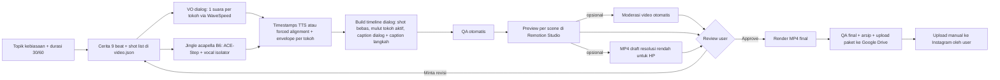
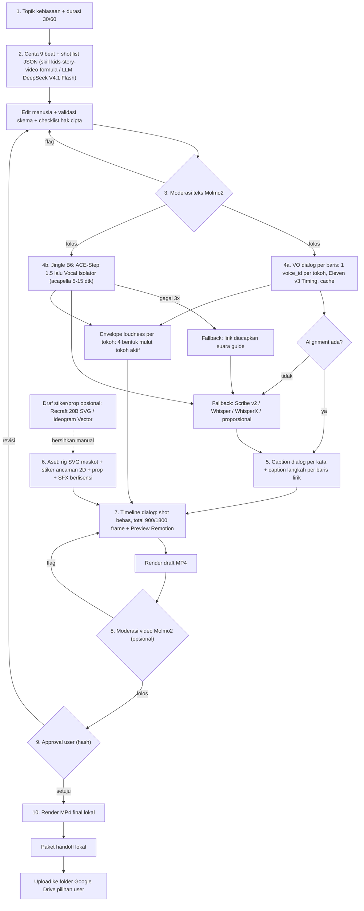

# PRD — Bintangku Video Studio — v1.4 draft

> Draf v1.4: format **video cerita** (*kids-story-video-formula*) dari `reference/PANDUAN-FORMAT-CERITA-v1.md` diterapkan atas perintah user "kerjain v1.4" (24 Nov 2026, 23:41 WIB). Keputusan user dikunci: DEC-46 (alur cerita padat 30–60 detik, formula saja), DEC-47 (jingle acapella inti di beat pelajaran), DEC-48 (potongan scene bebas mengikuti dialog; **grid 2,7 detik dihapus**). Turunannya DEC-49..54. Penanda **[v1.4]**; baris yang digantikan dicoret dan diberi catatan "Digantikan [v1.4]" supaya riwayat tetap terbaca. Sebelumnya, draf v1.3: jawaban user 24 Nov 2026 22:19 WIB dikunci (DEC-41..44: LLM DeepSeek V4.1 Flash, tanpa musik, handoff ke Google Drive, upload aset ke WaveSpeed boleh); usulan VO bernada (DEC-45, Lampiran D). Penanda **[v1.3]**. Sebelumnya, draf v1.2: menambahkan **pipeline & stack model rekomendasi** (DEC-32..40, Lampiran C) atas izin user "jika ada model dan flow yang lo sarankan boleh juga" (24 Nov 2026, 22:05 WIB). Penanda **[v1.2]** = berubah dari v1.1. Semua keputusan v1.2 berstatus **Usulan**. Sebelumnya, draf v1.1. Nama project **Bintangku Video Studio** sudah disetujui user (DEC-21, OQ-01 ditutup). Belum ditulis ke Coda. Dokumen ini hanya spesifikasi, bukan kode atau build aplikasi. Penanda **[v1.1]** menandai bagian yang berubah dari v1.0; rincian lengkap di `CHANGELOG.md`.

## 01. Document Control

| Field | Isi |
|---|---|
| Dokumen | Product Requirements Document (PRD) |
| Produk | Pipeline produksi internal video 2D chibi 30–60 detik untuk Instagram Reels bintangku.app |
| Nama project | Bintangku Video Studio (disetujui user 24 Nov 2026, DEC-21) |
| Versi | 1.4 draft |
| Status | Draf untuk review user. Belum final, belum ke Coda |
| Lokasi | `/workspace/product-architect/bintangku-video-studio/v1.4/PRD.md` (versi sebelumnya disimpan utuh di `../v1.0/` … `../v1.3/`; panduan format di `../reference/`) |
| Dokumen pasangan | `TRD.md` (HOW), `CHANGELOG.md` di folder yang sama |
| Tanggal | 24 November 2026 (WIB) |
| Pemilik produk | BrainBox Digital |
| Penulis | Product Architect |
| Sumber | Arahan user di chat 24 Nov 2026 (keputusan DEC-01..06), jawaban user 24 Nov 2026 20:56 WIB (DEC-19 dikunci, DEC-21..24); rekomendasi Product Architect (DEC-07..18, DEC-20, DEC-25..31, status usulan); [v1.4] perintah user 24 Nov 2026 23:41 WIB + `reference/CATATAN-PRD-TRD-v1.4.md` + `reference/PANDUAN-FORMAT-CERITA-v1.md` + `reference/SKILL-draft.md` (DEC-46..54); [v1.3] jawaban user 24 Nov 2026 22:19 WIB (DEC-41..44 dikunci), usulan DEC-45; [v1.2] pipeline & model rekomendasi DEC-32..40 (usulan, izin user 24 Nov 2026 22:05 WIB, halaman model WaveSpeed dibaca 24 Nov 2026); halaman model & docs WaveSpeed (Lampiran B); Brand Guidelines bintangku.app via PRD BintangMatika v1.0.1 Lampiran D; README 3 repo referensi Remotion dan skill voiceover resmi Remotion (Lampiran B) |
| Framework | AI-First Documentation Framework, PRD 22 bagian |

Status [v1.4] **Digantikan** = keputusan lama yang tidak berlaku lagi; teksnya dicoret tapi tetap ada sebagai riwayat.

Konvensi ID: `FR-<MODUL>-NNN`, `NFR-<KATEGORI>-NNN`, `US-NNN`, `AC-NNN`, `BR-NNN`, `EC-NNN`, `DEP-NN`, `RSK-NN`, `ASM-NN`, `DEC-NN`, `OQ-NN`, `TASK-USR-NNN` (tugas user). ID `SYS-`, `TECH-`, `ADR-` ada di TRD. Prioritas: P0 Must, P1 Should, P2 Could, P3 Won't (rilis ini).

Aturan angka: angka teknis hanya dari sumber yang dikutip. Angka desain tanpa sumber ditandai ASM. Harga, kuota, dan target bisnis yang belum diketahui masuk OQ. Tidak ada harga yang dikarang.

### Keputusan

Status **Dikunci** = keputusan langsung dari user. Status **Usulan** = rekomendasi Product Architect yang sudah disampaikan di chat tapi belum dikonfirmasi user secara eksplisit.

| ID | Keputusan | Status | Dampak |
|---|---|---|---|
| DEC-01 | Satu repository berisi aset, rencana konten, rules, skill agent, dan semua bahan lain untuk membuat setiap video | Dikunci (user) | FR-REPO-*, BR-001 |
| DEC-02 | ~~Suara/VO memakai ElevenLabs API~~ → **diganti DEC-24** [v1.1] | Diganti (user) | FR-VO-*, DEP-02 |
| ~~DEC-03~~ | ~~Scene/transisi berganti setiap 2,7 detik (30 detik ≈ 11 shot, 60 detik ≈ 22 shot)~~ **Digantikan [v1.4]:** alur bebas mengikuti dialog (DEC-48). Keputusan user v1.0 ini diganti oleh keputusan user v1.4 | Digantikan [v1.4] | BR-003, BR-004, FR-TL-002 |
| DEC-04 | Setiap video dibuat preview draft dulu di player Remotion Studio per scene; export MP4 hanya setelah approved | Dikunci (user) | FR-PRV-*, FR-APR-*, FR-RND-001, BR-006 |
| DEC-05 | Blender opsional, hanya kalau hasil di atas kurang bagus | Dikunci (user) | Future Scope, OQ-12 |
| DEC-06 | Dibangun dengan Remotion + Three.js; karakter dibuat sebagai SVG/kode (komponen React) supaya bisa dipakai ulang | Dikunci (user) | FR-CHR-*, FR-FX-* |
| DEC-07 | Basis dari `remotion-dev/template-prompt-to-video` (timeline Elements/Text/Audio, VO dengan timestamps, CLI `npm run gen`). Generate gambar AI diganti komponen SVG Thinker; ~~durasi slide dikunci 2,7 detik~~ (digantikan DEC-48 [v1.4]). [v1.1] OpenAI dan ElevenLabs dari template diganti WaveSpeed (DEC-24); draf naskah opsional via WaveSpeed AI Story Generator (DEC-28) | Usulan | TRD ADR-01 |
| DEC-08 | Dari `remotion-dev/template-three` hanya diambil setup `@remotion/three` + React Three Fiber, untuk efek opsional (partikel bintang, latar kosmik, parallax) sebagai satu jenis element | Usulan | FR-FX-*, TRD ADR-03 |
| DEC-09 | Dari `remotion-dev/template-audiogram` hanya diambil komponen caption per kata. [v1.1] Data caption dari timestamps TTS (WaveSpeed); jika TTS tidak memberi timestamps, pakai forced alignment (DEC-27) | Usulan | FR-CAP-*, TRD ADR-04, ADR-16 |
| DEC-10 | Semua package Remotion dikunci di versi yang sama (`npx remotion upgrade`) | Usulan | NFR-MAINT-001, TRD ADR-09 |
| DEC-11 | Satu file data per video (`video.json`) sebagai sumber kebenaran | Usulan | FR-SCR-002, BR-002 |
| DEC-12 | Thinker di-rig sebagai bagian SVG terpisah dengan props (pose, expression, mouth, blink). [v1.1] Detail gerak mulut di DEC-26 | Usulan | FR-CHR-*, TRD ADR-02 |
| DEC-13 | Master SVG Thinker digambar ulang dengan rapi (auto-trace dari PNG AI berantakan). Ini tugas user/ilustrator | Usulan | TASK-USR-001, RSK-01 |
| DEC-14 | Hybrid: SVG untuk mayoritas shot; image-to-video AI opsional hanya untuk 2–4 shot kunci | Usulan | FR-AIV-001, OQ-11 |
| DEC-15 | Preview dua level: Remotion Studio + MP4 draft resolusi rendah opsional untuk dicek dari HP | Usulan | FR-PRV-003 |
| ~~DEC-16~~ | ~~Satu voice ID dan setting suara dikunci di repo. [v1.1] Provider: WaveSpeed (DEC-24, DEC-25)~~ **Digantikan [v1.4]:** satu voice_id terkunci **per tokoh** + satu suara nyanyi jingle per seri (DEC-50) | Digantikan [v1.4] | FR-VO-002, BR-005 |
| DEC-17 | Aturan safe area Reels, template SFX yang dipakai ulang ([v1.3] tanpa musik, DEC-42), dan checklist QA (warna maskot, ejaan, sinkron VO) | Usulan | FR-QA-*, FR-AUD-*, FR-BRD-004 |
| DEC-18 | Blender dan Three.js sama-sama jalur fallback 3D; Three.js didahulukan karena satu stack dengan Remotion | Usulan | Future Scope |
| ~~DEC-19~~ | ~~Rekonsiliasi grid 2,7 detik dengan VO: VO dibuat per **beat** (satu kalimat/ide yang mencakup 1..n slot), lalu dibulatkan ke atas ke kelipatan penuh slot 2,7 detik. Grid tetap, VO menyesuaikan grid~~ **Digantikan [v1.4]:** tanpa grid; durasi shot mengikuti baris dialog, VO tidak pernah dipotong (DEC-48, ADR-26) | Digantikan [v1.4] | BR-003, BR-007, FR-VO-004, TRD ADR-05; OQ-05 ditutup |
| DEC-20 | Frame rate 30 fps. [v1.4] Alasan "2,7 detik = 81 frame" tidak berlaku lagi (DEC-48); 30 fps tetap dipakai sebagai standar | Usulan (alasan diperbarui [v1.4]) | ASM-02, TRD ADR-08 |
| DEC-21 | Nama project: **Bintangku Video Studio**. Folder `/workspace/product-architect/bintangku-video-studio/` | Dikunci (user) [v1.1] | OQ-01 ditutup; DEP-06 |
| ~~DEC-22~~ | ~~Video 30 detik = 11 slot (29,7 detik); 60 detik = 22 slot (59,4 detik)~~ **Digantikan [v1.4]:** total video tepat 30,0 detik (900 frame) atau 60,0 detik (1.800 frame) @30 fps, tanpa slot (DEC-48, BR-021) | Digantikan [v1.4] | OQ-06 ditutup; BR-004 |
| DEC-23 | BrainBox Digital punya 1 karyawan → Remotion Free License berlaku (syarat: for-profit maks. 3 karyawan) | Dikunci (user) [v1.1] | OQ-09 ditutup; DEP-01; RSK-03 tetap dipantau |
| DEC-24 | Semua model AI lewat **WaveSpeed** (satu `WAVESPEED_API_KEY`), menggantikan OpenAI dan ElevenLabs API langsung. TTS/VO memakai model text-to-speech di WaveSpeed | Dikunci (user) [v1.1] | DEC-02 diganti; FR-VO-*, FR-SCR-003, DEP-02, DEP-09, TRD ADR-13 |
| DEC-25 | TTS utama: `elevenlabs/eleven-v3/timing` **lewat WaveSpeed** (ditagih WaveSpeed, tanpa akun ElevenLabs). Alasan: dari 38 model TTS di katalog WaveSpeed, hanya model ini yang dinyatakan mengembalikan timestamps (alignment per karakter); halaman Eleven v4, MiniMax Speech 2.8 HD, Gemini 3.1 Flash TTS, OmniVoice, dan Qwen3 TTS yang dibaca tidak menyebut timestamps (model lain belum dicek satu per satu); Eleven v3 mendukung bahasa Indonesian (`id`); voice_id tetap. Alternatif: `minimax/speech-2.8-hd` (ada `language_boost: Indonesian`, voice clone, tanpa timestamps → butuh DEC-27). Pilihan final setelah uji A/B (TASK-VAL-006) | Usulan [v1.1] | FR-VO-001, OQ-21, TRD ADR-13 |
| DEC-26 | Lip-sync: [v1.4] setiap maskot yang bicara (bukan hanya Thinker, DEC-52) memakai 4 bentuk mulut (`closed`, `half`, `open`, `round`). Penggerak utama: amplitudo/envelope audio VO per frame (tidak bergantung provider). Jika TTS memberi timestamps, dipakai untuk memperhalus (mis. vokal o/u → `round`). Mulut menutup saat hening | Usulan [v1.1] | FR-CHR-002, FR-CHR-003, TRD ADR-15 |
| DEC-27 | Caption per kata dari timestamps TTS jika tersedia; jika tidak, forced alignment: speech-to-text dengan timestamps per kata (WaveSpeed `elevenlabs/scribe-v2` atau `wavespeed-ai/openai-whisper` dengan `enable_timestamps`), lalu dicocokkan ke kata naskah. Teks naskah tetap sumber kebenaran | Usulan [v1.1] | FR-CAP-001, TRD ADR-16 |
| DEC-28 | [v1.2] `wavespeed-ai/ai-story-generator` diturunkan jadi alat ide/brainstorm opsional (output prosa). Naskah per beat dalam bentuk JSON dibuat oleh LLM WaveSpeed (DEC-33), lalu diedit manusia sebelum masuk `video.json` | Model disebut user; peran diperbarui (usulan) [v1.2] | FR-SCR-003, FR-SCR-005, OQ-23 |
| DEC-29 | `wavespeed-ai/molmo2/video-content-moderator` sebagai gerbang QA otomatis opsional sebelum approval (audiens anak). Hasil moderator bukan approval; approval tetap dari user | Model disebut user; peran usulan [v1.1] | FR-QA-003, BR-006, TRD ADR-17 |
| DEC-30 | `recraft-ai/recraft-20b-svg` sebagai alat bantu draf ornamen/ikon/latar SVG (dan sketsa awal untuk master Thinker). Master rig Thinker tetap digambar/dipisah manual dan warnanya dikunci ke brand | Model disebut user; peran usulan [v1.1] | FR-AST-001, BR-016, TRD ADR-18 |
| DEC-31 | Image-to-video opsional untuk 2–4 shot kunci lewat model image-to-video WaveSpeed (kandidat: `bytedance/seedance-2.5-flash/image-to-video`, `kwaivgi/kling-v4.0/image-to-video`), audio bawaan dimatikan | Usulan [v1.1] | FR-AIV-001, OQ-11 |
| DEC-32 | [v1.2] Pipeline rekomendasi 10 tahap: brief → beat JSON (LLM) → moderasi teks → VO TTS per beat → alignment/caption → aset (SVG kode + ornamen) → [v1.4] timeline dialog (tanpa grid) + preview Remotion → moderasi video draft → approval user → render MP4 → paket handoff. Rincian model, harga, wajib/opsional di Lampiran C | Usulan [v1.2] | Lampiran C, ADR-21 |
| DEC-33 | [v1.2] Beat JSON dibuat lewat LLM API WaveSpeed (OpenAI-compatible, `https://llm.wavespeed.ai/v1`, key yang sama). Utama `deepseek/deepseek-v4.1-flash-1017`, alternatif `openai/gpt-6-luna`; output divalidasi skema `video.json` secara lokal, maks. 1 kali perbaikan otomatis | **Dikunci** [v1.3] (DEC-41) | FR-SCR-005, OQ-27, ADR-20 |
| DEC-34 | [v1.2] Moderasi teks (`wavespeed-ai/molmo2/text-content-moderator`) dijalankan pada naskah **sebelum** TTS, supaya naskah bermasalah tidak sempat menghabiskan biaya VO. Moderasi video tetap pada MP4 draft (DEC-29) | Usulan [v1.2] | FR-QA-004, ADR-21 |
| DEC-35 | [v1.2] Urutan fallback alignment: alignment Eleven v3 Timing → `elevenlabs/scribe-v2` (lebih murah untuk audio pendek: 30 detik USD 0,005) → `wavespeed-ai/openai-whisper` dengan timestamps → WhisperX lokal → proporsional | Usulan [v1.2] (memperjelas DEC-27) | FR-VO-007 |
| DEC-36 | [v1.2] Alat bantu vektor: (a) sekali saat setup, `ideogram-ai/ideogram-vector/image-to-vector` mengubah PNG referensi Thinker jadi SVG kasar sebagai **bahan jiplak** ilustrator (bukan master); (b) ornamen harian default `recraft-ai/recraft-20b-svg` (termurah); (c) ornamen yang harus mirip gaya brand: `ideogram-ai/ideogram-vector/text-to-vector` dengan gambar referensi | Usulan [v1.2] | FR-AST-002, FR-AST-003, OQ-30 |
| ~~DEC-37~~ | ~~[v1.2] Musik: pustaka berlisensi / Lyria 3 Clip opsional~~ — digantikan DEC-42 [v1.3] | Diganti | — |
| DEC-38 | [v1.2] B-roll image-to-video default maks. 1 klip per video. Kandidat utama `kwaivgi/kling-v4.0/image-to-video` 720p 3 detik (durasi minimum 3 detik; [v1.4] tanpa grid, klip dipotong ke durasi shot; hanya latar/prop, tidak pernah tokoh); alternatif `bytedance/seedance-2.5-flash/image-to-video` 480p 4 detik. Tidak pernah untuk menganimasikan Thinker | Usulan [v1.2] (memperjelas DEC-31) | FR-AIV-001, OQ-11 |
| DEC-39 | [v1.2] Model lip-sync/talking-avatar WaveSpeed (mis. `sync/lipsync-3`, `kwaivgi/kling-lipsync/audio-to-video`, InfiniteTalk) dan model gambar untuk membuat ulang Thinker **tidak dipakai**: semuanya membuat ulang piksel karakter sehingga konsistensi SVG hilang. Lip-sync tetap 4 bentuk mulut berbasis loudness (DEC-26) | Usulan [v1.2] | BR-017, ADR-23 |
| DEC-40 | [v1.2] Tahap akhir = paket handoff lokal `handoff/<videoId>/` (MP4 final, `caption.txt`, `handoff.json` berisi hash, durasi, model & biaya). [v1.3] Tujuan = Google Drive (DEC-43); paket lokal tetap dibuat lebih dulu | Diperbarui [v1.3] | FR-HND-001, OQ-29 |
| DEC-41 | [v1.3] LLM beat JSON: default `deepseek/deepseek-v4.1-flash-1017`; `openai/gpt-6-luna` sebagai opsi/fallback lewat `config/models.json` (bukan otomatis) | **Dikunci** (user: "DeepSeek … Flash dulu untuk awal, GPT-6 Luna untuk opsi"; "V1.4" ditafsirkan sebagai V4.1 Flash, satu-satunya DeepSeek Flash di katalog) | FR-SCR-005, OQ-27 ditutup |
| DEC-42 | [v1.3] **Tanpa musik latar** di semua video (pustaka musik & musik AI dihapus). SFX pendek berlisensi tetap boleh kecuali user menolak (OQ-31). Unsur "bernada" hanya lewat VO (DEC-45) | **Dikunci** (user: "tidak menggunakan musik") | FR-AUD-001, FR-AUD-002, FR-AUD-003, OQ-13, OQ-28 ditutup |
| DEC-43 | [v1.3] Handoff = upload paket (MP4 final, `caption.txt`, `handoff.json`) ke folder Google Drive pilihan user, satu subfolder per video. Paket lokal tetap disimpan | **Dikunci** (user: "Google Drive") | FR-HND-001, FR-HND-002, OQ-29 ditutup, OQ-33 |
| DEC-44 | [v1.3] PNG Thinker dan aset brand boleh diupload ke WaveSpeed (untuk `vectorize`, referensi Ideogram, image-to-video). File di WaveSpeed tersimpan sampai 7 hari | **Dikunci** (user: "boleh") | FR-AST-002, FR-AST-003, OQ-30 ditutup |
| DEC-45 | [v1.3] VO bernada lewat `wavespeed-ai/ace-step-1.5` → `wavespeed-ai/audio-vocal-isolator` (acapella). ~~Mode opsional, maks. 1 beat, 2 slot = 5,4 detik, contoh tagline penutup~~ **Diperbarui [v1.4]:** untuk format cerita jingle menjadi **inti** di beat pelajaran (DEC-47), 5–15 detik, tidak dikunci ke 5,4 detik; fallback ke VO bicara tetap | Diperbarui [v1.4] (bagian opsional/2 slot digantikan DEC-47) | FR-VO-008, OQ-32 |
| DEC-46 | [v1.4] Format **video cerita** (*kids-story-video-formula*): 30 atau 60 detik, alur dipadatkan dari formula video referensi: B1 momen sehari-hari → B2 peringatan → B3 takut/khayalan (ancaman 2D datar) → B4 bertanya → B5 menormalkan + mengajar + nilai merek → B6 jingle langkah → B7 percaya diri → B8 callback lucu → B9 end card. Versi 30 detik menggabung B1+B2, B4+B5, B7+B8 tanpa menghapus beat. Yang dipinjam hanya **formula** (struktur, peran, tempo, jenis shot, gaya caption, jenis SFX); karakter, nama, dialog, lirik, merek, dan kartu kutipan referensi tidak boleh ditiru | **Dikunci** (user) | FR-STY-001..005, BR-023, Lampiran E |
| DEC-47 | [v1.4] Beat pelajaran (B6) wajib berupa **jingle acapella**: tepat 1 per video, 4–8 baris lirik langkah, 5–15 detik (acuan 60 detik ≈ 6 baris/12 detik; 30 detik = 4 baris/±8 detik), lewat ACE-Step 1.5 + vocal isolator, tanpa musik (DEC-42). Gagal 3 kali → baris diucapkan biasa dengan caption langkah tetap tampil | **Dikunci** (user) | FR-VO-008, FR-CAP-004, BR-024, AC-039 |
| DEC-48 | [v1.4] Potongan scene **bebas mengikuti dialog**: tidak ada grid 2,7 detik / 81 frame, tidak ada hitungan 11/22 slot, VO tidak dibulatkan ke slot. Durasi shot dalam frame bebas di 30 fps; total tepat 900 atau 1.800 frame. Menggantikan DEC-03, DEC-19, DEC-22 dan bagian grid DEC-07/DEC-45 | **Dikunci** (user) | FR-TL-005, BR-021, ADR-26 |
| DEC-49 | [v1.4] Dialog multi-tokoh tanpa narator: tepat 3 peran bicara (*surrogate*, *catalyst*, *guide*) + maks. 1 cameo bisu. Default Dreamer (surrogate), Explorer (catalyst), Thinker (guide); Dream Keeper sebagai guide untuk topik malam/tidur/rutinitas; figur orang tua chibi orisinal opsional sebagai guide. Membuka sebagian OQ-17 | **Dikunci** (format cerita yang disetujui untuk v1.4) | FR-STY-002, FR-CHR-001, BR-022, OQ-36 |
| DEC-50 | [v1.4] Satu `voice_id` TTS terkunci **per tokoh** (Eleven v3 Timing via WaveSpeed) + satu suara nyanyi jingle terkunci per seri (tags + seed ACE-Step). Menggantikan DEC-16 | **Dikunci** (format cerita); pilihan preset per maskot → OQ-34 | FR-VO-002, BR-005, OQ-34 |
| DEC-51 | [v1.4] Dua lapisan caption: (1) **caption langkah** jingle: Fredoka Extra Bold/Black, isian `#FFD234`, outline `#0D1B4B` atau `#1A2F7A`, sepertiga bawah di safe area, masuk pop/scale-in 0,6 → 1,1 → 1,0 dalam 8–12 frame, tampil sinkron per baris (±1,5–2 detik); (2) caption dialog Nunito Sans Semi Bold, disembunyikan selama B6 | **Dikunci** (format cerita) | FR-CAP-004, FR-CAP-005, AC-045 |
| DEC-52 | [v1.4] Lip-sync per tokoh yang sedang bicara: 4 bentuk mulut dari loudness track suara tokoh itu; tokoh lain `closed`; kedip tetap jalan. Overlap ucapan maks. 0,3 detik (9 frame) | **Dikunci** (format cerita; melanjutkan DEC-26, DEC-39) | FR-CHR-003, BR-025, AC-044 |
| DEC-53 | [v1.4] Field `pacing` di `video.json`: `dialogue` (aktif, default, format cerita). Nilai `grid` (perilaku v1.3) disimpan sebagai **legacy nonaktif**, validator menolaknya sampai user menghidupkan lagi untuk format lain (OQ-35). Skema `video.json` mengikuti struktur keluaran skill `kids-story-video-formula` (`format`, `cast`, `voices`, `beats`, `jingle`, `shots`, `endCard`, `sfxCues`) + field produksi (status, approval, history) | Usulan [v1.4] | FR-SCR-002, FR-SCR-006, ADR-27, OQ-35 |
| DEC-54 | [v1.4] Visual format cerita: ancaman di beat khayalan = stiker SVG 2D datar orisinal + transisi swoosh/iris (bukan image-to-video tokoh, bukan talking-avatar, selaras DEC-39); end card = tagline *Langkah Kecil Menuju Anak Mandiri* + metode Misi → Kebiasaan → Bintang → Progres → Hadiah → Mandiri, tanpa foto anak sungguhan; output tetap 9:16 (referensi 16:9 hanya acuan formula) | **Dikunci** (catatan v1.4 + Brand Guidelines) | FR-STY-004, FR-STY-005, BR-011, AC-047 |
| ~~DEC-49~~ | ~~Dialog multi-tokoh tanpa narator…~~ **Digantikan [v1.4 amandemen]:** DEC-55 + DEC-56 (narator VO; maskot bisu). Cast visual tetap 3 peran | Digantikan 25 Nov 2026 | — |
| ~~DEC-50~~ | ~~Satu voice_id per tokoh…~~ **Digantikan:** satu voice narator di `config/voice.json` (DEC-55). OQ-34 tidak berlaku | Digantikan 25 Nov 2026 | — |
| ~~DEC-52~~ | ~~Lip-sync per tokoh yang sedang bicara…~~ **Digantikan:** maskot tidak bicara; mulut idle/smile saja (DEC-56) | Digantikan 25 Nov 2026 | — |
| DEC-55 | [v1.4 amandemen] VO = **satu suara narator** (bukan suara maskot). TTS Eleven v3 Timing via WaveSpeed; `voice_id` terkunci di `config/voice.json` | **Dikunci** (user 25 Nov 2026) | FR-VO-001, BR-005, OQ-34 ditutup |
| DEC-56 | [v1.4 amandemen] Maskot **tidak bersuara** — hanya gerak/pose/ekspresi (pantomim). Tidak ada dialog antar tokoh di audio | **Dikunci** (user 25 Nov 2026) | FR-STY-002, BR-022 diganti |
| DEC-57 | [v1.4 amandemen] Timeline & preview Studio = **per scene storyboard** (`pacing: "scene"`). Durasi scene mengikuti VO narator (+ pad); total 900/1800 frame. Bukan multi-voice dialogue shots; bukan grid 81 frame | **Dikunci** (user 25 Nov 2026) | FR-TL-*, FR-PRV-001, ADR-26/27 digeser |
| DEC-58 | [v1.4 amandemen] Video uji pertama: **sikat gigi sebelum tidur, 60 detik**, guide visual Dream Keeper (OQ-38) | **Dikunci** (user 25 Nov 2026) | OQ-38 ditutup |

### Amandemen user (25 Nov 2026)

Produksi MVP memakai **narator 1 voice + maskot bisu + timeline scene-first**. Lihat `docs/OQ-LOCKS.md`. DEC-46 (formula 8 beat), DEC-47 (jingle B6), DEC-48 (tanpa grid 2,7 dtk), DEC-51 (caption langkah), DEC-54 (stiker/end card) **tetap berlaku**.

## 02. Executive Summary

Bintangku Video Studio adalah pipeline produksi internal BrainBox Digital untuk membuat video Reels 2D chibi berdurasi 30–60 detik untuk akun Instagram bintangku.app. Semua bahan (brand token, karakter Thinker sebagai komponen SVG, rencana konten, rules, skill agent, template musik/SFX) ada di satu repository. Tiap video dideskripsikan dalam satu file `video.json`. Dari situ pipeline membuat VO lewat model TTS di WaveSpeed (dengan timestamps bila tersedia), menyusun timeline dengan pergantian scene tetap tiap 2,7 detik, menampilkan preview per scene di Remotion Studio, dan baru merender MP4 setelah user menyetujui.

[v1.4] Format utama sekarang **video cerita** berdialog antar maskot (DEC-46): tanpa narator, satu suara per tokoh, satu jingle acapella langkah di tengah video, potongan scene bebas mengikuti dialog (grid 2,7 detik dihapus, DEC-48). [v1.3] Tanpa musik latar (DEC-42); hasil akhir diupload ke Google Drive (DEC-43); VO bernada hanya sebagai beat jingle opsional (DEC-45, Lampiran D). [v1.2] Rekomendasi stack lengkap per tahap, estimasi biaya per video 30/60 detik, dan diagram alurnya ada di Lampiran C.

Basisnya repo resmi `remotion-dev/template-prompt-to-video`, dengan generate gambar AI diganti komponen SVG Thinker. Setup `@remotion/three` dari `template-three` dipakai untuk efek opsional, dan komponen caption per kata dari `template-audiogram`. Semua model AI dipanggil lewat satu akun WaveSpeed (TTS, opsional draf naskah, moderasi video, draf ornamen SVG, image-to-video) [v1.1]. Kredit berbayar terutama untuk VO, karena mayoritas shot adalah SVG yang dianimasikan dengan kode. Gerak mulut Thinker digerakkan amplitudo audio sehingga tidak bergantung pada provider TTS.

## 03. Product Vision

Setiap video bintangku.app tampil konsisten dengan brand (Thinker, palet, font, gaya 2D Chibi Cosmic), bisa dibuat ulang kapan saja dari data yang tersimpan di repo, dan diproduksi cepat dengan biaya kredit minimum. Agent AI bisa mengerjakan sebagian besar langkah lewat skill di repo, sementara keputusan kreatif dan approval tetap di tangan user.

## 04. Problem Statement

1. Video AI text-to-video panjang mahal dan karakternya mudah berubah antar-shot. Video cerita 60 detik butuh belasan shot dan beberapa tokoh ([v1.4]; v1.0 menghitung ±22 shot dari grid 2,7 detik), jadi generate per shot dengan AI video boros kredit dan rawan drift karakter.
2. Tanpa sumber karakter tunggal, warna dan proporsi Thinker bisa menyimpang dari Brand Guidelines bintangku.app (warna maskot tidak boleh diubah).
3. Tanpa tahap preview yang murah, kesalahan naskah, ejaan, atau sinkron VO baru ketahuan setelah render final, sehingga kredit dan waktu terbuang.
4. Tanpa repo dan data per video, setiap video dibuat dari nol, tidak bisa diaudit, dan sulit dikerjakan agent AI secara konsisten.

## 05. Target Audience

- **Pengguna pipeline (primer):** tim BrainBox Digital (pemilik/approver konten) dan agent AI yang menjalankan skill di repo.
- **Penonton video (sekunder):** audiens Instagram bintangku.app. Detail segmen audiens dan pilar konten belum ditetapkan (OQ-03).

## 06. User Personas

| Persona | Kebutuhan | Hambatan |
|---|---|---|
| Owner/Approver (BrainBox Digital) | Video rapi, on-brand, cepat; bisa review per scene sebelum keluar biaya render; keputusan akhir di tangannya | Waktu terbatas; review sering dari HP |
| Producer Agent (agent AI dengan skill repo) | Instruksi jelas, data terstruktur, rules eksplisit, perintah CLI yang deterministik | Tidak boleh mengarang requirement; tidak boleh menganggap dirinya sendiri sebagai approver |
| Ilustrator/Desainer (internal atau freelance) | Spesifikasi rig SVG Thinker yang jelas (bagian, nama layer, palet) | Butuh referensi master dan aturan warna |
| Copy Coach (agent copy, opsional) | Naskah VO dan teks layar untuk direview gaya bahasanya | Butuh akses ke naskah per beat |

## 07. Product Objectives

| ID | Objektif |
|---|---|
| OBJ-01 | Setiap video dibuat dari satu `video.json` dan bisa dirender ulang dengan hasil yang sama (reproducible) |
| OBJ-02 | Karakter Thinker dan ornamen konsisten 100% dengan brand karena berasal dari komponen SVG yang sama |
| OBJ-03 | Tidak ada render final tanpa approval user yang tercatat |
| OBJ-04 | Kredit berbayar hanya untuk VO, plus image-to-video opsional untuk maksimal beberapa shot kunci |
| OBJ-05 | Agent AI bisa menjalankan alur naskah → VO → timeline → preview lewat skill di repo |

## 08. Success Metrics

| ID | Metrik | Definisi | Target |
|---|---|---|---|
| ~~SM-01~~ | ~~Kepatuhan grid~~ **Digantikan [v1.4]:** % video dengan total durasi tepat 900/1.800 frame, 9 beat lengkap, jingle 5–15 detik, dan tidak ada VO terpotong (SM-08) | % scene yang berganti tepat di kelipatan 81 frame (2,7 detik @30 fps) | 100% (validasi otomatis) |
| SM-08 | [v1.4] Kepatuhan format cerita | % video lolos validasi format (durasi tepat, B1–B9 ada, jingle 5–15 detik acapella, tanpa narator, suara sesuai tokoh) | 100% (validasi otomatis) |
| SM-02 | Render tanpa approval | Jumlah render final tanpa status `approved` yang cocok | 0 |
| SM-03 | Kepatuhan brand | % video final lolos checklist QA brand (warna maskot, font, palet) | 100% |
| SM-04 | Reproducibility | Render ulang dari commit yang sama menghasilkan video yang identik secara visual | Lolos di uji regresi (TRD TECH-TEST) |
| SM-05 | Waktu produksi per video | Dari `video.json` siap sampai MP4 final | Baseline belum ada → OQ-14 |
| SM-06 | Biaya kredit per video | Biaya WaveSpeed per video (TTS per karakter + model opsional), dibaca dari catatan prediksi | Batas ditentukan user → OQ-08 [v1.1] |
| SM-07 | Iterasi review | Rata-rata putaran `changes_requested` per video | Dicatat dulu; target ditetapkan setelah 5 video (ASM-10) |

Metrik performa Instagram (views, retensi) di luar pipeline ini; dicatat di OQ-03 jika user ingin dihubungkan.

## 09. Product Scope

### In Scope (MVP)

- Repository tunggal dengan struktur baku: brand token, karakter, ornamen, rencana konten, rules, skill agent, config VO, template SFX (tanpa musik, DEC-42), folder per video.
- [v1.4] Komponen SVG/React maskot yang di-rig (Thinker, Dreamer, Explorer, Dream Keeper; pose, ekspresi, mulut, kedip) dan pustaka ornamen (bintang, confetti, badge, bingkai, latar sederhana).
- Format data `video.json` per video dan timeline turunan (Elements/Text/Audio).
- [v1.4] Generate VO per baris dialog lewat TTS WaveSpeed, satu voice terkunci per tokoh, cache agar tidak generate ulang teks yang sama.
- [v1.4] Jingle acapella langkah (ACE-Step 1.5 + vocal isolator) sebagai beat inti, dengan caption langkah membal.
- ~~Grid scene tetap 2,7 detik, 11–22 slot per video.~~ [v1.4] Potongan scene bebas mengikuti dialog; total 30,0 atau 60,0 detik (DEC-48).
- [v1.4] Format cerita 9 beat (B1–B9) dengan skema `video.json` selaras skill `kids-story-video-formula` (DEC-46, DEC-53).
- Caption per kata dari timestamps TTS, atau forced alignment jika TTS tidak memberi timestamps. [v1.1]
- Lip-sync 4 bentuk mulut berbasis amplitudo audio, [v1.4] per tokoh yang sedang bicara.
- Gerbang moderasi video otomatis (opsional) sebelum approval. [v1.1]
- Batas biaya WaveSpeed per video dan cek saldo sebelum panggilan berbayar. [v1.1]
- Preview per scene di Remotion Studio; MP4 draft resolusi rendah opsional.
- Alur approval dengan status tercatat; render MP4 final hanya untuk versi yang disetujui.
- Efek opsional Three.js (partikel bintang, latar kosmik, parallax) sebagai jenis element.
- [v1.3] Template SFX yang dipakai ulang (tanpa musik latar, DEC-42).
- Checklist QA dan validasi otomatis ([v1.4] durasi, beat wajib, jingle, suara per tokoh, palet maskot, safe area, sinkron VO).
- Skill agent di repo: dari naskah sampai preview, plus skill voiceover resmi Remotion sebagai referensi.

### Out of Scope (rilis ini)

Lihat bagian 17.

### Future Scope

- Image-to-video AI via WaveSpeed untuk 2–4 shot kunci (FR-AIV-001, P2) setelah model dan lisensinya dipilih (OQ-11).
- Draf ornamen/ikon SVG dengan Recraft 20B SVG (FR-AST-001, P2).
- Blender sebagai jalur 3D kalau hasil SVG + Three.js kurang bagus (DEC-05, OQ-12).
- Karakter tamu Mascot Squad (Cheerleader, Grower) sebagai komponen SVG.
- Render di cloud (Remotion Lambda) jika volume naik (TRD bagian 22).
- Format lain (TikTok, YouTube Shorts, 1:1/4:5) dari data yang sama.
- Integrasi jadwal posting (mis. Metricool) hanya dengan izin eksplisit user.

## 10. User Roles & Permissions

| Peran | Boleh | Tidak boleh |
|---|---|---|
| Owner/Approver (user) | Menyetujui/menolak video, mengubah rules, brand token, voice ID, menjalankan render final | — |
| Producer Agent | Membuat/mengubah `video.json` berstatus draft, generate VO, build timeline, membuka preview, render MP4 draft, menjalankan QA | Mengubah status ke `approved`; render final tanpa approval; mengubah warna maskot; commit secret; publish ke Instagram |
| Ilustrator | Mengubah file master SVG dan bagian rig lewat PR yang direview | Mengubah palet maskot tanpa persetujuan user |
| Copy Coach (opsional) | Memberi revisi naskah VO dan teks layar | Mengubah status approval |

## 11. User Journey

Langkah:

1. User atau agent memilih ide dari rencana konten (`content-plan/`).
2. [v1.4] Agent memakai skill `kids-story-video-formula` (atau LLM, FR-SCR-005) untuk menulis cerita 9 beat, dialog per tokoh, lirik jingle, shot list, caption langkah, dan cue SFX ke `video.json`; manusia mengedit (opsional review Copy Coach).
3. [v1.4] Agent menjalankan generate VO per baris dialog (suara sesuai tokoh) dan jingle B6 lewat WaveSpeed (saldo dan batas biaya dicek dulu). Beat yang teksnya tidak berubah memakai cache. Output diunduh segera karena file WaveSpeed hanya disimpan sampai 7 hari. [v1.1]
4. [v1.4] Agent membangun timeline: durasi shot mengikuti baris dialog (tanpa grid), total dipas ke 30,0/60,0 detik lewat end card, caption dialog per kata + caption langkah, gerak mulut tokoh aktif dari envelope suaranya.
5. Validasi otomatis jalan ([v1.4] durasi tepat, B1–B9, jingle 5–15 detik, suara per tokoh, palet maskot, safe area, VO tidak terpotong).
6. User membuka preview di Remotion Studio dan menonton per scene; bisa minta MP4 draft untuk HP. Jika moderasi aktif, MP4 draft dicek Molmo2 Video Content Moderator; hasil yang menandai kategori apa pun memblokir approval sampai user meninjau. [v1.1]
7. User approve atau minta revisi. Approval dicatat dengan hash timeline.
8. Render MP4 final hanya untuk hash yang disetujui, lalu QA final dan arsip.
9. User mengunggah sendiri ke Instagram (di luar pipeline).

## 12. Functional Requirements

| ID | Requirement | Prioritas |
|---|---|---|
| **Repository (REPO)** | | |
| FR-REPO-001 | Satu repository memuat: brand token, master karakter & rig SVG, ornamen, rencana konten, rules, skill agent, config VO, template SFX [v1.3], dan folder per video | P0 |
| FR-REPO-002 | Repo punya `AGENTS.md` dengan urutan baca (rules → brand → skill → data video) dan larangan agent (BR-006, BR-008, BR-009) | P0 |
| FR-REPO-003 | Repo menyediakan `.env.example` berisi nama variabel tanpa nilai; `.env` masuk `.gitignore` | P0 |
| FR-REPO-004 | Folder `rules/` memuat aturan brand, aturan konten/naskah, aturan safe area, dan checklist QA dalam Markdown | P0 |
| **Brand (BRD)** | | |
| FR-BRD-001 | Brand token tunggal (palet, font, outline, gaya) dari Brand Guidelines bintangku.app menjadi satu-satunya sumber warna/font untuk semua komponen | P0 |
| FR-BRD-002 | Warna maskot Thinker dikunci di komponen dan tidak bisa diubah lewat props atau data video | P0 |
| FR-BRD-003 | Teks di video hanya memakai Fredoka (judul, angka besar) dan Nunito Sans (body/caption), dari file font brand kit yang disetujui | P0 |
| FR-BRD-004 | Overlay safe area Reels tersedia di preview dan dicek otomatis untuk teks/caption | P1 |
| **Karakter & ornamen (CHR)** | | |
| FR-CHR-001 | [v1.4] Setiap maskot pemeran (MVP: Thinker, Dreamer, Explorer, Dream Keeper; Cheerleader & Grower untuk cameo menyusul) tersedia sebagai komponen dari bagian SVG terpisah dengan spesifikasi rig yang sama (badan, kepala, mata, kelopak, 5 varian mulut, lengan, aksesori khas) | P0 |
| FR-CHR-002 | Komponen menerima props `pose`, `expression`, `mouth`, `blink`, plus posisi/skala/arah hadap; nilai pose & ekspresi berupa daftar tertutup (enum). [v1.1] `mouth` punya 4 bentuk bicara: `closed`, `half`, `open`, `round` (+ `smile` untuk ekspresi diam) | P0 |
| FR-CHR-003 | [v1.4] Gerak mulut tiap tokoh digerakkan envelope loudness track suaranya sendiri per frame; hanya tokoh yang sedang bicara/bernyanyi yang bergerak, tokoh lain `closed`; timestamps TTS hanya memperhalus; kedip otomatis deterministik | P0 |
| FR-CHR-004 | Pose minimal mengikuti 6 pose Thinker di Lampiran D PRD BintangMatika: wave, think, cheer, point, calm, zoom | P1 |
| FR-CHR-005 | Pustaka ornamen SVG: bintang, confetti bintang, badge, bingkai, latar kosmik sederhana, panel teks | P0 |
| FR-CHR-006 | Animasi gerak murah per element (zoom, geser, bounce, kedip, muncul/hilang) tersedia sebagai preset bernama | P0 |
| **Konten & naskah (SCR)** | | |
| FR-SCR-001 | Folder `content-plan/` menyimpan daftar ide/pilar konten dan status (ide, dijadwalkan, diproduksi) | P1 |
| FR-SCR-002 | [v1.4] Setiap video punya satu `video.json` mengikuti struktur skill `kids-story-video-formula` (`format`, `topic`, `durationSec`, `pacing`, `cast`, `voices`, `beats`, `jingle`, `shots`, `endCard`, `sfxCues`) plus status dan riwayat approval | P0 |
| FR-SCR-003 | [v1.2] Naskah bisa ditulis manual, dimulai dari beat JSON LLM (FR-SCR-005), atau dari ide `wavespeed-ai/ai-story-generator` (opsional, mati default). Semua draf AI selalu diedit manusia sebelum masuk `video.json` | P1 |
| FR-SCR-004 | Skema `video.json` divalidasi sebelum langkah VO/timeline; error dilaporkan per field | P0 |
| FR-SCR-005 | [v1.2] Perintah `beats` mengirim brief + aturan brand + skema ke LLM WaveSpeed dan menerima [v1.4] JSON cerita sesuai skema FR-SCR-002 (beat B1–B9, dialog per tokoh, lirik jingle, shot list, caption langkah, cue SFX). Output divalidasi skema lokal; jika gagal, 1 kali permintaan perbaikan, lalu berhenti dengan daftar error | P1 |
| FR-SCR-006 | [v1.4] Skill `kids-story-video-formula` (dari `reference/SKILL-draft.md`) disimpan di `skills/` repo sebagai prosedur penulisan cerita; keluarannya langsung lolos validasi skema `video.json` | P1 |
| **Voiceover (VO)** | | |
| FR-VO-001 | [v1.4] VO dibuat lewat TTS WaveSpeed (DEC-25) **per baris dialog**, memakai `voice_id` tokoh yang mengucapkannya, dengan timestamps jika tersedia | P0 |
| FR-VO-002 | [v1.4] Peta `tokoh → voice_id + setting` dan suara nyanyi jingle (tags, seed) disimpan di `config/voices.json` dan dikunci; override per video hanya dengan persetujuan user | P0 |
| FR-VO-003 | Cache VO: baris dengan teks + tokoh + model + voice + settings yang sama tidak di-generate ulang [v1.4] | P0 |
| ~~FR-VO-004~~ | ~~Durasi tiap beat dibulatkan ke atas ke kelipatan slot 2,7 detik; VO tidak boleh melewati batas slot terakhir beat-nya~~ **Digantikan [v1.4]:** durasi shot mengikuti baris dialog tanpa pembulatan (FR-TL-005) | P0 |
| FR-VO-005 | [v1.1] Sebelum generate, pipeline menampilkan jumlah karakter dan estimasi biaya berdasarkan tarif di config (tarif dicatat dari halaman model, bisa berubah) | P1 |
| FR-VO-006 | [v1.1] Output WaveSpeed (audio, alignment, file lain) diunduh ke repo segera setelah prediksi `completed` dan dicatat hash-nya; URL WaveSpeed tidak pernah dipakai langsung di timeline (file dihapus WaveSpeed maks. 7 hari) | P0 |
| FR-VO-007 | [v1.1] Jika TTS tidak memberi timestamps, pipeline menjalankan forced alignment (DEC-27) dan menyimpan hasilnya dalam format alignment yang sama | P0 |
| FR-VO-008 | [v1.4] Wajib di format cerita: B6 = jingle acapella (ACE-Step 1.5 → vocal isolator), `duration` diminta = `jingle.durationSec` (5–15 detik), lirik 4–8 baris; hasil dipotong/dipad ke durasi jingle; timing tiap baris dari STT atau dari `jingle.lines[].durationSec`; mulut penyanyi di layar dari envelope; maks. 3 percobaan lalu fallback ke VO bicara | P0 |
| **Timeline (TL)** | | |
| FR-TL-001 | Timeline (Elements/Text/Audio, mengikuti template-prompt-to-video) dibangun otomatis dari `video.json` + hasil VO | P0 |
| ~~FR-TL-002~~ | ~~Setiap pergantian scene terjadi tepat di kelipatan 2,7 detik; jumlah slot 11–22~~ **Digantikan [v1.4]:** potongan bebas di frame mana pun (FR-TL-005) | P0 |
| FR-TL-003 | Transisi antar-scene dipilih dari preset bernama ([v1.4] `cut`, `swoosh`, `iris`, `star-wipe`, 8–12 frame) dan tidak memotong VO | P1 |
| FR-TL-004 | Timeline yang dihasilkan deterministik: input sama → timeline sama (hash sama) | P0 |
| FR-TL-005 | [v1.4] Timeline dialog: tiap shot = `max(durasi baris dialog + jeda, durasi minimum shot)`; boleh lebih panjang untuk aksi/insert; total tepat 900 (30 detik) atau 1.800 (60 detik) frame, selisih diserap end card dalam batas ASM-23; jika masih lebih/kurang → error | P0 |
| FR-TL-006 | [v1.4] `pacing: "grid"` ditolak validator (legacy nonaktif, DEC-53) sampai user menghidupkannya (OQ-35) | P1 |
| **Caption (CAP)** | | |
| FR-CAP-001 | [v1.1] Caption per kata dibuat dari timestamps TTS; jika tidak tersedia, dari forced alignment (FR-VO-007). Teks caption selalu dari naskah, bukan dari hasil transkripsi | P0 |
| FR-CAP-002 | Caption memakai font & palet brand dan berada di dalam safe area | P0 |
| FR-CAP-003 | Caption bisa dimatikan per video | P2 |
| FR-CAP-004 | [v1.4] Caption langkah jingle sesuai DEC-51: satu baris per langkah, Fredoka Extra Bold/Black, isian `#FFD234`, outline `#0D1B4B`/`#1A2F7A`, sepertiga bawah di safe area, pop/scale-in 8–12 frame, sinkron awal tiap baris lirik, kontras ≥ 4,5:1 (bayangan navy halus jika latar ramai) | P0 |
| FR-CAP-005 | [v1.4] Caption dialog (Nunito Sans Semi Bold) disembunyikan selama jingle B6 dan tidak pernah bertabrakan dengan caption langkah | P0 |
| **Efek 3D (FX)** | | |
| FR-FX-001 | Element bertipe efek Three.js tersedia: partikel bintang, latar kosmik dengan kedalaman, parallax | P1 |
| ~~FR-FX-002~~ | ~~Efek 3D opsional per slot; video tanpa efek 3D tetap valid~~ **Digantikan [v1.4]:** efek 3D opsional per shot; video tanpa efek 3D tetap valid [v1.4] | P0 |
| FR-FX-003 | [v1.4] Efek 3D (partikel bintang, gelembung, busa) opsional per shot; video tanpa efek 3D tetap valid | P0 |
| **SFX (AUD)** [v1.3] | | |
| FR-AUD-001 | [v1.3] Template SFX yang dipakai ulang disimpan di repo beserta info lisensi tiap file. Tidak ada track musik latar (DEC-42) | P1 |
| ~~FR-AUD-002~~ | ~~Level musik diturunkan (ducking) saat VO~~ — dihapus [v1.3]: tanpa musik (DEC-42) | — |
| ~~FR-AUD-003~~ | ~~Musik AI opsional~~ — dihapus [v1.3] (DEC-42) | — |
| FR-AUD-004 | [v1.4] Cue SFX kartun per shot dari pustaka berlisensi (`swoosh`, `pop`, `whoosh-chase`, `water`, `scrub`, `sparkle`, dll.); maks. 1 cue utama per shot; volume di bawah dialog/jingle | P1 |
| **Preview (PRV)** | | |
| FR-PRV-001 | Setiap video tampil sebagai composition di Remotion Studio yang bisa diputar dan dilompati per scene | P0 |
| FR-PRV-002 | [v1.4] Preview menampilkan marker per shot dan per beat (ID shot, ID beat, tokoh bicara) dan overlay safe area (bisa disembunyikan); tidak ada nomor slot | P1 |
| FR-PRV-003 | MP4 draft resolusi rendah dengan watermark "DRAFT" bisa dirender untuk dicek dari HP | P1 |
| **Approval (APR)** | | |
| FR-APR-001 | Status video mengikuti state machine: draft → vo_ready → preview_ready → in_review → changes_requested / approved → rendering → rendered → archived | P0 |
| FR-APR-002 | Approval dicatat di `video.json` (siapa, kapan, hash timeline, catatan) dan hanya diberikan oleh user | P0 |
| FR-APR-003 | Perubahan apa pun setelah approval membuat approval tidak berlaku (hash berubah) dan status kembali ke draft/preview_ready | P0 |
| FR-APR-004 | Catatan revisi user per scene disimpan di `video.json` | P1 |
| **Render (RND)** | | |
| FR-RND-001 | Render MP4 final hanya jalan jika status `approved` dan hash timeline cocok dengan hash yang disetujui | P0 |
| FR-RND-002 | Output final 9:16 untuk Reels, disimpan dengan nama `<video-id>__v<versi>__final.mp4` beserta metadata render | P0 |
| FR-RND-003 | Render default di lokal; render cloud (Remotion Lambda) opsional | P1 |
| **QA** | | |
| FR-QA-001 | [v1.4] Validasi otomatis: total durasi tepat 900/1.800 frame, B1–B9 ada (gabungan 30 detik sah), jingle 5–15 detik + 4–8 baris + hanya vokal, caption langkah di safe area, setiap baris dialog memakai suara tokohnya, overlap ≤ 9 frame, warna maskot sesuai token, font resmi, VO tidak terpotong | P0 |
| FR-QA-002 | Checklist QA manual (ejaan, sinkron VO, warna maskot, kesesuaian brand voice) diisi sebelum approval | P0 |
| FR-QA-003 | [v1.1] Gerbang moderasi otomatis (opsional, aktif per config): MP4 draft dikirim ke `wavespeed-ai/molmo2/video-content-moderator`; hasil (harassment, hate, sexual, sexual/minors, violence) disimpan di `qa-report.json`; flag `true` mana pun memblokir `approve` sampai user meninjau dan mencatat keputusan | P1 |
| FR-QA-004 | [v1.1] Opsional: naskah dicek `wavespeed-ai/molmo2/text-content-moderator` sebelum VO | P2 |
| FR-COST-001 | [v1.1] Batas biaya WaveSpeed per video (config) dan cek saldo (`GET /api/v3/balance`) sebelum setiap langkah berbayar; jika estimasi melewati batas atau saldo kurang, proses berhenti sebelum submit | P1 |
| FR-AST-001 | [v1.1] Draf ornamen/ikon/latar boleh dibuat dengan `recraft-ai/recraft-20b-svg`; hasil disimpan di `ornaments/_drafts/` dengan prompt & metadata, lalu dibersihkan manual (warna diganti token brand, path dirapikan) sebelum dipakai di video | P2 |
| FR-AST-002 | [v1.2] Perintah `vectorize` (sekali saat setup) mengubah PNG referensi Thinker jadi SVG kasar lewat `ideogram-ai/ideogram-vector/image-to-vector`, disimpan di `characters/thinker/_trace/` sebagai bahan jiplak, tidak pernah dipakai langsung di video | P2 |
| FR-AST-003 | [v1.2] `svg-draft` mendukung pilihan model (`recraft-20b-svg` default, `ideogram-vector/text-to-vector` dengan gambar referensi brand) lewat `config/models.json` | P2 |
| FR-HND-001 | [v1.3] Perintah `handoff` membuat paket lokal `handoff/<videoId>/` (MP4 final, `caption.txt`, `handoff.json` berisi approvalHash, durasi, jumlah shot [v1.4], model & biaya aktual), lalu mengupload paket ke subfolder `<videoId>` di folder Google Drive yang dipilih user. Hanya untuk video `approved` dengan render final | P1 |
| FR-HND-002 | [v1.3] Upload Drive idempoten: ID file Drive dicatat di `handoff.json`; jalan ulang dengan hash sama tidak mengupload ulang. Tidak pernah menghapus atau membagikan file Drive; scope OAuth `drive.file` | P1 |
| **Skill agent (SKL)** | | |
| FR-SKL-001 | Folder `skills/` berisi skill agent: buat video baru, tulis naskah per beat, generate VO, build timeline, preview, QA, render | P0 |
| FR-SKL-002 | Skill voiceover resmi Remotion disertakan sebagai referensi (permalink, Lampiran B) beserta catatan penyesuaian ([v1.4] VO per baris dialog, tanpa grid) | P1 |
| **Image-to-video AI (AIV)** | | |
| FR-AIV-001 | [v1.4] Hanya untuk latar/prop, tidak pernah tokoh (DEC-54). [v1.1] Slot boleh memakai klip image-to-video dari model WaveSpeed (maks. beberapa shot kunci per video), dibuat dari keyframe Thinker resmi, audio bawaan model dimatikan, klip dipotong ke durasi slot; lisensi model dicatat. [v1.2] Default maks. 1 klip per video, kandidat Kling V4.0 720p 3 detik (DEC-38) | P2 |
| **Format cerita (STY)** [v1.4] | | |
| FR-STY-001 | Validator memeriksa arc: B1–B9 berurutan dengan target waktu panduan (±1 detik); 30 detik memakai gabungan B1+B2, B4+B5, B7+B8 | P0 |
| FR-STY-002 | `cast` berisi tepat 3 peran bicara + maks. 1 cameo bisu; setiap baris dialog punya `character` yang ada di `cast`; tidak ada peran narator | P0 |
| FR-STY-003 | Checklist hak cipta wajib diisi sebelum approval: tidak ada tokoh/nama/dialog/lirik/merek/kartu kutipan dari referensi; baris yang mirip ditulis ulang | P0 |
| FR-STY-004 | End card B9 (2–3 detik): tagline, rangkaian metode, motif bintang, tanpa foto anak dan merek asing | P0 |
| FR-STY-005 | Ancaman di B3 = komponen stiker SVG 2D datar dari pustaka `threats/` (desain orisinal); masuk/keluar khayalan memakai transisi swoosh/iris | P1 |

### Non-Functional Requirements

| ID | Kategori | Requirement |
|---|---|---|
| NFR-BRAND-001 | Konsistensi brand | Warna, font, dan aset hanya dari brand token (Brand Guidelines bintangku.app); kontras teks ≥ 4,5:1 (teks besar ≥ 3:1), komponen non-teks ≥ 3:1 (WCAG 2.2 SC 1.4.3, 1.4.11) |
| NFR-REPRO-001 | Reproducibility | Commit + `video.json` + cache VO yang sama menghasilkan timeline dengan hash yang sama dan video yang identik secara visual |
| NFR-SEC-001 | Keamanan secret | Tidak ada API key di repo atau riwayat git; secret hanya dari environment |
| NFR-COST-001 | Efisiensi biaya | [v1.1] Panggilan berbayar WaveSpeed hanya terjadi jika input berubah; submit tidak pernah di-retry otomatis (bisa menagih dua kali); preview dan QA lokal tidak memanggil API berbayar |
| NFR-MAINT-001 | Maintainability | Semua package Remotion di versi yang sama persis; upgrade lewat `npx remotion upgrade` |
| NFR-MAINT-002 | Maintainability | Menambah pose/ornamen baru tidak mengubah skema `video.json` versi mayor |
| NFR-PERF-001 | Performa preview | Preview di Studio tidak memerlukan render MP4; waktu render final dicatat per video untuk baseline (target → OQ-14) |
| NFR-A11Y-001 | Keterbacaan | Caption selalu tersedia secara default, di dalam safe area, dengan kontras sesuai NFR-BRAND-001 |
| NFR-LIC-001 | Lisensi | Setiap aset pihak ketiga (font, SFX, model AI) [v1.3] punya catatan lisensi di repo |
| NFR-VENDOR-001 | Ketergantungan vendor | [v1.1] Pemanggilan model dibungkus satu adapter provider sehingga model/provider bisa diganti lewat config tanpa mengubah `video.json` atau komponen |

## 13. User Stories

| ID | Sebagai | Saya ingin | Supaya | FR | AC |
|---|---|---|---|---|---|
| US-001 | Owner | semua bahan video ada di satu repo | tiap video tidak mulai dari nol dan bisa diaudit | FR-REPO-001..004 | AC-001, AC-002 |
| US-002 | Owner | Thinker selalu sama persis dengan brand | akun terlihat konsisten dan profesional | FR-BRD-001..003, FR-CHR-001, FR-CHR-002 | AC-003, AC-004, AC-005 |
| US-003 | Producer Agent | menggerakkan Thinker lewat props | bisa menyusun scene tanpa menggambar ulang | FR-CHR-002..006 | AC-006, AC-007, AC-033 |
| US-004 | Producer Agent | menulis satu `video.json` per video | pipeline bisa menyusun video otomatis | FR-SCR-002, FR-SCR-004 | AC-008 |
| US-005 | Owner | [v1.4] setiap tokoh punya suara sendiri yang konsisten di semua video | penonton mengenali maskot dari suaranya | FR-VO-001, FR-VO-002 | AC-009, AC-043 |
| US-006 | Owner | VO yang tidak berubah tidak di-generate ulang | kredit WaveSpeed hemat | FR-VO-003, FR-VO-005, FR-VO-006 | AC-010, AC-011 |
| US-007 | Owner | [v1.4] scene berganti mengikuti dialog, bukan detik tetap | cerita terasa alami seperti kartun | FR-TL-003, FR-TL-005 | AC-041, AC-042 |
| US-008 | Penonton | membaca caption per kata | bisa mengikuti tanpa suara | FR-CAP-001..003, FR-VO-007 | AC-014, AC-015, AC-032 |
| US-009 | Owner | melihat preview per scene sebelum render | revisi murah dan cepat | FR-PRV-001..003 | AC-016, AC-017 |
| US-010 | Owner | hanya video yang saya setujui yang dirender final | tidak ada video keluar tanpa persetujuan | FR-APR-001..004, FR-RND-001 | AC-018, AC-019, AC-020 |
| US-011 | Owner | file final rapi dan siap upload Reels | tinggal unggah | FR-RND-002, FR-RND-003 | AC-021 |
| US-012 | Owner | efek bintang/latar kosmik yang menarik | video terasa lebih hidup | FR-FX-001, FR-FX-002 | AC-022 |
| US-013 | Owner | [v1.3] SFX dipakai ulang dan legal, tanpa musik latar | konsisten dan aman hak cipta | FR-AUD-001 | AC-023 |
| US-014 | Owner | kesalahan teknis/brand terdeteksi otomatis | tidak lolos ke final | FR-QA-001, FR-QA-002, FR-BRD-004 | AC-024, AC-025 |
| US-015 | Producer Agent | punya skill langkah demi langkah | mengerjakan video dengan cara yang sama tiap kali | FR-SKL-001, FR-SKL-002 | AC-026 |
| US-016 | Owner | sesekali punya shot spesial AI | momen kunci lebih menarik | FR-AIV-001 | AC-027 |
| US-017 | Owner | naskah bisa dibantu AI tapi tidak wajib | fleksibel tanpa biaya tambahan | FR-SCR-001, FR-SCR-003 | AC-028 |
| US-018 | Owner | video dicek otomatis untuk konten berbahaya sebelum saya approve | aman untuk audiens anak | FR-QA-003, FR-QA-004 | AC-029 |
| US-019 | Owner | ornamen/ikon baru bisa dibuat cepat dalam bentuk SVG | pustaka ornamen bertambah tanpa menggambar dari nol | FR-AST-001 | AC-030 |
| US-020 | Owner | biaya AI per video tidak melewati batas | pengeluaran terkendali | FR-COST-001, FR-VO-005 | AC-031 |
| US-021 | Owner | brief singkat langsung jadi beat JSON yang valid | tidak perlu menyusun beat dari nol | FR-SCR-005 | AC-034, AC-035 |
| US-022 | Owner | [v1.3] video final otomatis masuk ke folder Google Drive saya | mudah diambil Bintangku Studio tanpa mencari file | FR-HND-001, FR-HND-002 | AC-036, AC-040 |
| US-023 | Ilustrator | punya SVG kasar dari PNG Thinker | menjiplak master lebih cepat tanpa mengubah desain | FR-AST-002 | AC-037 |
| US-024 | Owner | [v1.3] satu beat bisa dibuat bernada/jingle tanpa musik latar | video lebih mudah diingat | FR-VO-008 | AC-039 |
| US-025 | Producer Agent | [v1.4] menulis cerita dengan skill formula dan langsung dapat `video.json` valid | tidak menyusun shot list dari nol | FR-SCR-002, FR-SCR-006, FR-STY-001, FR-STY-002 | AC-046 |
| US-026 | Penonton anak | [v1.4] membaca langkah besar yang membal saat lagu | mudah meniru langkahnya | FR-CAP-004, FR-CAP-005 | AC-045 |
| US-027 | Owner | [v1.4] video meniru formula tapi tidak meniru aset berhak cipta | aman dari klaim hak cipta | FR-STY-003, FR-STY-004, FR-STY-005 | AC-047 |

## 14. Business Rules

| ID | Aturan |
|---|---|
| BR-001 | Semua bahan produksi yang dipakai ulang disimpan di repo. File besar (audio/video hasil render) mengikuti aturan penyimpanan di TRD (OQ-10) |
| BR-002 | `video.json` adalah satu-satunya sumber kebenaran video; timeline adalah turunan dan tidak diedit manual |
| ~~BR-003~~ | ~~Satu slot = 2,7 detik = 81 frame @30 fps. Pergantian scene hanya di batas slot~~ **Digantikan [v1.4]:** BR-021 (tanpa slot; potongan bebas) |
| ~~BR-004~~ | ~~Durasi video: 30 detik = 11 slot (29,7 detik), 60 detik = 22 slot (59,4 detik); rentang valid 11–22 slot (DEC-22) [v1.1]~~ **Digantikan [v1.4]:** BR-021 (total tepat 900/1.800 frame) |
| BR-005 | [v1.4] Satu model TTS dan satu `voice_id` + setting terkunci per tokoh, plus satu suara nyanyi jingle per seri (dikunci di config). Perubahan butuh persetujuan user. (v1.1–v1.3: satu suara untuk semua video, digantikan DEC-50) |
| BR-006 | Approval hanya dari user. Pernyataan agent mana pun (termasuk agent yang meneruskan ucapan user) dan hasil moderator otomatis bukan approval [v1.1] |
| BR-007 | [v1.4] VO tidak boleh terpotong oleh batas shot. Jika baris lebih panjang dari shot, shot diperpanjang; jika total melewati 900/1.800 frame setelah end card dipendekkan ke minimum, validasi gagal dan naskah harus dipendekkan. (v1.1–v1.3: penambahan slot, digantikan) |
| BR-008 | Warna maskot tidak boleh diubah, karakter tidak boleh diregangkan, hanya font resmi (Brand Guidelines bintangku.app) |
| BR-009 | Secret (API key) tidak pernah di-commit; hanya di `.env` lokal atau secret store |
| BR-010 | [v1.3] SFX hanya dari sumber dengan lisensi komersial yang tercatat; musik latar tidak dipakai (DEC-42) |
| BR-011 | Teks/huruf tidak ada di gambar AI; semua teks di video dirender sebagai teks (font resmi) |
| BR-012 | Pipeline tidak memposting ke Instagram atau layanan lain. Upload dilakukan user secara manual |
| BR-013 | Brand voice: hangat, energik, kalimat pendek (mengikuti BR-027 BintangMatika). Copy final bisa direview Copy Coach |
| BR-014 | [v1.1] Semua panggilan AI lewat WaveSpeed dengan `WAVESPEED_API_KEY`; OpenAI dan ElevenLabs API langsung tidak dipakai (DEC-24) |
| BR-015 | [v1.1] Tidak ada panggilan berbayar jika estimasi biaya melewati batas per video atau saldo tidak cukup (FR-COST-001) |
| BR-016 | [v1.1] Gambar/SVG hasil AI (Recraft, image-to-video) tidak boleh menggantikan master rig Thinker dan tidak boleh mengubah warna maskot |
| BR-017 | [v1.2] Dilarang memakai model lip-sync/talking-avatar atau model gambar/video untuk membuat ulang Thinker. Gerak mulut hanya dari 4 layer SVG (DEC-26, DEC-39) |
| BR-018 | [v1.2] Output LLM (beat JSON) adalah draf: tidak boleh langsung masuk VO tanpa lolos validasi skema dan disimpan sebagai `video.json` oleh manusia. Fakta/angka matematika diperiksa manusia |
| BR-019 | [v1.3] Tidak ada track musik latar di video mana pun; beat jingle hanya vokal (acapella) |
| BR-020 | [v1.3] Upload Drive hanya ke folder pilihan user dengan scope `drive.file`; CLI tidak menghapus, memindah, atau membagikan file Drive |
| BR-021 | [v1.4] Video format cerita: 30 fps, total tepat 900 frame (30 detik) atau 1.800 frame (60 detik); titik potong boleh di frame mana pun (DEC-48) |
| BR-022 | [v1.4] Tanpa narator; tepat 3 tokoh bicara + maks. 1 cameo bisu; maskot hanya dari Mascot Squad resmi (+ figur orang tua orisinal jika diminta) |
| BR-023 | [v1.4] Dari referensi hanya formula yang dipinjam; karakter, nama, wajah, suara, dialog, lirik, merek, logo, kemasan, kartu kutipan, dan foto anak dilarang |
| BR-024 | [v1.4] Tepat satu jingle per video di B6: 4–8 baris, 5–15 detik, hanya vokal, lirik orisinal berupa langkah yang bisa ditiru |
| BR-025 | [v1.4] Ucapan dua tokoh boleh tumpang tindih maks. 0,3 detik (9 frame) |

## 15. UI/UX Requirements

"UI" pipeline ini adalah Remotion Studio (preview) dan output video.

**Video**

- Rasio 9:16 untuk Reels; resolusi output mengikuti ASM-01.
- Gaya 2D Chibi Cosmic: outline tebal konsisten 2–3 pt (diterjemahkan ke stroke relatif terhadap resolusi, TRD), proporsi kepala besar badan mungil.
- Palet utama: deep navy `#0d1b4b`, star yellow `#ffd234`, cosmic blue `#1a2f7a`, milky white `#f5f4f0`, golden glow `#ffb800`.
- Palet pendukung: sky blue `#5BC8F5`, pink `#F97BB0`, purple `#A97FE8`, mint `#5DDDB8`, orange `#FF8C42`. Warna pendukung di atas milky white kontrasnya rendah, jadi hanya untuk isian dengan outline/teks navy, bukan untuk teks.
- Teks dan caption: navy di atas terang atau milky white/star yellow di atas navy; kontras teks ≥ 4,5:1 (NFR-BRAND-001).
- Font: Fredoka untuk judul/angka besar, Nunito Sans untuk caption/body.
- Motif bintang sebagai elemen sekunder (confetti, badge, bingkai).
- Thinker: robot chibi di atas roda rantai, antena bohlam, visor oval mengilap dengan mata biru, memegang tablet, warna putih/navy/biru persis seperti master.
- Semua teks dan caption di dalam safe area Reels (nilai di OQ-07).

**Preview**

- Remotion Studio menampilkan satu composition per video; [v1.4] marker per shot/beat + nama tokoh bicara; overlay safe area bisa di-toggle.
- MP4 draft: resolusi rendah, watermark "DRAFT", [v1.4] ID shot dan beat di pojok.
- [v1.4] Caption langkah jingle: Fredoka Extra Bold/Black, kuning `#FFD234`, outline navy `#0D1B4B` / biru `#1A2F7A`, sepertiga bawah, pop/scale-in (DEC-51).

## 16. Edge Cases

| ID | Kasus | Penanganan |
|---|---|---|
| EC-001 | [v1.4] Baris dialog lebih panjang dari shot yang direncanakan | Shot diperpanjang otomatis + peringatan; jika total > target setelah end card minimum → gagal validasi, minta naskah dipendekkan |
| EC-002 | [v1.4] Total < 900/1.800 frame setelah end card dimaksimalkan | Validasi gagal; minta tambah aksi/shot atau ganti ke 30 detik |
| EC-003 | [v1.1] Prediksi WaveSpeed berstatus `failed`/`cancelled`/`timeout`/`deleted`, atau polling kena 429/5xx | Polling di-retry dengan backoff; status gagal → berhenti dengan task id; tidak ada timeline setengah jadi yang ditandai siap |
| EC-004 | `WAVESPEED_API_KEY` tidak ada [v1.1] | Berhenti sebelum memanggil API; tunjuk ke `.env.example` |
| EC-005 | Naskah berubah setelah approval | Hash berubah → approval batal → status kembali ke draft (FR-APR-003) |
| EC-006 | Pose/ekspresi tidak dikenal di `video.json` | Validasi skema gagal dengan daftar nilai yang valid |
| EC-007 | Efek Three.js gagal dirender di mesin render | Fallback ke latar SVG statis untuk shot itu [v1.4] + peringatan QA |
| EC-008 | Kata/angka dalam naskah dibaca salah oleh TTS (mis. singkatan, angka) | Field `pronunciation`/teks ucapan terpisah dari teks caption di beat (TRD); dicek di QA manual |
| EC-009 | [v1.1] TTS tidak memberi timestamps, atau timestamps tidak cocok dengan teks | Jalankan forced alignment (FR-VO-007); jika tetap gagal, caption pakai timing proporsional per beat dan QA menandai. Lip-sync tidak terpengaruh (berbasis amplitudo) |
| EC-010 | [v1.3] File SFX tanpa info lisensi, atau `video.json` masih berisi field musik | Validasi gagal; file/field tidak boleh dipakai |
| EC-011 | Agent mencoba set status `approved` | Ditolak oleh aturan repo (BR-006) dan dicatat; hanya perintah approval oleh user yang sah (mekanisme di TRD) |
| EC-012 | Versi package Remotion tidak seragam | Validasi dependensi gagal; jalankan `npx remotion upgrade` |
| EC-013 | Master SVG Thinker belum tersedia | Pakai placeholder bertanda "PLACEHOLDER" hanya untuk preview; render final diblokir |
| EC-014 | [v1.1] Submit ke WaveSpeed putus/5xx tanpa task id | Jangan submit ulang otomatis; cek daftar prediksi terbaru dulu (bisa sudah dibuat dan ditagih) |
| EC-015 | [v1.1] Moderator menandai salah satu kategori `true` | Status tidak bisa ke `approved` sampai user meninjau dan mencatat keputusan di `video.json` |
| EC-016 | [v1.1] URL output WaveSpeed sudah kedaluwarsa sebelum diunduh | Generate ulang beat tersebut (tercatat sebagai biaya tambahan) |
| EC-017 | [v1.1] Saldo WaveSpeed kurang atau estimasi melewati batas | Berhenti sebelum submit; tampilkan saldo, estimasi, dan batas |
| EC-018 | [v1.2] LLM mengembalikan JSON tidak valid atau field kurang | 1 kali permintaan perbaikan dengan daftar error; jika masih gagal, berhenti dan tampilkan error per field (tidak ada loop) |
| EC-019 | [v1.4] Cerita dari LLM melebihi target durasi setelah VO dibuat | Tolak di `timeline` (`ERR-DURATION-OVER`); minta pemangkasan dialog atau pilih 60 detik |
| EC-020 | [v1.2] Hasil `vectorize` berantakan (path terlalu banyak) | Coba mode `simple` sekali; jika tetap tidak layak, ilustrator menjiplak langsung dari PNG |
| EC-021 | [v1.3] Hasil jingle masih berisi instrumen, salah ucap bahasa Indonesia, atau jauh dari `jingle.durationSec` (> ±0,5 detik) [v1.4] | Maks. 3 percobaan (seed beda); jika gagal, baris jingle diucapkan VO bicara biasa (suara guide) dengan caption langkah tetap tampil [v1.4] |
| EC-022 | [v1.3] Upload Drive gagal (token kedaluwarsa, kuota penuh, jaringan) | Paket lokal tetap ada; status upload `failed` di `handoff.json`; upload bisa diulang manual (resumable), tanpa render ulang |
| EC-023 | [v1.4] Dua tokoh tumpang tindih > 9 frame | `timeline` menggeser baris berikutnya; jika merusak total durasi → `ERR-OVERLAP` |
| EC-024 | [v1.4] Lirik jingle < 4 atau > 8 baris, atau durasi di luar 5–15 detik | `validate` gagal (BR-024) |
| EC-025 | [v1.4] JSON cerita tidak punya salah satu beat B1–B9 | `validate` gagal dengan daftar beat yang hilang |
| EC-026 | [v1.4] Tokoh di dialog tidak punya `voice_id` di `config/voices.json` | Berhenti sebelum TTS (`ERR-VOICE-MISSING`); minta user memilih preset (OQ-34) |

## 17. Out of Scope

- Posting/penjadwalan otomatis ke Instagram, Metricool, atau platform lain.
- Text-to-video AI penuh untuk seluruh video.
- Auto-trace PNG AI menjadi rig SVG.
- Deploy ke VPS/n8n atau server produksi.
- Aplikasi web/UI custom di luar Remotion Studio.
- Analitik performa konten Instagram.
- Blender di MVP (hanya Future Scope).
- Transkripsi audio sebagai jalur utama caption (hanya fallback, DEC-27). [v1.1]
- OpenAI dan ElevenLabs API langsung (diganti WaveSpeed, DEC-24). [v1.1]

## 18. Dependencies

| ID | Dependensi | Catatan |
|---|---|---|
| DEP-01 | Remotion (framework, Studio, renderer) | [v1.1] Free License berlaku: BrainBox Digital 1 karyawan (DEC-23); Free License mencakup for-profit maks. 3 karyawan (Lampiran B) |
| DEP-02 | [v1.1] WaveSpeed API (TTS, opsional STT/alignment, moderasi, Recraft SVG, story generator, image-to-video) | Akun + saldo prabayar; tarif per model dari halaman model (Lampiran B); batas biaya → OQ-08 |
| DEP-03 | Repo referensi `remotion-dev/template-prompt-to-video`, `template-three`, `template-audiogram` | Lampiran B |
| DEP-04 | Brand Guidelines bintangku.app (Canva DAHXw4R2tmk) + brand kit (font, PNG Thinker) | PNG transparan Thinker & file font dari user belum diterima (TASK-USR-002) |
| DEP-05 | Master SVG Thinker yang di-rig | Dibuat user/ilustrator (TASK-USR-001) |
| DEP-06 | GitHub repository (privat) | Nama repo mengikuti nama project (DEC-21); nama slug repo → OQ-26 |
| DEP-07 | [v1.3] SFX berlisensi komersial (musik tidak dipakai) | Sumber SFX → OQ-31 |
| DEP-08 | Mesin render lokal (Node.js + Chrome headless via Remotion) | Spesifikasi mesin → OQ-15 |
| DEP-09 | Opsional: AWS (Remotion Lambda) [v1.1] | Hanya jika diaktifkan user |

## 19. Release Strategy

| Fase | Isi | Keluar fase jika |
|---|---|---|
| R0 — Fondasi | Repo dibuat, brand token, `video.json` schema, rules, `AGENTS.md`, uji A/B TTS Indonesia (TASK-VAL-006), keputusan OQ kritis (OQ-08, OQ-21) [v1.1] | Dokumen final disetujui user |
| R1 — Karakter | Master SVG Thinker + rig 6 pose, ornamen, preset gerak | AC-003..AC-007 lulus |
| R2 — Pipeline VO & timeline | [v1.4] VO multi-suara + jingle + cache + timestamps, timeline dialog, caption dialog & langkah, preview Studio | AC-008..AC-017 lulus pada 1 video uji 30 detik |
| R3 — Approval & render | State machine, hash guard, render final, QA otomatis | AC-018..AC-026 lulus; 1 video 30 detik dan 1 video 60 detik approved & dirender |
| R4 — Opsional | Efek Three.js, MP4 draft, SFX template, beat jingle [v1.3], image-to-video | Per fitur, sesuai AC |

Tidak ada build sebelum user menyetujui nama project dan dokumen ini.

## 20. Acceptance Criteria

| ID | Given | When | Then | Trace |
|---|---|---|---|---|
| AC-001 | Repo baru di-clone | Developer/agent membuka root | Ada folder brand, characters, ornaments, content-plan, rules, skills, config, audio-library, videos, serta `AGENTS.md` dan `.env.example` | US-001, FR-REPO-001..004 |
| AC-002 | Repo berisi `.env` lokal | `git status` / scan secret dijalankan | `.env` tidak terlacak; scan secret tidak menemukan API key di riwayat commit | US-001, FR-REPO-003, BR-009 |
| AC-003 | Komponen Thinker dirender di semua pose | Warna fill/stroke dibandingkan dengan token maskot | Semua warna cocok persis dengan token; tidak ada prop yang bisa mengubahnya | US-002, FR-BRD-002, BR-008 |
| AC-004 | Video berisi teks | QA font dijalankan | Hanya Fredoka dan Nunito Sans yang dimuat | US-002, FR-BRD-003 |
| AC-005 | Master SVG Thinker | Direview terhadap PNG master Thinker | Proporsi, roda rantai, antena bohlam, visor oval mata biru, tablet, dan warna sama dengan master; tidak diregangkan | US-002, FR-CHR-001, DEC-13 |
| AC-006 | `video.json` dengan pose `wave` lalu `cheer` | Timeline dibangun dan diputar | Thinker berganti pose tepat di titik potong shot [v1.4] tanpa bagian tubuh lepas/bergeser | US-003, FR-CHR-002, FR-CHR-004 |
| AC-007 | Beat dengan VO | Preview diputar | [v1.1] Mulut Thinker hanya memakai `closed`/`half`/`open`/`round`, bergerak saat envelope audio di atas ambang dan `closed` saat hening; kedip sama di setiap render | US-003, FR-CHR-002, FR-CHR-003 |
| AC-008 | `video.json` dengan field wajib hilang atau enum salah | Validasi dijalankan | Proses berhenti sebelum memanggil WaveSpeed dan menampilkan field yang salah | US-004, FR-SCR-004, EC-006 |
| AC-009 | [v1.4] Dua video dengan Dreamer | VO di-generate | Baris Dreamer di kedua video memakai `voice_id` & setting Dreamer dari `config/voices.json` | US-005, FR-VO-002, BR-005 |
| AC-010 | VO video sudah pernah di-generate | Generate dijalankan lagi tanpa perubahan teks | Tidak ada submit ke WaveSpeed; file cache dipakai | US-006, FR-VO-003 |
| AC-011 | Naskah siap | Generate VO akan dijalankan | Jumlah karakter dan estimasi biaya ditampilkan sebelum submit [v1.1] | US-006, FR-VO-005 |
| ~~AC-012~~ | ~~Timeline selesai~~ **Digantikan [v1.4]:** AC-041 | Validasi grid dijalankan | Setiap titik pergantian scene berada di kelipatan 81 frame; jumlah slot 11–22 | US-007, FR-TL-002, BR-003, BR-004 |
| ~~AC-013~~ | ~~Beat dengan VO 4,0 detik~~ **Digantikan [v1.4]:** AC-042 | Timeline dibangun | Beat mendapat 2 slot (5,4 detik); VO selesai sebelum batas slot ke-2; tidak ada VO terpotong | US-007, FR-VO-004, BR-007 |
| AC-014 | VO dengan timestamps (dari TTS atau forced alignment) | Caption dibangun | Setiap kata tampil saat diucapkan (selisih awal kata vs timestamp ≤ 1 frame); teks caption = teks naskah [v1.1] | US-008, FR-CAP-001 |
| AC-015 | Overlay safe area aktif | Preview semua shot [v1.4] | Semua caption dan teks berada di dalam safe area | US-008, FR-CAP-002, FR-BRD-004 |
| AC-016 | Timeline valid | User membuka Remotion Studio | Composition video tampil dan bisa dilompati per shot/beat [v1.4] dengan marker | US-009, FR-PRV-001, FR-PRV-002 |
| AC-017 | User minta draft HP | Render draft dijalankan | MP4 resolusi rendah ber-watermark "DRAFT" tersedia; status tidak berubah jadi `rendered` | US-009, FR-PRV-003 |
| AC-018 | Video berstatus `in_review` | User menyetujui | `video.json` mencatat approver, waktu (WIB), hash timeline; status `approved` | US-010, FR-APR-001, FR-APR-002 |
| AC-019 | Video `approved` | Satu kata naskah diubah | Hash berubah, approval tidak berlaku, status kembali ke draft | US-010, FR-APR-003, EC-005 |
| AC-020 | Video belum `approved` atau hash tidak cocok | Render final dijalankan | Render ditolak dengan pesan yang menyebut status/hash | US-010, FR-RND-001 |
| AC-021 | Video `approved` | Render final selesai | MP4 9:16 bernama `<video-id>__v<versi>__final.mp4` + metadata render tersimpan; status `rendered` | US-011, FR-RND-002 |
| AC-022 | [v1.4] Shot dengan element efek Three.js | Preview dan render | Efek tampil; jika gagal dirender, shot memakai latar SVG fallback dan QA memberi peringatan | US-012, FR-FX-001, FR-FX-002, EC-007 |
| AC-023 | [v1.3] Video memakai SFX dari template | Validasi audio | File punya info lisensi; tidak ada track musik di timeline | US-013, FR-AUD-001, BR-010, BR-019 |
| AC-024 | Video siap review | QA otomatis | [v1.4] Laporan lulus/gagal untuk durasi tepat, B1–B9, jingle, suara per tokoh, overlap, warna maskot, font, safe area, VO terpotong | US-014, FR-QA-001 |
| AC-025 | Video akan di-approve | User membuka checklist | Checklist manual (ejaan, sinkron VO, warna maskot, brand voice) terisi sebelum status `approved` | US-014, FR-QA-002 |
| AC-026 | Agent baru membuka repo | Diminta membuat video baru | Agent mengikuti `AGENTS.md` dan skill; berhenti di `in_review` tanpa mengubah status ke `approved` | US-015, FR-SKL-001, BR-006 |
| AC-027 | [v1.4] Shot memakai klip image-to-video | QA | Klip hanya latar/prop (tanpa tokoh), lisensi model tercatat, jumlah klip ≤ batas yang ditetapkan user (OQ-11) | US-016, FR-AIV-001 |
| AC-028 | [v1.1] Story generator tidak diaktifkan | Pipeline dijalankan | Tidak ada submit ke `ai-story-generator`; jika diaktifkan, hasilnya masuk `videos/<id>/drafts/` dan tidak langsung menjadi `video.json` | US-017, FR-SCR-003 |
| AC-029 | [v1.1] Moderasi aktif dan MP4 draft tersedia | `qa` menjalankan moderator | Hasil kelima kategori tersimpan di `qa-report.json`; jika ada `true`, `approve` ditolak sampai keputusan user tercatat; jika semua `false`, approval tetap butuh user | US-018, FR-QA-003, BR-006 |
| AC-030 | [v1.1] Draf SVG dari Recraft | Draf mau dipakai di video | Draf ada di `ornaments/_drafts/` dengan prompt & metadata; sebelum dipindah ke `ornaments/`, semua warna sudah token brand dan lint brand lulus | US-019, FR-AST-001, BR-016 |
| AC-031 | [v1.1] Batas biaya per video di config | Estimasi biaya langkah berikutnya melebihi sisa batas, atau saldo kurang | Tidak ada submit; pesan menampilkan saldo, estimasi, dan batas | US-020, FR-COST-001, BR-015 |
| AC-032 | [v1.1] Model TTS tanpa timestamps | VO selesai | Forced alignment dijalankan; alignment tersimpan dalam format yang sama; caption lulus AC-014 atau ditandai QA | US-008, FR-VO-007, EC-009 |
| AC-033 | [v1.1] Beat dengan jeda di tengah kalimat | Preview diputar | Selama jeda (envelope di bawah ambang), mulut `closed`; bentuk mulut ditahan minimal sesuai ASM-13 tanpa kedip-kedip | US-003, FR-CHR-003 |
| AC-034 | [v1.2] Brief valid dan `WAVESPEED_API_KEY` ada | `beats <videoId>` dijalankan | Terbentuk draf beat JSON yang lolos skema; [v1.4] estimasi durasi per beat dan biaya LLM tercatat; status tetap `draft` | US-021, FR-SCR-005 |
| AC-035 | [v1.2] LLM mengembalikan JSON tidak valid dua kali berturut-turut | `beats` dijalankan | Proses berhenti dengan daftar error per field; tidak ada panggilan ketiga | US-021, EC-018 |
| AC-036 | [v1.3] Video berstatus `approved` dan render final ada | `handoff <videoId>` dijalankan | Paket lokal berisi MP4, `caption.txt`, `handoff.json` dengan approvalHash sama dengan render; paket terupload ke subfolder `<videoId>` di folder Drive pilihan user; ID file Drive tercatat | US-022, FR-HND-001 |
| AC-037 | [v1.2] PNG referensi Thinker tersedia | `vectorize` dijalankan | SVG kasar tersimpan di `characters/thinker/_trace/`; komponen `Thinker` tidak berubah | US-023, FR-AST-002 |
| AC-038 | [v1.2] Moderasi teks menandai naskah | `vo` dijalankan | TTS tidak dipanggil; status tetap `draft`; alasan flag ditampilkan | FR-QA-004, DEC-34 |
| AC-039 | [v1.4] Video 60 detik dengan jingle 6 baris, `durationSec` 12 | `vo` lalu `timeline` dijalankan | Audio jingle hanya vokal, panjang 360 frame (dipotong/dipad), 6 caption langkah muncul di awal tiap baris, caption dialog tersembunyi, mulut tokoh bernyanyi mengikuti envelope dan `closed` saat hening | US-024, FR-VO-008, FR-CAP-004 |
| AC-040 | [v1.3] Paket sudah terupload dengan hash sama | `handoff` dijalankan lagi | Tidak ada upload ulang; tidak ada file Drive yang dihapus atau dibagikan | US-022, FR-HND-002, BR-020 |
| AC-041 | [v1.4] `video.json` 60 detik `pacing: dialogue` | `timeline` dijalankan | `durationInFrames` = 1.800; titik potong mengikuti `shots[]` tanpa syarat kelipatan 81; tidak ada field slot di timeline | US-007, FR-TL-005, BR-021 |
| AC-042 | [v1.4] Baris Explorer 4,0 detik di shot yang direncanakan 3,0 detik | `timeline` dijalankan | Shot diperpanjang ke ≥ 4,0 detik + jeda; end card disesuaikan; total tetap 1.800; peringatan tercatat | US-007, FR-TL-005, BR-007 |
| AC-043 | [v1.4] Dialog Dreamer, Explorer, Thinker | `vo` dijalankan | Tiap baris memakai `voice_id` tokohnya; QA gagal jika ada baris dengan suara tokoh lain | US-005, FR-VO-001, FR-QA-001 |
| AC-044 | [v1.4] Shot dua tokoh, Explorer bicara | Preview diputar | Mulut Explorer berubah mengikuti envelope suaranya; mulut Dreamer `closed`; keduanya tetap berkedip | FR-CHR-003, BR-025 |
| AC-045 | [v1.4] Jingle berjalan | Preview diputar | Caption langkah Fredoka kuning `#FFD234` outline navy/biru, scale 0,6→1,1→1,0 dalam 8–12 frame, di safe area, kontras ≥ 4,5:1; caption dialog tidak tampil | US-026, FR-CAP-004, FR-CAP-005 |
| AC-046 | [v1.4] Keluaran skill `kids-story-video-formula` | `validate` dijalankan | Lolos skema; B1–B9 lengkap; 3 peran bicara; jumlah `jingle.lines[].durationSec` = `jingle.durationSec`; total shot = `durationSec` | US-025, FR-STY-001, FR-STY-002 |
| AC-047 | [v1.4] Video siap approval | Checklist hak cipta dan end card dicek | Checklist FR-STY-003 terisi; end card berisi tagline + metode, tanpa foto anak/merek asing; ancaman B3 dari pustaka `threats/` | US-027, FR-STY-003, FR-STY-004, FR-STY-005 |

## 21. Risks & Assumptions

### Risks

| ID | Risiko | Dampak | Mitigasi |
|---|---|---|---|
| RSK-01 | Master SVG Thinker digambar kurang rapi atau tidak sesuai master | Seluruh video terlihat off-brand | DEC-13, review AC-005 terhadap PNG master, rig dikerjakan sekali dengan spesifikasi layer di TRD |
| ~~RSK-02~~ | ~~2,7 detik terlalu pendek untuk satu kalimat VO~~ **Digantikan [v1.4]:** tidak relevan lagi karena grid dihapus (DEC-48) | VO terburu-buru atau terpotong | Model beat multi-slot (DEC-19), BR-007 |
| RSK-03 | [v1.1] Lisensi Remotion: Free License berlaku selama BrainBox Digital ≤ 3 karyawan (sekarang 1). Jika karyawan > 3, wajib Company License (https://www.remotion.dev/license) | Pelanggaran lisensi bila tidak dipantau | Cek ulang saat headcount berubah atau saat upgrade mayor Remotion |
| RSK-04 | [v1.1] Biaya WaveSpeed melebihi rencana (saldo prabayar habis, tarif berubah) | Produksi tertahan | Cache VO, estimasi biaya, batas per video (FR-COST-001), cek saldo |
| RSK-05 | Three.js (WebGL) gagal atau lambat dirender di mesin tertentu | Render gagal/lama | Efek opsional, fallback SVG, setting renderer OpenGL `angle` sesuai docs Remotion (TRD) |
| RSK-06 | [v1.3] SFX tanpa lisensi jelas | Video diturunkan/klaim hak cipta | BR-010, info lisensi wajib; musik tidak dipakai |
| RSK-07 | Agent menganggap ucapan agent lain sebagai approval | Video final keluar tanpa persetujuan | BR-006, hash guard, approval hanya lewat perintah user |
| RSK-08 | Template referensi berubah/diarsipkan atau lisensi Remotion berubah (README menyebut perubahan lisensi di Remotion 5.0) | Basis kode bergeser | Pin versi, salin bagian yang dipakai ke repo sendiri, cek ulang lisensi saat upgrade mayor |
| RSK-09 | [v1.1] Pengucapan TTS bahasa Indonesia (angka, singkatan) kurang tepat | Kualitas VO turun | Teks ucapan terpisah (EC-008), uji A/B TASK-VAL-006 |
| RSK-10 | [v1.1] Lip-sync berbasis amplitudo terlihat kurang presisi dibanding viseme | Kualitas animasi turun | 4 bentuk sederhana sesuai gaya chibi, diperhalus timestamps bila ada; evaluasi di R2 |

### Assumptions

| ID | Asumsi | Status |
|---|---|---|
| ASM-01 | Output Reels 1080×1920 (9:16) | Belum diverifikasi ke panduan resmi Instagram → TASK-VAL |
| ASM-02 | 30 fps ([v1.4] tanpa slot 81 frame) | Usulan DEC-20 |
| ASM-03 | Bahasa VO dan teks layar: Bahasa Indonesia | Perlu konfirmasi (OQ-04) |
| ASM-04 | [v1.4] Thinker tetap maskot utama brand; di format cerita ia default guide, bersama Dreamer, Explorer, Dream Keeper | Dari arahan user + panduan format |
| ASM-05 | Fredoka dan Nunito Sans tersedia di brand kit dan boleh dipakai di video komersial | Cek file & lisensi font (TASK-USR-002) |
| ASM-06 | Render lokal cukup untuk volume awal | Volume per minggu belum diketahui (OQ-14) |
| ASM-07 | [v1.1] Timestamps Eleven v3 Timing (atau forced alignment) cukup akurat untuk caption per kata bahasa Indonesia | Divalidasi di R2 (TASK-VAL-006) |
| ASM-08 | Upload ke Instagram dilakukan manual oleh user | — |
| ASM-09 | [v1.4] Transisi 8–12 frame terjadi di dalam shot dan tidak memotong VO | Divalidasi saat preview |
| ASM-10 | Target iterasi review ditetapkan setelah 5 video pertama | — |
| ~~ASM-17~~ | ~~[v1.2] Kecepatan VO bahasa Indonesia ±15 karakter/detik; 30 detik video ≈ 400 karakter VO, 60 detik ≈ 800 karakter (angka desain, diukur di TASK-VAL-006)~~ **Digantikan [v1.4]:** ASM-21 | Belum diverifikasi |
| ASM-18 | [v1.2] Faktor ulang TTS 1,5× (sebagian beat diulang karena revisi) | Belum diverifikasi |
| ASM-19 | [v1.2] LLM beat JSON ±3.000 token input + 1.500 token output per panggilan, 2 panggilan per video | Belum diverifikasi |
| ~~ASM-20~~ | ~~[v1.3] Beat jingle 2 slot (5,4 detik), rata-rata 3 percobaan generate + isolasi vokal per video yang memakainya~~ **Digantikan [v1.4]:** ASM-22 | Belum diverifikasi |
| ASM-21 | [v1.4] Ucapan dialog ≈ 70% dari waktu non-jingle non-end card, ±15 karakter/detik: 30 detik ≈ 250 karakter, 60 detik ≈ 500 karakter (sebelum faktor ulang 1,5×) | Belum diverifikasi |
| ASM-22 | [v1.4] Jingle 8 detik (30 detik) / 12 detik (60 detik), rata-rata 3 percobaan generate + isolasi + STT | Belum diverifikasi |
| ASM-23 | [v1.4] End card boleh 2–3 detik (60–90 frame) untuk menyerap selisih durasi | Usulan, divalidasi saat preview |
| ASM-24 | [v1.4] LLM cerita ±6.000 token input + 3.000 token output per panggilan, 2 panggilan | Belum diverifikasi |

## 22. Open Questions

| ID | Pertanyaan | Kenapa penting | Default sementara |
|---|---|---|---|
| ~~OQ-01~~ | ~~Nama project~~ | **Ditutup [v1.1]**: Bintangku Video Studio (DEC-21) | — |
| OQ-02 | [v1.3] Konfirmasi keputusan usulan: DEC-07..18, DEC-20, DEC-25..32, DEC-34..36, DEC-38..40, DEC-45 | Status masih usulan | Dipakai sebagai default di draf |
| OQ-03 | Pilar konten, audiens, dan jenis video bintangku.app (edukasi, promosi produk, tips orang tua)? | Menentukan template scene dan rencana konten | Belum ada |
| OQ-04 | Bahasa VO dan teks: Indonesia saja? | Pilihan model & voice TTS | Indonesia |
| ~~OQ-05~~ | ~~Grid VO per beat~~ | **Ditutup [v1.1]**: VO per beat, dibulatkan ke slot penuh (DEC-19 dikunci) | — |
| ~~OQ-06~~ | ~~11/22 slot~~ | **Ditutup [v1.1]**: 30 detik = 11 slot, 60 detik = 22 slot (DEC-22) | — |
| OQ-07 | Nilai safe area Reels yang dipakai (atas/bawah/samping) | Posisi caption & teks | Diambil dari panduan resmi Instagram (TASK-VAL) |
| OQ-08 | [v1.1] Batas biaya WaveSpeed per video dan per bulan, serta pilihan voice_id | Biaya & konsistensi suara | Belum ada; tarif per model dicatat di Lampiran B (per 24 Nov 2026) |
| ~~OQ-09~~ | ~~Jumlah karyawan~~ | **Ditutup [v1.1]**: 1 karyawan → Free License (DEC-23); dipantau di RSK-03 | — |
| ~~OQ-10~~ | ~~Penyimpanan file besar~~ | **Ditutup [v1.3]**: MP4 final + paket ke Google Drive (DEC-43); MP3 VO di repo | — |
| OQ-11 | [v1.1] Image-to-video: dipakai atau tidak, model WaveSpeed mana (DEC-31), maks. berapa shot per video? [v1.4] Tanpa grid, klip dipotong ke durasi shot; hanya latar/prop | Biaya & lisensi | Tidak dipakai di MVP |
| OQ-12 | Kriteria "hasil kurang bagus" yang memicu Blender | Kapan fallback 3D | Dinilai user per video |
| ~~OQ-13~~ | ~~Sumber musik/SFX berlisensi~~ — ditutup [v1.3]: tanpa musik (DEC-42); sumber SFX → OQ-31 | — | — |
| OQ-14 | Target volume (video/minggu) dan waktu produksi per video | Pilihan render lokal vs cloud, metrik SM-05 | Belum ada |
| OQ-15 | Render di mesin mana (laptop user, box, atau cloud)? | Lingkungan render | Lokal |
| OQ-16 | Siapa yang menggambar master SVG Thinker (user, ilustrator freelance, atau desainer internal)? | Jadwal R1 | Belum ada |
| ~~OQ-17~~ | ~~Karakter tamu Mascot Squad di MVP?~~ | **Ditutup sebagian [v1.4]**: Dreamer, Explorer, Thinker, Dream Keeper masuk MVP (DEC-49); Cheerleader/Grower cameo → OQ-36 | — |
| OQ-21 | [v1.1] Setuju TTS utama `elevenlabs/eleven-v3/timing` via WaveSpeed (DEC-25), atau pilih `minimax/speech-2.8-hd` + forced alignment setelah uji A/B? | Kualitas suara Indonesia & caption | Eleven v3 Timing |
| OQ-22 | [v1.1] Mau suara custom/clone? (Eleven v3 Timing menerima "any ElevenLabs voice ID" — belum diverifikasi apakah voice dari library akun pribadi bisa dipakai lewat WaveSpeed; MiniMax punya `minimax/voice-clone` di WaveSpeed) | Identitas suara brand | Pakai voice preset |
| OQ-23 | [v1.1] AI Story Generator: halaman model tidak menyebut bahasa output. Boleh diuji untuk naskah bahasa Indonesia, atau naskah tetap ditulis agent/Copy Coach? | Kualitas naskah | Uji dulu (TASK-VAL-007) |
| OQ-24 | [v1.1] Moderasi butuh MP4 dikirim ke WaveSpeed (upload, disimpan maks. 7 hari). Boleh? [v1.3] User sudah mengizinkan upload PNG/aset brand (DEC-44); MP4 draft belum disebut eksplisit | Privasi draf | Boleh untuk MP4 draft resolusi rendah |
| OQ-25 | [v1.1] Perlu ElevenLabs API langsung sebagai cadangan jika WaveSpeed bermasalah? | Ketahanan pipeline | Tidak (hanya didokumentasikan sebagai opsi di TRD) |
| OQ-26 | [v1.1] Nama repo GitHub (slug), mis. `bintangku-video-studio` | Setup repo | `bintangku-video-studio` |
| ~~OQ-27~~ | ~~Pilihan LLM beat JSON~~ | **Ditutup [v1.3]**: DeepSeek V4.1 Flash default, GPT-6 Luna opsi (DEC-41). Dukungan JSON mode tetap dicek di TASK-VAL-010 | — |
| ~~OQ-28~~ | ~~Musik AI~~ | **Ditutup [v1.3]**: tanpa musik (DEC-42); VO bernada → OQ-32 | — |
| ~~OQ-29~~ | ~~Tujuan handoff~~ | **Ditutup [v1.3]**: Google Drive (DEC-43); pilihan folder → OQ-33 | — |
| ~~OQ-30~~ | ~~Upload aset brand ke WaveSpeed~~ | **Ditutup [v1.3]**: boleh, retensi sampai 7 hari dicatat (DEC-44) | — |
| OQ-31 | [v1.3] SFX pendek (whoosh, ding) masih boleh, atau audio hanya VO? Jika boleh, sumber SFX berlisensi mana? | Lisensi & nuansa video | SFX boleh, dari pustaka berlisensi |
| OQ-32 | [v1.4] Lokasi jingle sudah dijawab (B6, DEC-47). Sisa: setuju suara nyanyi jingle **berbeda** dari suara TTS dialog (default panduan: suara nyanyi terpisah, dikunci per seri)? | Konsistensi suara | Suara nyanyi terpisah, dikunci per seri |
| OQ-33 | [v1.3] Folder Drive: CLI membuat folder baru "Bintangku Video Studio – Handoff" (user bebas memindahkannya), atau memakai folder yang sudah ada (butuh Google Picker atau scope `drive` penuh yang restricted)? | Keamanan scope OAuth | Folder baru dibuat CLI, scope `drive.file` |
| OQ-34 | [v1.4] Pilih preset suara per maskot (Dreamer, Explorer, Thinker, Dream Keeper, + figur orang tua jika dipakai) setelah mendengar sampel A/B; dan arah suara nyanyi jingle (paduan anak atau satu penyanyi ceria) | Identitas suara tiap tokoh | Belum ada; sampel disiapkan di TASK-VAL-017 |
| OQ-35 | [v1.4] Masih ada format non-cerita yang butuh `pacing: grid` (2,7 detik)? Jika tidak, model grid dihapus permanen di v1.5 | Kompleksitas kode | Tidak; grid legacy nonaktif |
| OQ-36 | [v1.4] Cameo Cheerleader/Grower dan figur orang tua: dibutuhkan di MVP? | Jumlah rig yang harus digambar | Tidak di MVP |
| OQ-37 | [v1.4] Siapa yang menggambar master SVG + rig Dreamer, Explorer, Dream Keeper (dan stiker ancaman 2D)? Sumber PNG master tiap maskot? | Jadwal R1 | Sama dengan TASK-USR-001 |
| OQ-38 | [v1.4] Topik pertama untuk video uji (contoh panduan: sikat gigi sebelum tidur, 60 detik, guide Dream Keeper)? | Uji end-to-end | Sikat gigi sebelum tidur, 60 detik |

### Tugas user

| ID | Tugas |
|---|---|
| TASK-USR-001 | Siapkan master SVG Thinker yang digambar ulang rapi, dipisah per bagian sesuai spesifikasi layer di TRD (bagian 07) |
| TASK-USR-002 | Upload PNG transparan Thinker asli dan file font (Fredoka, Nunito Sans) dari brand kit |
| TASK-USR-003 | [v1.4] Pilih voice_id per maskot (preset WaveSpeed) setelah uji A/B TASK-VAL-006/017 (OQ-34) |
| ~~TASK-USR-004~~ | ~~Putuskan nama project~~ — selesai (DEC-21) [v1.1] |
| TASK-USR-005 | [v1.1] Buat akun WaveSpeed, isi saldo, buat API key, simpan di `.env` lokal (tidak dibagikan ke chat atau repo) |
| TASK-USR-006 | [v1.3] Buat OAuth client (Desktop app) di Google Cloud untuk Drive API, simpan client ID/secret di `.env` lokal, lalu login sekali saat `drive-auth` (tidak dibagikan ke chat atau repo) |
| TASK-USR-007 | [v1.4] Sediakan PNG master Dreamer, Explorer, Dream Keeper (dan Cheerleader/Grower jika cameo) untuk digambar ulang jadi rig SVG (OQ-37) |

## Lampiran A — Traceability (FR → US → AC)

| FR | US | AC |
|---|---|---|
| FR-REPO-001..004 | US-001 | AC-001, AC-002 |
| FR-BRD-001..003 | US-002 | AC-003, AC-004 |
| FR-BRD-004 | US-014 | AC-015, AC-024 |
| FR-CHR-001 | US-002 | AC-005 |
| FR-CHR-002, FR-CHR-004 | US-003 | AC-006 |
| FR-CHR-003 | US-003 | AC-007, AC-033 |
| FR-CHR-005, FR-CHR-006 | US-003 | AC-006 |
| FR-SCR-001, FR-SCR-003 | US-017 | AC-028 |
| FR-SCR-002, FR-SCR-004 | US-004 | AC-008 |
| FR-VO-001, FR-VO-002 | US-005 | AC-009 |
| FR-VO-003, FR-VO-005, FR-VO-006 | US-006 | AC-010, AC-011 |
| ~~FR-VO-004~~ → FR-TL-005 [v1.4] | US-007 | AC-041, AC-042 |
| FR-TL-001, FR-TL-004 | US-004, US-007 | AC-012, AC-019 |
| FR-TL-002, FR-TL-003 | US-007 | AC-012 |
| FR-CAP-001..003, FR-VO-007 | US-008 | AC-014, AC-015, AC-032 |
| FR-FX-001, FR-FX-002 | US-012 | AC-022 |
| FR-AUD-001 [v1.3] | US-013 | AC-023 |
| FR-PRV-001..003 | US-009 | AC-016, AC-017 |
| FR-APR-001..004 | US-010 | AC-018, AC-019 |
| FR-RND-001 | US-010 | AC-020 |
| FR-RND-002, FR-RND-003 | US-011 | AC-021 |
| FR-QA-001, FR-QA-002 | US-014 | AC-024, AC-025 |
| FR-SKL-001, FR-SKL-002 | US-015 | AC-026 |
| FR-AIV-001 | US-016 | AC-027 |
| FR-QA-003, FR-QA-004 | US-018 | AC-029 |
| FR-AST-001 | US-019 | AC-030 |
| FR-COST-001 | US-020 | AC-031 |
| FR-SCR-005 | US-021 | AC-034, AC-035 |
| FR-AST-002, FR-AST-003 | US-023 | AC-037 |
| FR-HND-001, FR-HND-002 [v1.3] | US-022 | AC-036, AC-040 |
| FR-VO-008 [v1.4] | US-024 | AC-039 |
| FR-STY-001, FR-STY-002, FR-SCR-006 [v1.4] | US-025 | AC-046 |
| FR-STY-003..005 [v1.4] | US-027 | AC-047 |
| FR-CAP-004, FR-CAP-005 [v1.4] | US-026 | AC-045 |
| FR-VO-001, FR-VO-002 (multi-suara) [v1.4] | US-005 | AC-009, AC-043 |
| FR-CHR-003 (tokoh aktif) [v1.4] | US-003 | AC-044 |
| FR-AUD-004, FR-TL-006 [v1.4] | US-013, US-007 | AC-023, AC-041 |
| FR-QA-004 (urutan DEC-34) | US-018 | AC-038 |

## Lampiran B — Sumber (diverifikasi 24 Nov 2026, WIB)

Repo referensi (README dibaca; detail di luar README tidak diasumsikan):

- template-prompt-to-video: https://github.com/remotion-dev/template-prompt-to-video — README: template video AI untuk TikTok/Instagram; CLI `npm run gen` membuat naskah, gambar, dan VO (OpenAI + ElevenLabs) dengan timestamps, lalu menggabungkannya jadi `timeline.json` (blok Elements, Text, Audio; text & audio tersinkron). Voice ID diganti di `generateVoice()` (`cli/service.ts`); penyusunan timeline di `createTimeLineFromStoryWithDetails()` (`cli/timeline.ts`); preview `npm run dev`; render `npx remotion render`. Mirror dari monorepo Remotion (`packages/template-ai-video`).
- template-three: https://github.com/remotion-dev/template-three — README: boilerplate Remotion + React Three Fiber + `@remotion/three`; konten template berlisensi MIT.
- template-audiogram: https://github.com/remotion-dev/template-audiogram — README: caption dari file .srt atau .json berformat `@remotion/captions`; SRT harus disegmentasi per kata; contoh transkripsi memakai Whisper (tidak dipakai di project ini).
- Skill voiceover resmi Remotion. Link `blob/HEAD/.../voiceover.md` memang 404 karena file dihapus dari repo `remotion-dev/skills` di commit `6f55706d` (18 Nov 2026, 17:18 WIB). Permalink versi terakhir yang masih ada (terverifikasi HTTP 200): https://github.com/remotion-dev/skills/blob/473352613039e718e46655a26df224851e84c4aa/skills/remotion-best-practices/remotion-markup/voiceover.md . Isinya: TTS ElevenLabs per scene ke `public/voiceover/<compositionId>/<sceneId>.mp3`, lalu `calculateMetadata` mengukur durasi audio untuk menentukan durasi composition. Panduan pengganti di versi terbaru digabung ke `audio.md`: https://github.com/remotion-dev/skills/blob/main/skills/remotion-best-practices/remotion-markup/audio.md
- Lisensi Remotion: https://github.com/remotion-dev/remotion/blob/main/LICENSE.md dan https://www.remotion.dev/license
- [v1.0, tidak dipakai lagi] ElevenLabs API langsung — Create speech with timing: https://elevenlabs.io/docs/api-reference/text-to-speech/convert-with-timestamps

### B.2 WaveSpeed (dibaca 24 Nov 2026, WIB) [v1.1]

Tarif dikutip dari halaman model pada tanggal itu. WaveSpeed sendiri menulis bahwa harga di dokumentasi "for reference and may be outdated"; tagihan final mengikuti tombol Generate/catatan prediksi.

| Model / dokumen | Fungsi (menurut halaman) | Input → output | Tarif tertera | URL |
|---|---|---|---|---|
| Pola API | `POST https://api.wavespeed.ai/api/v3/<model-id>` → prediction id; poll `GET /api/v3/predictions/<id>/result` sampai `completed`; baca `data.outputs` | Header `Authorization: Bearer <API key>`; contoh resmi memakai env `WAVESPEED_API_KEY` | — | https://wavespeed.ai/llms.txt , https://wavespeed.ai/docs/api-authentication |
| Errors & retries | Retry polling untuk 429/5xx dengan backoff; **jangan retry submit otomatis** (bisa tertagih dua kali) | — | — | https://wavespeed.ai/docs/errors-retries-timeouts |
| Retensi data | File hasil generate disimpan "up to 7 days" | — | — | https://wavespeed.ai/docs/data-retention-policy |
| Upload file | Upload audio/video untuk input model; file disimpan 7 hari; maks. 200 MB | — | — | https://wavespeed.ai/docs/docs-api/upload-file |
| Cek saldo | `GET https://api.wavespeed.ai/api/v3/balance` → saldo USD | — | — | https://wavespeed.ai/docs/check-balance |
| Penggunaan komersial | Tergantung syarat tiap model/provider | — | — | https://wavespeed.ai/docs/commercial-use-policy |
| `elevenlabs/eleven-v3/timing` | TTS + alignment per karakter (characters, character_start/end_times_seconds) | `text` (1–5.000 karakter), `voice_id` (preset atau "any ElevenLabs voice ID"), `stability` → URL audio MP3 + alignment | USD 0,20 / 1.000 karakter | https://wavespeed.ai/models/elevenlabs/eleven-v3/timing , https://wavespeed.ai/docs/docs-api/elevenlabs/eleven-v3/timing |
| Bahasa Eleven v3 | Eleven v3 mendukung 70+ bahasa termasuk Indonesian (`id`) — dari dokumen ElevenLabs, bukan halaman WaveSpeed | — | — | https://elevenlabs.io/docs/help-center/other/what-languages-do-you-support |
| `minimax/speech-2.8-hd` | TTS HD; `language_boost` termasuk "Indonesian"; voice preset atau voice hasil `minimax/voice-clone`; `pronunciation_dict`, `emotion`, `format` mp3/wav/pcm/flac. Timestamps tidak disebut | teks (maks. 10.000) → audio | USD 0,10 / 1.000 karakter | https://wavespeed.ai/models/minimax/speech-2.8-hd |
| `elevenlabs/eleven-v4` | TTS tanpa timing; `voice_id`, `stability`, `similarity` | teks (maks. 10.000) → audio | USD 0,08 / 1.000 karakter | https://wavespeed.ai/models/elevenlabs/eleven-v4 |
| `elevenlabs/scribe-v2` | Speech-to-text dengan timestamps per kata (fallback alignment) | `audio`, `language_code` → transkrip | USD 0,01 / menit audio | https://wavespeed.ai/docs/docs-api/elevenlabs/scribe-v2 |
| `wavespeed-ai/openai-whisper` | Whisper Large v3; `language` termasuk `id`; `enable_timestamps` = timestamps per kata | `audio` → transkrip | USD 0,001/detik; 0,002/detik dengan timestamps | https://wavespeed.ai/docs/docs-api/wavespeed-ai/openai-whisper |
| `wavespeed-ai/ai-story-generator` | Cerita dari ide; `genre`, `length` (short ~500 kata / medium ~1500 / long ~3000), `narrative_perspective`, `audience` (children, teens, adults), `format` (termasuk script). Bahasa output tidak disebut | `prompt` → teks cerita | USD 0,035 / cerita | https://wavespeed.ai/models/wavespeed-ai/ai-story-generator |
| `wavespeed-ai/molmo2/video-content-moderator` | Moderasi video (Molmo2-4B): boolean `harassment`, `hate`, `sexual`, `sexual/minors`, `violence` | `video` (upload/URL publik), `text` opsional → JSON boolean | USD 0,003 / video | https://wavespeed.ai/models/wavespeed-ai/molmo2/video-content-moderator |
| `wavespeed-ai/molmo2/text-content-moderator` | Moderasi teks | teks → kategori | USD 0,003 / request | https://wavespeed.ai/models/wavespeed-ai/molmo2/text-content-moderator |
| `recraft-ai/recraft-20b-svg` | Text-to-SVG; halaman menyatakan "true SVG format"; style antara lain `icon`, `vector_illustration/cartoon`, `vector_illustration/kawaii`, `vector_illustration/flat_2`, `vector_illustration/seamless`; aspect ratio termasuk 9:16. **Input hanya teks** (tidak ada input gambar referensi) | `prompt`, `aspect_ratio`, `style` → SVG | USD 0,044 / SVG | https://wavespeed.ai/models/recraft-ai/recraft-20b-svg |
| `bytedance/seedance-2.5-flash/image-to-video` | Animasi dari gambar awal (+ last frame opsional), 4–30 detik, 480p–4K, `generate_audio` default true | `image`, `prompt` → MP4 | 720p USD 0,216/detik (harga diskon tertera; 5 detik = USD 1,08) | https://wavespeed.ai/models/bytedance/seedance-2.5-flash/image-to-video |
| `kwaivgi/kling-v4.0/image-to-video` | Animasi first frame, 3–30 detik, last frame & keyframe opsional, 720p/1080p/4K | gambar + prompt → MP4 | 720p 5 detik USD 0,66725 (harga diskon tertera) | https://wavespeed.ai/models/kwaivgi/kling-v4.0/image-to-video |
| Katalog model | Daftar TTS (38), STT (6), moderasi (5), image-to-video | — | — | https://wavespeed.ai/for-ai |
- Brand: PRD BintangMatika v1.0.1 Lampiran D (Brand Guidelines bintangku.app, Canva DAHXw4R2tmk)

## Lampiran C — Pipeline & stack model rekomendasi [v1.2] [v1.3] [v1.4]

Status: **Usulan** (DEC-32..40), atas izin user "jika ada model dan flow yang lo sarankan boleh juga" (24 Nov 2026, 22:05 WIB). Semua model di bawah dicek ada di wavespeed.ai pada 24 Nov 2026 (WIB); harga dikutip dari halaman model (`/models/<id>/llms.txt`) dan halaman LLM pada tanggal itu. WaveSpeed sendiri menyebut harga di dokumentasi bisa berubah, jadi `config/budget.json` menyimpan tarif + tanggal cek (ADR-19). Tidak ada panggilan API sungguhan atau secret yang dipakai untuk menyusun lampiran ini.

Prinsip: satu key (`WAVESPEED_API_KEY`) untuk semua model; karakter selalu SVG/kode (tidak pernah digenerate ulang AI, BR-017); [v1.3] tanpa musik latar (DEC-42); [v1.4] potongan bebas mengikuti dialog @30 fps, total 900/1.800 frame (DEC-48; grid 81 frame dan pembulatan slot DEC-19 digantikan); satu suara per tokoh (DEC-50); jingle acapella inti di B6 (DEC-47); 4 bentuk mulut dari loudness tokoh yang bicara (DEC-26, DEC-52); render lokal dengan Remotion Free License (DEC-23); semua langkah berbayar di-cache dan dicek batas biaya (FR-COST-001).

### C.1 Diagram alur [v1.4]

### C.2 Tabel tahap

| # | Tahap | Model rekomendasi (WaveSpeed) | Harga tertera (24 Nov 2026) | Alternatif | Alasan | Wajib/Opsional |
|---|---|---|---|---|---|---|
| 1 | Brief | — (manusia, `content-plan/`) | — | — | Ide & pilar dari user | Wajib |
| 2 | Topik → cerita + shot list JSON [v1.4] | Skill `kids-story-video-formula` dijalankan agent, atau LLM `deepseek/deepseek-v4.1-flash-1017` via `https://llm.wavespeed.ai/v1` (DEC-41) | USD 0,15 input / 0,60 output per 1 juta token | `openai/gpt-6-luna` (USD 0,10 / 0,50) | Langsung keluar JSON sesuai skema FR-SCR-002 | Wajib (atau tulis manual) |
| 3 | Moderasi teks | `wavespeed-ai/molmo2/text-content-moderator` | USD 0,003 / request | Review manual saja | Murah; menghentikan naskah bermasalah sebelum biaya TTS | Opsional, disarankan aktif |
| 4 | VO dialog per baris [v1.4] | `elevenlabs/eleven-v3/timing`, 1 `voice_id` per tokoh | USD 0,20 / 1.000 karakter (prorata, tanpa minimum, jadi banyak suara tidak menambah biaya per karakter) | `minimax/speech-2.8-hd` USD 0,10 / 1.000 karakter + alignment | Satu-satunya TTS yang menyatakan timestamps; Eleven v3 mendukung `id` | Wajib |
| 5 | Alignment/caption | Alignment dari tahap 4 (tanpa biaya tambahan) | — | `elevenlabs/scribe-v2` USD 0,01/menit; `wavespeed-ai/openai-whisper` USD 0,002/detik dengan timestamps; WhisperX lokal (gratis, BSD-2) | Caption & timing kata; fallback berjenjang (DEC-35) | Wajib (fallback hanya jika perlu) |
| 5b | Envelope mulut | — (dihitung lokal dari audio tiap tokoh) | — | — | Lip-sync tokoh aktif, tidak tergantung provider (DEC-26, DEC-52) | Wajib |
| 6a | Karakter [v1.4] | — (komponen SVG Thinker, Dreamer, Explorer, Dream Keeper di repo) | — | — | Konsistensi 100% (BR-017) | Wajib |
| 6b | Bahan jiplak Thinker (sekali) | `ideogram-ai/ideogram-vector/image-to-vector` | USD 0,11 / SVG | Ilustrator jiplak manual dari PNG | Mempercepat penggambaran master; hasil bukan master | Opsional |
| 6c | Ornamen/ikon/latar | Pustaka repo; draf baru `recraft-ai/recraft-20b-svg` | USD 0,044 / SVG | `ideogram-ai/ideogram-vector/text-to-vector` (USD 0,145–0,22; high + referensi USD 0,36); `recraft-ai/recraft-v4/text-to-vector` USD 0,08 | Recraft 20B termurah; Ideogram bisa diberi gambar referensi brand | Opsional |
| 6d | Jingle acapella B6 [v1.4] | `wavespeed-ai/ace-step-1.5` + `wavespeed-ai/audio-vocal-isolator` | USD 0,0003/detik lagu + USD 0,001/detik isolasi | `minimax/music-3.0` USD 0,15/lagu; `google/lyria-3.5/music` USD 0,10/lagu (Lampiran D) | Durasi bisa diatur, murah; tanpa musik (DEC-42) | **Wajib** di format cerita (DEC-47) |
| 6e | B-roll [v1.4] | `kwaivgi/kling-v4.0/image-to-video` 720p 3 detik, hanya latar/prop | USD 0,40035 (harga diskon tertera) | `bytedance/seedance-2.5-flash/image-to-video` 480p 4 detik USD 0,432 (diskon) | Jarang perlu di format cerita; tidak pernah tokoh (DEC-54) | Opsional, maks. 1 klip |
| 7 | Timeline + preview [v1.4] | — (Remotion lokal) | — | — | Shot bebas mengikuti dialog, total 900/1.800 frame; preview tanpa biaya | Wajib |
| 8 | Moderasi video | `wavespeed-ai/molmo2/video-content-moderator` | USD 0,003 / video | Review manual saja | Gerbang otomatis sebelum approval; butuh upload MP4 (OQ-24) | Opsional |
| 9 | Approval | — (user) | — | — | Hanya user yang bisa approve (BR-006) | Wajib |
| 10 | Render + handoff | Remotion lokal (Free License) + [v1.3] upload Google Drive API (`drive.file`) | USD 0 render (mesin sendiri); biaya Drive API tidak dihitung, file memakai kuota Drive user | Lambda (OQ-15); upload manual | Tanpa biaya per render selama ≤ 3 karyawan; Drive = tujuan pilihan user (DEC-43) | Wajib |

Model yang sengaja **tidak** direkomendasikan: model lip-sync/talking avatar (mis. `sync/lipsync-3`, `kwaivgi/kling-lipsync/audio-to-video`, InfiniteTalk) dan model gambar (Seedream, Nano Banana, GPT Image) untuk Thinker, karena membuat ulang piksel karakter (DEC-39).

### C.3 Estimasi biaya per video (ESTIMASI, bukan tagihan) [v1.4]

Format cerita: 3 suara dialog + 1 jingle wajib. Asumsi: ASM-21 (dialog ±250 karakter untuk 30 detik, ±500 untuk 60 detik), ASM-18 (faktor ulang TTS 1,5×), ASM-22 (jingle 8 / 12 detik, 3 percobaan), ASM-24 (LLM 6.000 + 3.000 token × 2), moderasi teks 2× dan video 2×. Tarif TTS dihitung per karakter tanpa biaya minimum (halaman Eleven v3 Timing), jadi memakai 3 suara tidak menambah biaya selain karakter yang diucapkan. Harga per 24 Nov 2026. Render lokal = USD 0. Tanpa musik. Belum termasuk pajak/biaya top-up. Estimasi v1.3 (berbasis 1 suara + grid) digantikan tabel ini.

| Komponen | 30 detik | 60 detik |
|---|---:|---:|
| LLM cerita JSON (DeepSeek V4.1 Flash) | USD 0,005 | USD 0,005 |
| Moderasi teks 2× | USD 0,006 | USD 0,006 |
| TTS dialog 3 tokoh, Eleven v3 Timing (375 / 750 karakter) | USD 0,075 | USD 0,15 |
| Jingle: ACE-Step 3× + isolator 3× + Scribe 3× | ± USD 0,035 | ± USD 0,053 |
| Moderasi video 2× | USD 0,006 | USD 0,006 |
| **A. Minimal (wajib + moderasi)** | **± USD 0,13** | **± USD 0,22** |
| + 2 draf stiker/prop Recraft 20B | USD 0,088 | USD 0,088 |
| + Fallback Scribe v2 untuk audio dialog | ± USD 0,003 | ± USD 0,005 |
| **B. Standar** | **± USD 0,22** | **± USD 0,31** |
| + 1 B-roll latar Kling V4.0 720p 3 detik | USD 0,40 | USD 0,40 |
| **C. Lengkap** | **± USD 0,62** | **± USD 0,71** |
| Varian hemat: A dengan MiniMax 2.8 HD + Scribe v2 | ± USD 0,09 | ± USD 0,15 |

Rincian jingle 60 detik: ACE-Step 12 detik × USD 0,0003 = USD 0,0036 per percobaan; isolator 12 detik × USD 0,001 = USD 0,012; Scribe 12 detik ≈ USD 0,002; × 3 percobaan ≈ USD 0,053. Versi 30 detik (8 detik) ≈ USD 0,035.

Biaya setup sekali (opsional): sampel suara untuk memilih preset 4 maskot (±2.000 karakter) ± USD 0,40; `vectorize` 4 maskot × 3 percobaan ± USD 1,32; pustaka 10 stiker/prop ± USD 0,44 (Recraft 20B) sampai ± USD 3,60 (Ideogram high + referensi).

Contoh bulanan (estimasi): 20 video 60 detik skenario B ± USD 6,2; skenario A ± USD 4,4. Batas biaya final tetap menunggu user (OQ-08).

### C.4 Model yang belum bisa diverifikasi penuh

- Dukungan JSON mode/structured output di endpoint LLM WaveSpeed: tidak tertulis di halaman yang dibaca (OQ-27). Mitigasi: validasi skema lokal.
- Bahasa output `ai-story-generator` dan kualitas bahasa Indonesia LLM: belum diuji (OQ-23, TASK-VAL-010).
- [v1.3] VO bernada: kualitas nyanyian bahasa Indonesia ACE-Step 1.5 belum diuji; endpoint WaveSpeed tidak punya parameter bahasa; output isolator (vokal vs instrumen) tidak dijelaskan di skema; tag `[sings]` Eleven v3 lewat WaveSpeed belum terverifikasi (Lampiran D, TASK-VAL-013..015).
- Kualitas SVG `ideogram-vector/image-to-vector` untuk karakter chibi: belum diuji (TASK-VAL-011).
- Posisi objek alignment di respons Eleven v3 Timing: belum diuji (ASM-16).

### C.5 Sumber tambahan v1.2 (dibaca 24 Nov 2026, WIB)

| Model / dokumen | Isi yang dipakai | URL |
|---|---|---|
| LLM API WaveSpeed | 140 LLM, endpoint OpenAI-compatible `https://llm.wavespeed.ai/v1`, key sama dengan model media, tagihan per token | https://wavespeed.ai/for-ai, https://wavespeed.ai/llm |
| `deepseek/deepseek-v4.1-flash-1017` | USD 0,15 input / 0,60 output per 1 juta token, konteks 1M | https://wavespeed.ai/llm |
| `openai/gpt-6-luna` | USD 0,10 input / 0,50 output per 1 juta token (harga bertingkat), konteks 1,1M | https://wavespeed.ai/llm |
| `ideogram-ai/ideogram-vector/image-to-vector` | Gambar (JPEG/PNG/WebP ≤ 50 MB) → SVG editable; mode `default`/`simple`; USD 0,11 / SVG | https://wavespeed.ai/models/ideogram-ai/ideogram-vector/image-to-vector |
| `ideogram-ai/ideogram-vector/text-to-vector` | Prompt + maks. 5 gambar referensi → SVG; low USD 0,145, medium 0,18, high 0,22 (0,36 dengan referensi) | https://wavespeed.ai/models/ideogram-ai/ideogram-vector/text-to-vector |
| `recraft-ai/recraft-v4/text-to-vector` | Text → SVG native; USD 0,08 / gambar | https://wavespeed.ai/models/recraft-ai/recraft-v4/text-to-vector |
| `recraft-ai/recraft-v4.1/text-to-vector` | Text → vektor; USD 0,10 / gambar | https://wavespeed.ai/models/recraft-ai/recraft-v4.1/text-to-vector |
| `google/lyria-3-clip/music` [tidak dipakai, DEC-42] | Musik dari prompt (+ gambar opsional); USD 0,04 / klip | https://wavespeed.ai/models/google/lyria-3-clip/music |
| `minimax/music-2.5` [tidak dipakai, DEC-42] | Lagu dari prompt + lirik (wajib, 10–3.000 karakter); USD 0,15 / lagu | https://wavespeed.ai/models/minimax/music-2.5 |
| Model lip-sync (ditolak) | `sync/lipsync-3`, `kwaivgi/kling-lipsync/audio-to-video`, InfiniteTalk tercantum di katalog | https://wavespeed.ai/for-ai |
| Harga dicek ulang | Eleven v3 Timing USD 0,20/1.000 karakter; Molmo2 video & teks USD 0,003; Story generator USD 0,035; Recraft 20B USD 0,044; Scribe v2 USD 0,01/menit; Whisper USD 0,002/detik (timestamps); MiniMax 2.8 HD USD 0,10/1.000 karakter; Seedance 2.5 Flash 480p USD 0,108/detik (diskon); Kling V4.0 720p 3 detik USD 0,40035 (diskon) | URL per model di Lampiran B.2 |

## Lampiran D — Riset VO bernada / acapella di WaveSpeed [v1.3]

Status: **Usulan** (DEC-45). Dibaca 24 Nov 2026 (WIB) dari halaman model WaveSpeed (`/models/<id>/llms.txt`) dan sumber resmi yang dikutip. Tidak ada uji audio yang dijalankan.

### D.1 Kandidat

| Model | Yang tertulis di halaman | Kontrol durasi | Bahasa Indonesia | Harga tertera | Penilaian |
|---|---|---|---|---|---|
| `wavespeed-ai/ace-step-1.5` | Musik dengan lirik dari teks; input `tags`, `lyrics`, `duration` (5–240 detik), `seed`; "50+ languages" | Ya, `duration` dalam detik | `id` ada di `VALID_LANGUAGES` repo resmi ACE-Step 1.5; endpoint WaveSpeed **tidak** punya parameter `vocal_language`, jadi bahasa hanya diarahkan lewat lirik/tags | USD 0,0003/detik (30 detik USD 0,009) | **Direkomendasikan** untuk beat jingle: durasi bisa disamakan dengan slot, paling murah |
| `wavespeed-ai/audio-vocal-isolator` | Memisahkan vokal dari instrumen | Mengikuti input | — | USD 0,001/detik (dibulatkan ke atas per detik, maks. 600 detik ditagih) | **Direkomendasikan** sebagai langkah acapella. Skema hanya punya input `audio`; stem mana yang dikembalikan belum jelas (TASK-VAL-014) |
| `minimax/music-3.0` | Lagu dengan vokal + instrumen dari prompt & lirik; `is_instrumental`, `lyrics_optimizer` | Tidak ada parameter durasi | Tidak tertulis | USD 0,15/lagu | Alternatif; perlu isolator; durasi tidak bisa dikunci |
| `minimax/music-2.6` | Sama, lagu sampai 5 menit | Tidak ada | Tidak tertulis | USD 0,15/lagu | Alternatif |
| `google/lyria-3.5/music` | Lagu sampai ±3 menit "with expressive vocals, timed lyrics"; durasi hanya petunjuk di prompt, "exact length is not guaranteed" | Tidak dijamin | Tidak tertulis | USD 0,10/lagu | Alternatif; output timed lyrics belum dicek bentuknya |
| `wavespeed-ai/song-generation` (LeVo) | Lirik + prompt → lagu; tag struktur | Tidak ada | Tidak tertulis | USD 0,05/run | Cadangan |
| `wavespeed-ai/heartmula/generate-music` | Lagu dari lirik + tags | Tidak ada | Tidak tertulis | USD 0,10/lagu | Cadangan |
| `elevenlabs/music-v2.5` | Lagu vokal/instrumental; `music_length_ms`, `force_instrumental` | Ya | Tidak tertulis | USD 0,75 per menit yang dimulai (minimal 1 menit, jadi jingle 5 detik = USD 0,75) | Tidak direkomendasikan: mahal untuk klip pendek |
| `mureka-ai/mureka-v9.5/generate-song` | Lagu dari lirik; `gender` vokal | Tidak ada | **Tidak**: FAQ Mureka hanya menyebut 10 bahasa (Cina, Inggris, Jepang, Korea, Portugis, Spanyol, Jerman, Prancis, Italia, Rusia) | USD 0,225/lagu | Tidak direkomendasikan |
| `elevenlabs/eleven-v3` / `eleven-v3/timing` + tag `[sings]` | Halaman WaveSpeed hanya menyebut tag `[pause]`, `[short pause]`, `[long pause]`. Panduan resmi ElevenLabs menyebut `[sings]` sebagai tag **eksperimental** | Ikut TTS | Eleven v3 mendukung `id` | USD 0,20 / 1.000 karakter | Belum bisa diandalkan; diuji di TASK-VAL-015. Jika berhasil, ini cara termurah dengan suara VO yang sama |
| `wavespeed-ai/heartmula/transcribe-lyrics` | Ekstrak lirik dari audio, multibahasa | — | Tidak tertulis | USD 0,05/transkripsi | Tidak perlu: lirik sudah diketahui dari naskah |

### D.2 ~~Cara beat jingle masuk ke grid dan lip-sync~~ [v1.4: langkah 1, 2, 4 digantikan DEC-47/DEC-48; lihat Lampiran E.4]

1. ~~Penulis menandai satu beat `delivery: "sung"` (mis. tagline penutup), `minSlots: 2`.~~ [v1.4 digantikan]
2. ~~CLI meminta ACE-Step 1.5 dengan `duration` = slot × 2,7 detik (minimum model 5 detik, jadi minimal 2 slot = 5,4 detik)~~ [v1.4: `duration` = `jingle.durationSec`, E.4], `lyrics` = teks beat, `tags` mis. "a cappella, cheerful, children song, Indonesian".
3. Hasil dilewatkan ke vocal isolator → file vokal saja (acapella). Tidak ada track musik di timeline (BR-019).
4. ~~Audio dipotong/dipad tepat ke slot × 81 frame; tidak ada pergeseran slot lain.~~ [v1.4 digantikan]
5. Caption = lirik naskah; timing dari Scribe v2/Whisper pada vokal hasil isolasi, atau proporsional jika transkripsi nyanyian buruk.
6. Mulut: envelope loudness per frame seperti VO bicara (nada panjang = `open`/`half` ditahan, hening = `closed`); `round` hanya jika ada timing kata.
7. Gagal 3 kali (instrumen tersisa, salah ucap, durasi meleset) → beat kembali ke VO bicara (EC-021).

### D.3 Risiko

- Suara penyanyi berbeda dari voice VO terkunci (konsistensi karakter suara), OQ-32.
- Pengucapan bahasa Indonesia saat bernyanyi belum teruji; ACE-Step tanpa parameter bahasa di WaveSpeed.
- Isolasi vokal bisa menyisakan artefak instrumen.
- Transkripsi nyanyian untuk caption kurang akurat dibanding bicara.
- Lisensi komersial output tiap model harus dicek (TASK-VAL-009).

### D.4 Rekomendasi

[v1.4] Rekomendasi "mati secara default" digantikan keputusan user DEC-47: jingle wajib di B6 format cerita. Pilihan model (ACE-Step 1.5 + isolator) tetap.

Seluruh video tetap **VO bicara ekspresif** (Eleven v3 Timing, hanya tag jeda yang terdokumentasi). Beat jingle 1 beat per video sebagai opsi yang **mati secara default**, dinyalakan setelah uji TASK-VAL-013 lolos. Seluruh video dinyanyikan tidak direkomendasikan untuk konten edukasi: sulit dipahami, suara berbeda dari VO, dan timing per beat lebih sulit dijaga.

### D.5 Sumber

| Sumber | URL |
|---|---|
| ACE-Step 1.5 di WaveSpeed | https://wavespeed.ai/models/wavespeed-ai/ace-step-1.5 |
| Daftar bahasa ACE-Step 1.5 (`VALID_LANGUAGES` berisi `id`) | https://github.com/ace-step/ACE-Step-1.5/blob/53a60bae/acestep/constants.py |
| Audio Vocal Isolator | https://wavespeed.ai/models/wavespeed-ai/audio-vocal-isolator |
| MiniMax Music 3.0 / 2.6 | https://wavespeed.ai/models/minimax/music-3.0 , https://wavespeed.ai/models/minimax/music-2.6 |
| Lyria 3.5 | https://wavespeed.ai/models/google/lyria-3.5/music |
| SongGeneration (LeVo) | https://wavespeed.ai/models/wavespeed-ai/song-generation |
| HeartMuLa Generate / Transcribe | https://wavespeed.ai/models/wavespeed-ai/heartmula/generate-music , https://wavespeed.ai/models/wavespeed-ai/heartmula/transcribe-lyrics |
| ElevenLabs Music v2.5 | https://wavespeed.ai/models/elevenlabs/music-v2.5 |
| Mureka 9.5 + FAQ bahasa Mureka | https://wavespeed.ai/models/mureka-ai/mureka-v9.5/generate-song , https://platform.mureka.ai/docs/en/faq.html |
| Eleven v3 di WaveSpeed (tag jeda) | https://wavespeed.ai/models/elevenlabs/eleven-v3 |
| Panduan prompting Eleven v3 (tag eksperimental `[sings]`) | https://elevenlabs.io/docs/best-practices/prompting/eleven-v3 |
| Scope OAuth Drive (`drive.file` non-sensitive; `drive` restricted) — untuk DEC-43 | https://developers.google.com/workspace/drive/api/guides/api-specific-auth |

## Lampiran E — Format video cerita (*kids-story-video-formula*) [v1.4]

Sumber: `reference/PANDUAN-FORMAT-CERITA-v1.md` (panduan produksi lengkap, contoh naskah orisinal, aturan hak cipta) dan `reference/SKILL-draft.md` (prosedur + struktur keluaran JSON). Lampiran ini hanya ringkasan yang mengikat spek; jika berbeda, PRD/TRD ini yang berlaku untuk validasi.

### E.1 Template beat

| Beat | Nama | Target 60 detik | Target 30 detik |
|---|---|---|---|
| B1 | Momen sehari-hari | 0:00–0:06 | B1+B2: 0:00–0:05 |
| B2 | Peringatan dari catalyst | 0:06–0:12 | (gabung B1) |
| B3 | Takut / khayalan, ancaman 2D datar | 0:12–0:20 | 0:05–0:10 |
| B4 | Bertanya ke guide | 0:20–0:25 | B4+B5: 0:10–0:16 |
| B5 | Normalkan + ajar + nilai merek | 0:25–0:33 | (gabung B4) |
| B6 | Jingle acapella langkah (5–15 detik) | 0:33–0:45 (±6 baris) | 0:16–0:24 (4 baris) |
| B7 | Percaya diri | 0:45–0:50 | B7+B8: 0:24–0:28 |
| B8 | Callback lucu | 0:50–0:57 | (gabung B7) |
| B9 | End card | 0:57–1:00 | 0:28–0:30 |

Target boleh bergeser ±1 detik (FR-STY-001); urutan tidak boleh berubah.

### E.2 Pemeran dan suara

| Peran | Default | Alternatif | Arah suara |
|---|---|---|---|
| Surrogate | Dreamer | Grower (topik tumbuh/proses) | Tinggi, lembut, ekspresif |
| Catalyst | Explorer | Cheerleader | Enerjik, sedikit lebih cepat |
| Guide | Thinker | Dream Keeper (topik malam/tidur/rutinitas); figur orang tua opsional | Tenang, jelas, hangat |
| Cameo bisu | — | Cheerleader / Grower | — |
| Jingle | Suara nyanyi ACE-Step terpisah, dikunci per seri | — | Ceria, paduan anak atau satu penyanyi |

Preset vendor per tokoh belum dipilih (OQ-34).

### E.3 Tempo dan kamera (acuan, bukan grid)

Dialog 2,5–4 detik per shot; insert benda ±1,5 detik; caption langkah 1,5–2 detik per baris; push-in pelan 100% → 108–115% di B3 dan B7; latar berlapis sedikit blur; transisi swoosh/iris 8–12 frame; satu cue SFX utama per shot; end card diam atau bergerak sangat pelan.

### E.4 Jingle di timeline (pengganti D.2)

1. `jingle.durationSec` 5–15, `jingle.lines` 4–8, jumlah `lines[].durationSec` = `durationSec` (toleransi 0,1 detik).
2. ACE-Step 1.5: `duration` = `jingle.durationSec`, `lyrics` = baris lirik, `tags` + `seed` dari suara nyanyi seri (`config/voices.json`).
3. Vocal isolator → vokal saja; dipotong/dipad ke `durationSec × 30` frame.
4. Caption langkah muncul di awal tiap baris (timing dari STT jika cocok, jika tidak dari `lines[].durationSec`).
5. Tokoh di layar yang "bernyanyi" memakai envelope jingle untuk mulutnya; tokoh lain `closed`.
6. Gagal 3 kali → baris diucapkan TTS guide; caption langkah tetap.

### E.5 SFX

`swoosh`, `pop`, `whoosh-chase`, `rumble`, `water`, `soap-squirt`/`foam`, `scrub`, `towel`, `sparkle`, `clock`/`yawn`, `boing`. Pustaka berlisensi komersial (sumber: OQ-31), tidak dari video referensi, tanpa musik.

### E.6 Aturan hak cipta (ringkas)

Boleh: arc 9 beat, dialog orisinal antar maskot, jingle orisinal, gaya caption langkah, ancaman sebagai stiker 2D orisinal, end card tagline + metode, prop generik. Dilarang: tokoh/nama/wajah/suara referensi, dialog atau lirik referensi (termasuk parafrase rapat), kartu ayat/hadis, logo/kemasan sponsor, foto anak sungguhan, merek lain.
