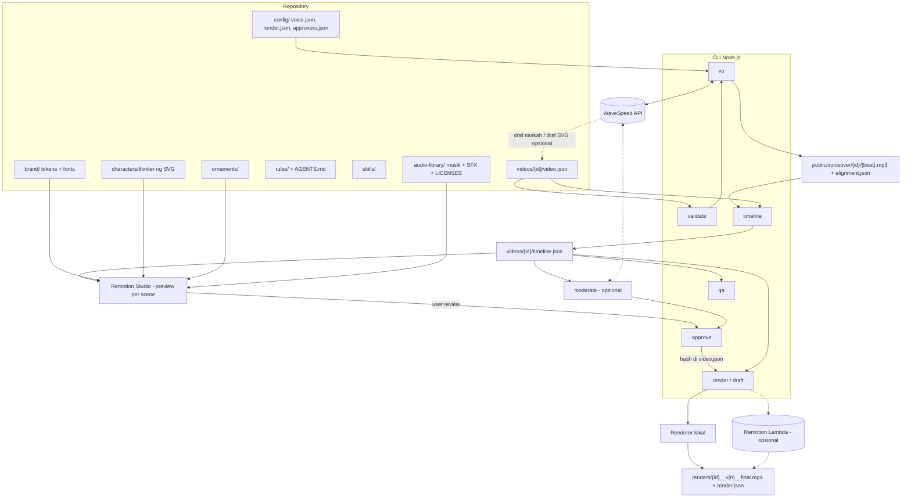
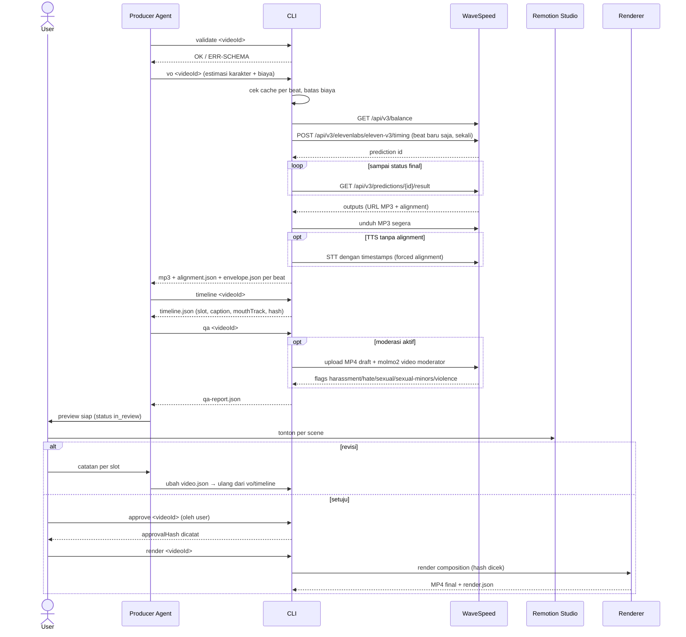
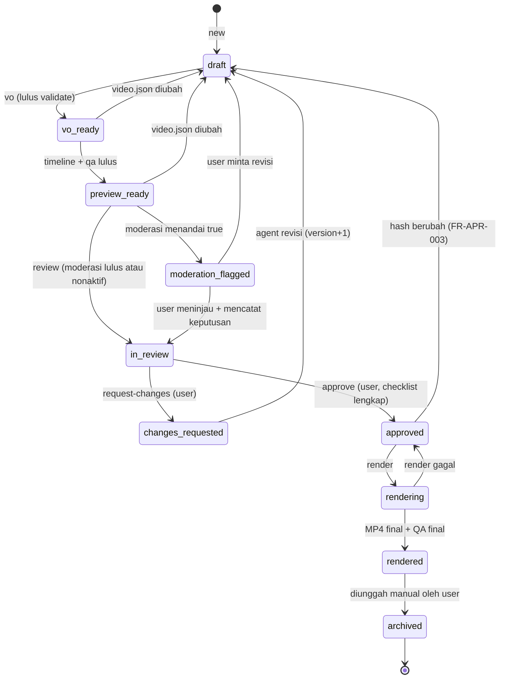

# TRD — Bintangku Video Studio — v1.1 draft

> Draf v1.1. Nama project disetujui (PRD DEC-21). Belum ditulis ke Coda. Penanda **[v1.1]** = berubah dari v1.0 (rincian di `CHANGELOG.md`). Dokumen ini spesifikasi teknis (HOW), bukan kode. Contoh JSON di bawah adalah kontrak data, sesuai aturan framework (JSON/YAML untuk kontrak mesin).

## 01. Document Control

| Field | Isi |
|---|---|
| Dokumen | Technical Requirements Document (TRD) |
| Produk | Pipeline produksi video 2D chibi Reels bintangku.app |
| Versi | 1.1 draft |
| Status | Draf untuk review user |
| Lokasi | `/workspace/product-architect/bintangku-video-studio/v1.1/TRD.md` |
| Acuan | `PRD.md` v1.1 draft (folder yang sama) |
| Tanggal | 24 November 2026 (WIB) |
| Pemilik | BrainBox Digital |
| Penulis | Product Architect |
| Sumber teknis | README `remotion-dev/template-prompt-to-video`, `template-three`, `template-audiogram`; skill voiceover resmi Remotion (permalink); docs Remotion (`@remotion/three`, captions, calculateMetadata, lisensi, Lambda); [v1.1] halaman model & docs WaveSpeed (PRD Lampiran B.2); README WhisperX. Semua tautan di bagian 14 dan Lampiran |
| Framework | AI-First Documentation Framework, TRD 25 bagian |

Konvensi ID: `SYS-NNN` (kebutuhan sistem), `TECH-<AREA>-NNN` (spesifikasi teknis), `ADR-NN` (keputusan arsitektur), `RSK-NN` melanjutkan nomor PRD, `OQ-NN` melanjutkan nomor PRD, `ASM-NN` melanjutkan nomor PRD, `ERR-<KODE>` (kode error). FR/AC/BR/DEC merujuk ke PRD.

Aturan: detail repo referensi hanya dari README-nya. Struktur internal template (isi `timeline.json` asli, signature fungsi) **belum dibaca** dan diverifikasi saat implementasi (TASK-VAL-001). Angka tanpa sumber = ASM; harga/kuota yang tidak diketahui = OQ.

## 02. Technical Overview

Sistem ini adalah project Remotion (React) dalam satu repository, ditambah CLI Node.js untuk langkah yang butuh API atau file sistem. Tidak ada server, database, atau UI custom.

Alur: `video.json` (ditulis manusia/agent) → validasi → [v1.1] VO per beat lewat TTS WaveSpeed (submit + poll, unduh segera, cache) → alignment (dari TTS atau forced alignment) + envelope audio → build `timeline.json` (grid 81 frame, caption per kata, track mulut) → QA otomatis → preview di Remotion Studio (+ MP4 draft opsional) → approval user (hash) → render MP4 final (lokal; Lambda opsional).

Prinsip:

- **Data-driven & deterministik.** Composition adalah fungsi murni dari `timeline.json` + frame. Tidak ada `Math.random()`; acak memakai `random(seed)` Remotion.
- **Biaya hanya saat input berubah.** Preview, QA lokal, dan render tidak memanggil API berbayar. [v1.1] Pengecualian opsional: moderasi video (FR-QA-003) per putaran review.
- **Satu provider AI, satu adapter.** [v1.1] Semua model lewat WaveSpeed melalui adapter `cli/providers/wavespeed` (ADR-13).
- **Grid dulu.** Durasi composition = jumlah slot × 81 frame.

## 03. Technology Stack

| Layer | Teknologi | Tanggung jawab | Batasan |
|---|---|---|---|
| Video framework | Remotion (Studio, renderer, CLI) | Composition, preview, render MP4 | Semua package `remotion`/`@remotion/*` versi sama persis (ADR-09). Lisensi: lihat bagian 22 |
| UI komponen | React + TypeScript | Komponen Thinker, ornamen, caption, layout | Komponen tidak boleh punya prop warna maskot |
| Grafik karakter | SVG inline (komponen React) | Rig Thinker & ornamen | Digambar ulang manual; auto-trace dilarang (DEC-13) |
| Efek 3D (opsional) | `@remotion/three` + React Three Fiber (`<ThreeCanvas>`) | Partikel bintang, latar kosmik, parallax | Renderer OpenGL `angle` (docs `@remotion/three`); `<Sequence layout="none">` di dalam canvas |
| Caption | `@remotion/captions` (format `Caption`, paging gaya TikTok) + komponen tampilan dari template-audiogram | Caption per kata | [v1.1] Data dari timestamps TTS; fallback forced alignment (ADR-04, ADR-16) |
| TTS [v1.1] | WaveSpeed: `elevenlabs/eleven-v3/timing` (utama, usulan DEC-25); alternatif `minimax/speech-2.8-hd` | VO per beat + alignment per karakter (Eleven v3 Timing) | `WAVESPEED_API_KEY`; async submit + poll; output dihapus WaveSpeed ≤ 7 hari → unduh segera |
| CLI | Node.js + TypeScript (pola dari template-prompt-to-video `cli/`) | validate, vo, timeline, qa, approve, render | Satu perintah per langkah; idempoten |
| Validasi skema | JSON Schema (draft 2020-12) | `video.json`, `timeline.json`, config | Validator dipilih saat implementasi |
| Naskah AI (opsional) [v1.1] | WaveSpeed `wavespeed-ai/ai-story-generator` | Draf cerita/naskah untuk diedit manusia | Mati default; output prosa, bukan JSON beat |
| Alignment fallback [v1.1] | WaveSpeed `elevenlabs/scribe-v2` (timestamps per kata) atau `wavespeed-ai/openai-whisper` (`enable_timestamps`); opsi lokal WhisperX (alignment model Indonesia `cahya/wav2vec2-large-xlsr-indonesian`) | Timestamps per kata bila TTS tidak memberi | Hanya jika TTS tanpa timestamps (ADR-16) |
| Envelope audio [v1.1] | Dekode MP3 di CLI (RMS per frame @30 fps) | Penggerak lip-sync (ADR-15) | Deterministik, tanpa API |
| Moderasi (opsional) [v1.1] | WaveSpeed `wavespeed-ai/molmo2/video-content-moderator` (+ `molmo2/text-content-moderator` untuk naskah) | Gerbang QA otomatis | Butuh upload MP4 draft ke WaveSpeed (OQ-24) |
| Draf SVG (opsional) [v1.1] | WaveSpeed `recraft-ai/recraft-20b-svg` | Draf ornamen/ikon/latar | Input hanya teks; hasil dibersihkan manual (ADR-18) |
| Image-to-video (opsional) [v1.1] | WaveSpeed, kandidat `bytedance/seedance-2.5-flash/image-to-video`, `kwaivgi/kling-v4.0/image-to-video` | 2–4 shot kunci | Audio model dimatikan; durasi minimum > 1 slot (OQ-11) |
| Render cloud (opsional) | Remotion Lambda (AWS) | Render paralel | Hanya jika diaktifkan user (OQ-14/15) |
| Versi & kolaborasi | Git + GitHub privat | Riwayat, PR, approval | Nama repo: slug → PRD OQ-26 |
| 3D fallback (Future) | Blender | Shot 3D khusus | Di luar MVP (DEC-05) |

## 04. System Architecture



Hubungan antarlayer:

- **Data layer** (`videos/`, `config/`, `public/voiceover/`) hanya ditulis oleh CLI atau manusia, tidak oleh composition.
- **CLI layer** satu-satunya yang memanggil API eksternal dan menulis file turunan.
- **Composition layer** (Remotion) hanya membaca `timeline.json` dan aset statis lewat `staticFile()`, lalu menggambar frame.
- **Render layer** memanggil composition yang sama dengan input yang sama (Studio, draft, final).

## 05. Architecture Decisions

| ID | Keputusan | Alasan | Alternatif ditolak | Status |
|---|---|---|---|---|
| ADR-01 | Basis kode dari `template-prompt-to-video`: konsep timeline 3 blok (Elements/Text/Audio), CLI `npm run gen`, VO + timestamps. Generate gambar AI dihapus, diganti referensi komponen SVG. [v1.1] Pemanggilan OpenAI/ElevenLabs di CLI template diganti adapter WaveSpeed (ADR-13) | Paling dekat dengan alur user; sudah menyinkronkan text & audio | Mulai dari blank Remotion (lebih lama) | Usulan (DEC-07) |
| ADR-02 | Thinker = komponen React dari bagian SVG terpisah dengan props enum; warna dari token terkunci | Konsistensi 100%, gerak murah, reuse | PNG per pose (tidak bisa lip-sync); AI per shot (drift) | Dikunci user (DEC-06) + detail usulan (DEC-12) |
| ADR-03 | Three.js hanya sebagai satu jenis element `fx3d` (partikel bintang, latar kosmik, parallax), opsional per slot, dengan fallback SVG | Render 3D lebih berat; karakter 2D lebih rapi di SVG | Seluruh scene di Three.js | Usulan (DEC-08) |
| ADR-04 | [v1.1] Caption per kata dari alignment karakter TTS (Eleven v3 Timing via WaveSpeed), dikonversi CLI ke array `Caption` (`@remotion/captions`). Jika TTS tidak memberi alignment → ADR-16 | Tanpa biaya/latensi transkripsi; teks pasti sama dengan naskah | Whisper sebagai jalur utama; `@remotion/elevenlabs` (hanya mengonversi output Speech to Text ElevenLabs) | Usulan (DEC-09, DEC-27) |
| ADR-05 | Grid tetap 81 frame per slot. VO dibuat per **beat** (1..n slot). `slotCount(beat) = ceil((padStart + durasiVO + padEnd) / 81 frame)`. Composition = Σ slot × 81 | Menjaga aturan user 2,7 detik sekaligus VO utuh. Skill resmi Remotion menyesuaikan durasi scene ke audio; di sini kebalikannya: audio ditempatkan di grid | VO per slot ≤ 2,7 detik (narasi terpotong-potong); durasi scene mengikuti VO (melanggar DEC-03) | Usulan (DEC-19, OQ-05) |
| ADR-06 | Transisi dibuat sebagai animasi enter/exit **di dalam** slot (pola "enter/exit transitions" di Elements template), bukan overlap `<TransitionSeries>` | Titik potong tetap di kelipatan 81; durasi tidak berkurang oleh overlap | `<TransitionSeries>` dengan kompensasi overlap (perhitungan grid jadi rumit) | Usulan |
| ADR-07 | State produksi & approval disimpan di file (`video.json`) di git, tanpa database | Satu sumber kebenaran, bisa diaudit lewat riwayat git | Database/Notion/Coda | Usulan |
| ADR-08 | 30 fps; 1 slot = 81 frame | 2,7 × 30 = 81 (bilangan bulat); di 25 fps = 67,5 frame (tidak bulat) | 25/24 fps | Usulan (DEC-20) |
| ADR-09 | Semua package Remotion versi sama, diupgrade dengan `npx remotion upgrade`; lockfile di-commit | Disarankan di README ketiga template | Versi campur | Usulan (DEC-10) |
| ADR-10 | Render final dijaga hash: `approvalHash` = SHA-256 dari timeline kanonik + hash file VO + versi rig + versi Remotion | Perubahan sekecil apa pun membatalkan approval (FR-APR-003) | Flag boolean `approved` saja | Usulan |
| ADR-11 | Render default lokal; Remotion Lambda opsional | Volume awal belum diketahui; tanpa setup AWS | Lambda sejak awal | Usulan (OQ-14/15) |
| ADR-12 | Media VO di `public/voiceover/<videoId>/<beatId>.mp3` (mengikuti konvensi skill voiceover resmi, dengan `compositionId` = `videoId`, `sceneId` = `beatId`) | Bisa diakses `staticFile()`; konsisten dengan skill resmi | Path bebas | Usulan |
| ADR-13 | [v1.1] Semua model AI lewat WaveSpeed dengan satu adapter `cli/providers/wavespeed`: submit `POST /api/v3/<model-id>` sekali (tanpa retry otomatis), poll `GET /api/v3/predictions/<id>/result` dengan backoff untuk 429/5xx, unduh `outputs` segera, simpan `predictionId`. Model per fungsi diatur di `config/models.json` | Keputusan user (DEC-24); satu key, satu tagihan; pola API seragam; aturan retry resmi WaveSpeed | OpenAI + ElevenLabs langsung (dua akun/key). ElevenLabs langsung hanya opsi cadangan terdokumentasi (OQ-25), tidak diimplementasi | Dikunci (provider) / Usulan (desain adapter) |
| ADR-14 | [v1.1] TTS utama `elevenlabs/eleven-v3/timing` via WaveSpeed; `minimax/speech-2.8-hd` sebagai alternatif bila uji A/B (TASK-VAL-006) lebih baik untuk bahasa Indonesia | Hanya model ini yang dinyatakan memberi timestamps; Eleven v3 mendukung `id`; voice_id tetap | Gemini/OmniVoice/Qwen3 TTS (Qwen3 tidak mencantumkan Indonesia; yang lain tanpa timestamps menurut halaman yang dibaca) | Usulan (DEC-25) |
| ADR-15 | [v1.1] Lip-sync 4 bentuk (`closed`, `half`, `open`, `round`) digerakkan envelope audio (RMS per frame) yang dihitung CLI saat `timeline`; timestamps (jika ada) hanya memilih `round` untuk vokal o/u dan menjaga `closed` di spasi/tanda baca panjang | Tidak bergantung provider TTS; deterministik; cocok gaya chibi | Viseme penuh dari timestamps (bergantung provider); `useAudioData()` saat render (lebih berat, hasil tidak masuk hash) | Usulan (DEC-26) |
| ADR-16 | [v1.1] Fallback alignment berjenjang: (1) timestamps TTS; (2) STT dengan timestamps per kata di WaveSpeed (`elevenlabs/scribe-v2` atau `wavespeed-ai/openai-whisper` + `enable_timestamps`), kata hasil STT dicocokkan ke kata naskah; (3) opsi lokal WhisperX forced alignment; (4) timing proporsional per beat + peringatan QA | Caption tetap jalan walau model TTS diganti | Hanya timing proporsional | Usulan (DEC-27) |
| ADR-17 | [v1.1] Moderasi video opsional sebagai gerbang sebelum `approve`: MP4 draft → upload WaveSpeed → Molmo2 Video Content Moderator → hasil di `qa-report.json`. Flag `true` memblokir `approve` sampai keputusan user tercatat. Hasil `false` semua tidak mengganti approval user | Audiens anak; biaya per video kecil menurut halaman model | Tanpa moderasi; moderasi manual saja | Usulan (DEC-29) |
| ADR-18 | [v1.1] Recraft 20B SVG hanya untuk draf di `ornaments/_drafts/`; wajib pembersihan manual (palet → token, path dirapikan, nama layer) dan lint brand sebelum masuk `ornaments/`. Untuk master Thinker hanya sebagai sketsa referensi; master rig tetap digambar ulang manual dengan pemisahan bagian (07.2) | Halaman model menyatakan output "true SVG", tetapi input hanya teks (tidak bisa diberi PNG Thinker sebagai referensi) dan warna hanya diarahkan lewat prompt | Pakai hasil Recraft langsung | Usulan (DEC-30) |
| ADR-19 | [v1.1] Batas biaya: `config/budget.json` (batas per video & per bulan, tarif per model yang dicatat dari halaman model + tanggal). CLI menghitung estimasi, cek saldo `GET /api/v3/balance`, dan berhenti sebelum submit jika melewati batas | Saldo prabayar; tarif bisa berubah | Tanpa batas | Usulan (FR-COST-001) |

## 06. Application Structure

Struktur repo usulan (root: slug repo, PRD OQ-26) [v1.1]:

```
<repo-root>/
├── AGENTS.md                      # urutan baca, larangan agent, workflow
├── README.md
├── .env.example                   # nama variabel saja, tanpa nilai
├── .gitignore                     # .env, renders/, node_modules/, cache sementara
├── package.json / package-lock.json   # semua remotion/@remotion/* versi sama
├── remotion.config.ts             # termasuk renderer OpenGL "angle" (bagian 07)
├── docs/                          # salinan PRD/TRD final + CHANGELOG
├── brand/
│   ├── tokens.json                # palet, font, outline, warna maskot terkunci
│   ├── fonts/                     # Fredoka, Nunito Sans dari brand kit + LICENSE
│   └── reference/thinker_master.png   # PNG asli user, tidak diubah
├── characters/
│   └── thinker/
│       ├── master.svg             # master gambar ulang (TASK-USR-001)
│       ├── parts/                 # bagian rig per layer (bagian 07)
│       ├── poses.json             # transform per bagian per pose
│       ├── expressions.json
│       └── CHANGELOG.md           # versi rig (semver) → masuk approvalHash
├── ornaments/                     # bintang, confetti, badge, frame, panel, planet (SVG)
│   └── _drafts/                   # [v1.1] draf Recraft + prompt + metadata, belum boleh dipakai
├── src/                           # project Remotion
│   ├── Root.tsx                   # daftar composition per videoId
│   ├── compositions/VideoFromTimeline.tsx
│   ├── components/                # Thinker, Ornament, Background, Caption, TextBlock, SafeArea, DraftWatermark, SlotMarker
│   ├── fx3d/                      # element Three.js opsional
│   ├── motion/                    # preset gerak & enter/exit
│   └── lib/                       # grid, lipsync, captions, tokens loader
├── cli/                           # validate, vo, timeline, qa, approve, render, draft
│   └── providers/wavespeed/       # [v1.1] adapter submit/poll/download (ADR-13)
├── schemas/                       # video.schema.json, timeline.schema.json, voice.schema.json
├── config/
│   ├── voice.json                 # [v1.1] model TTS, voice_id, stability (terkunci)
│   ├── models.json                # [v1.1] model WaveSpeed per fungsi (tts, align, story, moderate, svg, i2v)
│   ├── budget.json                # [v1.1] batas biaya + tarif tercatat
│   ├── render.json                # fps 30, resolusi, codec, preset draft
│   ├── safe-area.json             # nilai dari OQ-07
│   └── approvers.json             # identitas approver (user)
├── audio-library/
│   ├── music/  sfx/
│   └── LICENSES.md                # sumber & lisensi tiap file (wajib)
├── content-plan/
│   ├── pillars.md
│   └── backlog.md                 # ide → dijadwalkan → diproduksi
├── rules/
│   ├── brand.md                   # dari Brand Guidelines bintangku.app
│   ├── script.md                  # brand voice, panjang beat, teks ucapan
│   ├── safe-area.md
│   └── qa-checklist.md
├── skills/
│   ├── new-video/SKILL.md
│   ├── write-script/SKILL.md
│   ├── generate-vo/SKILL.md
│   ├── build-timeline/SKILL.md
│   ├── preview-and-qa/SKILL.md
│   ├── render/SKILL.md
│   └── references/remotion-voiceover.md   # ringkasan + permalink skill resmi (Lampiran)
├── videos/
│   └── <videoId>/
│       ├── video.json             # sumber kebenaran (satu file per video)
│       ├── timeline.json          # turunan, di-commit (untuk hash)
│       ├── qa-report.json
│       └── logs/
├── public/
│   └── voiceover/<videoId>/<beatId>.mp3 + <beatId>.alignment.json + <beatId>.envelope.json [v1.1]
└── renders/                       # di-gitignore; MP4 final/draft (penyimpanan → OQ-10)
```

`videoId` format: `YYYYMMDD-<slug>` (mis. `20261201-thinker-kenalan`), huruf kecil, `-` sebagai pemisah.

## 07. Frontend Architecture

"Frontend" di sini = composition Remotion.

### 07.1 Composition

- `Root.tsx` mendaftarkan satu composition `VideoFromTimeline` per `videoId` (atau satu composition dengan prop `videoId`). README template menyebut `Root.tsx` memakai nama project; di sini diganti prop `videoId`, mirip saran README untuk deploy remote (timeline sebagai prop).
- `calculateMetadata` membaca `timeline.json` dan mengembalikan `durationInFrames = totalSlots × 81`, `fps = 30`, ukuran dari `config/render.json` (TECH-TL-002). Durasi tidak diukur ulang dari audio di sini karena sudah dihitung CLI (ADR-05).
- Tiap slot dirender sebagai `<Sequence from={slotIndex×81} durationInFrames={81}>`. Tiap beat VO sebagai `<Sequence>` audio yang mulai di slot pertama beat + `padStart`.

### 07.2 Spesifikasi rig Thinker (TECH-CHR-001; untuk ilustrator, TASK-USR-001)

Ciri wajib (dari Lampiran D PRD BintangMatika): robot chibi astronot di atas roda rantai, antena bohlam, visor oval mengilap dengan mata biru, memegang tablet, warna putih/navy/biru persis master, outline 2–3 pt konsisten, kepala besar badan mungil.

| Layer/ID grup SVG | Isi | Pivot | Digerakkan oleh |
|---|---|---|---|
| `treads` | Roda rantai | tengah bawah | pose `zoom` (garis gerak), bounce |
| `body` | Badan | tengah bawah badan | bounce, pose |
| `arm-left`, `arm-right` | Lengan (terpisah dari badan) | bahu | pose wave/cheer/point |
| `tablet` | Tablet di tangan | genggaman | pose point/think |
| `head` | Kepala + helm | leher | tilt, pose |
| `visor` | Visor oval + kilap | tengah visor | statis (ikut head) |
| `eye-left`, `eye-right` | Mata biru | tengah mata | arah lihat |
| `eyelids` | Kelopak untuk kedip | atas mata | blink |
| `mouth-*` | [v1.1] Varian `closed`, `half`, `open`, `round` (bicara) + `smile` (ekspresi diam) | tengah mulut | lip-sync, expression |
| `brow-*` (jika ada di master) | Ekspresi | — | expression |
| `antenna`, `bulb`, `bulb-glow` | Antena + bohlam + cahaya | pangkal antena | bulb on/dim/off, goyang |

Aturan file:

- Setiap fill/stroke memakai **nama token** (mis. `mascot.navy`), bukan hex lepas. Nilai hex warna maskot (putih, navy, biru) diambil dari PNG master dan dikunci di `brand/tokens.json` (TASK-VAL-002; navy brand `#0d1b4b`, biru/putih maskot belum disampling).
- Stroke outline diskalakan relatif terhadap tinggi karakter supaya setara 2–3 pt pada ukuran referensi (ASM-11: ukuran referensi = tinggi Thinker di master).
- Tidak ada efek raster; kilap visor berupa bentuk vektor.

### 07.3 API komponen `Thinker`

| Prop | Tipe | Default | Keterangan |
|---|---|---|---|
| `pose` | `"idle" \| "wave" \| "think" \| "cheer" \| "point" \| "calm" \| "zoom"` | `"idle"` | 6 pose dari Lampiran D + `idle` |
| `expression` | `"neutral" \| "happy" \| "excited" \| "thinking" \| "surprised" \| "calm"` | `"happy"` | Mengatur mata/alis/mulut dasar |
| `mouth` | `"auto" \| "closed" \| "half" \| "open" \| "round" \| "smile"` [v1.1] | `"auto"` | `auto` = ikut `mouthTrack` |
| `mouthTrack` | array `{frame, shape}` | dari timeline | Dihasilkan CLI (TECH-CHR-002) |
| `blink` | `"auto" \| "off" \| "closed"` | `"auto"` | `auto` = jadwal deterministik dari `seed` |
| `bulb` | `"off" \| "dim" \| "on"` | sesuai pose | think → on, calm → dim |
| `x`, `y` | angka 0–1 (relatif frame) | 0,5 / 0,62 | Posisi titik pivot bawah |
| `scale` | angka > 0 | 1 | Skala seragam saja (tidak ada skala X/Y terpisah, BR-008) |
| `facing` | `"left" \| "right"` | `"right"` | Mirror horizontal |
| `motion` | nama preset (`bounce`, `float`, `shake-soft`, `none`) | `"float"` | Dari `src/motion/` |
| `enter`, `exit` | nama preset (`pop`, `slide-left`, `fade`, `blur`, `none`) | `"pop"` / `"none"` | Animasi di dalam slot (ADR-06) |
| `seed` | string | `videoId+slotIndex` | Untuk `random(seed)` |

Sengaja **tidak ada** prop warna, `scaleX/scaleY`, atau `style` bebas.

### 07.4 Komponen lain

| Komponen | Props utama | Catatan |
|---|---|---|
| `Ornament` | `type` (`star`, `confetti`, `badge`, `frame`, `panel`, `planet`), `color` (hanya nama token), `x`, `y`, `scale`, `motion`, `enter` | Motif bintang = star yellow/golden glow |
| `Background` | `type` (`cosmic-flat`, `gradient`, `fx3d-stars`, `fx3d-parallax`), `palette` (nama token) | `fx3d-*` → `<ThreeCanvas>`, fallback `cosmic-flat` (EC-007) |
| `TextBlock` | `role` (`title` → Fredoka, `body`/`number`), `text`, `color` (token), `position` (zona safe area) | Validasi kontras terhadap latar (NFR-BRAND-001) |
| `Caption` | `captions` (array `Caption`), `style` preset | Paging via `createTikTokStyleCaptions()`; tampilan diadaptasi dari template-audiogram |
| `SafeAreaOverlay` | `visible` | Hanya di Studio/draft |
| `DraftWatermark` | `label` | Hanya di render draft |
| `SlotMarker` | `slotIndex`, `beatId` | Hanya di Studio/draft |

### 07.5 Three.js

- Pakai `<ThreeCanvas>` agar `useCurrentFrame()` bisa dipakai di dalam canvas (animasi tidak di `useFrame()`).
- `<Sequence>` di dalam canvas wajib `layout="none"`.
- Renderer OpenGL `angle` diset di config (docs `@remotion/three`: Three.js tidak merender dengan renderer OpenGL default).
- Sumber: https://www.remotion.dev/docs/three

## 08. Backend Architecture

Tidak ada server. "Backend" = CLI di `cli/`, dijalankan manual atau oleh agent lewat skill.



`npm run gen -- <videoId>` (nama dari template) = `validate` → `vo` → `timeline` → `qa` berurutan.

### 08.1 Algoritme grid (TECH-TL-001)

1. Untuk tiap beat: `voFrames = ceil(durasiVO × 30)`; `need = padStartFrames + voFrames + padEndFrames`; `slots = max(beat.minSlots, ceil(need / 81))`.
2. Jika `beat.slots` diisi manual dan `< slots` → perpanjang otomatis + peringatan (BR-007, EC-001).
3. `totalSlots = Σ slots`. Jika `< 11` → `ERR-GRID-MIN`; jika `> 22` → `ERR-GRID-MAX` (BR-004, DEC-22: 30 detik = 11 slot, 60 detik = 22 slot) [v1.1].
4. Slot-slot dalam satu beat diisi visual dari `beat.shots[]` berurutan; jika jumlah shot < slots, shot terakhir diperpanjang dengan preset gerak berbeda (peringatan QA).
5. Default `padStartFrames` dan `padEndFrames` = 6 frame (0,2 detik) — **ASM-12**, divalidasi saat preview.
6. [v1.1] Durasi VO diambil dari durasi file MP3 yang diunduh (diukur CLI); alignment hanya dipakai untuk caption/penghalus mulut.

### 08.2 Lip-sync (TECH-CHR-002)

[v1.1] Ditulis ulang sesuai DEC-26 / ADR-15.

1. **Envelope (wajib, tanpa provider):** CLI mendekode MP3 beat, menghitung RMS per frame @30 fps, lalu menormalkan per beat (0–1). Disimpan di `<beatId>.envelope.json`.
2. **Ambang → bentuk dasar:** `e < T1` → `closed`; `T1 ≤ e < T2` → `half`; `e ≥ T2` → `open`. Nilai `T1`, `T2` = **ASM-15** (ditetapkan saat uji R2, disimpan di `config/lipsync.json`).
3. **Penghalus dari timestamps (opsional):** jika alignment ada dan frame berada di vokal `o`/`u`, bentuk `open`/`half` diganti `round`; frame di spasi/tanda baca dengan envelope rendah dipaksa `closed`.
4. **Hening:** envelope di bawah `T1` selama ≥ 2 frame → `closed` (mulut menutup saat jeda).
5. **Stabilisasi:** bentuk ditahan minimal 2 frame (ASM-13).
6. Output: `mouthTrack` per beat dalam frame absolut composition; masuk hash timeline.

### 08.3 Caption (TECH-CAP-001)

- [v1.1] Sumber timing (ADR-16): alignment TTS → jika tidak ada, STT dengan timestamps per kata (WaveSpeed) → opsi lokal WhisperX → timing proporsional.
- Dari alignment karakter: kata = urutan karakter non-spasi. `startMs` = start karakter pertama, `endMs` = end karakter terakhir, `timestampMs` = tengah kata, `confidence` = null. Offset = awal beat + `padStart`.
- Dari STT: kata hasil transkripsi dicocokkan ke kata naskah (urutan + kemiripan teks); teks yang tampil selalu kata naskah. Kata naskah tanpa pasangan mendapat timing interpolasi dari tetangga. Format detail output Scribe/Whisper di WaveSpeed belum terdokumentasi di halaman model → TASK-VAL-006.
- Catatan WhisperX (README): kata yang berisi karakter di luar kamus model alignment (mis. angka "2014") tidak mendapat timing → pakai `beat.speech` yang angkanya ditulis dengan huruf.
- Teks caption diambil dari `beat.text` (teks tampil), sedangkan TTS memakai `beat.speech` jika ada (teks ucapan, EC-008). Jika `speech ≠ text`, caption dipetakan per kata berurutan; jika jumlah kata beda → `WARN-CAPTION-MAP` dan caption pakai timing proporsional per beat (EC-009).
- Paging/pengelompokan kata via `createTikTokStyleCaptions()` dari `@remotion/captions`.

## 09. Database Architecture

Tidak ada database (ADR-07). Penyimpanan:

| Data | Lokasi | Di git? |
|---|---|---|
| `video.json`, `timeline.json`, `qa-report.json` | `videos/<videoId>/` | Ya |
| VO MP3 + alignment | `public/voiceover/<videoId>/` | Ya, kecuali OQ-10 memutuskan LFS/Drive |
| Cache index VO | `public/voiceover/<videoId>/manifest.json` | Ya |
| MP4 draft/final | `renders/` | Tidak (penyimpanan → OQ-10) |
| Secret | `.env` lokal / secret store CI | Tidak pernah |

## 10. Data Model

### 10.1 `video.json` (sumber kebenaran, satu per video)

| Field | Tipe | Wajib | Validasi |
|---|---|---|---|
| `schemaVersion` | string semver | Ya | `1.x.x` |
| `id` | string | Ya | `^\d{8}-[a-z0-9-]+$`, sama dengan nama folder |
| `version` | integer ≥ 1 | Ya | Naik tiap putaran revisi setelah `changes_requested` |
| `title` | string | Ya | — |
| `pillar` | string | Tidak | Dari `content-plan/pillars.md` (OQ-03) |
| `language` | string | Ya | default `id` (ASM-03) |
| `targetDuration` | `30 \| 60` | Ya | Info; batas keras = slot 11–22 |
| `voiceOverride` | object | Tidak | Hanya jika disetujui user (BR-005) |
| `music` | `{trackId, volume, duckUnderVO}` | Tidak | `trackId` wajib ada di `audio-library/LICENSES.md` |
| `beats[]` | array | Ya | ≥ 1 |
| `beats[].id` | string | Ya | `^b\d{2}$`, unik |
| `beats[].text` | string | Ya | Teks tampil/caption |
| `beats[].speech` | string | Tidak | Teks ucapan untuk TTS (angka/singkatan) |
| `beats[].minSlots` | integer ≥ 1 | Tidak | default 1 |
| `beats[].shots[]` | array | Ya | ≥ 1 |
| `shots[].character` | objek props Thinker (07.3) atau null | Tidak | enum tervalidasi |
| `shots[].background` | objek `Background` | Ya | — |
| `shots[].ornaments[]` | array objek `Ornament` | Tidak | — |
| `shots[].onScreenText` | objek `TextBlock` | Tidak | — |
| `shots[].sfx[]` | `{sfxId, atFrame}` | Tidak | `atFrame` 0–80 (dalam slot) |
| `shots[].aiClip` | `{file, model, licenseRef}` | Tidak | Hanya jika FR-AIV-001 aktif (OQ-11) |
| `captions.enabled` | boolean | Tidak | default `true` |
| `status` | enum (bagian 15) | Ya | Transisi divalidasi |
| `reviewNotes[]` | `{slot, note, at, by}` | Tidak | — |
| `approval` | `{by, at, approvalHash, checklist}` | Tidak | Diisi hanya oleh `approve` |
| `history[]` | `{from, to, at, by}` | Ya | Ditambah otomatis |

Contoh ringkas:

```json
{
  "schemaVersion": "1.0.0",
  "id": "20261201-thinker-kenalan",
  "version": 1,
  "title": "Kenalan sama Thinker",
  "language": "id",
  "targetDuration": 30,
  "music": { "trackId": "calm-cosmic-01", "volume": 0.3, "duckUnderVO": true },
  "beats": [
    {
      "id": "b01",
      "text": "Halo! Aku Thinker.",
      "minSlots": 1,
      "shots": [
        {
          "character": { "pose": "wave", "expression": "happy", "x": 0.5, "y": 0.62 },
          "background": { "type": "cosmic-flat", "palette": "navy" },
          "ornaments": [{ "type": "star", "color": "brand.starYellow", "x": 0.2, "y": 0.2 }]
        }
      ]
    }
  ],
  "captions": { "enabled": true },
  "status": "draft",
  "history": []
}
```

### 10.2 `timeline.json` (turunan, jangan diedit manual)

Mengikuti konsep 3 blok template-prompt-to-video (Elements, Text, Audio), ditambah blok grid. Bentuk persis struktur asli template belum dibaca (TASK-VAL-001); skema ini milik project sendiri.

| Field | Isi |
|---|---|
| `meta` | `{videoId, version, fps: 30, slotFrames: 81, totalSlots, durationInFrames, width, height, generatedAt, generator, rigVersion, remotionVersion}` |
| `slots[]` | `{index, beatId, from, durationInFrames: 81}` |
| `elements[]` | `{slotIndex, kind: "character" \| "ornament" \| "background" \| "fx3d" \| "aiClip", props, enter, exit, motion}` |
| `text[]` | `{kind: "caption" \| "onScreen", from, to, ...}`; caption berisi array `Caption` (`text`, `startMs`, `endMs`, `timestampMs`, `confidence`) |
| `audio[]` | `{kind: "vo" \| "music" \| "sfx", src, from, durationInFrames, volume}` |
| `mouthTracks[]` | `{beatId, frames: [{frame, shape}]}` |
| `approvalHash` | SHA-256 (ADR-10), dihitung dari isi kanonik di atas (tanpa `generatedAt`) + hash MP3 + `rigVersion` + `remotionVersion` |

### 10.3 `config/voice.json`

| Field | Isi |
|---|---|
| `provider` | `wavespeed` [v1.1] |
| `model` | `elevenlabs/eleven-v3/timing` (usulan DEC-25) atau `minimax/speech-2.8-hd` [v1.1] |
| `voice_id` | Dipilih user (TASK-USR-003); Eleven v3 Timing: nama preset atau ElevenLabs voice ID; MiniMax: voice sistem atau hasil `minimax/voice-clone` |
| `settings` | Eleven v3 Timing: `stability` (0–1). MiniMax: `language_boost: "Indonesian"`, `emotion`, `speed`, `pitch`, `format`, `pronunciation_dict`. Nilai ditentukan saat uji suara |
| `returns_alignment` | `true` untuk Eleven v3 Timing; `false` → aktifkan ADR-16 |
| `locked` | `true`; perubahan butuh persetujuan user |

### 10.4 `public/voiceover/<videoId>/manifest.json`

[v1.1] Per beat: `{beatId, cacheKey, file, fileSha256, alignmentFile, alignmentSource (tts\|stt\|local\|proportional), envelopeFile, durationSec, characters, model, predictionId, estimatedCostUsd, createdAt}`. `cacheKey` = SHA-256(`speech ?? text` + `provider` + `model` + `voice_id` + `settings`).

### 10.5 `config/models.json` & `config/budget.json` [v1.1]

| File | Field |
|---|---|
| `models.json` | `tts`, `align` (urutan fallback), `story`, `moderateVideo`, `moderateText`, `svg`, `i2v` → model id WaveSpeed; `enabled` per fungsi opsional |
| `budget.json` | `perVideoUsd`, `perMonthUsd` (nilai dari user, OQ-08); `rates[]` = `{model, unit, priceUsd, sourceUrl, checkedAt}` dari halaman model; `minBalanceUsd` |

## 11. API Specification

Tidak ada HTTP API internal; OpenAPI tidak relevan. Kontrak berikut adalah kontrak CLI (dijalankan via `npm run <cmd> -- <videoId>`), plus satu API eksternal.

| Perintah | Input | Sukses | Error |
|---|---|---|---|
| `new` | `--slug`, `--date` | Folder `videos/<id>/` + `video.json` dari template, status `draft` | `ERR-ID-EXISTS` |
| `validate` | `videoId` | Exit 0, ringkasan slot estimasi | `ERR-SCHEMA` (daftar field), `ERR-ASSET-MISSING`, `ERR-LICENSE-MISSING` |
| `vo` | `videoId`, `--dry-run` | [v1.1] Estimasi karakter & biaya; MP3 + alignment + envelope per beat baru; status `vo_ready` | `ERR-ENV-MISSING`, `ERR-BUDGET`, `ERR-WS-SUBMIT`, `ERR-WS-FAILED`, `ERR-WS-POLL`, `ERR-WS-EXPIRED` |
| `timeline` | `videoId` | `timeline.json` + `approvalHash` | `ERR-GRID-MIN`, `ERR-GRID-MAX`, `ERR-VO-MISSING` |
| `qa` | `videoId`, `--moderate` | `qa-report.json` (+ hasil moderasi jika aktif); status `preview_ready` jika lulus [v1.1] | `ERR-QA-FAIL`, `ERR-MODERATION-FLAG` |
| `review` | `videoId` | Status `in_review` | `ERR-STATE` |
| `draft` | `videoId` | MP4 draft resolusi rendah + watermark di `renders/` | `ERR-RENDER` |
| `request-changes` | `videoId`, `--slot`, `--note` | Catatan disimpan, status `changes_requested` | `ERR-STATE` |
| `approve` | `videoId` | `approval` diisi, status `approved` | `ERR-NOT-APPROVER`, `ERR-CHECKLIST`, `ERR-STATE` |
| `render` | `videoId`, `--target local\|lambda` | MP4 final + `render.json`, status `rendered` | `ERR-NOT-APPROVED`, `ERR-HASH-MISMATCH`, `ERR-RENDER` |
| `gen` | `videoId` | `validate`→`vo`→`timeline`→`qa` | Error langkah pertama yang gagal |
| `story` [v1.1] | `videoId`, `--prompt` | Draf teks di `videos/<id>/drafts/story-<ts>.md` (tidak mengubah `video.json`) | `ERR-BUDGET`, `ERR-WS-*` |
| `svg-draft` [v1.1] | `--prompt`, `--style`, `--aspect` | SVG + metadata di `ornaments/_drafts/` | `ERR-BUDGET`, `ERR-WS-*` |
| `balance` [v1.1] | — | Saldo USD WaveSpeed | `ERR-ENV-MISSING`, `ERR-WS-POLL` |

[v1.1] API eksternal WaveSpeed (dari docs, dibaca 24 Nov 2026):

- **Auth:** header `Authorization: Bearer <WAVESPEED_API_KEY>` (https://wavespeed.ai/docs/api-authentication).
- **Submit:** `POST https://api.wavespeed.ai/api/v3/<model-id>` dengan body JSON input model → `data.id` (prediction id). Jangan di-retry otomatis; jika putus tanpa id, cek daftar prediksi dulu (https://wavespeed.ai/docs/errors-retries-timeouts).
- **Result:** `GET https://api.wavespeed.ai/api/v3/predictions/<id>/result` → `data.status` (`completed`; terminal gagal: `failed`, `cancelled`, `timeout`, `deleted`), `data.outputs` (URL, teks, atau objek terstruktur tergantung model), `data.error`.
- **Eleven v3 Timing:** input `text` (1–5.000 karakter), `voice_id`, `stability`; output URL MP3 + objek `alignment` (`characters`, `character_start_times_seconds`, `character_end_times_seconds`) (https://wavespeed.ai/docs/docs-api/elevenlabs/eleven-v3/timing). Posisi persis objek alignment di dalam `outputs` diverifikasi saat TASK-VAL-006.
- **Upload (untuk moderasi/STT):** Upload Files API; file disimpan 7 hari, maks. 200 MB (https://wavespeed.ai/docs/docs-api/upload-file).
- **Saldo:** `GET https://api.wavespeed.ai/api/v3/balance` (https://wavespeed.ai/docs/check-balance).
- Opsi global `enable_sync_mode` dan `enable_base64_output` ada di docs; tidak dipakai (pola submit + poll dipertahankan).

## 12. Authentication

- Tidak ada login pengguna.
- [v1.1] WaveSpeed: `WAVESPEED_API_KEY` dari environment (`.env` lokal, tidak di-commit). CLI berhenti sebelum memanggil API jika tidak ada (EC-004). OpenAI dan ElevenLabs key tidak dipakai.
- AWS (opsional, Lambda): kredensial sesuai docs Remotion Lambda saat setup; tidak disimpan di repo.
- GitHub: akses repo privat milik BrainBox Digital.

## 13. Authorization

| Aksi | Siapa | Mekanisme |
|---|---|---|
| Ubah `video.json` (status draft) | Agent, user | Git commit biasa |
| `approve` | Hanya user | (1) identitas git committer harus ada di `config/approvers.json`; (2) perintah meminta konfirmasi interaktif yang mengetik ulang `videoId`; (3) disarankan: branch `main` diproteksi dan approval masuk lewat PR yang di-approve user di GitHub |
| `render` final | User, atau agent atas instruksi user | Hanya jika `approval.approvalHash` = hash timeline saat ini |
| Ubah `brand/tokens.json` warna maskot, `config/voice.json` | Hanya user | CODEOWNERS + review PR |

Keterbatasan: guard lokal bersifat prosedural, bukan kriptografis; agent dengan akses shell secara teknis bisa memalsukan identitas git. Karena itu proteksi branch di GitHub direkomendasikan (OQ-18) dan `AGENTS.md` melarang agent menjalankan `approve` (BR-006).

## 14. Third-Party Integrations

| Integrasi | Dipakai untuk | Sumber | Catatan |
|---|---|---|---|
| template-prompt-to-video | Basis CLI + konsep timeline | https://github.com/remotion-dev/template-prompt-to-video | Mirror dari monorepo Remotion (`packages/template-ai-video`); lisensi Remotion berlaku |
| template-three | Setup `@remotion/three` + R3F | https://github.com/remotion-dev/template-three | Konten template MIT |
| template-audiogram | Komponen tampilan caption per kata | https://github.com/remotion-dev/template-audiogram | Bagian Whisper & waveform tidak dipakai |
| Skill voiceover resmi Remotion | Referensi skill agent | https://github.com/remotion-dev/skills/blob/473352613039e718e46655a26df224851e84c4aa/skills/remotion-best-practices/remotion-markup/voiceover.md | Dihapus dari `main` di commit `6f55706d` (18 Nov 2026, 17:18 WIB); panduan penggantinya di `audio.md` |
| `@remotion/captions` | Format `Caption`, paging | https://www.remotion.dev/docs/captions/caption , https://www.remotion.dev/docs/captions/create-tiktok-style-captions | — |
| `@remotion/three` | Efek 3D | https://www.remotion.dev/docs/three | Renderer `angle` |
| `calculateMetadata` | Durasi composition | https://www.remotion.dev/docs/calculate-metadata | Dipakai dengan durasi dari grid |
| WaveSpeed API [v1.1] | TTS, alignment fallback, story, moderasi, Recraft SVG, image-to-video | https://wavespeed.ai/docs , model per fungsi di PRD Lampiran B.2 | Saldo prabayar; batas biaya ADR-19 |
| `@remotion/elevenlabs` | Alternatif konversi caption dari output STT ElevenLabs (Scribe) | https://www.remotion.dev/docs/elevenlabs | [v1.1] Kompatibilitas dengan output Scribe via WaveSpeed belum diverifikasi |
| WhisperX (opsional lokal) [v1.1] | Forced alignment lokal | https://github.com/m-bain/whisperX | BSD-2-Clause; model alignment Indonesia di `DEFAULT_ALIGN_MODELS_HF`; butuh Python + PyTorch |
| `useAudioData` / `visualizeAudio` | Referensi analisis audio Remotion | https://www.remotion.dev/docs/use-audio-data , https://www.remotion.dev/docs/visualize-audio | [v1.1] Tidak dipakai saat render; envelope dihitung CLI (ADR-15) |
| ElevenLabs API langsung | — | https://elevenlabs.io/docs/api-reference/text-to-speech/convert-with-timestamps | [v1.1] Tidak dipakai; cadangan terdokumentasi saja (PRD OQ-25) |
| Remotion Lambda (opsional) | Render cloud | https://www.remotion.dev/docs/lambda , contoh biaya https://www.remotion.dev/docs/lambda/cost-example | Biaya AWS → OQ-14 |


### Penyesuaian skill voiceover resmi ke grid 2,7 detik

| Skill resmi | Di project ini |
|---|---|
| TTS per **scene** ke `public/voiceover/<compositionId>/<sceneId>.mp3` | TTS per **beat** ke `public/voiceover/<videoId>/<beatId>.mp3` (ADR-12) |
| Panggilan langsung ElevenLabs `/v1/text-to-speech/{voiceId}` | [v1.1] WaveSpeed `elevenlabs/eleven-v3/timing` (submit + poll) untuk audio + alignment |
| `calculateMetadata` mengukur durasi audio → durasi scene = durasi audio | CLI mengukur durasi saat `timeline`; durasi beat = durasi VO dibulatkan **ke atas** ke kelipatan 81 frame; `calculateMetadata` hanya membaca `totalSlots × 81` (ADR-05) |
| Kompensasi overlap jika memakai `<TransitionSeries>` | Tidak perlu: transisi di dalam slot (ADR-06) |
| Voice settings di dalam script; `ELEVENLABS_API_KEY` | Dikunci di `config/voice.json` (BR-005); `WAVESPEED_API_KEY` [v1.1] |

## 15. State Management

### 15.1 State produksi video



Aturan transisi (TECH-APR-001):

- Setiap transisi ditambahkan ke `history[]` dengan waktu WIB dan pelaku.
- Setiap perintah mengecek hash timeline; jika `video.json` lebih baru dari `timeline.json` atau hash berbeda dari `approval.approvalHash`, status turun ke `draft` dan `approval` dikosongkan (disimpan di `history`).
- Render draft (`draft`) tidak mengubah status.

### 15.2 State di dalam composition

Tidak ada state runtime. Semua nilai (posisi, mulut, kedip, partikel) dihitung dari `useCurrentFrame()` + `timeline.json` + `random(seed)`.

## 16. Error Handling

| Kode | Penyebab | Perilaku | Retry |
|---|---|---|---|
| `ERR-SCHEMA` | `video.json` tidak valid | Berhenti; daftar path field + nilai valid | — |
| `ERR-ASSET-MISSING` | Pose/ornamen/track tidak ada | Berhenti | — |
| `ERR-LICENSE-MISSING` | Musik/SFX/font tanpa catatan lisensi | Berhenti (BR-010) | — |
| `ERR-ENV-MISSING` | API key tidak ada | Berhenti sebelum panggilan API | — |
| `ERR-WS-SUBMIT` [v1.1] | Submit WaveSpeed gagal/putus | Berhenti; jika tidak ada task id, minta cek daftar prediksi sebelum submit ulang (EC-014) | Tidak pernah otomatis |
| `ERR-WS-POLL` [v1.1] | 429/5xx/putus saat polling | Backoff (hormati `Retry-After`), lanjut polling | Maks. 3 error transien beruntun (ASM-14), lalu berhenti dengan task id |
| `ERR-WS-FAILED` [v1.1] | Status `failed`/`cancelled`/`timeout`/`deleted` | Simpan beat yang sudah sukses; berhenti dengan task id + `data.error` | Manual |
| `ERR-WS-EXPIRED` [v1.1] | URL output tidak bisa diunduh (≤ 7 hari terlewat) | Tandai beat untuk generate ulang (EC-016) | Manual |
| `ERR-BUDGET` [v1.1] | Estimasi > sisa batas atau saldo < `minBalanceUsd` | Berhenti sebelum submit (EC-017) | — |
| `ERR-MODERATION-FLAG` [v1.1] | Moderator memberi `true` | Status `moderation_flagged`; `approve` diblokir | — |
| `WARN-ALIGN-FALLBACK` [v1.1] | Alignment bukan dari TTS | Lanjut; sumber dicatat di manifest | — |
| `ERR-VO-MISSING` | Timeline dibangun tanpa VO lengkap | Berhenti | — |
| `ERR-GRID-MIN` / `ERR-GRID-MAX` | Slot < 11 atau > 22 | Berhenti; saran tambah/pendekkan beat | — |
| `WARN-SLOT-EXTENDED` | VO lebih panjang dari `minSlots` | Lanjut, slot ditambah | — |
| `WARN-CAPTION-MAP` | Kata ucapan ≠ kata tampil | Lanjut, timing proporsional | — |
| `WARN-FX3D-FALLBACK` | Efek 3D gagal | Lanjut dengan latar SVG | — |
| `ERR-QA-FAIL` | Cek otomatis gagal | Status tetap; laporan | — |
| `ERR-STATE` | Transisi status tidak sah | Berhenti | — |
| `ERR-NOT-APPROVER` / `ERR-CHECKLIST` | Bukan approver / checklist belum lengkap | Berhenti | — |
| `ERR-NOT-APPROVED` / `ERR-HASH-MISMATCH` | Render tanpa approval sah | Berhenti, tanpa render | — |
| `ERR-RENDER` | Renderer gagal | Status kembali ke `approved`; log disimpan | Manual |

Semua penulisan file bersifat atomik (tulis ke file sementara lalu rename) supaya tidak ada artefak setengah jadi.

## 17. Security Requirements

| ID | Requirement |
|---|---|
| TECH-SEC-001 | `.env` di `.gitignore`; `.env.example` hanya nama variabel |
| TECH-SEC-002 | Pre-commit + CI menjalankan secret scanner (mis. gitleaks; pilihan alat saat implementasi) terhadap staged files dan riwayat |
| TECH-SEC-003 | API key tidak pernah ditulis ke log, `video.json`, `timeline.json`, `render.json`, atau output CLI |
| TECH-SEC-004 | Repo GitHub privat; branch `main` diproteksi (OQ-18); CODEOWNERS untuk `brand/`, `config/`, `characters/` |
| TECH-SEC-005 | [v1.1] Jika key bocor: hapus key di halaman API Keys WaveSpeed, buat key baru, bersihkan riwayat git — langkah di `rules/security.md` |
| TECH-SEC-008 | [v1.1] File yang di-upload ke WaveSpeed (MP4 draft untuk moderasi, audio untuk STT) hanya draf resolusi rendah; disimpan WaveSpeed 7 hari (OQ-24) |
| TECH-SEC-009 | [v1.1] Pola key bergaya Bearer/WaveSpeed ditambahkan ke aturan secret scanner |
| TECH-SEC-006 | Tidak ada panggilan ke layanan lain (Instagram, Metricool, Drive, Telegram, n8n/VPS) dari pipeline (BR-012) |
| TECH-SEC-007 | Lisensi aset pihak ketiga dicatat (NFR-LIC-001) |

## 18. Performance Requirements

Belum ada angka target dari user; tidak ada angka yang dikarang.

| ID | Requirement |
|---|---|
| TECH-PERF-001 | Preview di Studio tidak memicu panggilan API atau render MP4 |
| TECH-PERF-002 | `vo` hanya memanggil API untuk beat yang `cacheKey`-nya baru |
| TECH-PERF-003 | `render.json` mencatat durasi render, mesin, versi Remotion, ukuran file → baseline untuk OQ-14 |
| TECH-PERF-004 | Komponen SVG tidak memakai filter raster berat (blur besar) di setiap frame kecuali preset `blur` enter/exit |
| TECH-PERF-005 | Efek `fx3d` dibatasi per slot (opsional); jumlah partikel dikonfigurasi di preset dan diukur dampaknya saat R4 |

## 19. Scalability

- Volume naik → render paralel via Remotion Lambda (ADR-11) tanpa mengubah composition; README template menyebut perlunya timeline sebagai prop dan aset sebagai URL untuk render remote — diterapkan jika Lambda dipilih.
- Format lain (Shorts, TikTok, 4:5) = composition tambahan yang membaca `timeline.json` yang sama dengan layout/safe area berbeda (Future).
- Karakter baru (Mascot Squad) = folder baru di `characters/` dengan API komponen yang sama.

## 20. Logging & Monitoring

| Log | Lokasi | Isi |
|---|---|---|
| Run log CLI | `videos/<id>/logs/<timestamp>-<cmd>.log` | Perintah, durasi, hasil, error (tanpa secret) |
| Pemakaian TTS | `public/voiceover/<id>/manifest.json` + ringkasan di log `vo` | Jumlah karakter terkirim per beat & total, beat yang dari cache |
| QA | `videos/<id>/qa-report.json` | Hasil tiap cek |
| Render | `renders/<id>__v<n>__final.render.json` (+ salinan ringkas di `videos/<id>/`) | Hash, durasi render, mesin, versi |
| Riwayat status | `video.json.history[]` | Transisi + pelaku + waktu WIB |

Tidak ada monitoring eksternal di MVP.

## 21. Testing Architecture

| ID | Jenis | Isi | AC |
|---|---|---|---|
| TECH-TEST-001 | Unit (CLI) | Algoritme grid (`ceil`, batas 11–22, perpanjangan slot) | AC-012, AC-013 |
| TECH-TEST-002 | Unit | Konversi alignment → `Caption[]` dan `mouthTrack` | AC-007, AC-014 |
| TECH-TEST-003 | Unit | `cacheKey` & cache hit (tanpa panggilan API; API di-mock) | AC-010, AC-011 |
| TECH-TEST-004 | Schema | Contoh `video.json` valid/tidak valid | AC-008 |
| TECH-TEST-005 | Lint brand | Scan SVG/komponen: hanya warna token; tidak ada prop warna di `Thinker`; hanya 2 font | AC-003, AC-004 |
| TECH-TEST-006 | State machine | Semua transisi sah/tidak sah; hash berubah → kembali `draft` | AC-018, AC-019, AC-020 |
| TECH-TEST-007 | Visual snapshot | `npx remotion still` untuk frame tertentu tiap pose & tiap preset; dibandingkan dengan baseline | AC-005, AC-006 |
| TECH-TEST-008 | Render regression | Render video contoh 30 detik dari commit yang sama dua kali → hash timeline sama, frame sampel identik | NFR-REPRO-001 |
| TECH-TEST-009 | Safe area | Bounding box teks/caption vs `config/safe-area.json` | AC-015 |
| TECH-TEST-010 | Secret scan | CI gagal jika ada pola API key | AC-002 |
| TECH-TEST-011 | Dependensi | Semua `remotion`/`@remotion/*` versi sama | EC-012 |
| TECH-TEST-012 [v1.1] | Unit | Envelope → `mouthTrack` (ambang, hening → `closed`, tahan 2 frame, `round` dari timestamps) | AC-007, AC-033 |
| TECH-TEST-013 [v1.1] | Unit | Adapter WaveSpeed: submit tidak di-retry, polling backoff, unduh segera, status terminal | AC-010, EC-014 |
| TECH-TEST-014 [v1.1] | Unit | Forced alignment: pencocokan kata STT ↔ naskah, interpolasi kata tanpa pasangan | AC-032 |
| TECH-TEST-015 [v1.1] | Unit | Batas biaya & cek saldo memblokir submit | AC-031 |
| TECH-TEST-016 [v1.1] | Integrasi (mock) | Flag moderasi memblokir `approve` | AC-029 |

[v1.1] Tes tidak boleh memanggil WaveSpeed sungguhan; adapter di-mock dengan fixture (respons submit, polling, outputs, error 429/5xx, status gagal).

## 22. Deployment Architecture

Tidak ada deploy aplikasi. "Deployment" = lingkungan render.

| Opsi | Cocok untuk | Kebutuhan | Biaya |
|---|---|---|---|
| Lokal (laptop user atau box) — default | Volume awal, review manual | Node.js, dependensi Remotion (Chrome headless diunduh Remotion), dukungan renderer `angle` untuk `fx3d` | Tidak ada biaya infrastruktur tambahan; waktu render tergantung mesin (diukur, TECH-PERF-003) |
| Remotion Lambda — opsional | Volume tinggi, render paralel | Akun AWS, setup sesuai docs Lambda, aset diakses via URL | Biaya AWS per pemakaian; lihat contoh biaya resmi (https://www.remotion.dev/docs/lambda/cost-example). Estimasi untuk volume BrainBox belum ada → OQ-14 |
| CI (mis. GitHub Actions) — kemungkinan | Render otomatis setelah approval | Runner dengan Chrome headless | Belum dinilai → OQ-15 |

### Lisensi Remotion (berlaku untuk semua opsi)

Sumber: https://github.com/remotion-dev/remotion/blob/main/LICENSE.md dan https://www.remotion.dev/license (dibaca 24 Nov 2026, WIB).

- **Free License**: individu, organisasi for-profit dengan **maksimal 3 karyawan**, organisasi nirlaba, atau tahap evaluasi non-komersial. Boleh dipakai komersial untuk membuat video.
- **Company License**: wajib untuk entitas yang tidak memenuhi syarat Free License.
- Di halaman lisensi per 24 Nov 2026 tertera, antara lain: "Remotion for Creators" USD 25/bulan per seat (produksi manual volume rendah, termasuk Remotion Studio dan AI agent) dan "Remotion for Automators" USD 0,01 per render dengan minimum USD 100/bulan (render otomatis/batch). Harga bisa berubah; cek ulang saat membeli.
- LICENSE.md menyebut lisensi akan sedikit berubah di Remotion 5.0 (RSK-14).
- [v1.1] BrainBox Digital punya 1 karyawan (PRD DEC-23) → **Free License berlaku**. Pantau RSK-03: jika karyawan > 3, wajib Company License (https://www.remotion.dev/license).

## 23. Environment Variables

| Variabel | Wajib | Dipakai oleh | Catatan |
|---|---|---|---|
| `WAVESPEED_API_KEY` [v1.1] | Ya (untuk `vo`, `story`, `svg-draft`, moderasi, alignment fallback, `balance`) | Adapter `cli/providers/wavespeed` | Hanya di `.env`; tidak pernah di-commit; nama variabel sesuai contoh resmi WaveSpeed |
| Kredensial AWS untuk Remotion Lambda | Tidak | `render --target lambda` | Nama variabel mengikuti docs Remotion Lambda saat setup |
| `VIDEO_STUDIO_LOG_LEVEL` | Tidak | CLI | `info` default |

Konfigurasi non-rahasia (voice ID, fps, resolusi, safe area) ada di `config/*.json`, bukan env.

## 24. Technical Constraints

| ID | Batasan |
|---|---|
| TECH-CON-001 | 30 fps, slot 81 frame, 11–22 slot per video (BR-003, BR-004) |
| TECH-CON-002 | Rasio 9:16; resolusi sesuai ASM-01 |
| TECH-CON-003 | Hanya warna dari token; warna maskot terkunci; hanya Fredoka & Nunito Sans |
| TECH-CON-004 | Composition deterministik (tanpa `Math.random()`, tanpa fetch runtime) |
| TECH-CON-005 | Semua package Remotion satu versi |
| TECH-CON-006 | Tidak ada deploy ke VPS/n8n dan tidak ada panggilan ke Drive/Telegram/Metricool/Instagram. [v1.1] Satu-satunya API AI eksternal: WaveSpeed |
| TECH-CON-007 | Tidak ada secret di repo |
| TECH-CON-008 | Tidak ada build sebelum nama project dan dokumen disetujui user |
| TECH-CON-009 | Detail internal template (selain README) diverifikasi sebelum dipakai (TASK-VAL-001) |

### Kebutuhan sistem (SYS)

| ID | Kebutuhan sistem | FR | TECH |
|---|---|---|---|
| SYS-001 | Sistem menyimpan semua bahan produksi dalam satu repo dengan struktur baku | FR-REPO-001..004 | Bagian 06, TECH-SEC-001 |
| SYS-002 | Sistem memvalidasi `video.json` terhadap skema sebelum langkah berbayar | FR-SCR-002, FR-SCR-004 | 10.1, `validate` |
| SYS-003 | Sistem menghasilkan VO per beat lewat WaveSpeed dengan alignment, envelope, dan cache [v1.1] | FR-VO-001..007 | 10.3, 10.4, ADR-13, ADR-14, TECH-PERF-002 |
| SYS-004 | Sistem menempatkan VO di grid 81 frame tanpa memotong VO | FR-VO-004, FR-TL-001, FR-TL-002 | TECH-TL-001 (08.1) |
| SYS-005 | Sistem merender Thinker dari rig SVG dengan props terbatas dan warna terkunci | FR-CHR-001..004, FR-BRD-002 | 07.2, 07.3, TECH-TEST-005 |
| SYS-006 | Sistem menghasilkan caption per kata (alignment TTS atau fallback) dan track mulut dari envelope [v1.1] | FR-CAP-001, FR-CHR-003, FR-VO-007 | TECH-CAP-001, TECH-CHR-002, ADR-15, ADR-16 |
| SYS-007 | Sistem menampilkan preview per slot di Studio dan draft MP4 opsional | FR-PRV-001..003 | 07.1, 07.4, `draft` |
| SYS-008 | Sistem menegakkan state machine & approval berbasis hash | FR-APR-001..004, FR-RND-001 | ADR-10, TECH-APR-001, bagian 13 |
| SYS-009 | Sistem merender MP4 final 9:16 dengan metadata | FR-RND-002, FR-RND-003 | Bagian 22, TECH-PERF-003 |
| SYS-010 | Sistem menjalankan QA otomatis brand/grid/safe area | FR-QA-001, FR-BRD-004, FR-CAP-002 | TECH-TEST-005, TECH-TEST-009 |
| SYS-011 | Sistem menyediakan efek 3D opsional dengan fallback | FR-FX-001, FR-FX-002 | 07.5, ADR-03 |
| SYS-012 | Sistem memakai musik/SFX berlisensi dengan ducking | FR-AUD-001, FR-AUD-002 | 10.1 `music`, `ERR-LICENSE-MISSING` |
| SYS-013 | Sistem menyediakan skill agent dan aturan agent | FR-SKL-001, FR-SKL-002 | Bagian 06 `skills/`, bagian 14 |
| SYS-014 | Sistem tidak menyimpan/menampilkan secret | NFR-SEC-001 | TECH-SEC-001..005 |
| SYS-015 [v1.1] | Sistem menjalankan moderasi video opsional dan memblokir approval saat ditandai | FR-QA-003, FR-QA-004 | ADR-17 |
| SYS-016 [v1.1] | Sistem menegakkan batas biaya dan cek saldo sebelum panggilan berbayar | FR-COST-001 | ADR-19, 10.5 |
| SYS-017 [v1.1] | Sistem membuat draf SVG yang terpisah dari pustaka resmi | FR-AST-001 | ADR-18 |

## 25. Technical Risks

| ID | Risiko | Dampak | Mitigasi |
|---|---|---|---|
| RSK-11 | Struktur internal template-prompt-to-video berbeda dari asumsi (hanya README yang dibaca) | Rework saat adaptasi | TASK-VAL-001: baca kode template sebelum implementasi; skema timeline milik project sendiri |
| RSK-12 | [v1.1] Alignment Eleven v3 Timing atau forced alignment untuk bahasa Indonesia kurang presisi | Caption meleset (lip-sync tidak terdampak karena berbasis amplitudo) | Uji TASK-VAL-006; fallback berjenjang ADR-16 |
| RSK-13 | Three.js gagal di renderer headless/mesin tertentu | Render gagal | Renderer `angle`, fallback SVG, efek opsional |
| RSK-14 | Perubahan lisensi Remotion 5.0 | Syarat/biaya berubah | Pin versi mayor; cek LICENSE saat upgrade |
| RSK-15 | Guard approval lokal bisa dilewati agent | Render tanpa persetujuan | Proteksi branch GitHub + PR review user (OQ-18), larangan di `AGENTS.md` |
| RSK-16 | File MP3/MP4 membengkakkan repo | Clone lambat | MP4 di luar git; MP3 di LFS/Drive jika perlu (OQ-10) |
| RSK-17 | Skill/docs Remotion berpindah lokasi lagi (contoh: `voiceover.md` dihapus 18 Nov 2026) | Link mati di skill repo | Simpan ringkasan + permalink commit di `skills/references/` |
| RSK-18 | Mesin render lokal lambat untuk video 60 detik dengan `fx3d` | Waktu produksi naik | Ukur di R2 (TECH-PERF-003); pertimbangkan Lambda |
| RSK-19 [v1.1] | Model/tarif di WaveSpeed berubah atau model dihapus (WaveSpeed: harga dokumentasi "may be outdated") | Pipeline gagal/biaya naik | Model di `config/models.json`, tarif bertanggal di `budget.json`, adapter tunggal |
| RSK-20 [v1.1] | Output WaveSpeed hilang sebelum diunduh (retensi ≤ 7 hari) | Generate ulang berbayar | Unduh segera setelah `completed` (FR-VO-006) |
| RSK-21 [v1.1] | Submit tertagih dua kali karena retry | Biaya ganda | Submit tanpa retry otomatis (ADR-13) |
| RSK-22 [v1.1] | Story generator menghasilkan prosa panjang/bahasa tidak sesuai, bukan beat | Naskah perlu banyak edit | Draf saja, diedit manusia; uji TASK-VAL-007 |
| RSK-23 [v1.1] | Moderator salah (false negative/positive); kategori terbatas (tidak menilai kesesuaian umur secara umum atau brand) | Konten tidak pantas lolos / approval tertahan | Moderator hanya gerbang tambahan; review user tetap wajib (BR-006) |
| RSK-24 [v1.1] | Draf Recraft tidak cocok dengan Thinker/brand (input hanya teks, warna lewat prompt) | Ornamen off-brand | ADR-18: draf terpisah, pembersihan manual, lint brand |
| RSK-25 [v1.1] | Ketergantungan satu vendor (WaveSpeed) | Gangguan produksi saat WaveSpeed down | Adapter provider (NFR-VENDOR-001); cadangan terdokumentasi (OQ-25) |
| RSK-26 [v1.1] | Syarat komersial per model berbeda (kebijakan WaveSpeed: tergantung model/provider) | Risiko lisensi output | Catat `licenseRef` per model sebelum dipakai (NFR-LIC-001) |

### Asumsi teknis tambahan

| ID | Asumsi |
|---|---|
| ASM-11 | Ukuran referensi outline 2–3 pt = tinggi Thinker di master; stroke diskalakan proporsional |
| ASM-12 | `padStart` / `padEnd` VO default 6 frame (0,2 detik) |
| ASM-13 | Bentuk mulut ditahan minimal 2 frame |
| ASM-14 | [v1.1] Submit WaveSpeed tidak pernah di-retry otomatis; polling berhenti setelah 3 error transien beruntun (sejalan protokol maks. 3 retry) |
| ASM-15 [v1.1] | Ambang envelope `T1`/`T2` lip-sync ditetapkan dari uji R2 (belum ada nilai) |
| ASM-16 [v1.1] | Objek alignment Eleven v3 Timing ada di `data.outputs` hasil prediksi; posisi persis diverifikasi saat TASK-VAL-006 |

### Open questions teknis (lanjutan PRD)

| ID | Pertanyaan |
|---|---|
| OQ-18 | Boleh mengaktifkan proteksi branch `main` + approval via PR GitHub oleh user? |
| OQ-19 | ~~Zero retention ElevenLabs~~ → [v1.1] tidak relevan (ElevenLabs langsung tidak dipakai). Diganti: perlukah webhook WaveSpeed alih-alih polling? Default: polling |
| OQ-20 | Codec/bitrate final untuk Reels (ikut default Remotion H.264 atau ditentukan)? |

### Tugas validasi sebelum build

| ID | Tugas |
|---|---|
| TASK-VAL-001 | Baca kode template-prompt-to-video (`cli/service.ts`, `cli/timeline.ts`, `src/Root.tsx`, contoh `timeline.json`) dan petakan ke skema 10.2 |
| TASK-VAL-002 | Sampling hex warna putih/biru maskot dari PNG master Thinker dan kunci di `brand/tokens.json` |
| TASK-VAL-003 | ~~Uji ElevenLabs~~ → digantikan TASK-VAL-006 [v1.1] |
| TASK-VAL-004 | Verifikasi resolusi & safe area Reels dari panduan resmi Instagram (ASM-01, OQ-07) |
| TASK-VAL-005 | Uji render `fx3d` di mesin render pilihan |
| TASK-VAL-006 [v1.1] | Uji A/B TTS Indonesia di WaveSpeed: Eleven v3 Timing vs MiniMax Speech 2.8 HD (3 voice masing-masing, naskah sama berisi angka & singkatan); nilai suara, cek posisi/akurasi alignment, dan uji forced alignment (Scribe v2 / Whisper) pada audio MiniMax |
| TASK-VAL-007 [v1.1] | Uji AI Story Generator dengan prompt bahasa Indonesia, `audience: children`, `format: script`, `length: short`; nilai apakah bahasa output Indonesia dan bisa dipecah jadi beat |
| TASK-VAL-008 [v1.1] | Uji Recraft 20B SVG: buka SVG di Figma/Inkscape, cek apakah path vektor bersih (bukan raster tertanam), jumlah warna, dan kemudahan mengganti warna ke token |
| TASK-VAL-009 [v1.1] | Cek syarat komersial tiap model WaveSpeed yang dipakai (halaman model/provider) dan catat di `licenseRef` |

## Lampiran — Traceability FR → SYS → TECH → TEST → AC

| FR | SYS | TECH | TEST | AC |
|---|---|---|---|---|
| FR-REPO-001..004 | SYS-001 | Bagian 06, TECH-SEC-001 | TECH-TEST-010 | AC-001, AC-002 |
| FR-BRD-001..003 | SYS-005 | 07.2, 07.3 | TECH-TEST-005 | AC-003, AC-004 |
| FR-BRD-004, FR-CAP-002 | SYS-010 | `config/safe-area.json` | TECH-TEST-009 | AC-015 |
| FR-CHR-001, FR-CHR-002, FR-CHR-004 | SYS-005 | 07.2, 07.3 | TECH-TEST-007 | AC-005, AC-006 |
| FR-CHR-003 | SYS-006 | TECH-CHR-002, ADR-15 | TECH-TEST-002, TECH-TEST-012 | AC-007, AC-033 |
| FR-CHR-005, FR-CHR-006 | SYS-005 | 07.4, `src/motion/` | TECH-TEST-007 | AC-006 |
| FR-SCR-002, FR-SCR-004 | SYS-002 | 10.1 | TECH-TEST-004 | AC-008 |
| FR-VO-001, FR-VO-002 | SYS-003 | 10.3, bagian 11, ADR-13, ADR-14 | TECH-TEST-003, TECH-TEST-013 | AC-009 |
| FR-VO-003, FR-VO-005, FR-VO-006 | SYS-003 | 10.4, TECH-PERF-002 | TECH-TEST-003, TECH-TEST-013 | AC-010, AC-011 |
| FR-VO-004, FR-TL-001, FR-TL-002 | SYS-004 | TECH-TL-001 | TECH-TEST-001 | AC-012, AC-013 |
| FR-TL-003 | SYS-004 | ADR-06 | TECH-TEST-007 | AC-012 |
| FR-TL-004 | SYS-008 | ADR-10 | TECH-TEST-008 | AC-019 |
| FR-CAP-001, FR-VO-007 | SYS-006 | TECH-CAP-001, ADR-16 | TECH-TEST-002, TECH-TEST-014 | AC-014, AC-032 |
| FR-FX-001, FR-FX-002 | SYS-011 | 07.5 | TECH-TEST-007 | AC-022 |
| FR-AUD-001, FR-AUD-002 | SYS-012 | 10.1 | TECH-TEST-004 | AC-023 |
| FR-PRV-001..003 | SYS-007 | 07.1, 07.4 | TECH-TEST-007 | AC-016, AC-017 |
| FR-APR-001..004, FR-RND-001 | SYS-008 | TECH-APR-001, bagian 13 | TECH-TEST-006 | AC-018, AC-019, AC-020 |
| FR-RND-002, FR-RND-003 | SYS-009 | Bagian 22 | TECH-TEST-008 | AC-021 |
| FR-QA-001, FR-QA-002 | SYS-010 | `qa` | TECH-TEST-005, TECH-TEST-009 | AC-024, AC-025 |
| FR-SKL-001, FR-SKL-002 | SYS-013 | Bagian 06, 14 | — (review manual) | AC-026 |
| NFR-SEC-001 | SYS-014 | TECH-SEC-001..005 | TECH-TEST-010 | AC-002 |
| FR-QA-003, FR-QA-004 | SYS-015 | ADR-17 | TECH-TEST-016 | AC-029 |
| FR-COST-001 | SYS-016 | ADR-19, 10.5 | TECH-TEST-015 | AC-031 |
| FR-AST-001 | SYS-017 | ADR-18 | TECH-TEST-005 | AC-030 |
