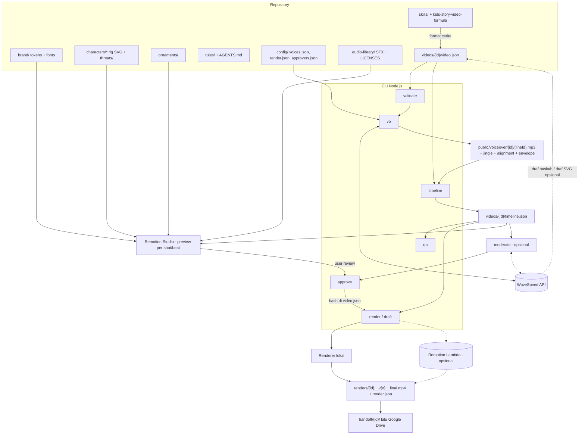
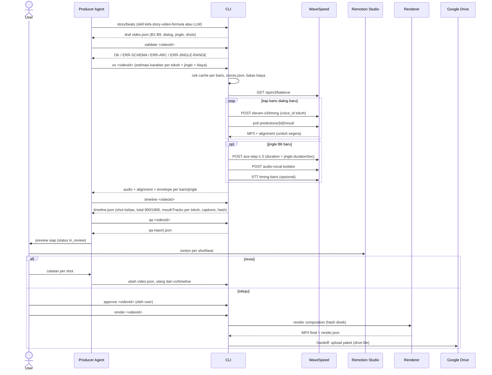
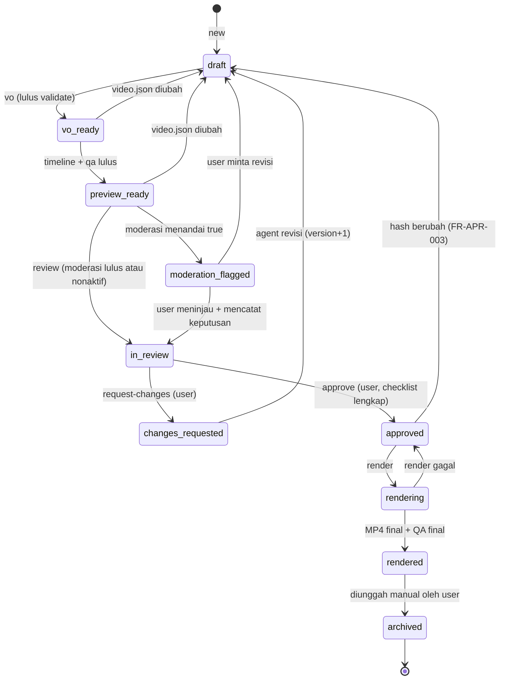

# TRD — Bintangku Video Studio — v1.4 draft

> Draf v1.4: format video cerita *kids-story-video-formula* (PRD DEC-46..54): timeline dialog dengan potongan bebas (grid 81 frame digantikan, ADR-26), multi-tokoh dengan satu suara per tokoh (ADR-28), jingle acapella inti di B6 (ADR-24 diperbarui), caption langkah (ADR-31), lip-sync per tokoh aktif (ADR-30), `approvalHash` untuk shot variabel (ADR-29), skema `video.json` 2.0 selaras skill (ADR-27). Penanda **[v1.4]**; item lama dicoret + "Digantikan [v1.4]". Sebelumnya, draf v1.3: jawaban user dikunci (PRD DEC-41..44): LLM DeepSeek V4.1 Flash, tanpa musik, handoff Google Drive, upload aset ke WaveSpeed boleh; beat jingle opsional (DEC-45). Penanda **[v1.3]**. Sebelumnya, draf v1.2: stack model & pipeline rekomendasi (PRD DEC-32..40, Lampiran C) ditambahkan sebagai **usulan**; penanda **[v1.2]**. Sebelumnya, draf v1.1. Nama project disetujui (PRD DEC-21). Belum ditulis ke Coda. Penanda **[v1.1]** = berubah dari v1.0 (rincian di `CHANGELOG.md`). Dokumen ini spesifikasi teknis (HOW), bukan kode. Contoh JSON di bawah adalah kontrak data, sesuai aturan framework (JSON/YAML untuk kontrak mesin).

## 01. Document Control

| Field | Isi |
|---|---|
| Dokumen | Technical Requirements Document (TRD) |
| Produk | Pipeline produksi video 2D chibi Reels bintangku.app |
| Versi | 1.4 draft |
| Status | Draf untuk review user |
| Lokasi | `/workspace/product-architect/bintangku-video-studio/v1.4/TRD.md` |
| Acuan | `PRD.md` v1.4 draft (folder yang sama); [v1.4] `reference/CATATAN-PRD-TRD-v1.4.md`, `reference/PANDUAN-FORMAT-CERITA-v1.md`, `reference/SKILL-draft.md` |
| Tanggal | 24 November 2026 (WIB) |
| Pemilik | BrainBox Digital |
| Penulis | Product Architect |
| Sumber teknis | README `remotion-dev/template-prompt-to-video`, `template-three`, `template-audiogram`; skill voiceover resmi Remotion (permalink); docs Remotion (`@remotion/three`, captions, calculateMetadata, lisensi, Lambda); [v1.1] halaman model & docs WaveSpeed (PRD Lampiran B.2); README WhisperX. Semua tautan di bagian 14 dan Lampiran |
| Framework | AI-First Documentation Framework, TRD 25 bagian |

Konvensi ID: `SYS-NNN` (kebutuhan sistem), `TECH-<AREA>-NNN` (spesifikasi teknis), `ADR-NN` (keputusan arsitektur), `RSK-NN` melanjutkan nomor PRD, `OQ-NN` melanjutkan nomor PRD, `ASM-NN` melanjutkan nomor PRD, `ERR-<KODE>` (kode error). FR/AC/BR/DEC merujuk ke PRD.

Aturan: detail repo referensi hanya dari README-nya. Struktur internal template (isi `timeline.json` asli, signature fungsi) **belum dibaca** dan diverifikasi saat implementasi (TASK-VAL-001). Angka tanpa sumber = ASM; harga/kuota yang tidak diketahui = OQ.

## 02. Technical Overview

Sistem ini adalah project Remotion (React) dalam satu repository, ditambah CLI Node.js untuk langkah yang butuh API atau file sistem. Tidak ada server, database, atau UI custom.

Alur (amandemen 25 Nov 2026): `storyboard.md` (scene) → `video.json` (`pacing: "scene"`) → validasi → VO **narator** per scene (satu `voice_id` di `config/voice.json`) + jingle B6 (ACE-Step + isolator, suara = VO) → alignment + envelope → `timeline.json` (satu sequence per scene, total 900/1.800 frame) → QA → preview Remotion (**composition penuh + per scene**) → approval user → render → handoff.

### Amandemen teknis (25 Nov 2026) — DEC-55..58

| ID | Isi teknis |
|---|---|
| DEC-55 | Satu voice narator; tidak ada `voices.json` multi-tokoh |
| DEC-56 | Tidak ada mouthTrack per tokoh bicara; maskot idle/smile |
| DEC-57 | `pacing: "scene"`; VO file `public/voiceover/<videoId>/<sceneId>.mp3`; Studio: `<videoId>` + `<videoId>-S01`… |
| DEC-58 | Uji: sikat gigi 60 dtk |

Prinsip:

- **Data-driven & deterministik.** Composition adalah fungsi murni dari `timeline.json` + frame. Tidak ada `Math.random()`; acak memakai `random(seed)` Remotion.
- **Biaya hanya saat input berubah.** Preview, QA lokal, dan render tidak memanggil API berbayar.
- **Satu provider AI, satu adapter.** WaveSpeed via `cli/providers/wavespeed`.
- **Gerbang murah sebelum langkah mahal.** Validasi skema sebelum TTS.
- ~~**Grid dulu** / ~~**Dialog multi-voice dulu**~~ **Digantikan [amandemen]:** **Scene dulu.** Durasi scene mengikuti VO narator; total 900/1.800 frame, selisih diserap end card.

## 03. Technology Stack

| Layer | Teknologi | Tanggung jawab | Batasan |
|---|---|---|---|
| Video framework | Remotion (Studio, renderer, CLI) | Composition, preview, render MP4 | Semua package `remotion`/`@remotion/*` versi sama persis (ADR-09). Lisensi: lihat bagian 22 |
| UI komponen | React + TypeScript | Komponen maskot (`Mascot`) [v1.4], ornamen, stiker ancaman, caption dialog & langkah, end card, layout | Komponen tidak boleh punya prop warna maskot |
| Grafik karakter | SVG inline (komponen React) | Rig maskot (Thinker, Dreamer, Explorer, Dream Keeper) [v1.4], stiker ancaman 2D & ornamen | Digambar ulang manual; auto-trace dilarang (DEC-13) |
| Efek 3D (opsional) | `@remotion/three` + React Three Fiber (`<ThreeCanvas>`) | Partikel bintang, latar kosmik, parallax | Renderer OpenGL `angle` (docs `@remotion/three`); `<Sequence layout="none">` di dalam canvas |
| Caption | `@remotion/captions` (format `Caption`, paging gaya TikTok) + komponen tampilan dari template-audiogram | Caption per kata | [v1.1] Data dari timestamps TTS; fallback forced alignment (ADR-04, ADR-16) |
| TTS [v1.1] | WaveSpeed: `elevenlabs/eleven-v3/timing` (utama, usulan DEC-25); alternatif `minimax/speech-2.8-hd` | VO per baris dialog, satu suara per tokoh [v1.4] + alignment per karakter (Eleven v3 Timing) | `WAVESPEED_API_KEY`; async submit + poll; output dihapus WaveSpeed ≤ 7 hari → unduh segera |
| CLI | Node.js + TypeScript (pola dari template-prompt-to-video `cli/`) | validate, vo, timeline, qa, approve, render | Satu perintah per langkah; idempoten |
| Validasi skema | JSON Schema (draft 2020-12) | `video.json`, `timeline.json`, config | Validator dipilih saat implementasi |
| Naskah AI (opsional) [v1.2] | WaveSpeed `wavespeed-ai/ai-story-generator` | Ide/brainstorm prosa | Mati default; beat JSON dibuat LLM (baris di bawah) |
| LLM beat JSON [v1.2] | WaveSpeed LLM API `https://llm.wavespeed.ai/v1` (OpenAI-compatible), model `deepseek/deepseek-v4.1-flash-1017`; alternatif `openai/gpt-6-luna` | Brief → beat JSON | Dikunci DEC-41 [v1.3]; GPT-6 Luna hanya lewat `models.json`; JSON mode belum terverifikasi → validasi skema lokal (ADR-20) |
| Alignment fallback [v1.1] | WaveSpeed `elevenlabs/scribe-v2` (timestamps per kata) atau `wavespeed-ai/openai-whisper` (`enable_timestamps`); opsi lokal WhisperX (alignment model Indonesia `cahya/wav2vec2-large-xlsr-indonesian`) | Timestamps per kata bila TTS tidak memberi | Hanya jika TTS tanpa timestamps (ADR-16) |
| Envelope audio [v1.1] | Dekode MP3 di CLI (RMS per frame @30 fps) | Penggerak lip-sync (ADR-15) | Deterministik, tanpa API |
| Moderasi (opsional) [v1.1] | WaveSpeed `wavespeed-ai/molmo2/video-content-moderator` (+ `molmo2/text-content-moderator` untuk naskah) | Gerbang QA otomatis | Butuh upload MP4 draft ke WaveSpeed (OQ-24) |
| Draf SVG (opsional) [v1.1] | WaveSpeed `recraft-ai/recraft-20b-svg` | Draf ornamen/ikon/latar | Input hanya teks; hasil dibersihkan manual (ADR-18) |
| Image-to-video (opsional) [v1.1] | WaveSpeed, kandidat `bytedance/seedance-2.5-flash/image-to-video`, `kwaivgi/kling-v4.0/image-to-video` | Maks. 1 klip latar/prop [v1.4] | Audio model dimatikan; tidak untuk tokoh (DEC-54); durasi klip 3–4 detik dipotong ke shot (OQ-11) |
| Vektorisasi (opsional, sekali) [v1.2] | WaveSpeed `ideogram-ai/ideogram-vector/image-to-vector` | PNG Thinker → SVG kasar untuk dijiplak | Bukan master (DEC-36); upload perlu izin (OQ-30) |
| Ornamen bergaya brand (opsional) [v1.2] | WaveSpeed `ideogram-ai/ideogram-vector/text-to-vector` (dengan gambar referensi) | Draf ornamen mirip gaya brand | Lebih mahal dari Recraft 20B; dibersihkan manual |
| ~~Musik AI~~ [v1.3] | — | Dihapus: tanpa musik latar (PRD DEC-42) | — |
| VO bernada / beat jingle (opsional) [v1.3] | WaveSpeed `wavespeed-ai/ace-step-1.5` → `wavespeed-ai/audio-vocal-isolator` | Maks. 1 beat dinyanyikan, acapella | Mati default; usulan DEC-45; uji TASK-VAL-013/014 |
| Handoff [v1.3] | Google Drive API v3 (OAuth Desktop, scope `drive.file`, upload resumable) | Upload paket final ke folder pilihan user | PRD DEC-43; tidak ada panggilan sungguhan sebelum build |
| Render cloud (opsional) | Remotion Lambda (AWS) | Render paralel | Hanya jika diaktifkan user (OQ-14/15) |
| Versi & kolaborasi | Git + GitHub privat | Riwayat, PR, approval | Nama repo: slug → PRD OQ-26 |
| 3D fallback (Future) | Blender | Shot 3D khusus | Di luar MVP (DEC-05) |

## 04. System Architecture



Hubungan antarlayer:

- **Data layer** (`videos/`, `config/`, `public/voiceover/`) hanya ditulis oleh CLI atau manusia, tidak oleh composition.
- **CLI layer** satu-satunya yang memanggil API eksternal dan menulis file turunan.
- **Composition layer** (Remotion) hanya membaca `timeline.json` dan aset statis lewat `staticFile()`, lalu menggambar frame.
- **Render layer** memanggil composition yang sama dengan input yang sama (Studio, draft, final).

## 05. Architecture Decisions

| ID | Keputusan | Alasan | Alternatif ditolak | Status |
|---|---|---|---|---|
| ADR-01 | Basis kode dari `template-prompt-to-video`: konsep timeline 3 blok (Elements/Text/Audio), CLI `npm run gen`, VO + timestamps. Generate gambar AI dihapus, diganti referensi komponen SVG. [v1.1] Pemanggilan OpenAI/ElevenLabs di CLI template diganti adapter WaveSpeed (ADR-13) | Paling dekat dengan alur user; sudah menyinkronkan text & audio | Mulai dari blank Remotion (lebih lama) | Usulan (DEC-07) |
| ADR-02 | Thinker = komponen React dari bagian SVG terpisah dengan props enum; warna dari token terkunci | Konsistensi 100%, gerak murah, reuse | PNG per pose (tidak bisa lip-sync); AI per shot (drift) | Dikunci user (DEC-06) + detail usulan (DEC-12) |
| ADR-03 | Three.js hanya sebagai satu jenis element `fx3d` (partikel bintang, latar kosmik, parallax), opsional per shot [v1.4], dengan fallback SVG | Render 3D lebih berat; karakter 2D lebih rapi di SVG | Seluruh scene di Three.js | Usulan (DEC-08) |
| ADR-04 | [v1.1] Caption per kata dari alignment karakter TTS (Eleven v3 Timing via WaveSpeed), dikonversi CLI ke array `Caption` (`@remotion/captions`). Jika TTS tidak memberi alignment → ADR-16 | Tanpa biaya/latensi transkripsi; teks pasti sama dengan naskah | Whisper sebagai jalur utama; `@remotion/elevenlabs` (hanya mengonversi output Speech to Text ElevenLabs) | Usulan (DEC-09, DEC-27) |
| ~~ADR-05~~ | ~~Grid tetap 81 frame per slot. VO dibuat per **beat** (1..n slot). `slotCount(beat) = ceil((padStart + durasiVO + padEnd) / 81 frame)`. Composition = Σ slot × 81~~ **Digantikan [v1.4]:** grid dan pembulatan slot dihapus untuk format cerita; lihat ADR-26 (timeline dialog) dan ADR-27 (`pacing: grid` legacy nonaktif) | Menjaga aturan user 2,7 detik sekaligus VO utuh. Skill resmi Remotion menyesuaikan durasi scene ke audio; di sini kebalikannya: audio ditempatkan di grid | VO per slot ≤ 2,7 detik (narasi terpotong-potong); durasi scene mengikuti VO (melanggar DEC-03) | Digantikan [v1.4] |
| ~~ADR-06~~ | ~~Transisi dibuat sebagai animasi enter/exit **di dalam** slot (pola "enter/exit transitions" di Elements template), bukan overlap `<TransitionSeries>`~~ **Digantikan [v1.4]:** transisi boleh berupa potongan atau swoosh/iris/star-wipe 8–12 frame di awal shot tanpa overlap durasi (FR-TL-003); dihitung di dalam durasi shot, jadi total tetap 900/1.800 | Titik potong tetap di kelipatan 81; durasi tidak berkurang oleh overlap | `<TransitionSeries>` dengan kompensasi overlap (perhitungan grid jadi rumit) | Digantikan [v1.4] |
| ADR-07 | State produksi & approval disimpan di file (`video.json`) di git, tanpa database | Satu sumber kebenaran, bisa diaudit lewat riwayat git | Database/Notion/Coda | Usulan |
| ADR-08 | 30 fps; ~~1 slot = 81 frame~~ [v1.4] tanpa slot; 30 detik = 900 frame, 60 detik = 1.800 frame | Standar Reels; ~~2,7 × 30 = 81~~ alasan grid digantikan (DEC-48) | 25/24 fps | Usulan (DEC-20) |
| ADR-09 | Semua package Remotion versi sama, diupgrade dengan `npx remotion upgrade`; lockfile di-commit | Disarankan di README ketiga template | Versi campur | Usulan (DEC-10) |
| ADR-10 | Render final dijaga hash: `approvalHash` = SHA-256 dari timeline kanonik + hash file VO + versi rig + versi Remotion ([v1.4] dirinci untuk shot variabel & multi-suara di ADR-29) | Perubahan sekecil apa pun membatalkan approval (FR-APR-003) | Flag boolean `approved` saja | Usulan |
| ADR-11 | Render default lokal; Remotion Lambda opsional | Volume awal belum diketahui; tanpa setup AWS | Lambda sejak awal | Usulan (OQ-14/15) |
| ADR-12 | Media VO di ~~`public/voiceover/<videoId>/<beatId>.mp3`~~ [v1.4] `public/voiceover/<videoId>/<lineId>.mp3` per baris dialog dan `jingle.mp3` (mengikuti konvensi skill voiceover resmi, dengan `compositionId` = `videoId`, `sceneId` = `lineId`) | Bisa diakses `staticFile()`; konsisten dengan skill resmi | Path bebas | Usulan |
| ADR-13 | [v1.1] Semua model AI lewat WaveSpeed dengan satu adapter `cli/providers/wavespeed`: submit `POST /api/v3/<model-id>` sekali (tanpa retry otomatis), poll `GET /api/v3/predictions/<id>/result` dengan backoff untuk 429/5xx, unduh `outputs` segera, simpan `predictionId`. Model per fungsi diatur di `config/models.json` | Keputusan user (DEC-24); satu key, satu tagihan; pola API seragam; aturan retry resmi WaveSpeed | OpenAI + ElevenLabs langsung (dua akun/key). ElevenLabs langsung hanya opsi cadangan terdokumentasi (OQ-25), tidak diimplementasi | Dikunci (provider) / Usulan (desain adapter) |
| ADR-14 | [v1.1] TTS utama `elevenlabs/eleven-v3/timing` via WaveSpeed; `minimax/speech-2.8-hd` sebagai alternatif bila uji A/B (TASK-VAL-006) lebih baik untuk bahasa Indonesia | Hanya model ini yang dinyatakan memberi timestamps; Eleven v3 mendukung `id`; voice_id tetap | Gemini/OmniVoice/Qwen3 TTS (Qwen3 tidak mencantumkan Indonesia; yang lain tanpa timestamps menurut halaman yang dibaca) | Usulan (DEC-25) |
| ADR-15 | [v1.1] Lip-sync 4 bentuk (`closed`, `half`, `open`, `round`) digerakkan envelope audio (RMS per frame) yang dihitung CLI saat `timeline`; timestamps (jika ada) hanya memilih `round` untuk vokal o/u dan menjaga `closed` di spasi/tanda baca panjang | Tidak bergantung provider TTS; deterministik; cocok gaya chibi | Viseme penuh dari timestamps (bergantung provider); `useAudioData()` saat render (lebih berat, hasil tidak masuk hash) | Usulan (DEC-26) |
| ADR-16 | [v1.1] Fallback alignment berjenjang: (1) timestamps TTS; (2) STT dengan timestamps per kata di WaveSpeed (`elevenlabs/scribe-v2` atau `wavespeed-ai/openai-whisper` + `enable_timestamps`), kata hasil STT dicocokkan ke kata naskah; (3) opsi lokal WhisperX forced alignment; (4) timing proporsional per beat + peringatan QA | Caption tetap jalan walau model TTS diganti | Hanya timing proporsional | Usulan (DEC-27) |
| ADR-17 | [v1.1] Moderasi video opsional sebagai gerbang sebelum `approve`: MP4 draft → upload WaveSpeed → Molmo2 Video Content Moderator → hasil di `qa-report.json`. Flag `true` memblokir `approve` sampai keputusan user tercatat. Hasil `false` semua tidak mengganti approval user | Audiens anak; biaya per video kecil menurut halaman model | Tanpa moderasi; moderasi manual saja | Usulan (DEC-29) |
| ADR-18 | [v1.1] Recraft 20B SVG hanya untuk draf di `ornaments/_drafts/`; wajib pembersihan manual (palet → token, path dirapikan, nama layer) dan lint brand sebelum masuk `ornaments/`. Untuk master Thinker hanya sebagai sketsa referensi; master rig tetap digambar ulang manual dengan pemisahan bagian (07.2) | Halaman model menyatakan output "true SVG", tetapi input hanya teks (tidak bisa diberi PNG Thinker sebagai referensi) dan warna hanya diarahkan lewat prompt | Pakai hasil Recraft langsung | Usulan (DEC-30) |
| ADR-19 | [v1.1] Batas biaya: `config/budget.json` (batas per video & per bulan, tarif per model yang dicatat dari halaman model + tanggal). CLI menghitung estimasi, cek saldo `GET /api/v3/balance`, dan berhenti sebelum submit jika melewati batas | Saldo prabayar; tarif bisa berubah | Tanpa batas | Usulan (FR-COST-001) |
| ADR-20 | [v1.2] LLM lewat `https://llm.wavespeed.ai/v1` (`chat.completions`), key `WAVESPEED_API_KEY`. Prompt = aturan brand + skema beat + brief. Output diparse dan divalidasi skema `video.json` lokal; jika gagal, 1 permintaan perbaikan dengan daftar error, lalu `ERR-LLM-SCHEMA`. Model id disimpan di `config/models.json` (`llm`) | Satu key; LLM murah menghasilkan struktur langsung, tidak perlu memecah prosa | Story generator prosa sebagai sumber utama; akun LLM terpisah | Dikunci (DEC-41) [v1.3] |
| ADR-21 | [v1.2] Urutan gerbang: validasi skema → moderasi teks → TTS → alignment → timeline → preview → render draft → moderasi video → approval → render final → handoff. Langkah berbayar hanya berjalan jika gerbang sebelumnya lolos dan input berubah (cache by hash) | Biaya terbuang paling kecil | Moderasi hanya di akhir | Usulan (DEC-32, DEC-34) |
| ADR-22 | [v1.2] Perintah `vectorize` (Ideogram image-to-vector) menulis ke `characters/thinker/_trace/` saja; `svg-draft` memilih model dari `models.json` (`svg`: `recraft-ai/recraft-20b-svg` default, `ideogram-ai/ideogram-vector/text-to-vector` opsi). Folder `_trace/` dan `_drafts/` dikecualikan dari import composition (dicek `qa`) | Aset AI tidak bisa bocor ke video tanpa dibersihkan | Memakai SVG AI langsung | Usulan (DEC-36) |
| ADR-23 | [v1.2] Tidak memakai model lip-sync/talking-avatar atau model gambar untuk Thinker; mulut tetap 4 layer SVG + envelope (ADR-15) | Konsistensi karakter, biaya, determinisme | `sync/lipsync-3`, Kling Lipsync, InfiniteTalk | Usulan (DEC-39) |
| ADR-24 | [v1.3] [v1.4 diperbarui] Jingle B6 (inti, DEC-47): `vo` membuat satu file jingle dari `jingle.lines[].lyric` lewat ACE-Step 1.5 (`duration` = `jingle.durationSec`, 5–15 detik; ~~slot × 2,7 detik, min. 2 slot~~; `tags` + `seed` dari `config/voices.json` `jingle`) → vocal isolator → STT untuk timing baris (opsional) → dipotong/dipad ke `durationSec × 30` frame. Maks. 3 percobaan; gagal → `WARN-JINGLE-FALLBACK`, baris diucapkan TTS guide | Satu-satunya model lagu dengan durasi bebas yang murah; tanpa musik (DEC-42) | Lagu penuh dengan instrumen; Eleven v3 `[sings]` (belum terbukti, TASK-VAL-015) | Dikunci user (DEC-47) |
| ADR-25 | [v1.3] Handoff Drive: OAuth 2.0 Desktop app, scope `https://www.googleapis.com/auth/drive.file` (non-sensitive: hanya file yang dibuat/dibuka app). Saat `drive-auth` pertama, CLI membuat folder "Bintangku Video Studio – Handoff" (atau memakai folder yang dipilih lewat Picker, OQ-33) dan menyimpan `folderId` di `config/handoff.json`. `handoff` membuat subfolder `<videoId>`, upload resumable MP4 + `caption.txt` + `handoff.json`, mencatat `driveFileIds`. Idempoten berdasarkan approvalHash; tidak ada delete/share | Scope paling sempit yang disarankan Google; folder pilihan user tetap bisa dipindah di Drive | Scope `drive` (restricted, butuh verifikasi); upload manual; konektor agent | Dikunci tujuan (DEC-43); desain auth usulan |
| ADR-26 | [v1.4] Timeline dialog (TECH-TL-001, 08.1): durasi shot = max(rencana, audio baris + pad, minimum shot); `from` kumulatif dalam frame bebas; total dikunci 900/1.800 frame, selisih diserap end card 60–90 frame, sisanya error `ERR-DURATION-OVER/UNDER`; overlap ucapan ≤ 9 frame | Potongan mengikuti dialog seperti format referensi; durasi Reels tetap pasti | Grid 81 frame (ADR-05); durasi bebas tanpa batas total | Dikunci user (DEC-48) + detail usulan |
| ADR-27 | [v1.4] Skema `video.json` 2.0 mengikuti keluaran skill `kids-story-video-formula` (10.1) + field produksi; `pacing` enum dengan `dialogue` aktif dan `grid` legacy ditolak (`ERR-PACING`); skill disimpan di `skills/kids-story-video-formula/` dan `beats` (LLM) memakai prompt + skema yang sama | Agent dan LLM menghasilkan file yang langsung tervalidasi; grid tidak dihapus sebelum OQ-35 | Dua skema terpisah; hapus grid total | Usulan (DEC-53) |
| ADR-28 | [v1.4] Multi-suara: `config/voices.json` memetakan tokoh → `voice_id` + settings; TTS per baris dialog, `cacheKey` per baris memuat `character` + `voice_id`; tokoh tanpa entri → `ERR-VOICE-MISSING` sebelum panggilan API | Konsistensi suara per maskot lintas video; revisi satu baris hanya membayar baris itu | TTS per beat dengan banyak tokoh dalam satu file (tidak bisa dipisah untuk lip-sync) | Dikunci (DEC-50); preset: OQ-34 |
| ADR-29 | [v1.4] `approvalHash` = SHA-256 dari JSON kanonik (kunci diurutkan, angka integer frame) berisi: `meta.durationInFrames`, `shots[]` (`shotId`, `from`, `durationInFrames`, `transitionIn`), `elements[]`, `text[]` (caption dialog + caption langkah), `audio[]` dengan `fileSha256` tiap baris dialog/jingle/SFX + `character` + `voice_id`, `mouthTracks[]` per tokoh, `rigVersions` per tokoh yang tampil, `remotionVersion` | Perubahan kecil (geser 1 frame, ganti suara satu tokoh, ganti rig satu maskot) membatalkan approval | Hash per slot; hash `video.json` saja | Usulan |
| ADR-30 | [v1.4] Lip-sync per tokoh: satu `mouthTrack` per `character`; hanya tokoh yang sedang bicara/bernyanyi yang membuka mulut, lainnya `closed`; 4 bentuk dari envelope (ADR-15) | Dialog multi-tokoh terbaca jelas; tanpa model lip-sync (ADR-23) | Satu track untuk semua tokoh | Dikunci (DEC-52) |
| ADR-31 | [v1.4] Caption langkah = komponen `StepCaption` dengan gaya terkunci (Fredoka Extra Bold/Black, `#FFD234`, outline `#0D1B4B`/`#1A2F7A`, pop-in 8–12 frame), satu per baris jingle; caption dialog disembunyikan selama B6 | Tanda tangan visual format; konsisten antar video | Gaya caption bebas per video | Dikunci (DEC-51) |

## 06. Application Structure

Struktur repo usulan (root: slug repo, PRD OQ-26) [v1.1] [v1.2]:

```
<repo-root>/
├── AGENTS.md                      # urutan baca, larangan agent, workflow
├── README.md
├── .env.example                   # nama variabel saja, tanpa nilai
├── .gitignore                     # .env, renders/, node_modules/, cache sementara
├── package.json / package-lock.json   # semua remotion/@remotion/* versi sama
├── remotion.config.ts             # termasuk renderer OpenGL "angle" (bagian 07)
├── docs/                          # salinan PRD/TRD final + CHANGELOG
├── brand/
│   ├── tokens.json                # palet, font, outline, warna maskot terkunci
│   ├── fonts/                     # Fredoka, Nunito Sans dari brand kit + LICENSE
│   └── reference/thinker_master.png   # PNG asli user, tidak diubah
├── characters/                    # [v1.4] satu folder per maskot: thinker/, dreamer/, explorer/, dream-keeper/ (+ cheerleader/, grower/, parent/ nanti)
│   └── thinker/                   # struktur sama untuk tiap maskot
│       ├── master.svg             # master gambar ulang (TASK-USR-001)
│       ├── _trace/                # [v1.2] SVG kasar hasil `vectorize`, hanya bahan jiplak
│       ├── parts/                 # bagian rig per layer (bagian 07)
│       ├── poses.json             # transform per bagian per pose
│       ├── expressions.json
│       └── CHANGELOG.md           # versi rig (semver) → masuk approvalHash
├── threats/                       # [v1.4] stiker ancaman 2D orisinal untuk B3 (kuman, gigi sedih, dll.)
├── props/                         # [v1.4] prop generik (sikat gigi, gelas, handuk, kasur)
├── ornaments/                     # bintang, confetti, badge, frame, panel, planet (SVG)
│   └── _drafts/                   # [v1.1] draf Recraft + prompt + metadata, belum boleh dipakai
├── src/                           # project Remotion
│   ├── Root.tsx                   # daftar composition per videoId
│   ├── compositions/VideoFromTimeline.tsx
│   ├── components/                # Mascot (+ alias Thinker), Ornament, Background, Caption, StepCaption, ThreatSticker, EndCard, TextBlock, SafeArea, DraftWatermark, ShotMarker [v1.4]
│   ├── fx3d/                      # element Three.js opsional
│   ├── motion/                    # preset gerak & enter/exit
│   └── lib/                       # timeline (ADR-26), lipsync, captions, tokens loader [v1.4]
├── cli/                           # validate, vo, timeline, qa, approve, render, draft
│   └── providers/wavespeed/       # [v1.1] adapter submit/poll/download (ADR-13)
├── schemas/                       # video.schema.json (2.0), timeline.schema.json, voices.schema.json [v1.4]
├── config/
│   ├── voices.json                # [v1.4] voice_id per tokoh + jingle tags/seed (terkunci); menggantikan voice.json
│   ├── lipsync.json               # ambang T1/T2 (ASM-15)
│   ├── models.json                # [v1.1] model WaveSpeed per fungsi (tts, align, story, moderate, svg, i2v)
│   ├── budget.json                # [v1.1] batas biaya + tarif tercatat
│   ├── render.json                # fps 30, resolusi, codec, preset draft
│   ├── safe-area.json             # nilai dari OQ-07
│   └── approvers.json             # identitas approver (user)
├── audio-library/
│   ├── sfx/                       # [v1.3] tanpa folder music/ (DEC-42)
│   └── LICENSES.md                # sumber & lisensi tiap file (wajib)
├── content-plan/
│   ├── pillars.md
│   └── backlog.md                 # ide → dijadwalkan → diproduksi
├── rules/
│   ├── brand.md                   # dari Brand Guidelines bintangku.app
│   ├── script.md                  # brand voice, panjang beat, teks ucapan
│   ├── safe-area.md
│   └── qa-checklist.md
├── skills/
│   ├── kids-story-video-formula/SKILL.md   # [v1.4] dari reference/SKILL-draft.md + references/format-guide.md
│   ├── new-video/SKILL.md
│   ├── write-script/SKILL.md
│   ├── generate-vo/SKILL.md
│   ├── build-timeline/SKILL.md
│   ├── preview-and-qa/SKILL.md
│   ├── render/SKILL.md
│   └── references/remotion-voiceover.md   # ringkasan + permalink skill resmi (Lampiran)
├── videos/
│   └── <videoId>/
│       ├── video.json             # sumber kebenaran (satu file per video)
│       ├── timeline.json          # turunan, di-commit (untuk hash)
│       ├── qa-report.json
│       └── logs/
├── public/
│   └── voiceover/<videoId>/<lineId>.mp3 + .alignment.json + .envelope.json; jingle.mp3 + jingle.vocal.mp3 + jingle.envelope.json; manifest.json [v1.4]
├── renders/                       # di-gitignore; MP4 final/draft (penyimpanan → OQ-10)
└── handoff/<videoId>/             # [v1.2] paket serah terima: MP4 final, caption.txt, handoff.json (di-gitignore)
```

`videoId` format: `YYYYMMDD-<slug>` (mis. `20261201-sikat-gigi-malam`), huruf kecil, `-` sebagai pemisah.

## 07. Frontend Architecture

"Frontend" di sini = composition Remotion.

### 07.1 Composition [v1.4]

- `Root.tsx` mendaftarkan composition `VideoFromTimeline` dengan prop `videoId`.
- `calculateMetadata` membaca `timeline.json` dan mengembalikan `durationInFrames = meta.durationInFrames` (900 atau 1.800), `fps = 30`, ukuran dari `config/render.json`. Durasi sudah dihitung CLI (ADR-26); composition tidak mengukur audio.
- Tiap shot dirender sebagai `<Sequence from={shot.from} durationInFrames={shot.durationInFrames}>` dengan nilai frame bebas (bukan kelipatan 81). Tiap baris dialog dan jingle adalah `<Sequence>` audio sendiri di `audio[]`.
- (v1.0–v1.3: "Tiap slot = `<Sequence from={slotIndex×81} durationInFrames={81}>`; durasi = totalSlots × 81" — **digantikan [v1.4]**, DEC-48.)

### 07.2 Spesifikasi rig maskot (TECH-CHR-001; untuk ilustrator, TASK-USR-001, TASK-USR-007)

[v1.4] Semua maskot pemeran (Thinker, Dreamer, Explorer, Dream Keeper; Cheerleader/Grower menyusul) memakai pola rig yang sama: `body`, `head`, `eye-*`, `eyelids`, `mouth-closed|half|open|round|smile`, `arm-left`, `arm-right`, plus grup aksesori khas (Thinker: `treads`, `tablet`, `antenna`/`bulb`; Dreamer: topi wizard + tongkat bintang; Explorer: jetpack; Dream Keeper: topi tidur + bintang). Ciri tiap maskot diambil dari Brand Guidelines dan PNG master (OQ-37). Tabel di bawah adalah rig Thinker sebagai acuan.

Ciri wajib (dari Lampiran D PRD BintangMatika): robot chibi astronot di atas roda rantai, antena bohlam, visor oval mengilap dengan mata biru, memegang tablet, warna putih/navy/biru persis master, outline 2–3 pt konsisten, kepala besar badan mungil.

| Layer/ID grup SVG | Isi | Pivot | Digerakkan oleh |
|---|---|---|---|
| `treads` | Roda rantai | tengah bawah | pose `zoom` (garis gerak), bounce |
| `body` | Badan | tengah bawah badan | bounce, pose |
| `arm-left`, `arm-right` | Lengan (terpisah dari badan) | bahu | pose wave/cheer/point |
| `tablet` | Tablet di tangan | genggaman | pose point/think |
| `head` | Kepala + helm | leher | tilt, pose |
| `visor` | Visor oval + kilap | tengah visor | statis (ikut head) |
| `eye-left`, `eye-right` | Mata biru | tengah mata | arah lihat |
| `eyelids` | Kelopak untuk kedip | atas mata | blink |
| `mouth-*` | [v1.1] Varian `closed`, `half`, `open`, `round` (bicara) + `smile` (ekspresi diam) | tengah mulut | lip-sync, expression |
| `brow-*` (jika ada di master) | Ekspresi | — | expression |
| `antenna`, `bulb`, `bulb-glow` | Antena + bohlam + cahaya | pangkal antena | bulb on/dim/off, goyang |

Aturan file:

- Setiap fill/stroke memakai **nama token** (mis. `mascot.navy`), bukan hex lepas. Nilai hex warna maskot (putih, navy, biru) diambil dari PNG master dan dikunci di `brand/tokens.json` (TASK-VAL-002; navy brand `#0d1b4b`, biru/putih maskot belum disampling).
- Stroke outline diskalakan relatif terhadap tinggi karakter supaya setara 2–3 pt pada ukuran referensi (ASM-11: ukuran referensi = tinggi Thinker di master).
- Tidak ada efek raster; kilap visor berupa bentuk vektor.

### 07.3 API komponen `Mascot` [v1.4]

Komponen `Thinker` (v1.0–v1.3) digeneralisasi menjadi `Mascot` dengan prop `character`; `Thinker` tetap ada sebagai alias `Mascot character="thinker"`.

| Prop | Tipe | Default | Keterangan |
|---|---|---|---|
| `character` [v1.4] | `"thinker" \| "dreamer" \| "explorer" \| "dream-keeper" \| "cheerleader" \| "grower" \| "parent"` | — | Wajib; hanya karakter yang rig-nya ada di `characters/` |
| `pose` | enum per karakter (`poses.json`) | `"idle"` | Thinker: idle, wave, think, cheer, point, calm, zoom |
| `expression` | `"neutral" \| "happy" \| "excited" \| "thinking" \| "surprised" \| "calm" \| "scared" \| "proud"` [v1.4] | `"happy"` | `scared` (B3), `proud` (B7) ditambah untuk format cerita |
| `mouth` | `"auto" \| "closed" \| "half" \| "open" \| "round" \| "smile"` | `"auto"` | `auto` = ikut `mouthTrack` tokoh ini |
| `mouthTrack` | array `{frame, shape}` | dari timeline | Per tokoh (ADR-30) |
| `blink` | `"auto" \| "off" \| "closed"` | `"auto"` | Jadwal deterministik dari `seed` |
| `accessory` | objek per karakter (mis. Thinker `bulb: off\|dim\|on`) | sesuai pose | Tidak ada prop warna |
| `x`, `y` | angka 0–1 | 0,5 / 0,62 | Titik pivot bawah |
| `scale` | angka > 0 | 1 | Skala seragam saja (BR-008) |
| `facing` | `"left" \| "right"` | `"right"` | Mirror horizontal |
| `motion` | preset (`bounce`, `float`, `shake-soft`, `none`) | `"float"` | Dari `src/motion/` |
| `enter`, `exit` | preset (`pop`, `slide-left`, `fade`, `blur`, `none`) | `"pop"` / `"none"` | Di dalam shot |
| `seed` | string | `videoId+shotId+character` | Untuk `random(seed)` |

Sengaja **tidak ada** prop warna, `scaleX/scaleY`, atau `style` bebas.

### 07.4 Komponen lain

| Komponen | Props utama | Catatan |
|---|---|---|
| `Ornament` | `type` (`star`, `confetti`, `badge`, `frame`, `panel`, `planet`), `color` (hanya nama token), `x`, `y`, `scale`, `motion`, `enter` | Motif bintang = star yellow/golden glow |
| `Background` | `type` (`cosmic-flat`, `gradient`, `fx3d-stars`, `fx3d-parallax`), `palette` (nama token) | `fx3d-*` → `<ThreeCanvas>`, fallback `cosmic-flat` (EC-007) |
| `TextBlock` | `role` (`title` → Fredoka, `body`/`number`), `text`, `color` (token), `position` (zona safe area) | Validasi kontras terhadap latar (NFR-BRAND-001) |
| `Caption` | `captions` (array `Caption`), `style` preset; [v1.4] Nunito Sans Semi Bold, disembunyikan di B6 | Paging via `createTikTokStyleCaptions()`; tampilan diadaptasi dari template-audiogram |
| `SafeAreaOverlay` | `visible` | Hanya di Studio/draft |
| `DraftWatermark` | `label` | Hanya di render draft |
| `StepCaption` [v1.4] | `text`, `outline` (`navy` = `#0D1B4B` \| `cosmic` = `#1A2F7A`), `from`, `durationInFrames` | Fredoka Extra Bold/Black, isian `#FFD234`, sepertiga bawah di safe area, scale 0,6 → 1,1 → 1,0 dalam 8–12 frame (`spring` deterministik), bayangan navy halus opsional; lint kontras ≥ 4,5:1 (DEC-51) |
| `ThreatSticker` [v1.4] | `type` (dari `threats/`), `x`, `y`, `scale`, `motion` | Stiker SVG 2D datar orisinal untuk B3 (DEC-54) |
| `EndCard` [v1.4] | `tagline`, `method[]` | Tagline + rangkaian metode, motif bintang, gerak sangat pelan; tanpa foto (FR-STY-004) |
| `ShotMarker` [v1.4] | `shotId`, `beatId`, `speaker` | Hanya di Studio/draft; menggantikan `SlotMarker` |
| ~~`SlotMarker`~~ | ~~`slotIndex`, `beatId`~~ | **Digantikan [v1.4]** oleh `ShotMarker` |

### 07.5 Three.js

- Pakai `<ThreeCanvas>` agar `useCurrentFrame()` bisa dipakai di dalam canvas (animasi tidak di `useFrame()`).
- `<Sequence>` di dalam canvas wajib `layout="none"`.
- Renderer OpenGL `angle` diset di config (docs `@remotion/three`: Three.js tidak merender dengan renderer OpenGL default).
- Sumber: https://www.remotion.dev/docs/three

## 08. Backend Architecture

Tidak ada server. "Backend" = CLI di `cli/`, dijalankan manual atau oleh agent lewat skill.



`npm run gen -- <videoId>` (nama dari template) = `validate` → `vo` → `timeline` → `qa` berurutan.

### 08.1 Penyusunan timeline dialog (TECH-TL-001) [v1.4]

(v1.0–v1.3 "Algoritme grid": `slots = ceil(need / 81)`, batas 11–22 slot — **digantikan [v1.4]**, DEC-48 / ADR-26.)

1. Ambil `shots[]` berurutan. Untuk tiap shot, `need = padStart + Σ durasi audio baris di shot (dengan overlap ≤ 9 frame) + padEnd`; durasi audio diukur dari file MP3 yang diunduh. `padStart`/`padEnd` default 6 frame (ASM-12).
2. `shot.durationInFrames = max(round(shot.durationSec × 30), need, minShot)` dengan `minShot` = 30 frame (1 detik) untuk insert dan 45 frame untuk shot dialog (ASM-25). Jika diperpanjang → `WARN-SHOT-EXTENDED`.
3. Shot B6 = `jingle.durationSec × 30` frame (jingle dipotong/dipad ke nilai itu); dibagi ke sub-shot sesuai `jingle.lines[]`.
4. `from` tiap shot = jumlah durasi shot sebelumnya (frame bebas, tidak ada kelipatan tetap).
5. Target `T` = 900 (30 detik) atau 1.800 (60 detik). Selisih `Δ = T − Σ shot` diserap end card B9 dalam rentang 60–90 frame (ASM-23). Jika tidak bisa: `Δ < 0` → `ERR-DURATION-OVER`; `Δ > 0` → `ERR-DURATION-UNDER`.
6. Cek arc: setiap beat B1–B9 punya ≥ 1 shot; posisi beat dalam ±30 frame dari target panduan → di luar itu `WARN-BEAT-DRIFT` (bukan error).
7. Overlap ucapan dua tokoh > 9 frame → baris berikutnya digeser; jika merusak total → `ERR-OVERLAP` (BR-025).
8. `pacing: "grid"` → `ERR-PACING` (legacy nonaktif, DEC-53).

### 08.2 Lip-sync per tokoh (TECH-CHR-002) [v1.4]

1. **Envelope per audio:** CLI mendekode tiap file baris dialog dan jingle, menghitung RMS per frame @30 fps, menormalkan per file (0–1). Disimpan `<lineId>.envelope.json`.
2. **Ambang → bentuk:** `e < T1` → `closed`; `T1 ≤ e < T2` → `half`; `e ≥ T2` → `open` (`T1`, `T2` = ASM-15, `config/lipsync.json`).
3. **Penghalus timestamps (opsional):** vokal `o`/`u` → `round`; spasi/tanda baca dengan envelope rendah → `closed`.
4. **Tokoh aktif saja [v1.4]:** `mouthTracks[]` dibuat per `character`. Frame di luar baris tokoh itu = `closed`. Saat jingle, tokoh yang ditandai `singers` di shot B6 memakai envelope jingle.
5. **Hening & stabilisasi:** envelope < `T1` ≥ 2 frame → `closed`; bentuk ditahan minimal 2 frame (ASM-13).
6. Output: `mouthTracks[] = {character, frames[]}` dalam frame absolut; masuk hash timeline.

### 08.3 Caption (TECH-CAP-001) [v1.4]

**Caption dialog (Nunito Sans Semi Bold):**

- Sumber timing (ADR-16): alignment TTS → STT dengan timestamps (WaveSpeed) → WhisperX lokal → proporsional, per baris dialog.
- Kata = urutan karakter non-spasi; `startMs`/`endMs` dari karakter pertama/terakhir; offset = `from` baris di timeline.
- Teks tampil selalu dari `dialogue[].line`; TTS memakai `dialogue[].speech` jika ada (EC-008). Jumlah kata beda → `WARN-CAPTION-MAP` + timing proporsional.
- Paging via `createTikTokStyleCaptions()`; disembunyikan selama shot B6 (FR-CAP-005).

**Caption langkah (StepCaption, DEC-51):**

- Satu entri per `jingle.lines[]`: `from` = awal baris (dari STT jika kata pertama cocok, jika tidak dari kumulatif `lines[].durationSec`), `durationInFrames` = durasi baris.
- Teks = `lines[].caption` (singkat, satu langkah). Gaya dikunci di komponen; tidak bisa diubah per video.

## 09. Database Architecture

Tidak ada database (ADR-07). Penyimpanan:

| Data | Lokasi | Di git? |
|---|---|---|
| `video.json`, `timeline.json`, `qa-report.json` | `videos/<videoId>/` | Ya |
| VO MP3 + alignment | `public/voiceover/<videoId>/` | Ya, kecuali OQ-10 memutuskan LFS/Drive |
| Cache index VO | `public/voiceover/<videoId>/manifest.json` | Ya |
| MP4 draft/final | `renders/` | Tidak (penyimpanan → OQ-10) |
| Secret | `.env` lokal / secret store CI | Tidak pernah |

## 10. Data Model

### 10.1 `video.json` (sumber kebenaran, satu per video) [v1.4]

[v1.4] Skema mengikuti struktur keluaran skill `kids-story-video-formula` (`reference/SKILL-draft.md`) dan menambah field produksi. Skema v1.0–v1.3 (`beats[].minSlots`, `beats[].shots[]` per slot, `targetDuration` dengan batas slot 11–22, `shots[].sfx[].atFrame` 0–80) **digantikan**; `schemaVersion` naik ke `2.0.0`.

| Field | Tipe | Wajib | Validasi |
|---|---|---|---|
| `schemaVersion` | string semver | Ya | `2.x.x` |
| `id` | string | Ya | `^\d{8}-[a-z0-9-]+$`, sama dengan nama folder |
| `version` | integer ≥ 1 | Ya | Naik tiap putaran revisi |
| `format` | `"kids-story-video-formula"` | Ya | Satu-satunya format aktif |
| `topic` | string | Ya | Satu frasa kebiasaan |
| `durationSec` | `30 \| 60` | Ya | Total timeline = `durationSec × 30` frame |
| `language` | string | Ya | default `id` |
| `pacing` | `"dialogue"` | Ya | `"grid"` ditolak (`ERR-PACING`, DEC-53) |
| `cast` | `{surrogate, catalyst, guide, cameo}` | Ya | Nilai = id karakter yang punya rig; `cameo` boleh null; 3 peran bicara berbeda |
| `voices` | map `character → {style, deliveryDefault}` + `jingle` | Ya | Setiap tokoh di `cast` (kecuali cameo) wajib ada; `voice_id` sebenarnya dari `config/voices.json` |
| `valueLine` | string | Ya | Kalimat nilai merek yang diucapkan guide (tagline atau satu tahap metode) |
| `tagline`, `method[]` | string, array | Ya | Default dari brand; dipakai end card |
| `beats[]` | `{id: "B1".."B9" \| "B1+B2" \| "B4+B5" \| "B7+B8", name, startSec, endSec, purpose}` | Ya | Urutan dan kelengkapan dicek (FR-STY-001) |
| `jingle` | `{startSec, durationSec, lineCount, lines[{index, lyric, caption, durationSec}], singers[]}` | Ya | 5 ≤ `durationSec` ≤ 15; 4 ≤ `lineCount` ≤ 8 = panjang `lines`; Σ `lines[].durationSec` = `durationSec` (±0,1) |
| `shots[]` | lihat baris berikut | Ya | ≥ 1 per beat |
| `shots[].id` | `^S\d{2}$` | Ya | Unik |
| `shots[].beatId`, `startSec`, `durationSec` | string, angka, angka | Ya | `durationSec` > 0; tidak harus kelipatan apa pun |
| `shots[].camera`, `framing` | enum (`static`, `slow-push`, `pan`, `shake-soft`; `close`, `medium`, `wide`, `insert`, `ots`) | Ya | — |
| `shots[].characters[]` | id karakter + props `Mascot` opsional (pose, expression, x, y, facing) | Ya | Hanya dari `cast` |
| `shots[].action` | string | Tidak | Catatan untuk preview |
| `shots[].dialogue[]` | `{lineId, character, line, speech?, delivery: "spoken" \| "sung"}` | Tidak | `character` ∈ `cast`; `sung` hanya di B6 |
| `shots[].captionStep` | `{lineIndex}` atau null | Tidak | Hanya di B6 |
| `shots[].background`, `props[]`, `threats[]`, `fx3d` | objek komponen | Tidak | `threats` hanya di B3 |
| `shots[].transitionIn` | `cut \| swoosh \| iris \| star-wipe` | Tidak | default `cut` |
| `shots[].sfx[]` | id cue | Tidak | Maks. 1 cue utama |
| `shots[].notes` | string | Tidak | — |
| `endCard` | `{startSec, durationSec, tagline, method[], noRealChildrenPhotos: true}` | Ya | `durationSec` 2–3 |
| `sfxCues[]` | `{id, atSec, shotId}` | Tidak | id ada di `audio-library/LICENSES.md` |
| `ipChecklist` | `{noReferenceCharacters, noReferenceDialogue, noReferenceLyrics, noBrands, noQuoteCards, checkedBy, at}` | Ya sebelum `approve` | Semua `true` (FR-STY-003) |
| `captions.enabled` | boolean | Tidak | default `true` |
| `status`, `reviewNotes[]`, `approval`, `history[]` | seperti v1.3 | — | `reviewNotes[].shotId` menggantikan `slot` [v1.4] |

`beats`, `shots`, dan `jingle.lines` harus konsisten (aturan skill): jumlah detik jingle = jumlah durasi baris, total shot menutupi `durationSec`. Nilai `startSec`/`durationSec` di `video.json` adalah **rencana**; nilai frame final dihitung `timeline` (08.1).

Contoh ringkas (60 detik, dipotong):

```json
{
  "schemaVersion": "2.0.0",
  "id": "20261201-sikat-gigi-malam",
  "version": 1,
  "format": "kids-story-video-formula",
  "topic": "sikat gigi sebelum tidur",
  "durationSec": 60,
  "language": "id",
  "pacing": "dialogue",
  "cast": { "surrogate": "dreamer", "catalyst": "explorer", "guide": "dream-keeper", "cameo": null },
  "voices": {
    "dreamer": { "style": "tinggi, lembut, ekspresif", "deliveryDefault": "spoken" },
    "explorer": { "style": "enerjik", "deliveryDefault": "spoken" },
    "dream-keeper": { "style": "tenang, hangat", "deliveryDefault": "spoken" },
    "jingle": { "style": "nyanyi ceria terpisah", "deliveryDefault": "sung" }
  },
  "valueLine": "Langkah kecil tiap malam bikin kamu makin mandiri.",
  "tagline": "Langkah Kecil Menuju Anak Mandiri",
  "method": ["Misi", "Kebiasaan", "Bintang", "Progres", "Hadiah", "Mandiri"],
  "beats": [{ "id": "B1", "name": "momen-sehari-hari", "startSec": 0, "endSec": 6, "purpose": "" }],
  "jingle": { "startSec": 33, "durationSec": 12, "lineCount": 6, "singers": ["dreamer"],
    "lines": [{ "index": 1, "lyric": "", "caption": "", "durationSec": 2 }] },
  "shots": [{ "id": "S01", "beatId": "B1", "startSec": 0, "durationSec": 6, "camera": "slow-push",
    "framing": "medium", "characters": [{ "id": "dreamer", "pose": "idle", "expression": "happy" }],
    "dialogue": [{ "lineId": "L01", "character": "dreamer", "line": "", "delivery": "spoken" }],
    "captionStep": null, "sfx": [], "notes": "" }],
  "endCard": { "startSec": 57, "durationSec": 3, "tagline": "Langkah Kecil Menuju Anak Mandiri",
    "method": ["Misi", "Kebiasaan", "Bintang", "Progres", "Hadiah", "Mandiri"], "noRealChildrenPhotos": true },
  "sfxCues": [{ "id": "swoosh", "atSec": 12, "shotId": "S04" }],
  "status": "draft",
  "history": []
}
```

### 10.2 `timeline.json` (turunan, jangan diedit manual) [v1.4]

| Field | Isi |
|---|---|
| `meta` | `{videoId, version, fps: 30, pacing: "dialogue", durationInFrames: 900 \| 1800, width, height, generatedAt, generator, rigVersions{character: semver}, remotionVersion}`. `slotFrames`/`totalSlots` **dihapus [v1.4]** |
| `shots[]` | `{shotId, beatId, from, durationInFrames, transitionIn, camera, framing}` (menggantikan `slots[]`) |
| `elements[]` | `{shotId, kind: "character" \| "ornament" \| "background" \| "threat" \| "prop" \| "fx3d" \| "endCard" \| "aiClip", props, enter, exit, motion}` |
| `text[]` | `{kind: "caption" \| "stepCaption" \| "onScreen", from, to, ...}`; caption dialog berisi array `Caption` |
| `audio[]` | `{kind: "dialogue" \| "jingle" \| "sfx", character?, lineId?, src, from, durationInFrames, volume}` |
| `mouthTracks[]` | `{character, frames: [{frame, shape}]}` (per tokoh, ADR-30) |
| `approvalHash` | ADR-29 |

### 10.3 `config/voices.json` [v1.4]

(v1.1–v1.3 `config/voice.json` satu suara — **digantikan [v1.4]**, DEC-50.)

| Field | Isi |
|---|---|
| `provider` | `wavespeed` |
| `model` | `elevenlabs/eleven-v3/timing` (alternatif `minimax/speech-2.8-hd`) |
| `characters` | map `character → {voice_id, settings: {stability, ...}, styleNote}`; satu entri per maskot (Thinker, Dreamer, Explorer, Dream Keeper, opsional parent). Nilai `voice_id` dipilih user (OQ-34) |
| `jingle` | `{model: "wavespeed-ai/ace-step-1.5", tags, seed, isolator: "wavespeed-ai/audio-vocal-isolator"}` — dikunci per seri |
| `returns_alignment` | `true` untuk Eleven v3 Timing; `false` → ADR-16 |
| `locked` | `true`; perubahan butuh persetujuan user |

### 10.4 `public/voiceover/<videoId>/manifest.json` [v1.4]

Per baris dialog: `{lineId, character, cacheKey, file, fileSha256, alignmentFile, alignmentSource, envelopeFile, durationSec, characters, model, voice_id, predictionId, estimatedCostUsd, createdAt}`. `cacheKey` = SHA-256(`speech ?? line` + `character` + `provider` + `model` + `voice_id` + `settings`). Jingle: `{kind: "jingle", cacheKey (lirik + tags + seed + durationSec + model), aceFile, vocalFile, attempts, alignmentSource, ...}`.

### 10.5 `config/models.json` & `config/budget.json` [v1.1]

| File | Field |
|---|---|
| `models.json` | `tts`, `align` (urutan fallback), `story`, `moderateVideo`, `moderateText`, `svg`, `i2v` → model id WaveSpeed; `enabled` per fungsi opsional. [v1.2] Tambah `llm` (`{baseUrl: "https://llm.wavespeed.ai/v1", model, fallbackModel: "openai/gpt-6-luna"}`), `vectorize`. [v1.3] `music` dihapus; tambah `sing` (`wavespeed-ai/ace-step-1.5`), `vocalIsolate` (`wavespeed-ai/audio-vocal-isolator`) |
| `handoff.json` (config) [v1.3] | `provider: "gdrive"`, `folderId`, `folderName`, `createdByApp` (bool), `scope: "drive.file"` — tidak berisi token |
| `budget.json` | `perVideoUsd`, `perMonthUsd` (nilai dari user, OQ-08); `rates[]` = `{model, unit, priceUsd, sourceUrl, checkedAt}` dari halaman model; `minBalanceUsd` |

## 11. API Specification

Tidak ada HTTP API internal; OpenAPI tidak relevan. Kontrak berikut adalah kontrak CLI (dijalankan via `npm run <cmd> -- <videoId>`), plus satu API eksternal.

| Perintah | Input | Sukses | Error |
|---|---|---|---|
| `new` | `--slug`, `--date` | Folder `videos/<id>/` + `video.json` dari template, status `draft` | `ERR-ID-EXISTS` |
| `validate` | `videoId` | Exit 0, ringkasan beat/shot/estimasi durasi [v1.4] | `ERR-SCHEMA` (daftar field), `ERR-ASSET-MISSING`, `ERR-LICENSE-MISSING`, `ERR-ARC`, `ERR-JINGLE-RANGE`, `ERR-PACING`, `ERR-VOICE-MISSING`, `ERR-IP-CHECKLIST` [v1.4] |
| `vo` | `videoId`, `--dry-run` | [v1.1] Estimasi karakter & biaya; MP3 + alignment + envelope per baris dialog baru + jingle B6 [v1.4]; status `vo_ready` | `ERR-ENV-MISSING`, `ERR-BUDGET`, `ERR-WS-SUBMIT`, `ERR-WS-FAILED`, `ERR-WS-POLL`, `ERR-WS-EXPIRED` |
| `timeline` | `videoId` | `timeline.json` + `approvalHash` | ~~`ERR-GRID-MIN`, `ERR-GRID-MAX`~~ [v1.4] `ERR-DURATION-OVER`, `ERR-DURATION-UNDER`, `ERR-OVERLAP`, `ERR-VO-MISSING` |
| `qa` | `videoId`, `--moderate` | `qa-report.json` (+ hasil moderasi jika aktif); status `preview_ready` jika lulus [v1.1] | `ERR-QA-FAIL`, `ERR-MODERATION-FLAG` |
| `review` | `videoId` | Status `in_review` | `ERR-STATE` |
| `draft` | `videoId` | MP4 draft resolusi rendah + watermark di `renders/` | `ERR-RENDER` |
| `request-changes` | `videoId`, ~~`--slot`~~ `--shot` [v1.4], `--note` | Catatan disimpan, status `changes_requested` | `ERR-STATE` |
| `approve` | `videoId` | `approval` diisi, status `approved` | `ERR-NOT-APPROVER`, `ERR-CHECKLIST`, `ERR-STATE` |
| `render` | `videoId`, `--target local\|lambda` | MP4 final + `render.json`, status `rendered` | `ERR-NOT-APPROVED`, `ERR-HASH-MISMATCH`, `ERR-RENDER` |
| `gen` | `videoId` | `validate`→`vo`→`timeline`→`qa` | Error langkah pertama yang gagal |
| `story` [v1.1] | `videoId`, `--prompt` | Draf teks di `videos/<id>/drafts/story-<ts>.md` (tidak mengubah `video.json`) | `ERR-BUDGET`, `ERR-WS-*` |
| `svg-draft` [v1.1] | `--prompt`, `--style`, `--aspect` | SVG + metadata di `ornaments/_drafts/` | `ERR-BUDGET`, `ERR-WS-*` |
| `balance` [v1.1] | — | Saldo USD WaveSpeed | `ERR-ENV-MISSING`, `ERR-WS-POLL` |
| `beats` [v1.2] | `videoId`, `--brief`, `--dry-run` | Draf beat JSON di `videos/<id>/drafts/beats-<ts>.json` yang lolos skema 2.0 + estimasi durasi & biaya; [v1.4] prompt = skill `kids-story-video-formula` | `ERR-LLM-SCHEMA`, `ERR-BUDGET`, `ERR-ENV-MISSING` |
| `vectorize` [v1.2] | `--image`, `--mode default\|simple` | SVG kasar di `characters/<mascot>/_trace/` [v1.4] | `ERR-BUDGET`, `ERR-WS-*` |
| `handoff` [v1.3] | `videoId`, `--no-upload` | Paket lokal `handoff/<videoId>/` + upload ke Drive subfolder `<videoId>`; `driveFileIds` & status upload di `handoff.json` | `ERR-STATE`, `ERR-HASH-MISMATCH`, `ERR-DRIVE-AUTH`, `ERR-DRIVE-UPLOAD` |
| `drive-auth` [v1.3] | — | Login OAuth sekali (browser lokal user), simpan refresh token di luar repo, buat/catat folder handoff | `ERR-DRIVE-AUTH`, `ERR-ENV-MISSING` |

[v1.1] API eksternal WaveSpeed (dari docs, dibaca 24 Nov 2026):

- **Auth:** header `Authorization: Bearer <WAVESPEED_API_KEY>` (https://wavespeed.ai/docs/api-authentication).
- **Submit:** `POST https://api.wavespeed.ai/api/v3/<model-id>` dengan body JSON input model → `data.id` (prediction id). Jangan di-retry otomatis; jika putus tanpa id, cek daftar prediksi dulu (https://wavespeed.ai/docs/errors-retries-timeouts).
- **Result:** `GET https://api.wavespeed.ai/api/v3/predictions/<id>/result` → `data.status` (`completed`; terminal gagal: `failed`, `cancelled`, `timeout`, `deleted`), `data.outputs` (URL, teks, atau objek terstruktur tergantung model), `data.error`.
- **Eleven v3 Timing:** input `text` (1–5.000 karakter), `voice_id`, `stability`; output URL MP3 + objek `alignment` (`characters`, `character_start_times_seconds`, `character_end_times_seconds`) (https://wavespeed.ai/docs/docs-api/elevenlabs/eleven-v3/timing). Posisi persis objek alignment di dalam `outputs` diverifikasi saat TASK-VAL-006.
- **Upload (untuk moderasi/STT):** Upload Files API; file disimpan 7 hari, maks. 200 MB (https://wavespeed.ai/docs/docs-api/upload-file).
- **Saldo:** `GET https://api.wavespeed.ai/api/v3/balance` (https://wavespeed.ai/docs/check-balance).
- Opsi global `enable_sync_mode` dan `enable_base64_output` ada di docs; tidak dipakai (pola submit + poll dipertahankan).

## 12. Authentication

- Tidak ada login pengguna.
- [v1.1] WaveSpeed: `WAVESPEED_API_KEY` dari environment (`.env` lokal, tidak di-commit). CLI berhenti sebelum memanggil API jika tidak ada (EC-004). OpenAI dan ElevenLabs key tidak dipakai.
- AWS (opsional, Lambda): kredensial sesuai docs Remotion Lambda saat setup; tidak disimpan di repo.
- GitHub: akses repo privat milik BrainBox Digital.

## 13. Authorization

| Aksi | Siapa | Mekanisme |
|---|---|---|
| Ubah `video.json` (status draft) | Agent, user | Git commit biasa |
| `approve` | Hanya user | (1) identitas git committer harus ada di `config/approvers.json`; (2) perintah meminta konfirmasi interaktif yang mengetik ulang `videoId`; (3) disarankan: branch `main` diproteksi dan approval masuk lewat PR yang di-approve user di GitHub |
| `render` final | User, atau agent atas instruksi user | Hanya jika `approval.approvalHash` = hash timeline saat ini |
| Ubah `brand/tokens.json` warna maskot, `config/voices.json` [v1.4] | Hanya user | CODEOWNERS + review PR |

Keterbatasan: guard lokal bersifat prosedural, bukan kriptografis; agent dengan akses shell secara teknis bisa memalsukan identitas git. Karena itu proteksi branch di GitHub direkomendasikan (OQ-18) dan `AGENTS.md` melarang agent menjalankan `approve` (BR-006).

## 14. Third-Party Integrations

| Integrasi | Dipakai untuk | Sumber | Catatan |
|---|---|---|---|
| template-prompt-to-video | Basis CLI + konsep timeline | https://github.com/remotion-dev/template-prompt-to-video | Mirror dari monorepo Remotion (`packages/template-ai-video`); lisensi Remotion berlaku |
| template-three | Setup `@remotion/three` + R3F | https://github.com/remotion-dev/template-three | Konten template MIT |
| template-audiogram | Komponen tampilan caption per kata | https://github.com/remotion-dev/template-audiogram | Bagian Whisper & waveform tidak dipakai |
| Skill voiceover resmi Remotion | Referensi skill agent | https://github.com/remotion-dev/skills/blob/473352613039e718e46655a26df224851e84c4aa/skills/remotion-best-practices/remotion-markup/voiceover.md | Dihapus dari `main` di commit `6f55706d` (18 Nov 2026, 17:18 WIB); panduan penggantinya di `audio.md` |
| `@remotion/captions` | Format `Caption`, paging | https://www.remotion.dev/docs/captions/caption , https://www.remotion.dev/docs/captions/create-tiktok-style-captions | — |
| `@remotion/three` | Efek 3D | https://www.remotion.dev/docs/three | Renderer `angle` |
| `calculateMetadata` | Durasi composition | https://www.remotion.dev/docs/calculate-metadata | [v1.4] Dipakai dengan `meta.durationInFrames` dari timeline dialog |
| WaveSpeed API [v1.1] | TTS, alignment fallback, story, moderasi, Recraft SVG, image-to-video | https://wavespeed.ai/docs , model per fungsi di PRD Lampiran B.2 | Saldo prabayar; batas biaya ADR-19 |
| Google Drive API v3 [v1.3] | Upload paket handoff (DEC-43) | https://developers.google.com/workspace/drive/api/guides/api-specific-auth | Scope `drive.file` (non-sensitive); `drive` penuh = restricted, tidak dipakai |
| `@remotion/elevenlabs` | Alternatif konversi caption dari output STT ElevenLabs (Scribe) | https://www.remotion.dev/docs/elevenlabs | [v1.1] Kompatibilitas dengan output Scribe via WaveSpeed belum diverifikasi |
| WhisperX (opsional lokal) [v1.1] | Forced alignment lokal | https://github.com/m-bain/whisperX | BSD-2-Clause; model alignment Indonesia di `DEFAULT_ALIGN_MODELS_HF`; butuh Python + PyTorch |
| `useAudioData` / `visualizeAudio` | Referensi analisis audio Remotion | https://www.remotion.dev/docs/use-audio-data , https://www.remotion.dev/docs/visualize-audio | [v1.1] Tidak dipakai saat render; envelope dihitung CLI (ADR-15) |
| ElevenLabs API langsung | — | https://elevenlabs.io/docs/api-reference/text-to-speech/convert-with-timestamps | [v1.1] Tidak dipakai; cadangan terdokumentasi saja (PRD OQ-25) |
| Remotion Lambda (opsional) | Render cloud | https://www.remotion.dev/docs/lambda , contoh biaya https://www.remotion.dev/docs/lambda/cost-example | Biaya AWS → OQ-14 |


### Penyesuaian skill voiceover resmi ke timeline dialog [v1.4] (v1.0–v1.3: "ke grid 2,7 detik")

| Skill resmi | Di project ini |
|---|---|
| TTS per **scene** ke `public/voiceover/<compositionId>/<sceneId>.mp3` | [v1.4] TTS per **baris dialog** ke `public/voiceover/<videoId>/<lineId>.mp3`, suara sesuai tokoh (ADR-12, ADR-28) |
| Panggilan langsung ElevenLabs `/v1/text-to-speech/{voiceId}` | [v1.1] WaveSpeed `elevenlabs/eleven-v3/timing` (submit + poll) untuk audio + alignment |
| `calculateMetadata` mengukur durasi audio → durasi scene = durasi audio | [v1.4] Sama prinsipnya, tetapi dihitung CLI saat `timeline`: durasi shot = audio + pad (ADR-26); total dikunci 900/1.800 frame; `calculateMetadata` hanya membaca `meta.durationInFrames`. (~~dibulatkan ke kelipatan 81 frame~~ digantikan) |
| Kompensasi overlap jika memakai `<TransitionSeries>` | Tidak perlu: transisi dihitung di dalam durasi shot (ADR-06 [v1.4]) |
| Voice settings di dalam script; `ELEVENLABS_API_KEY` | Dikunci per tokoh di `config/voices.json` (BR-005, ADR-28); `WAVESPEED_API_KEY` [v1.1] |

## 15. State Management

### 15.1 State produksi video



Aturan transisi (TECH-APR-001):

- Setiap transisi ditambahkan ke `history[]` dengan waktu WIB dan pelaku.
- Setiap perintah mengecek hash timeline; jika `video.json` lebih baru dari `timeline.json` atau hash berbeda dari `approval.approvalHash`, status turun ke `draft` dan `approval` dikosongkan (disimpan di `history`).
- Render draft (`draft`) tidak mengubah status.

### 15.2 State di dalam composition

Tidak ada state runtime. Semua nilai (posisi, mulut, kedip, partikel) dihitung dari `useCurrentFrame()` + `timeline.json` + `random(seed)`.

## 16. Error Handling

| Kode | Penyebab | Perilaku | Retry |
|---|---|---|---|
| `ERR-SCHEMA` | `video.json` tidak valid | Berhenti; daftar path field + nilai valid | — |
| `ERR-ASSET-MISSING` | Pose/ornamen/track tidak ada | Berhenti | — |
| `ERR-LICENSE-MISSING` | [v1.3] SFX/font tanpa catatan lisensi | Berhenti (BR-010) | — |
| `ERR-ENV-MISSING` | API key tidak ada | Berhenti sebelum panggilan API | — |
| `ERR-WS-SUBMIT` [v1.1] | Submit WaveSpeed gagal/putus | Berhenti; jika tidak ada task id, minta cek daftar prediksi sebelum submit ulang (EC-014) | Tidak pernah otomatis |
| `ERR-WS-POLL` [v1.1] | 429/5xx/putus saat polling | Backoff (hormati `Retry-After`), lanjut polling | Maks. 3 error transien beruntun (ASM-14), lalu berhenti dengan task id |
| `ERR-WS-FAILED` [v1.1] | Status `failed`/`cancelled`/`timeout`/`deleted` | Simpan baris/beat yang sudah sukses [v1.4]; berhenti dengan task id + `data.error` | Manual |
| `ERR-WS-EXPIRED` [v1.1] | URL output tidak bisa diunduh (≤ 7 hari terlewat) | Tandai beat untuk generate ulang (EC-016) | Manual |
| `ERR-BUDGET` [v1.1] | Estimasi > sisa batas atau saldo < `minBalanceUsd` | Berhenti sebelum submit (EC-017) | — |
| `ERR-MODERATION-FLAG` [v1.1] | Moderator memberi `true` | Status `moderation_flagged`; `approve` diblokir | — |
| `WARN-ALIGN-FALLBACK` [v1.1] | Alignment bukan dari TTS | Lanjut; sumber dicatat di manifest | — |
| `ERR-LLM-SCHEMA` [v1.2] | Output LLM tidak valid setelah 1 perbaikan | Berhenti; daftar error per field; tidak ada panggilan ketiga | Tidak |
| `ERR-DRIVE-AUTH` [v1.3] | Token Drive tidak ada/kedaluwarsa/ditolak | Berhenti; minta `drive-auth`; paket lokal tetap | Tidak |
| `ERR-DRIVE-UPLOAD` [v1.3] | Upload gagal (jaringan, kuota) | Status `failed` di `handoff.json`; lanjutkan sesi resumable | Ya, maks. 3 dengan backoff |
| `WARN-JINGLE-FALLBACK` [v1.3] | Jingle gagal 3 kali | [v1.4] Baris jingle diucapkan TTS guide; caption langkah tetap; dicatat di manifest | — |
| `ERR-VO-MISSING` | Timeline dibangun tanpa VO lengkap | Berhenti | — |
| ~~`ERR-GRID-MIN` / `ERR-GRID-MAX`~~ | ~~Slot < 11 atau > 22~~ **Digantikan [v1.4]** oleh `ERR-DURATION-*` | — | — |
| `ERR-DURATION-OVER` [v1.4] | Σ shot + end card minimum (60 frame) > 900/1.800 | Berhenti; daftar shot terpanjang + saran memendekkan dialog (EC-019) | — |
| `ERR-DURATION-UNDER` [v1.4] | Σ shot + end card maksimum (90 frame) < 900/1.800 | Berhenti; saran menambah shot/memanjangkan beat | — |
| `ERR-OVERLAP` [v1.4] | Overlap ucapan dua tokoh > 9 frame tidak bisa digeser tanpa melanggar total | Berhenti (EC-023) | — |
| `ERR-VOICE-MISSING` [v1.4] | Tokoh di `cast`/`dialogue` tidak punya entri di `config/voices.json` | Berhenti sebelum panggilan API (EC-026) | — |
| `ERR-ARC` [v1.4] | Beat B1–B9 kurang/urutan salah | Berhenti; daftar beat yang hilang (FR-STY-001) | — |
| `ERR-JINGLE-RANGE` [v1.4] | Jingle < 5 atau > 15 detik, baris < 4 atau > 8, atau jumlah durasi baris ≠ `durationSec` | Berhenti | — |
| `ERR-PACING` [v1.4] | `pacing` bukan `dialogue` | Berhenti (DEC-53) | — |
| `ERR-IP-CHECKLIST` [v1.4] | `ipChecklist` belum lengkap saat `approve` | Berhenti (FR-STY-003) | — |
| `WARN-BEAT-DRIFT` [v1.4] | Posisi beat > ±1 detik dari template | Lanjut; dicatat di `qa-report.json` | — |
| ~~`WARN-SLOT-EXTENDED`~~ | ~~VO lebih panjang dari `minSlots`~~ **Digantikan [v1.4]** | — | — |
| `WARN-SHOT-EXTENDED` [v1.4] | Audio baris lebih panjang dari rencana `durationSec` shot | Lanjut, shot diperpanjang; end card menyerap | — |
| `WARN-CAPTION-MAP` | Kata ucapan ≠ kata tampil | Lanjut, timing proporsional | — |
| `WARN-FX3D-FALLBACK` | Efek 3D gagal | Lanjut dengan latar SVG | — |
| `ERR-QA-FAIL` | Cek otomatis gagal | Status tetap; laporan | — |
| `ERR-STATE` | Transisi status tidak sah | Berhenti | — |
| `ERR-NOT-APPROVER` / `ERR-CHECKLIST` | Bukan approver / checklist belum lengkap | Berhenti | — |
| `ERR-NOT-APPROVED` / `ERR-HASH-MISMATCH` | Render tanpa approval sah | Berhenti, tanpa render | — |
| `ERR-RENDER` | Renderer gagal | Status kembali ke `approved`; log disimpan | Manual |

Semua penulisan file bersifat atomik (tulis ke file sementara lalu rename) supaya tidak ada artefak setengah jadi.

## 17. Security Requirements

| ID | Requirement |
|---|---|
| TECH-SEC-001 | `.env` di `.gitignore`; `.env.example` hanya nama variabel |
| TECH-SEC-002 | Pre-commit + CI menjalankan secret scanner (mis. gitleaks; pilihan alat saat implementasi) terhadap staged files dan riwayat |
| TECH-SEC-003 | API key tidak pernah ditulis ke log, `video.json`, `timeline.json`, `render.json`, atau output CLI |
| TECH-SEC-004 | Repo GitHub privat; branch `main` diproteksi (OQ-18); CODEOWNERS untuk `brand/`, `config/`, `characters/` |
| TECH-SEC-005 | [v1.1] Jika key bocor: hapus key di halaman API Keys WaveSpeed, buat key baru, bersihkan riwayat git — langkah di `rules/security.md` |
| TECH-SEC-008 | [v1.1] File yang di-upload ke WaveSpeed (MP4 draft untuk moderasi, audio untuk STT) hanya draf resolusi rendah; disimpan WaveSpeed 7 hari (OQ-24) |
| TECH-SEC-009 | [v1.1] Pola key bergaya Bearer/WaveSpeed ditambahkan ke aturan secret scanner |
| TECH-SEC-010 | [v1.2] `WAVESPEED_API_KEY` hanya dikirim ke host `api.wavespeed.ai` dan `llm.wavespeed.ai` (allowlist di adapter); prompt LLM tidak berisi secret atau data pribadi |
| TECH-SEC-011 | [v1.3] Kredensial Google: client ID/secret hanya di `.env`; refresh token di `~/.config/bintangku-video-studio/google-token.json` (izin file 600, di luar repo); scope hanya `drive.file`; tidak ada panggilan delete/permissions di kode Drive |
| TECH-SEC-006 | Tidak ada panggilan ke layanan lain (Instagram, Metricool, Drive, Telegram, n8n/VPS) dari pipeline (BR-012) |
| TECH-SEC-007 | Lisensi aset pihak ketiga dicatat (NFR-LIC-001) |

## 18. Performance Requirements

Belum ada angka target dari user; tidak ada angka yang dikarang.

| ID | Requirement |
|---|---|
| TECH-PERF-001 | Preview di Studio tidak memicu panggilan API atau render MP4 |
| TECH-PERF-002 | `vo` hanya memanggil API untuk beat yang `cacheKey`-nya baru |
| TECH-PERF-003 | `render.json` mencatat durasi render, mesin, versi Remotion, ukuran file → baseline untuk OQ-14 |
| TECH-PERF-004 | Komponen SVG tidak memakai filter raster berat (blur besar) di setiap frame kecuali preset `blur` enter/exit |
| TECH-PERF-005 | Efek `fx3d` dibatasi per shot [v1.4] (opsional); jumlah partikel dikonfigurasi di preset dan diukur dampaknya saat R4 |

## 19. Scalability

- Volume naik → render paralel via Remotion Lambda (ADR-11) tanpa mengubah composition; README template menyebut perlunya timeline sebagai prop dan aset sebagai URL untuk render remote — diterapkan jika Lambda dipilih.
- Format lain (Shorts, TikTok, 4:5) = composition tambahan yang membaca `timeline.json` yang sama dengan layout/safe area berbeda (Future).
- Karakter baru (Mascot Squad) = folder baru di `characters/` dengan API komponen yang sama.

## 20. Logging & Monitoring

| Log | Lokasi | Isi |
|---|---|---|
| Run log CLI | `videos/<id>/logs/<timestamp>-<cmd>.log` | Perintah, durasi, hasil, error (tanpa secret) |
| Pemakaian TTS | `public/voiceover/<id>/manifest.json` + ringkasan di log `vo` | Jumlah karakter terkirim per tokoh/baris & total, baris yang dari cache, detik jingle [v1.4] |
| QA | `videos/<id>/qa-report.json` | Hasil tiap cek |
| Render | `renders/<id>__v<n>__final.render.json` (+ salinan ringkas di `videos/<id>/`) | Hash, durasi render, mesin, versi |
| Riwayat status | `video.json.history[]` | Transisi + pelaku + waktu WIB |

Tidak ada monitoring eksternal di MVP.

## 21. Testing Architecture

| ID | Jenis | Isi | AC |
|---|---|---|---|
| ~~TECH-TEST-001~~ | ~~Unit (CLI)~~ **Digantikan [v1.4]:** TECH-TEST-024 | Algoritme grid (`ceil`, batas 11–22, perpanjangan slot) | AC-012, AC-013 |
| TECH-TEST-002 | Unit | Konversi alignment → `Caption[]` dan `mouthTrack` | AC-007, AC-014 |
| TECH-TEST-003 | Unit | `cacheKey` & cache hit (tanpa panggilan API; API di-mock) | AC-010, AC-011 |
| TECH-TEST-004 | Schema | Contoh `video.json` valid/tidak valid | AC-008 |
| TECH-TEST-005 | Lint brand | Scan SVG/komponen: hanya warna token; tidak ada prop warna di `Mascot` [v1.4]; hanya 2 font | AC-003, AC-004 |
| TECH-TEST-006 | State machine | Semua transisi sah/tidak sah; hash berubah → kembali `draft` | AC-018, AC-019, AC-020 |
| TECH-TEST-007 | Visual snapshot | `npx remotion still` untuk frame tertentu tiap pose & tiap preset; dibandingkan dengan baseline | AC-005, AC-006 |
| TECH-TEST-008 | Render regression | Render video contoh 30 detik dari commit yang sama dua kali → hash timeline sama, frame sampel identik | NFR-REPRO-001 |
| TECH-TEST-009 | Safe area | Bounding box teks/caption vs `config/safe-area.json` | AC-015 |
| TECH-TEST-010 | Secret scan | CI gagal jika ada pola API key | AC-002 |
| TECH-TEST-011 | Dependensi | Semua `remotion`/`@remotion/*` versi sama | EC-012 |
| TECH-TEST-012 [v1.1] | Unit | Envelope → `mouthTrack` (ambang, hening → `closed`, tahan 2 frame, `round` dari timestamps) | AC-007, AC-033 |
| TECH-TEST-013 [v1.1] | Unit | Adapter WaveSpeed: submit tidak di-retry, polling backoff, unduh segera, status terminal | AC-010, EC-014 |
| TECH-TEST-014 [v1.1] | Unit | Forced alignment: pencocokan kata STT ↔ naskah, interpolasi kata tanpa pasangan | AC-032 |
| TECH-TEST-015 [v1.1] | Unit | Batas biaya & cek saldo memblokir submit | AC-031 |
| TECH-TEST-016 [v1.1] | Integrasi (mock) | Flag moderasi memblokir `approve` | AC-029 |
| TECH-TEST-017 [v1.2] | Unit (mock LLM) | JSON tidak valid → 1 perbaikan → `ERR-LLM-SCHEMA`; JSON valid lolos skema | AC-034, AC-035 |
| TECH-TEST-018 [v1.2] | Integrasi (mock) | Flag moderasi teks mencegah panggilan TTS | AC-038 |
| TECH-TEST-019 [v1.2] | Unit | `handoff` menolak video belum `approved` atau hash berbeda | AC-036 |
| TECH-TEST-020 [v1.2] | Unit | `qa` gagal jika composition mengimpor file dari `_trace/` atau `_drafts/` | AC-037 |
| ~~TECH-TEST-021 [v1.3]~~ | ~~Unit (mock WaveSpeed)~~ **Digantikan [v1.4]:** TECH-TEST-027 | ~~Beat `sung` 2 slot → audio tepat 162 frame; 3 kegagalan → `WARN-JINGLE-FALLBACK`~~ | AC-039 |
| TECH-TEST-022 [v1.3] | Integrasi (mock Drive) | Upload pertama mencatat `driveFileIds`; jalan ulang dengan hash sama tidak upload; tidak ada request delete/share | AC-036, AC-040 |
| TECH-TEST-023 [v1.3] | Unit | `video.json` dengan field `music` atau timeline dengan audio `music` ditolak | AC-023 |
| TECH-TEST-024 [v1.4] | Unit (CLI) | Timeline dialog: durasi shot dari audio + pad, `from` kumulatif, total tepat 900/1.800, end card menyerap 60–90 frame, `ERR-DURATION-OVER/UNDER`, `WARN-SHOT-EXTENDED` | AC-041, AC-042 |
| TECH-TEST-025 [v1.4] | Unit (CLI) | Overlap ≤ 9 frame diterima, > 9 frame digeser / `ERR-OVERLAP` | AC-043 |
| TECH-TEST-026 [v1.4] | Unit (mock WaveSpeed) | Multi-suara: tiap baris memakai `voice_id` tokohnya; tokoh tanpa voice → `ERR-VOICE-MISSING` tanpa request; ubah satu baris → hanya baris itu yang di-submit | AC-044 |
| TECH-TEST-027 [v1.4] | Unit (mock WaveSpeed) | Jingle: `duration` = `jingle.durationSec`; audio tepat `durationSec × 30` frame; `ERR-JINGLE-RANGE`; 3 kegagalan → fallback ucapan guide | AC-039, AC-045 |
| TECH-TEST-028 [v1.4] | Unit | `mouthTracks` per tokoh: tokoh tidak bicara selalu `closed`; jingle menggerakkan `singers` saja | AC-046 |
| TECH-TEST-029 [v1.4] | Visual snapshot | `StepCaption` (warna, outline, posisi safe area, frame pop-in), caption dialog hilang di B6 | AC-047 |
| TECH-TEST-030 [v1.4] | Schema | `video.json` 2.0: arc B1–B9 / gabungan 30 detik, `pacing: grid` ditolak, `threats` di luar B3 ditolak | AC-008, AC-041 |
| TECH-TEST-031 [v1.4] | Unit | `approvalHash` berubah jika: satu shot bergeser 1 frame, `voice_id` satu tokoh berubah, file jingle berubah, `rigVersions` satu maskot berubah | AC-019 |

[v1.1] Tes tidak boleh memanggil WaveSpeed sungguhan; adapter di-mock dengan fixture (respons submit, polling, outputs, error 429/5xx, status gagal).

## 22. Deployment Architecture

Tidak ada deploy aplikasi. "Deployment" = lingkungan render.

| Opsi | Cocok untuk | Kebutuhan | Biaya |
|---|---|---|---|
| Lokal (laptop user atau box) — default | Volume awal, review manual | Node.js, dependensi Remotion (Chrome headless diunduh Remotion), dukungan renderer `angle` untuk `fx3d` | Tidak ada biaya infrastruktur tambahan; waktu render tergantung mesin (diukur, TECH-PERF-003) |
| Remotion Lambda — opsional | Volume tinggi, render paralel | Akun AWS, setup sesuai docs Lambda, aset diakses via URL | Biaya AWS per pemakaian; lihat contoh biaya resmi (https://www.remotion.dev/docs/lambda/cost-example). Estimasi untuk volume BrainBox belum ada → OQ-14 |
| CI (mis. GitHub Actions) — kemungkinan | Render otomatis setelah approval | Runner dengan Chrome headless | Belum dinilai → OQ-15 |

### Lisensi Remotion (berlaku untuk semua opsi)

Sumber: https://github.com/remotion-dev/remotion/blob/main/LICENSE.md dan https://www.remotion.dev/license (dibaca 24 Nov 2026, WIB).

- **Free License**: individu, organisasi for-profit dengan **maksimal 3 karyawan**, organisasi nirlaba, atau tahap evaluasi non-komersial. Boleh dipakai komersial untuk membuat video.
- **Company License**: wajib untuk entitas yang tidak memenuhi syarat Free License.
- Di halaman lisensi per 24 Nov 2026 tertera, antara lain: "Remotion for Creators" USD 25/bulan per seat (produksi manual volume rendah, termasuk Remotion Studio dan AI agent) dan "Remotion for Automators" USD 0,01 per render dengan minimum USD 100/bulan (render otomatis/batch). Harga bisa berubah; cek ulang saat membeli.
- LICENSE.md menyebut lisensi akan sedikit berubah di Remotion 5.0 (RSK-14).
- [v1.1] BrainBox Digital punya 1 karyawan (PRD DEC-23) → **Free License berlaku**. Pantau RSK-03: jika karyawan > 3, wajib Company License (https://www.remotion.dev/license).

## 23. Environment Variables

| Variabel | Wajib | Dipakai oleh | Catatan |
|---|---|---|---|
| `WAVESPEED_API_KEY` [v1.1] | Ya (untuk `vo`, `story`, `svg-draft`, moderasi, alignment fallback, `balance`, `beats`, `vectorize`, jingle [v1.3]) | Adapter `cli/providers/wavespeed` | Hanya di `.env`; tidak pernah di-commit; nama variabel sesuai contoh resmi WaveSpeed |
| `GOOGLE_OAUTH_CLIENT_ID` [v1.3] | Ya untuk upload Drive | `drive-auth`, `handoff` | Hanya di `.env`; OAuth client tipe Desktop (TASK-USR-006) |
| `GOOGLE_OAUTH_CLIENT_SECRET` [v1.3] | Ya untuk upload Drive | `drive-auth`, `handoff` | Hanya di `.env`; refresh token tidak di env, tapi di file token di luar repo (TECH-SEC-011) |
| Kredensial AWS untuk Remotion Lambda | Tidak | `render --target lambda` | Nama variabel mengikuti docs Remotion Lambda saat setup |
| `VIDEO_STUDIO_LOG_LEVEL` | Tidak | CLI | `info` default |

Konfigurasi non-rahasia (voice ID, fps, resolusi, safe area) ada di `config/*.json`, bukan env.

## 24. Technical Constraints

| ID | Batasan |
|---|---|
| TECH-CON-001 | 30 fps; ~~slot 81 frame, 11–22 slot per video (BR-003, BR-004)~~ [v1.4] total tepat 900 (30 detik) atau 1.800 frame (60 detik); durasi shot bebas (BR-021) |
| TECH-CON-002 | Rasio 9:16; resolusi sesuai ASM-01 |
| TECH-CON-003 | Hanya warna dari token; warna maskot terkunci; hanya Fredoka & Nunito Sans |
| TECH-CON-004 | Composition deterministik (tanpa `Math.random()`, tanpa fetch runtime) |
| TECH-CON-005 | Semua package Remotion satu versi |
| TECH-CON-006 | Tidak ada deploy ke VPS/n8n dan tidak ada panggilan ke Drive/Telegram/Metricool/Instagram. [v1.1] Satu-satunya API AI eksternal: WaveSpeed |
| TECH-CON-007 | Tidak ada secret di repo |
| TECH-CON-008 | Tidak ada build sebelum nama project dan dokumen disetujui user |
| TECH-CON-009 | Detail internal template (selain README) diverifikasi sebelum dipakai (TASK-VAL-001) |

### Kebutuhan sistem (SYS)

| ID | Kebutuhan sistem | FR | TECH |
|---|---|---|---|
| SYS-001 | Sistem menyimpan semua bahan produksi dalam satu repo dengan struktur baku | FR-REPO-001..004 | Bagian 06, TECH-SEC-001 |
| SYS-002 | Sistem memvalidasi `video.json` terhadap skema sebelum langkah berbayar | FR-SCR-002, FR-SCR-004 | 10.1, `validate` |
| SYS-003 | Sistem menghasilkan VO per baris dialog [v1.4] lewat WaveSpeed dengan alignment, envelope, dan cache [v1.1] | FR-VO-001..007 | 10.3, 10.4, ADR-13, ADR-14, TECH-PERF-002 |
| ~~SYS-004~~ | ~~Sistem menempatkan VO di grid 81 frame tanpa memotong VO~~ **Digantikan [v1.4]:** SYS-024 | FR-VO-004, FR-TL-001, FR-TL-002 | TECH-TL-001 (08.1) |
| SYS-005 | Sistem merender maskot (Thinker, Dreamer, Explorer, Dream Keeper) [v1.4] dari rig SVG dengan props terbatas dan warna terkunci | FR-CHR-001..004, FR-BRD-002 | 07.2, 07.3, TECH-TEST-005 |
| SYS-006 | Sistem menghasilkan caption per kata (alignment TTS atau fallback) dan track mulut dari envelope [v1.1] | FR-CAP-001, FR-CHR-003, FR-VO-007 | TECH-CAP-001, TECH-CHR-002, ADR-15, ADR-16 |
| SYS-007 | Sistem menampilkan preview per shot/beat [v1.4] di Studio dan draft MP4 opsional | FR-PRV-001..003 | 07.1, 07.4, `draft` |
| SYS-008 | Sistem menegakkan state machine & approval berbasis hash | FR-APR-001..004, FR-RND-001 | ADR-10, TECH-APR-001, bagian 13 |
| SYS-009 | Sistem merender MP4 final 9:16 dengan metadata | FR-RND-002, FR-RND-003 | Bagian 22, TECH-PERF-003 |
| SYS-010 | Sistem menjalankan QA otomatis brand/durasi & arc [v1.4]/safe area | FR-QA-001, FR-BRD-004, FR-CAP-002 | TECH-TEST-005, TECH-TEST-009 |
| SYS-011 | Sistem menyediakan efek 3D opsional dengan fallback | FR-FX-001, FR-FX-002 | 07.5, ADR-03 |
| SYS-012 | [v1.3] Sistem memakai SFX berlisensi; tidak ada musik latar | FR-AUD-001 | 10.1, `ERR-LICENSE-MISSING`, TECH-TEST-023 |
| SYS-013 | Sistem menyediakan skill agent dan aturan agent | FR-SKL-001, FR-SKL-002 | Bagian 06 `skills/`, bagian 14 |
| SYS-014 | Sistem tidak menyimpan/menampilkan secret | NFR-SEC-001 | TECH-SEC-001..005 |
| SYS-015 [v1.1] | Sistem menjalankan moderasi video opsional dan memblokir approval saat ditandai | FR-QA-003, FR-QA-004 | ADR-17 |
| SYS-016 [v1.1] | Sistem menegakkan batas biaya dan cek saldo sebelum panggilan berbayar | FR-COST-001 | ADR-19, 10.5 |
| SYS-017 [v1.1] | Sistem membuat draf SVG yang terpisah dari pustaka resmi | FR-AST-001 | ADR-18 |
| SYS-018 [v1.2] | Sistem membuat beat JSON tervalidasi dari brief lewat LLM | FR-SCR-005 | ADR-20 |
| SYS-019 [v1.2] | Sistem menjalankan gerbang murah sebelum langkah mahal | FR-QA-004, FR-COST-001 | ADR-21 |
| SYS-020 [v1.2] | Sistem membuat bahan jiplak vektor terpisah dari master | FR-AST-002, FR-AST-003 | ADR-22 |
| SYS-021 [v1.2] | Sistem membuat paket handoff lokal (upload Drive di SYS-023 [v1.3]) | FR-HND-001 | DEC-40 |
| SYS-022 [v1.3] | Sistem membuat jingle acapella B6 dengan durasi tepat `jingle.durationSec` [v1.4] | FR-VO-008 | ADR-24 |
| SYS-023 [v1.3] | Sistem mengupload paket final ke Google Drive secara idempoten tanpa delete/share | FR-HND-001, FR-HND-002 | ADR-25 |
| SYS-024 [v1.4] | Sistem menyusun timeline dialog dengan shot bebas dan total tepat 900/1.800 frame tanpa memotong dialog | FR-TL-001, FR-TL-005, FR-TL-006 | ADR-26, TECH-TL-001 (08.1) |
| SYS-025 [v1.4] | Sistem membuat VO per baris dengan satu suara per tokoh | FR-VO-001, FR-VO-002, FR-VO-003 | ADR-28, 10.3, 10.4 |
| SYS-026 [v1.4] | Sistem memvalidasi format cerita (arc, cast, jingle, end card, ancaman 2D, checklist hak cipta) | FR-STY-001..005, FR-SCR-002, FR-SCR-006 | ADR-27, 10.1 |
| SYS-027 [v1.4] | Sistem menampilkan caption langkah dan menggerakkan mulut per tokoh aktif | FR-CAP-004, FR-CAP-005, FR-CHR-003 | ADR-30, ADR-31, 08.2, 08.3 |

## 25. Technical Risks

| ID | Risiko | Dampak | Mitigasi |
|---|---|---|---|
| RSK-11 | Struktur internal template-prompt-to-video berbeda dari asumsi (hanya README yang dibaca) | Rework saat adaptasi | TASK-VAL-001: baca kode template sebelum implementasi; skema timeline milik project sendiri |
| RSK-12 | [v1.1] Alignment Eleven v3 Timing atau forced alignment untuk bahasa Indonesia kurang presisi | Caption meleset (lip-sync tidak terdampak karena berbasis amplitudo) | Uji TASK-VAL-006; fallback berjenjang ADR-16 |
| RSK-13 | Three.js gagal di renderer headless/mesin tertentu | Render gagal | Renderer `angle`, fallback SVG, efek opsional |
| RSK-14 | Perubahan lisensi Remotion 5.0 | Syarat/biaya berubah | Pin versi mayor; cek LICENSE saat upgrade |
| RSK-15 | Guard approval lokal bisa dilewati agent | Render tanpa persetujuan | Proteksi branch GitHub + PR review user (OQ-18), larangan di `AGENTS.md` |
| RSK-16 | File MP3/MP4 membengkakkan repo | Clone lambat | MP4 di luar git; MP3 di LFS/Drive jika perlu (OQ-10) |
| RSK-17 | Skill/docs Remotion berpindah lokasi lagi (contoh: `voiceover.md` dihapus 18 Nov 2026) | Link mati di skill repo | Simpan ringkasan + permalink commit di `skills/references/` |
| RSK-18 | Mesin render lokal lambat untuk video 60 detik dengan `fx3d` | Waktu produksi naik | Ukur di R2 (TECH-PERF-003); pertimbangkan Lambda |
| RSK-19 [v1.1] | Model/tarif di WaveSpeed berubah atau model dihapus (WaveSpeed: harga dokumentasi "may be outdated") | Pipeline gagal/biaya naik | Model di `config/models.json`, tarif bertanggal di `budget.json`, adapter tunggal |
| RSK-20 [v1.1] | Output WaveSpeed hilang sebelum diunduh (retensi ≤ 7 hari) | Generate ulang berbayar | Unduh segera setelah `completed` (FR-VO-006) |
| RSK-21 [v1.1] | Submit tertagih dua kali karena retry | Biaya ganda | Submit tanpa retry otomatis (ADR-13) |
| RSK-22 [v1.1] | Story generator menghasilkan prosa panjang/bahasa tidak sesuai, bukan beat | Naskah perlu banyak edit | Draf saja, diedit manusia; uji TASK-VAL-007 |
| RSK-23 [v1.1] | Moderator salah (false negative/positive); kategori terbatas (tidak menilai kesesuaian umur secara umum atau brand) | Konten tidak pantas lolos / approval tertahan | Moderator hanya gerbang tambahan; review user tetap wajib (BR-006) |
| RSK-24 [v1.1] | Draf Recraft tidak cocok dengan Thinker/brand (input hanya teks, warna lewat prompt) | Ornamen off-brand | ADR-18: draf terpisah, pembersihan manual, lint brand |
| RSK-25 [v1.1] | Ketergantungan satu vendor (WaveSpeed) | Gangguan produksi saat WaveSpeed down | Adapter provider (NFR-VENDOR-001); cadangan terdokumentasi (OQ-25) |
| RSK-26 [v1.1] | Syarat komersial per model berbeda (kebijakan WaveSpeed: tergantung model/provider) | Risiko lisensi output | Catat `licenseRef` per model sebelum dipakai (NFR-LIC-001) |
| RSK-27 [v1.2] | LLM menulis fakta/angka matematika yang salah untuk konten edukasi | Konten menyesatkan anak | BR-018: cek manusia; prompt menyertakan data materi; approval tetap wajib |
| RSK-28 [v1.2] | Model id LLM/media di WaveSpeed sering berganti versi atau harga | Panggilan gagal / biaya berubah | Model id & tarif + tanggal cek di `models.json`/`budget.json`; `balance` & estimasi sebelum submit |
| RSK-29 [v1.2] | Estimasi biaya Lampiran C meleset (kecepatan bicara, jumlah revisi) | Anggaran salah | [v1.4] ASM-18, ASM-21, ASM-22 diukur di 5 video pertama; biaya aktual dicatat di `handoff.json` |
| RSK-30 [v1.3] | Jingle: pengucapan Indonesia buruk, suara berbeda dari VO, artefak instrumen setelah isolasi | Kualitas/konsistensi turun | ~~Mati default, maks. 1 beat,~~ [v1.4] wajib di B6 (DEC-47), maks. 3 percobaan, fallback ucapan guide, uji TASK-VAL-013/014, fallback VO bicara |
| RSK-31 [v1.3] | Refresh token Drive bocor | Akses ke file Drive yang dibuat app | Scope `drive.file`, file token 600 di luar repo, secret scanner, bisa dicabut dari akun Google |
| RSK-32 [v1.3] | App OAuth berstatus "Testing" di Google Cloud bisa membuat refresh token kedaluwarsa berkala | Upload gagal sampai login ulang | `ERR-DRIVE-AUTH` jelas + `drive-auth` ulang; status publikasi app dicek di TASK-VAL-016 |
| RSK-33 [v1.4] | Suara antar tokoh terlalu mirip atau berubah warna antar video; preset vendor dihapus | Penonton tidak bisa membedakan tokoh; konsistensi seri turun | `voice_id` dikunci per tokoh (ADR-28), uji sampel TASK-VAL-017, simpan sampel referensi; ganti preset = keputusan user |
| RSK-34 [v1.4] | Hasil terlalu mirip video referensi (arc, ritme, gaya caption digabung dengan tokoh/dialog mirip) | Risiko hak cipta / reputasi | Hanya formula (DEC-46); `ipChecklist` wajib sebelum approve (FR-STY-003); dialog/lirik orisinal; review user |
| RSK-35 [v1.4] | Beban gambar rig 4 maskot + pustaka stiker ancaman/prop | Jadwal R1/R2 mundur | Mulai dari 3 tokoh pemeran topik pertama (OQ-38); rig mengikuti pola Thinker; draf Recraft untuk stiker (ADR-18); OQ-37 |
| RSK-36 [v1.4] | Timing baris jingle dari STT nyanyian buruk; caption langkah tidak pas dengan baris | Caption langkah meleset | Fallback durasi `lines[].durationSec`; lirik pendek per baris; TASK-VAL-018 |

### Asumsi teknis tambahan

| ID | Asumsi |
|---|---|
| ASM-11 | Ukuran referensi outline 2–3 pt = tinggi Thinker di master; stroke diskalakan proporsional |
| ASM-12 | `padStart` / `padEnd` VO default 6 frame (0,2 detik) |
| ASM-13 | Bentuk mulut ditahan minimal 2 frame |
| ASM-14 | [v1.1] Submit WaveSpeed tidak pernah di-retry otomatis; polling berhenti setelah 3 error transien beruntun (sejalan protokol maks. 3 retry) |
| ASM-15 [v1.1] | Ambang envelope `T1`/`T2` lip-sync ditetapkan dari uji R2 (belum ada nilai) |
| ASM-16 [v1.1] | Objek alignment Eleven v3 Timing ada di `data.outputs` hasil prediksi; posisi persis diverifikasi saat TASK-VAL-006 |
| ASM-25 [v1.4] | Shot minimum 45 frame (1,5 detik) untuk dialog, 30 frame untuk insert; diuji di R2 |
| ASM-26 [v1.4] | Penyerapan selisih oleh end card 60–90 frame cukup untuk sebagian besar naskah yang ditulis dengan template beat; jika sering gagal, batas dilonggarkan |

### Open questions teknis (lanjutan PRD)

| ID | Pertanyaan |
|---|---|
| OQ-18 | Boleh mengaktifkan proteksi branch `main` + approval via PR GitHub oleh user? |
| OQ-19 | ~~Zero retention ElevenLabs~~ → [v1.1] tidak relevan (ElevenLabs langsung tidak dipakai). Diganti: perlukah webhook WaveSpeed alih-alih polling? Default: polling |
| OQ-20 | Codec/bitrate final untuk Reels (ikut default Remotion H.264 atau ditentukan)? |

### Tugas validasi sebelum build

| ID | Tugas |
|---|---|
| TASK-VAL-001 | Baca kode template-prompt-to-video (`cli/service.ts`, `cli/timeline.ts`, `src/Root.tsx`, contoh `timeline.json`) dan petakan ke skema 10.2 |
| TASK-VAL-002 | Sampling hex warna putih/biru maskot dari PNG master Thinker dan kunci di `brand/tokens.json` |
| TASK-VAL-003 | ~~Uji ElevenLabs~~ → digantikan TASK-VAL-006 [v1.1] |
| TASK-VAL-004 | Verifikasi resolusi & safe area Reels dari panduan resmi Instagram (ASM-01, OQ-07) |
| TASK-VAL-005 | Uji render `fx3d` di mesin render pilihan |
| TASK-VAL-006 [v1.1] | Uji A/B TTS Indonesia di WaveSpeed: Eleven v3 Timing vs MiniMax Speech 2.8 HD (3 voice masing-masing, naskah sama berisi angka & singkatan); nilai suara, cek posisi/akurasi alignment, dan uji forced alignment (Scribe v2 / Whisper) pada audio MiniMax |
| TASK-VAL-007 [v1.1] | Uji AI Story Generator dengan prompt bahasa Indonesia, `audience: children`, `format: script`, `length: short`; nilai apakah bahasa output Indonesia dan bisa dipecah jadi beat |
| TASK-VAL-008 [v1.1] | Uji Recraft 20B SVG: buka SVG di Figma/Inkscape, cek apakah path vektor bersih (bukan raster tertanam), jumlah warna, dan kemudahan mengganti warna ke token |
| TASK-VAL-009 [v1.1] | Cek syarat komersial tiap model WaveSpeed yang dipakai (halaman model/provider) dan catat di `licenseRef` |
| TASK-VAL-010 [v1.2] | Uji LLM beat JSON bahasa Indonesia: DeepSeek V4.1 Flash vs GPT-6 Luna pada 3 brief; cek validitas skema, kualitas bahasa, biaya token; cek apakah `response_format` JSON didukung |
| TASK-VAL-011 [v1.2] | Uji `ideogram-vector/image-to-vector` (mode default & simple) pada PNG Thinker setelah izin OQ-30; nilai kebersihan path |
| ~~TASK-VAL-012~~ | ~~Cek Lyria 3 Clip~~ — dibatalkan [v1.3] (tanpa musik, DEC-42) |
| TASK-VAL-013 [v1.3] | Uji beat jingle bahasa Indonesia: ACE-Step 1.5 (3 seed) vs MiniMax Music 3.0, nilai pengucapan, durasi, dan kecocokan dengan voice VO |
| TASK-VAL-014 [v1.3] | Cek output `audio-vocal-isolator` (stem vokal atau instrumen, format, satu atau dua URL) |
| TASK-VAL-015 [v1.3] | Uji tag `[sings]` Eleven v3 lewat WaveSpeed (biasa & Timing): apakah tag dibaca, dan apakah tag muncul di alignment karakter |
| TASK-VAL-016 [v1.3] | Uji alur OAuth Desktop + `drive.file` di folder Drive uji (setelah izin build): buat folder, upload resumable, cek tidak ada akses ke file lain |
| TASK-VAL-017 [v1.4] | Audisi suara: 4 maskot × ±5 preset Eleven v3 (dan MiniMax) dengan baris contoh yang sama (±2.000 karakter, ± USD 0,40); user memilih per tokoh (OQ-34); catat `voice_id` di `config/voices.json` |
| TASK-VAL-018 [v1.4] | Uji jingle 8 dan 12 detik (4 dan 6 baris) dengan ACE-Step 1.5 (3 seed) + isolator: cek pengucapan Indonesia dan apakah STT bisa memberi awal tiap baris |
| TASK-VAL-019 [v1.4] | Uji algoritme timeline dengan contoh naskah 60 detik dari `PANDUAN-FORMAT-CERITA-v1.md` (fixture audio mock dengan durasi realistis): berapa sering end card tidak bisa menyerap selisih |

## Lampiran — Traceability FR → SYS → TECH → TEST → AC

| FR | SYS | TECH | TEST | AC |
|---|---|---|---|---|
| FR-REPO-001..004 | SYS-001 | Bagian 06, TECH-SEC-001 | TECH-TEST-010 | AC-001, AC-002 |
| FR-BRD-001..003 | SYS-005 | 07.2, 07.3 | TECH-TEST-005 | AC-003, AC-004 |
| FR-BRD-004, FR-CAP-002 | SYS-010 | `config/safe-area.json` | TECH-TEST-009 | AC-015 |
| FR-CHR-001, FR-CHR-002, FR-CHR-004 | SYS-005 | 07.2, 07.3 | TECH-TEST-007 | AC-005, AC-006 |
| FR-CHR-003 | SYS-006 | TECH-CHR-002, ADR-15 | TECH-TEST-002, TECH-TEST-012 | AC-007, AC-033 |
| FR-CHR-005, FR-CHR-006 | SYS-005 | 07.4, `src/motion/` | TECH-TEST-007 | AC-006 |
| FR-SCR-002, FR-SCR-004 | SYS-002 | 10.1 | TECH-TEST-004 | AC-008 |
| FR-VO-001, FR-VO-002 | SYS-003 | 10.3, bagian 11, ADR-13, ADR-14 | TECH-TEST-003, TECH-TEST-013 | AC-009 |
| FR-VO-003, FR-VO-005, FR-VO-006 | SYS-003 | 10.4, TECH-PERF-002 | TECH-TEST-003, TECH-TEST-013 | AC-010, AC-011 |
| ~~FR-VO-004, FR-TL-001, FR-TL-002~~ [v1.4] FR-TL-001, FR-TL-005, FR-TL-006 | SYS-024 | ADR-26, TECH-TL-001 | TECH-TEST-024, TECH-TEST-025 | AC-041, AC-042, AC-043 |
| FR-TL-003 | SYS-024 | ADR-06 [v1.4] | TECH-TEST-007 | AC-016 |
| FR-TL-004 | SYS-008 | ADR-10 | TECH-TEST-008 | AC-019 |
| FR-CAP-001, FR-VO-007 | SYS-006 | TECH-CAP-001, ADR-16 | TECH-TEST-002, TECH-TEST-014 | AC-014, AC-032 |
| FR-FX-001, FR-FX-003 [v1.4] | SYS-011 | 07.5 | TECH-TEST-007 | AC-022 |
| FR-AUD-001, FR-AUD-002 | SYS-012 | 10.1 | TECH-TEST-004 | AC-023 |
| FR-PRV-001..003 | SYS-007 | 07.1, 07.4 | TECH-TEST-007 | AC-016, AC-017 |
| FR-APR-001..004, FR-RND-001 | SYS-008 | TECH-APR-001, bagian 13 | TECH-TEST-006 | AC-018, AC-019, AC-020 |
| FR-RND-002, FR-RND-003 | SYS-009 | Bagian 22 | TECH-TEST-008 | AC-021 |
| FR-QA-001, FR-QA-002 | SYS-010 | `qa` | TECH-TEST-005, TECH-TEST-009 | AC-024, AC-025 |
| FR-SKL-001, FR-SKL-002 | SYS-013 | Bagian 06, 14 | — (review manual) | AC-026 |
| NFR-SEC-001 | SYS-014 | TECH-SEC-001..005 | TECH-TEST-010 | AC-002 |
| FR-QA-003, FR-QA-004 | SYS-015 | ADR-17 | TECH-TEST-016 | AC-029 |
| FR-COST-001 | SYS-016 | ADR-19, 10.5 | TECH-TEST-015 | AC-031 |
| FR-AST-001 | SYS-017 | ADR-18 | TECH-TEST-005 | AC-030 |
| FR-SCR-005 | SYS-018 | ADR-20, `beats` | TECH-TEST-017 | AC-034, AC-035 |
| FR-QA-004 (urutan) | SYS-019 | ADR-21 | TECH-TEST-018 | AC-038 |
| FR-AST-002, FR-AST-003 | SYS-020 | ADR-22, `vectorize`, `svg-draft` | TECH-TEST-020 | AC-037 |
| FR-HND-001, FR-HND-002 [v1.3] | SYS-021, SYS-023 | `handoff`, `drive-auth`, ADR-25 | TECH-TEST-019, TECH-TEST-022 | AC-036, AC-040 |
| FR-VO-008 [v1.3] [v1.4] | SYS-022 | ADR-24 | TECH-TEST-027 | AC-039, AC-045 |
| FR-AUD-001 [v1.3] | SYS-012 | 10.1 | TECH-TEST-023 | AC-023 |
| FR-VO-001..003 [v1.4] | SYS-025 | ADR-28, 10.3, 10.4 | TECH-TEST-026 | AC-044 |
| FR-STY-001..005, FR-SCR-002, FR-SCR-006 [v1.4] | SYS-026 | ADR-27, 10.1 | TECH-TEST-030 | AC-008, AC-041 |
| FR-CAP-004, FR-CAP-005, FR-CHR-003 [v1.4] | SYS-027 | ADR-30, ADR-31, 08.2, 08.3 | TECH-TEST-028, TECH-TEST-029 | AC-046, AC-047 |
| FR-TL-004 [v1.4] | SYS-008 | ADR-29 | TECH-TEST-031 | AC-019 |
